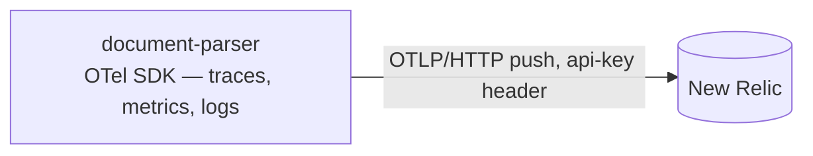

# Observability

What document-parser monitors and exports. Requirements live in
[requirements.md](requirements.md) (NFR-5); the wire contract is
[http.md](http.md); the class-level build is the LLD in
[references/observability.md](references/observability.md).

**Status: the pipeline build landed against the LLD — resource, adapters,
factory, and boot wiring; the extract route's verdict sites are deferred to
a follow-up change and remain unwired in the meantime.**

## Pipeline



One pipeline, three signals, zero hops: the SDK exports traces, metrics, and
logs directly to New Relic's native OTLP endpoint (`otlp.nr-data.net`; EU
accounts: `otlp.eu01.nr-data.net`), authenticated with the **ingest license
key** in the `api-key` header — never a user API key, and the region prefix
must match the account. HTTP/protobuf keeps `grpcio` out of the image and
gzips the payloads.

Version-safe scope: this document covers one producer of telemetry —
document-parser — and its push path. The collector keeps serving other
services and stays out of scope here.

## The gate (NFR-5)

With `OTEL_EXPORTER_OTLP_ENDPOINT` unset nothing is emitted: the boot builds
the null observability and installs no SDK providers at all — dev is a silent
no-op. With the endpoint set but `NEW_RELIC_LICENSE_KEY` missing, the boot
fails closed on the same path as `API_KEY`. Dev may also point the endpoint at
any OTLP/HTTP receiver (a local collector on 4318, for instance) — the same
code path, no special-casing anywhere.

## Metric inventory

Six instruments, with names and attribute keys preserved from the
pre-refactor service so New Relic dashboards and Terraform alerts keep their
queries unchanged.

| Instrument | Type | Attributes | Consumed by |
|------------|------|------------|-------------|
| `rejected_uploads_total` | Counter | `reason` | alert + dashboards |
| `parsed_documents_total` | Counter | `mime_type`, `status` | dashboards |
| `extraction_failures_total` | Counter | `mime_type`, `error_type` | dashboards |
| `extraction_timeouts_total` | Counter | `mime_type` | dashboards |
| `extraction_duration_seconds` | Histogram | `mime_type`, `status` | dashboards |
| `in_flight_requests` | ObservableGauge | — | dashboards |

Dropped: `http_requests_total` and `http_request_duration_seconds`
(request/error-rate and latency signals come from OTel **spans**, which
auto-instrumentation already provides and the existing alerts already query),
plus the five unused size/ratio histograms. **Dropped for the Lambda
target:** `extraction_queue_wait_seconds`, `extraction_pool_queue_depth`,
`extraction_pool_max_workers` — they assume a long-lived container with a
bounded worker queue; the deployed target serves one request per instance, so
the quantities are structurally constant (no queue forms, wait is zero) and
recording them is noise. They return with the pool if a container deployment
comes back. `in_flight_requests` stays — per-instance ≤ 1 on Lambda, but the
name and semantics are runtime-neutral.

## What each verdict records

Every recording site on the extract route, and what each call touches:

| Route site | Verdict | Call | Instruments touched |
|---|---|---|---|
| body beyond the bound, or `TooLargeError` | 413 | `record_rejection("too_large")` | `rejected_uploads_total` |
| `UnsupportedTypeError` | 415 | `record_rejection("unsupported_type")` | `rejected_uploads_total` |
| `CorruptDocumentError` | 422 | `record_rejection("corrupt")` | `rejected_uploads_total` |
| malformed multipart / missing `file` | 422 | `record_rejection("malformed")` | `rejected_uploads_total` |
| the pipeline returns | 200 | `record_extraction(mime, "ok" \| "truncated", d)` | `parsed_documents_total`, `extraction_duration_seconds` |
| `BudgetExhaustedError` | 504 | `record_extraction(mime, "timeout", d)` | `extraction_timeouts_total`, `extraction_duration_seconds` |
| `UnreadableDocumentError` | 422 | `record_extraction(mime, "unreadable", d)` | `extraction_failures_total`, `extraction_duration_seconds` |

Plus the two brackets, which carry no instruments of their own:
`track_request` → `in_flight_requests` (it brackets the whole handler,
rejections included — the gauge counts requests in flight, not successes),
and `track_extraction` → the `extraction` span, carrying the `mime_type`.

The counters partition outcomes — a timeout is **not** also a failure, so
dashboards sum `extraction_failures_total + extraction_timeouts_total`
without double counting. `error_type` discriminates today's
`unreadable_document` from the failure classes to come without a contract
change.

## Config

```ini
OTEL_EXPORTER_OTLP_ENDPOINT=        # unset → nothing is emitted (NFR-5); e.g. https://otlp.nr-data.net
NEW_RELIC_LICENSE_KEY=              # ingest license key — the secrets blob, not SSM
OTEL_SERVICE_NAME=document-parser   # resource identity (SSM-seedable; already allowlisted)
OTEL_SERVICE_VERSION=               # optional; "dev" when unset (SSM-seedable; already allowlisted)
OTEL_TRACE_SAMPLE_RATIO=1.0         # 0 < ratio ≤ 1
```

- Fail-closed: an endpoint without a license key fails the boot on the same
  path as `API_KEY`'s minimum length; an unset endpoint is a legitimate
  disabled boot in every plane.
- A set endpoint demands the key in every plane — the local collector on
  4318 included; a throwaway value is legitimate there, and the destination
  knob stays `OTEL_EXPORTER_OTLP_ENDPOINT` alone (no enable/disable switch).
- The SSM allowlist in `tools/secrets.py` carries the `OTEL_*` keys, the
  sample ratio included; `NEW_RELIC_LICENSE_KEY` joins the secrets blob (the
  blob, the terraform variable, and the tool's validation, in the same PR).

## Export shape

- **Interval**: 15 s — the old scrape cadence.
- **Temporality**: delta for counters and histograms — the New Relic OTLP best
  fit for pushed data.
- **Sampling**: `ParentBased(TraceIdRatioBased(ratio))`, default 100% — the
  ratio knob dials down without a code change.
- **Resource**: `service.name`, `service.version`, and
  `deployment.environment.name` (the flick: dev/prod).

Push is fire-and-forget from the request path: an OTLP export failure is
logged by the SDK to its internal stderr logger and costs a batch, never a 5xx.
