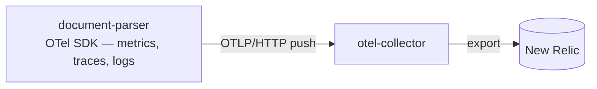

# Observability Design

Observability for the document-parser service. Requirements live in [requirements.md](requirements.md) (NFR-5); the metrics contract is referenced from [http.md](http.md).

**Status: settled direction, pending final sign-off before build.**

## Pipeline

Everything exports through one OTel pipeline:

Version-safe scope: this document covers one producer of telemetry — document-parser — and its push path. The collector keeps serving other services' scrape entries; that is unchanged, out of scope here. Only this service's entry dies once this build removes its endpoint.

## Metric inventory

Nine instruments, with names and attribute keys preserved from the pre-refactor service so New Relic dashboards and Terraform alerts keep their queries unchanged.

| Instrument | Type | Attributes | Consumed by |
|------------|------|------------|-------------|
| `rejected_uploads_total` | Counter | `reason` | alert + dashboards |
| `parsed_documents_total` | Counter | `mime_type`, `status` | dashboards |
| `extraction_failures_total` | Counter | `mime_type`, `error_type` | dashboards |
| `extraction_timeouts_total` | Counter | `mime_type` | dashboards |
| `extraction_duration_seconds` | Histogram | `mime_type`, `status` | dashboards |
| `extraction_queue_wait_seconds` | Histogram | `mime_type` | dashboards |
| `extraction_pool_queue_depth` | ObservableGauge | — | alert + dashboards |
| `extraction_pool_max_workers` | ObservableGauge | — | dashboards |
| `in_flight_requests` | ObservableGauge | — | dashboards |

Dropped: `http_requests_total` and `http_request_duration_seconds` (request/error-rate and latency signals come from OTel **spans**, which auto-instrumentation already provides and the existing alerts already query), plus the five unused size/ratio histograms.

## Notes

- Delta aggregation temporality — best fit for the New Relic OTLP ingestion of pushed counters.
- Export interval aligns with the old 15s scrape cadence.
- Without `OTEL_EXPORTER_OTLP_ENDPOINT` the SDK hands out no-op meters — every record call is a safe no-op in dev.
- Gauges sample pool counters at export time; no private pool internals, no scrape-time refresh logic.
- **Removal inventory** for the pull endpoint: the `/api/v1/metrics` route, the `prometheus-client` dependency, the multiprocess registry logic, `PROMETHEUS_MULTIPROC_DIR` (+ its cleanup step) in the Dockerfile and compose files, the entire `gunicorn.conf.py` (`child_exit` hook existed only for multiprocess metrics), and the request middleware's metric recording — middleware becomes logging-only.

## Infra follow-on (outside this service)

- `infra/docker/prod/otel-collector-config.yaml`: the document-parser scrape entry (`metrics_path: /api/v1/metrics`) becomes dead — removed in an **infra pull request**, not this build. Sequence it close behind: until it lands, the collector logs harmless scrape 404s for this service.
- Loadtest collector: the load rig sets `OTEL_EXPORTER_OTLP_ENDPOINT` to the collector's OTLP receiver; its scrape slot for this service is removed in the same infra effort.
