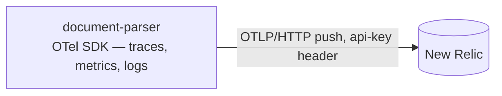
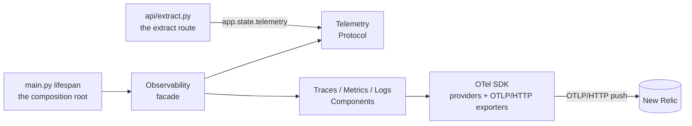
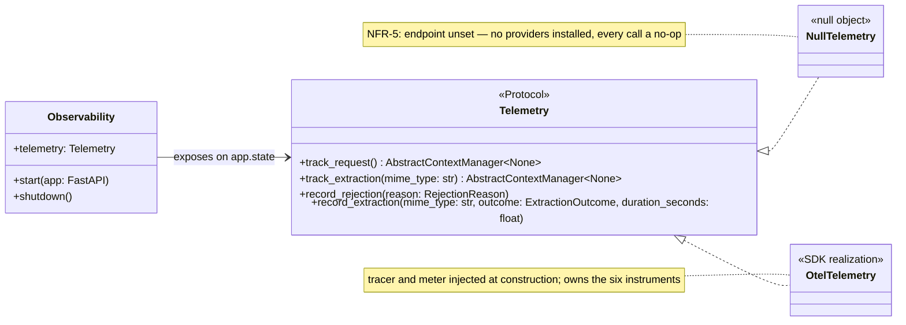
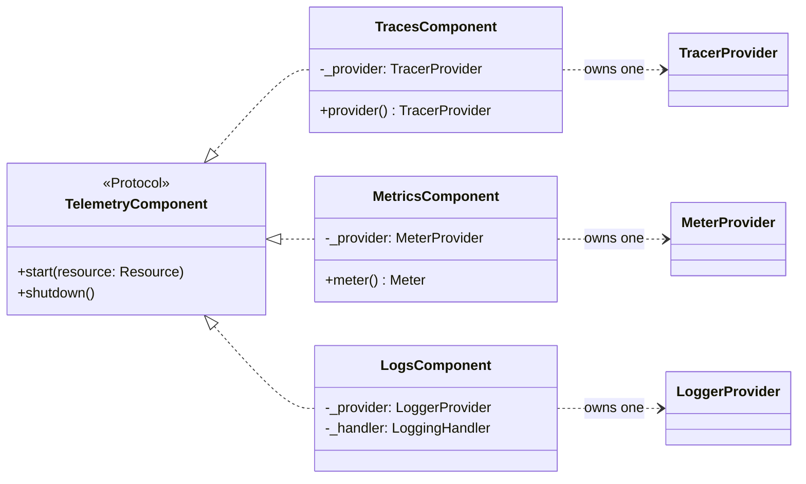
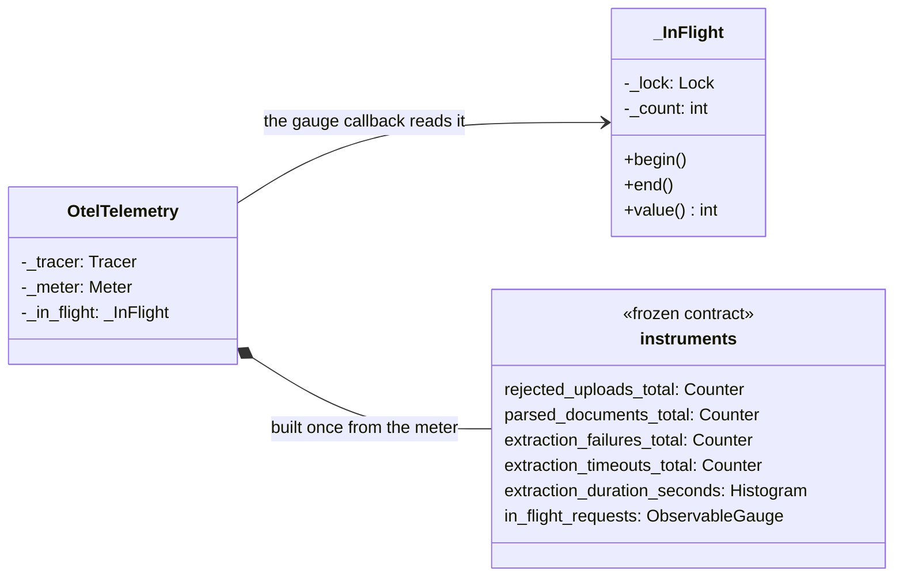
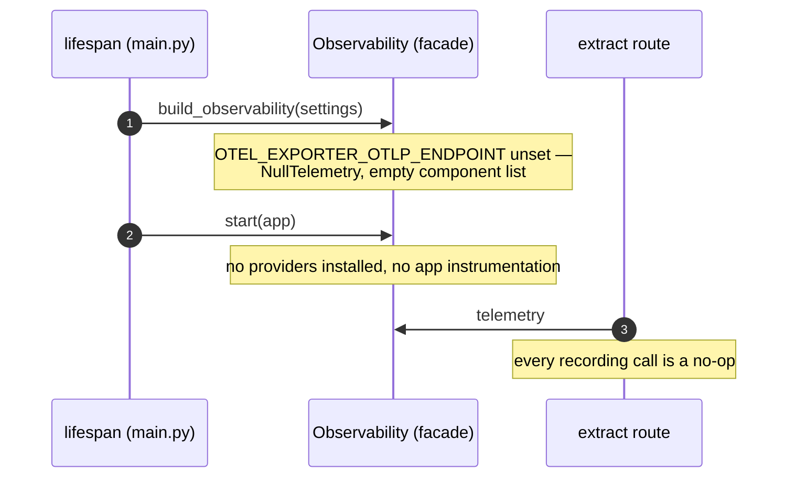

# Observability Design

Observability for the document-parser service. Requirements live in [requirements.md](requirements.md) (NFR-5); the metrics contract is referenced from [http.md](http.md).

**Status: settled design — the OTel SDK in this service pushes straight to New Relic; no collector on this service's path. The metric inventory below is unchanged and stays frozen.**

## Pipeline



One pipeline, three signals, zero hops: the SDK exports traces, metrics, and logs directly to New Relic's native OTLP endpoint (`otlp.nr-data.net`; EU accounts: `otlp.eu01.nr-data.net`), authenticated with the **ingest license key** in the `api-key` header — never a user API key, and the region prefix must match the account. HTTP/protobuf keeps `grpcio` out of the image and gzips the payloads. The collector keeps serving other services and stays out of scope here.

Version-safe scope: this document covers one producer of telemetry — document-parser — and its push path. Nothing else's telemetry changes.

## The four views

The design reads top-down: the dependency view (who may depend on whom), the seam view (the Protocol the app speaks), the lifecycle view (the three signal components), and the instrument view (the realization that owns the frozen names). The sequence diagrams under [Runtime](#runtime) cover the behavior.

### View 1 — dependency view



The rule this view encodes: `opentelemetry` imports live inside `app/observability` alone. The route sees only the `Telemetry` Protocol; the facade is the only class that touches both Protocols; configuration flows in typed (`Settings`), never re-parsed inside the package. Nothing outside the package imports it except through `build_observability` / `Observability` / `Telemetry`.

### View 2 — seam view



The seam holds exactly four methods — one per class of verdict site on the route. `record_extraction` folds the four outcome instruments: one call per attempt, the implementation owns the mapping, and the route cannot record an inconsistent pair. `track_request` / `track_extraction` are exception-safe context managers, not begin/end pairs — nothing to forget.

### View 3 — lifecycle view



The facade holds the components behind this Protocol: a signal joins or leaves the pipeline without the facade changing (a new component is a new module plus one line in the factory). Each component owns exactly one SDK provider, starts against the shared `Resource`, and is started once — the global providers are singletons, so a double start is a wiring bug and fails loudly. Exporters default to the New Relic wiring and are injected through the constructors in tests.

### View 4 — instrument view



`in_flight_requests` samples the counter at export time — the observable-gauge callback reads `_InFlight.value()`; no scrape-time refresh logic, no pool internals. The counter is guarded, not because the event loop races but because a thawing Lambda instance may not share a thread. `track_request` emits no span of its own — FastAPI instrumentation already owns the request span; the bracket only feeds the gauge.

## Runtime

### Boot — enabled

```mermaid
sequenceDiagram
    autonumber
    participant L as lifespan (main.py)
    participant F as Observability (facade)
    participant T as TracesComponent
    participant M as MetricsComponent
    participant G as LogsComponent
    participant A as FastAPI app

    L->>L: Settings.from_provider(plane)
    L->>F: build_observability(settings)
    Note over F: endpoint set — the wired build
    L->>F: start(app)
    F->>F: resource = build_resource(settings) — once, shared
    F->>T: start(resource)
    Note over T: TracerProvider + BatchSpanProcessor<br/>ParentBased(ratio); set_tracer_provider — once
    F->>M: start(resource)
    Note over M: MeterProvider + PeriodicExportingMetricReader<br/>15 s interval, delta temporality
    F->>G: start(resource)
    Note over G: LoggerProvider + batch processor;<br/>LoggingHandler onto the root logger
    F->>A: FastAPIInstrumentor.instrument_app(app, tracer_provider)
    F->>F: telemetry = OtelTelemetry(tracer, meter)
    L->>A: app.state.telemetry = observability.telemetry
    Note over L,G: serving — every signal alive
```

- The `Resource` is built once and handed to every provider — three providers each building their own is how `service.name` splits across New Relic dashboards.
- The provider installs are global singletons; a second call is a wiring bug and fails the boot loudly, matching the config planes' fail-closed contract.
- The logging handler rides alongside `main.py`'s `basicConfig` stdout handler; the root's INFO level stays the gate.
- `instrument_app` is explicit — no `opentelemetry-instrument` launcher, no distro: env-driven auto-wiring fights the planes and hides the tested surface (the same rationale that rejected Mangum).

### Boot — disabled



NFR-5 reads "without it nothing is emitted" as a build choice, not runtime checks: the disabled build installs no SDK providers at all — stronger than no-op meters, zero SDK objects — and `app.state.telemetry` is the null object, so the route keeps one code path with no `if endpoint` branches.

### Request — the verdict sites

```mermaid
sequenceDiagram
    autonumber
    participant R as extract route
    participant T as OtelTelemetry
    participant I as _InFlight
    participant S as OTel SDK
    participant NR as New Relic

    R->>T: track_request()
    T->>I: begin()
    Note over R: bounded read, then the admission verdicts
    opt rejected upload (413 / 415 / 422)
        R->>T: record_rejection(reason)
        T->>S: rejected_uploads_total + 1{reason}
    end
    R->>T: track_extraction(mime_type)
    T->>S: start span "extraction"
    Note over R: the pipeline runs under its cooperative budget
    R->>T: record_extraction(mime, outcome, duration)
    T->>S: histogram record{mime_type, status} + the outcome's counter
    T->>S: end span
    T->>I: end()
    Note over S,NR: every 15 s the metric reader exports (delta); the batch span processor exports on its own cadence
    S-->>NR: OTLP/HTTP push, api-key header
```

- `track_request` brackets the whole handler — rejections included: the gauge counts requests in flight, not successes.
- Durations are wall time around the extract call (`perf_counter`): a doomed parse lands ≈ budget + one page, and the histogram shows exactly that shape.
- `mime_type` is the sniffed MIME the admission gate returned, never the declared Content-Type; `reason`, `status`, and `error_type` vocabularies are in the [outcome mapping](#outcome-mapping-the-one-fold).

### Shutdown — the drain

```mermaid
sequenceDiagram
    autonumber
    participant L as lifespan (main.py)
    participant F as Observability (facade)
    participant T as TracesComponent
    participant M as MetricsComponent
    participant G as LogsComponent
    participant NR as New Relic

    Note over L: the drain begins (uvicorn, 12 s graceful)
    L->>L: logger.info("document parser shutdown complete")
    L->>F: shutdown()
    F->>T: shutdown()
    T-->>NR: force-flush queued spans
    F->>M: shutdown()
    M-->>NR: final metrics export
    F->>G: shutdown()
    Note over G: handler detached first, then the flush — the final boot log line rides out
    G-->>NR: force-flush queued records
    Note over F: per-component try/except; idempotent
```

- The flush order is spans → metrics → logs, and the final boot log line is queued **before** the logs flush so it rides out with them.
- Exporter timeouts are capped (~5 s per flush): three flushes must fit inside the 12 s graceful drain the Dockerfile bounds.
- One component's failed flush never skips the others (per-component try/except); shutdown is idempotent.
- An OTLP export failure never reaches the request path: the SDK logs it to its internal stderr logger. A lost export is a lost batch, not a 5xx.

## Metric inventory

Six instruments, with names and attribute keys preserved from the pre-refactor service so New Relic dashboards and Terraform alerts keep their queries unchanged.

| Instrument | Type | Attributes | Consumed by |
|------------|------|------------|-------------|
| `rejected_uploads_total` | Counter | `reason` | alert + dashboards |
| `parsed_documents_total` | Counter | `mime_type`, `status` | dashboards |
| `extraction_failures_total` | Counter | `mime_type`, `error_type` | dashboards |
| `extraction_timeouts_total` | Counter | `mime_type` | dashboards |
| `extraction_duration_seconds` | Histogram | `mime_type`, `status` | dashboards |
| `in_flight_requests` | ObservableGauge | — | dashboards |

Dropped: `http_requests_total` and `http_request_duration_seconds` (request/error-rate and latency signals come from OTel **spans**, which auto-instrumentation already provides and the existing alerts already query), plus the five unused size/ratio histograms. **Dropped for the Lambda target:** `extraction_queue_wait_seconds`, `extraction_pool_queue_depth`, `extraction_pool_max_workers` — they assume a long-lived container with a bounded worker queue; the deployed target serves one request per instance, so the quantities are structurally constant (no queue forms, wait is zero) and recording them is noise. They return with the pool if a container deployment comes back. `in_flight_requests` stays — per-instance ≤ 1 on Lambda, but the name and semantics are runtime-neutral.

### Outcome mapping (the one fold)

Every recording site on the extract route, and what each call touches:

| Route site | Verdict | Call | Instruments touched |
|---|---|---|---|
| body beyond the bound, or `TooLargeError` | 413 | `record_rejection("too_large")` | `rejected_uploads_total` |
| `UnsupportedTypeError` | 415 | `record_rejection("unsupported_type")` | `rejected_uploads_total` |
| `CorruptDocumentError` | 422 | `record_rejection("corrupt")` | `rejected_uploads_total` |
| malformed multipart / missing `file` | 422 | `record_rejection("malformed")` | `rejected_uploads_total` |
| the pipeline returns | 200 | `record_extraction(mime, "ok" \| "truncated", d)` | `parsed_documents_total`, `extraction_duration_seconds` |
| `BudgetExhaustedError` | 504 | `record_extraction(mime, "timeout", d)` | `extraction_timeouts_total`, `extraction_duration_seconds` |
| `UnreadableDocumentError` | 422 | `record_extraction(mime, "unreadable", d)` | `extraction_failures_total`, `extraction_duration_seconds` |

Plus the two brackets, which carry no instruments of their own: `track_request` → `in_flight_requests`, and `track_extraction` → the `extraction` span (with the `mime_type` attribute).

The counters partition outcomes — a timeout is **not** also a failure, so dashboards sum `extraction_failures_total + extraction_timeouts_total` without double counting. `error_type` discriminates today's `unreadable_document` from the failure classes to come without a contract change.

## Export shape

- **Interval**: 15 s (`PeriodicExportingMetricReader`) — the old scrape cadence.
- **Temporality**: delta for counters and histograms — the New Relic OTLP best fit for pushed data.
- **Transport**: OTLP/HTTP protobuf, gzip compression on.
- **Sampling**: `ParentBased(TraceIdRatioBased(ratio))`, default 100% — the ratio knob dials down without a code change.
- **Resource**: `service.name` (default `document-parser`), `service.version` (optional, `dev` when unset), `deployment.environment.name` (the flick: dev/prod).

## Config and seeding

```ini
OTEL_EXPORTER_OTLP_ENDPOINT=        # unset → nothing is emitted (NFR-5); e.g. https://otlp.nr-data.net
NEW_RELIC_LICENSE_KEY=              # ingest license key — the secrets blob, not SSM
OTEL_SERVICE_NAME=document-parser   # resource identity (SSM-seedable; already allowlisted)
OTEL_SERVICE_VERSION=               # optional; "dev" when unset (SSM-seedable; already allowlisted)
OTEL_TRACE_SAMPLE_RATIO=1.0         # 0 < ratio ≤ 1
```

- Fail-closed: an endpoint without a license key fails the boot on the same path as `API_KEY`'s minimum length; an unset endpoint is a legitimate disabled boot in every plane.
- The SSM allowlist in `tools/secrets.py` already carries the `OTEL_*` keys — only `NEW_RELIC_LICENSE_KEY` joins the secrets blob (the blob, the terraform variable, and the tool's validation, in the same PR).
- Dev can point the endpoint at any OTLP/HTTP receiver (a local collector on 4318, for instance) — the same code path, no special-casing anywhere.

## Logs

- `basicConfig` (INFO, stdout) stays; the OTel handler adds a destination — the double copy is intentional (Lambda ships stdout anyway).
- Every record through the handler carries its trace/span ids automatically: New Relic correlates logs with traces with no custom formatter.
- Uvicorn's loggers (`propagate=False`) stay stdout-only — the request spans already carry latency and status; this is a deliberate scope cut.

## Instrumentation surface

- **FastAPI ASGI instrumentation only** — the request spans the existing alerts query.
- **No boto3 / httpx instrumentation**: boto3 runs once at boot for the config planes, and instrumenting it would paint boot-time root spans over the service picture; there is no outbound HTTP in the request path.
- **One manual span** — `extraction`, created through the `track_extraction` seam; the domain never imports OTel.
- **The pull model's machinery does not return**: the `/api/v1/metrics` route, `prometheus-client`, the multiprocess registry, and the gunicorn `child_exit` hook exist only in `slop/` reference material.

## Testing

- Components accept injected exporters (in-memory span, metric, and log exporters) — the tests assert names, attributes, and flush behavior without the network.
- Unit: resource attributes, the per-signal paths, the settings validators (endpoint-without-key fails the boot; the ratio bounds), instrument names/attributes against the inventory, the in-flight bracket, and the null path installing no providers.
- Integration: the extract matrix (401/413/415/422/200/504) passes unchanged with telemetry live, each verdict advancing its counter — telemetry never alters the wire contract.
- Verified with the service's standard commands: `ruff check`, `pytest`, `docker build`.

## Infra follow-on (outside this service)

- The collector's document-parser scrape slot (`metrics_path: /api/v1/metrics`, pointing at the old deployed build) is dead either way and is removed in an **infra pull request**, exactly as before — this build adds nothing to the collector.
- The load rig's `OTEL_EXPORTER_OTLP_ENDPOINT` keeps pointing wherever its OTLP receiver lives — the collector's, or New Relic's directly; config, no code.
- The Lambda target has no runtime to scrape: the scrape entry's removal there is a consequence of the deployment, not a separate action.
