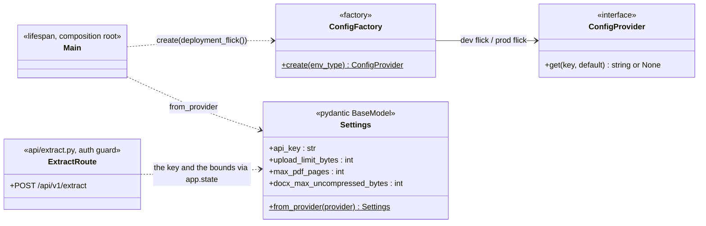
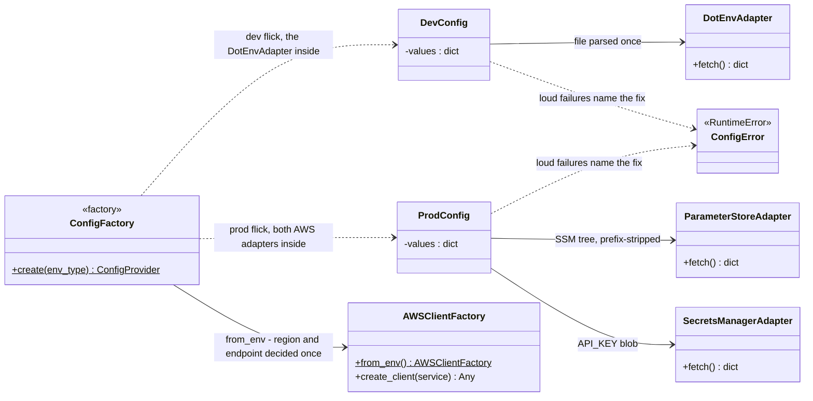
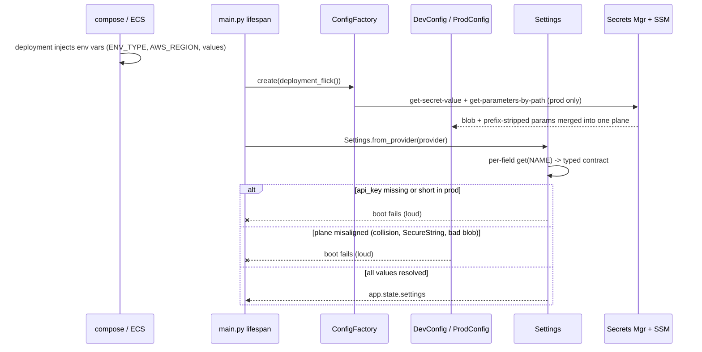

# Config Resolution Design

How document-parser resolves its config values per plane. Requirements live in
[requirements.md](../requirements.md) (api key NFR); what AWS holds is defined
in [`infra/terraform/README.md`](../../infra/terraform/README.md) — the secret
blob `detectai/document-parser/secrets` (`{"API_KEY": ...}`) and the SSM config
prefix `/detectai/document-parser/<KEY>`, both seeded by `tools/secrets.py`.

**Status: built; the provider planes and typed bridge are the live path.**

## Source model

`Settings` is the single typed contract — today the mandatory credential plus
the three consumed bounds (`api_key`, `upload_limit_bytes`, `max_pdf_pages`,
`docx_max_uncompressed_bytes`; the consume-first rule: fields land when the
runtime consumes them, seeded keys ride along on the planes either way). *Where values come from* is
selected once at boot by the `ENV_TYPE` flick and composed through the
factories:

- **dev** (`ENV_TYPE` unset or anything but `prod`): `DevConfig` — the process
  environment over the parsed `infra/.env` file. Env wins because a container
  ships no dotenv file and receives its values injected as environment
  variables (compose `env_file`); locally the file is the baseline and an
  export still overrides it.
- **prod** (`ENV_TYPE` exactly `prod`): `ProdConfig` — **AWS exact**. The
  secrets blob fills first, SSM parameters complete the plane; process env and
  dotenv never reach this path, so a stray variable cannot leak a value in.
  The two AWS planes are disjoint by seeding contract
  (`tools/secrets.py`: `API_KEY` only ever in the blob, only allowlisted
  non-secret keys in SSM), and the merge enforces it: a case-insensitive
  key collision fails the boot loud.

`AWS_REGION` and `EMULATOR_ENDPOINT` are bootstrap variables, not config:
`AWSClientFactory.from_env()` reads them from the process environment once
(`AWS_REGION` required — compose injects it from `infra/.env`, ECS injects it
in real prod; the endpoint override points a prod-config fetch at Floci).
Credentials ride boto3's default chain (the task role), never the config.

The config classes split cleanly in two: the boot shell — who builds what
from the flick, and who reads the result — and the plane machinery, the
adapters and AWS plumbing behind each plane.

### The boot shell

### The plane machinery

One fetch per boot, one plane, pure in-memory lookups. The flatten rule: the
planes speak env names (upper snake), `Settings.from_provider` reads each
declared field as `provider.get(FIELD.upper())`; keys without a declared field
are ignored (the unconsumed allowlist entries ride along freely), and a
required field missing or invalid fails the boot through the field's own
contract.

## Boot sequence

## Resolution and failure contract

| Case | Result |
|---|---|
| Key seeded on the plane the boot chose | the plane's value wins; other sources cannot leak in (dev: env already over file; prod: AWS only) |
| `api_key` absent or shorter than 16 chars | **boot fails** at `Settings.from_provider` (requirements.md) |
| Key in both the secrets blob and SSM | **boot fails** — planes are disjoint by seeding contract; remove the duplicate, re-apply |
| SecureString under the SSM config prefix | **boot fails** — the config plane holds plain String entries only |
| Secret missing / access denied / bad blob shape | `ConfigFetchError` naming the stack and the fix (`make secrets-apply`) |
| `ENV_TYPE=prod`, `AWS_REGION` unset | `ConfigFetchError` naming the var — fail fast |
| Extra seeded keys the model does not declare | ignored (the consume-first rule keeps adding fields a zero-source change) |
| dev flick | process env over `infra/.env`; values identical to the pre-plane behavior |

## File layout

| File | Role |
|------|------|
| `app/config/settings.py` | typed contract (fields + validators), `deployment_flick`, `from_provider` bridge |
| `app/config/provider.py` | `ConfigProvider` contract + the two planes (dev merge, prod merge, disjointness) |
| `app/config/adapters/dotenv.py` | the .env file plane reader (once per boot, explicit paths fail loud) |
| `app/config/adapters/parameters.py` | SSM tree fetch (paged, prefix-stripped, String-only) |
| `app/config/adapters/secrets_manager.py` | secrets blob fetch (JSON-object contract) |
| `app/config/factories/aws_client_factory.py` | region/endpoint decided once; boto3 stays method-local |
| `app/config/factories/config_factory.py` | the flick wiring: plane composition per boot |
| `app/main.py` | composition root: flick -> factory -> provider -> Settings |

## Settled decisions

- **Consume-first Settings**: a field exists only when runtime code reads it.
  Seeded plane keys without a field are ignored, so future fields return with
  their consumers, not ahead of them (the three numeric bounds landed with
  theirs).
- **AWS exact in prod, env-over-file in dev**: no plane can be quietly
  overridden from a competing source; a conflict is a loud boot failure.
- **One fetch, pure memory**: both AWS planes read once at construction;
  a restart, not polling, picks up re-seeded values.
- **Bootstrap stays out of config**: region/endpoint/credentials are
  deployment variables read by `from_env` / boto3's default chain — never
  Settings fields, never the planes.
- **Untyped planes, typed contract**: the planes carry `str` values by
  design; only `Settings` talks types, bounds, and failure behavior.

## Non-goals

No polling/TTL or reload (config changes mean a restart), no caching layer,
no per-key AWS reads, no AppConfig/FeatureFlags, no dotenv file in prod
images (the compose plane injects env vars instead), nothing beyond the
planned reader classes.
