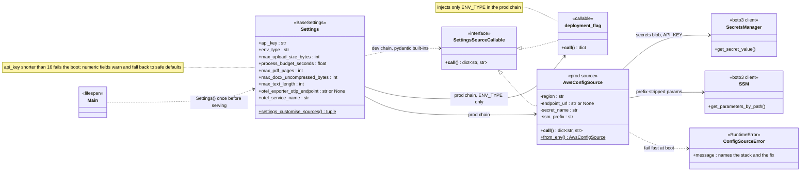
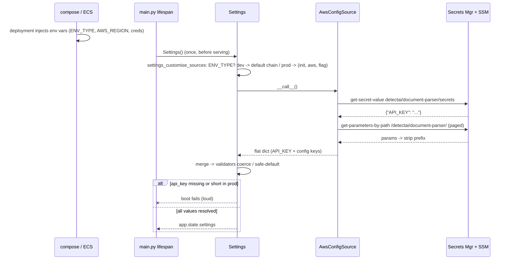

# Config Resolution Design

How document-parser resolves its Settings values per plane. Requirements live in
[requirements.md](../requirements.md) (api key NFR, fail-closed bounds); what AWS
holds is defined in [`infra/terraform/README.md`](../../infra/terraform/README.md) —
the secret blob `detectai/document-parser/secrets` (`{"API_KEY": ...}`) and the
SSM config prefix `/detectai/document-parser/<KEY>`, both seeded by
`tools/secrets.py`.

**Status: settled direction, pending build.**

## Source model

`Settings` stays the single typed contract — field names, bounds, and the
warn-and-fall-back validators do not change. What changes is only *where the
values come from*, selected once at boot by the `ENV_TYPE` flick:

- **dev** (`ENV_TYPE` unset or anything but `prod`): pydantic-settings' default
  chain `(init, env, dotenv)` reading `infra/.env` — today's behavior, byte for
  byte.
- **prod**: chain `(init, AwsConfigSource, deployment_flag)` — **AWS exact**.
  Both process env and dotenv are dropped from the chain: a stray container
  variable can never take over an unseeded key, missing required values fail
  the boot fast, and AWS is the single source of truth. `ENV_TYPE` itself is
  never seeded, so a three-line `deployment_flag` source injects just that one
  bootstrap field — keeping `settings.env_type` truthful without `main.py`
  ever knowing about the flick.

One fetch per boot, one flat `dict[str, str]`: the blob yields `API_KEY`; SSM
yields the prefix-stripped UPPER_SNAKE keys. Extra keys not declared on
`Settings` (e.g. the unconsumed allowlist keys) are ignored by pydantic — adding
those fields later requires zero source change.

## Boot sequence

## Resolution and failure contract

| Case (prod flick) | Result |
|---|---|
| Key seeded in SSM or the blob | AWS wins; container env **cannot** override it |
| Key absent everywhere | numeric → warn + safe default (fail closed); `api_key` → **boot fails** (requirements.md) |
| `ENV_TYPE=prod`, `AWS_REGION` unset | `ConfigSourceError` from `from_env()` — fail fast, message names the var |
| Secret missing / access denied | `ConfigSourceError` naming the stack and the fix (`make secrets-apply`) |
| Non-numeric SSM value | existing warn + safe-default validator, untouched |
| Extra blob/SSM keys | ignored (the 4 unconsumed keys ride along for free) |
| dev flick | unchanged default chain; existing test suite stays green |

Bootstrap plumbing never enters Settings: `AWS_REGION` and credentials are read
from the environment by `from_env()` / boto3's default chain — task role on ECS,
`test`/`test` plus `EMULATOR_ENDPOINT` (endpoint-url override) when proving the
prod flick against Floci.

## File layout

| File | Change |
|------|--------|
| `app/config.py` | ~+20 lines — `deployment_flick()`, the flag source, `settings_customise_sources` (dev returns the default chain) |
| `app/config_source.py` | NEW ~110 lines — `AwsConfigSource`, `ConfigSourceError` |
| `tests/test_config_source.py` | NEW — fake-client unit tests (fetch, merge, paging, prefix strip, error messages, no-env-leak precedence, flag source, boot fail on bad `api_key`) |
| tests (integration) | ONE test against a live Floci plane, auto-skips when it is not reachable |
| `pyproject.toml` | + `boto3` — the one required runtime dependency |

## Settled decisions

- **AWS exact in prod, no env fallback**: only AWS app config is the source of
  truth; unresolvable required values fail fast. No `.env` exists in prod, so
  there is nothing for a container variable to fall back to and no unpredictable
  results from a key silently taken from env.
- **Reader in its own module**: `config.py` stays the pure typed contract; the
  SDK-touching reader is separate, mirroring how the other services keep
  adapters apart from the core.
- **Verification is code-level**: unit tests with fake clients plus one
  skip-graceful Floci integration test; no manual container-showcase cycle.

## Non-goals

No polling/TTL or reload (config changes mean a restart), no caching layer, no
per-key reads, no AppConfig/FeatureFlags, no reader for
`WORKER_THREADS`/`READINESS_MAX_QUEUE_DEPTH`/`LOG_LEVEL`/`OTEL_SERVICE_VERSION`
until the runtime consumes them, nothing beyond the single source class.
