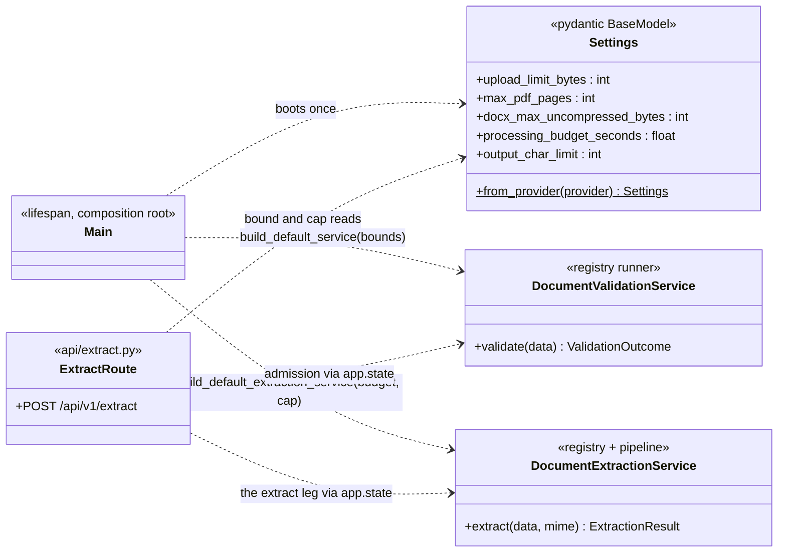
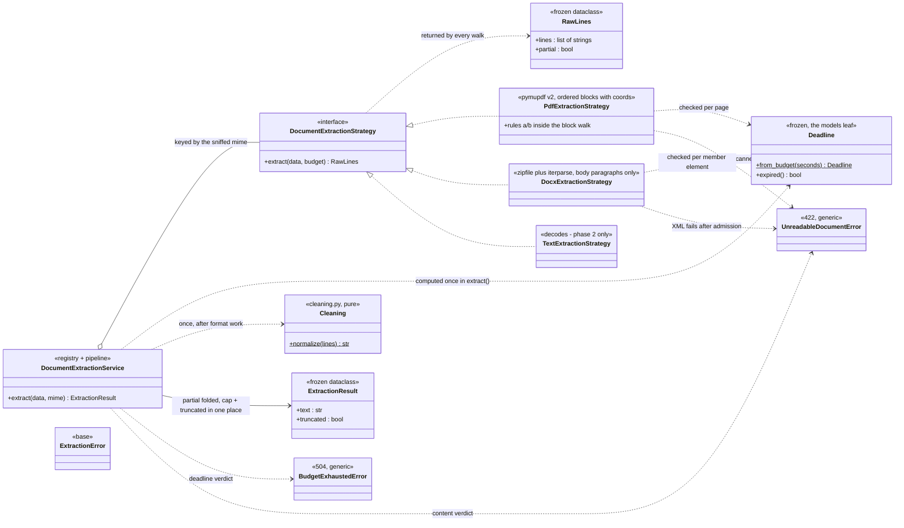
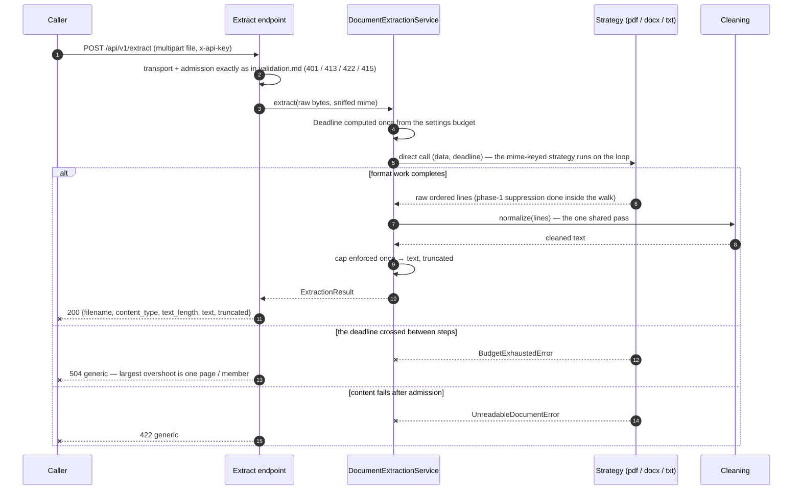

# Extraction Design

How an admitted upload becomes cleaned, capped text. Requirements live in
[requirements.md](../requirements.md) (FR-3/FR-4, NFR-3's budget); the wire
answers are defined in [http.md](../http.md) (the eventual 200/504), the
phase split and its deletion rules in [cleaning.md](../cleaning.md), the gate
that produces the sniffed MIME in [validation.md](validation.md), and the
boundary settings in [config.md](config.md).

**Status: drafted — the LLD for the extraction chunk. The transport gate and
admission are the live path ([validation.md](validation.md)); admitted uploads
still answer the interim 501 until this chunk lands. The PyMuPDF choice and
the sync-only runtime decision recorded below supersede [design.md](../design.md)'s
pypdfium2 chapter and executor wording; those design.md corrections land with
the build.**

## The pipeline model

One rule governs this chunk: **the endpoint does transport, the strategies own
formats, and the pipeline owns everything else** — budget, cleaning, cap, and
the result vocabulary. The sniffed MIME the admission gate returns is the
registry key; strategies never re-sniff, and no diagnosis layer exists here
because there is nothing to decline. After admission, four stages, in order:

1. **Budget** (the service, from a models-leaf value) — computed once in
   `extract()` from settings and carried down as a frozen `Deadline`. Strategies
   check it between pages and member elements; the cooperative raise is the
   whole timeout story on a synchronous path.
2. **Format** (the strategies) — everything that needs document structure:
   PyMuPDF's ordered blocks with coordinates (and rules (a)/(b) inside the
   block walk), the DOCX body-paragraph walk, the TXT decode. Phase-1
   suppression lives *here*, per [cleaning.md](../cleaning.md) — it needs the
   structure only the parser knows. Strategies return `RawLines` — the
   ordered lines and the partial flag for any page the walk could not read
   — and nothing else.
3. **Cleaning** (`cleaning.py`) — one pure, shared normalizer pass, all types
   ([cleaning.md](../cleaning.md) §Phase 2, the ordered rules). It runs exactly
   once, after format work, owned by the pipeline — never by a strategy.
4. **Cap** (the service) — the 1M-char output limit enforced once after
   cleaning, with `truncated` set at the same single place
   ([http.md](../http.md) decision 6). The old service's per-parser cap-skip
   cannot be re-created; there is nowhere else to cap.

## Runtime under the sync-only decision

There is **no executor and no worker pool — anywhere**. The strategy call is a
direct synchronous call on the event loop in prod, in compose, and in tests;
concurrency is provided *outside* the process (Lambda instances, and for a
container target: replicas, not threads). Compose is a test rig, so its
serialization behind an in-flight parse is accepted.

Consequences worth naming:

- The 504 path is **self-abandonment**: a parser that crosses the deadline
  between steps raises, and the shaped 504 leaves — no other thread ever
  finishes work alone. The interior caps (1,000 pages, 30 MiB XML, 3 MiB
  text) remain the termination guarantee; they are now the *only* guarantee,
  because there is no executor to abandon into.
- The largest possible overshoot past the budget is one page or one member
  element. The timeout stack (function timeout 12 s above the in-code budget,
  API GW integration timeout above both, NFR-3c) is unchanged, and
  `design.md`'s runtime-model paragraph receives its executor-retirement
  correction with the build.
- Memory is per-request and bounded: the document lives as bytes end to end,
  nothing is written to durable storage (NFR-1), and the worst-case working
  set is tens of MB against the configured memory. No S3 exists on this path —
  the 6 MB invocation payload, not RAM, is the binding constraint.

## Disposal contract

Warm instances reuse the process, so every native handle is closed by the
owner that opened it: the PyMuPDF document via a context manager (MuPDF holds
C-land buffers the GC does not manage), the multipart spooled parts via the
route's existing `_close_parts`, and nothing is ever written to `/tmp` by this
chunk (starlette's part spooling is transient and already closed). PyMuPDF is
explicitly not thread-safe — moot under the no-pool decision, recorded so
nobody re-introduces threads into it.

## Components

The components split cleanly in two: the composition shell — boot and state,
who builds what and who reads it — and the extraction core, the pipeline that
carries one document from bytes to capped text.

### The composition shell

### The extraction core

## One request's production path

## Extraction contract

| Case | Verdict | Wire answer | Decided by |
|------|---------|-------------|-----------|
| Admitted bytes that parse and clean | extract | 200 response body per [http.md](../http.md) | strategy + pipeline |
| Deadline crossed between pages / members | timed out | 504, generic | the strategy's deadline check |
| Content that fails after admission (XML explodes mid-stream, PDF unusable post-open) | corrupt | 422, generic — a failing file cannot be branded | typed-error mapping |
| PDF with zero extractable text (scanned / OCR-only) | corrupt | 422 — per [cleaning.md](../cleaning.md)'s scanned rule | pdf strategy |
| Empty TXT, or a DOCX body part with no paragraphs | valid empty | 200, `text_length` 0 (TXT is explicit in validation.md; DOCX follows) | txt / docx strategy |
| Output cap crossed | success, flagged | 200 with `truncated: true` — never an error ([http.md](../http.md) decision 6) | the service, after cleaning |
| PDF pages yielding no content inside an otherwise extractable document | success, flagged | 200 with `truncated: true` — the strategy reports `partial`, the service owns the flag | pdf strategy + the service |

At-the-line semantics mirror the admission gate: text exactly at the char
limit is kept whole; the first character beyond sets `truncated`. The budget
is checked *between* steps, so a crossing is observed within one page's work.

## Bounds and settings

The consume-first rule brings two new fields with their consumer
([config.md](config.md)): `processing_budget_seconds` (env
`PROCESSING_BUDGET_SECONDS`, default 10.0) and `output_char_limit` (env
`OUTPUT_CHAR_LIMIT`, default 1,000,000). Both are single-sourced in
`app/extraction/models.py` next to the defaults the strategies already own,
and both fail closed: a garbage seed lands on the safe default — only the
credential may fail the boot. The six cleaning knobs travel settings → pdf
strategy unchanged; their stricter out-of-range failure behavior (boot fails)
is [cleaning.md](../cleaning.md)'s contract, not re-decided here.

| Bound | Default | Checked | Enforced by |
|-------|---------|---------|-------------|
| Processing budget | 10 s | between pages / member elements | strategies via the `Deadline` |
| Output text cap | 1,000,000 chars | once, after cleaning | the service (single owner) |
| PDF pages / DOCX uncompressed / upload size | unchanged | before parse | admission ([validation.md](validation.md)) — unchanged, termination guarantees live there |

The fail-closed chain also keeps tests cheap: the composition root injects
settings into `build_default_extraction_service`, so the 504 path is exercised
with a microsecond budget and the `truncated` path with a small cap — no
thousand-page document is ever materialized in a test.

## File layout

| File | Role |
|------|------|
| `app/extraction/models.py` | the vocabulary leaf: the `Deadline` value, `ExtractionResult` (frozen, two fields), the typed verdicts behind `ExtractionError`, and the budget/cap defaults |
| `app/extraction/cleaning.py` | the pure phase-2 normalizer, exactly [cleaning.md](../cleaning.md) §Phase 2 |
| `app/extraction/service.py` | mime-keyed registry + the cleaning/cap pipeline; computes the `Deadline` in `extract()`; `build_default_extraction_service` composing the production strategies |
| `app/extraction/strategies/base.py` | the strategy seam: `RawLines` (raw ordered lines plus the partial flag) out, typed errors out, the budget travels in |
| `app/extraction/strategies/pdf.py` | PyMuPDF open over the bounded stream, ordered block walk with coordinates, rules (a)/(b) inside the walk, context-managed close |
| `app/extraction/strategies/docx.py` | `zipfile` + `iterparse` streaming the body part; body paragraphs only; field-char remnants stripped in the walk |
| `app/extraction/strategies/text.py` | strict UTF-8 decode — the second decode is the cost of owning the input instead of trusting another layer's verdict |
| `app/api/extract.py` | grows the last leg: extraction call, typed-error→HTTP mapping joined to the existing chain, response assembly (the interim 501 leaves) |
| `app/main.py` | composition root: budget + cap → `build_default_extraction_service` → `app.state.extraction_service` |

Supporting a new format is one strategy module plus one registry entry (FR-2)
— with the strategy key coming from admission, never from the file. Fixtures
stay dependency-free: positioned-text PDFs are hand-crafted content streams;
DOCX behavior ports the body-only and field-char cases from the earlier
build-out (git history).

## Settled decisions

- **Strategies return RawLines, the pipeline finishes** — the raw lines
  plus the partial flag for pages the walk could not read; cleaning and the
  cap run exactly once, owned by the service; per-parser rule lists and
  per-parser cap skips cannot return because there is nowhere to put them.
- **The budget travels with the work** — a frozen `Deadline` from the models
  leaf, computed once in `extract()`; strategies self-check between pages and
  member elements. On a synchronous path this is the entire timeout mechanism;
  the function timeout is only the backstop.
- **No pool anywhere** — sync direct call in prod, compose, and tests; the
  platform (instances, replicas) owns concurrency. This supersedes the
  compose-executor wording in [design.md](../design.md)'s runtime model;
  readiness likewise loses its saturation semantics when this chunk lands,
  and the endpoints stay in the contract for local parity only.
- **Two libraries, disjoint jobs, recorded why** — pypdf remains the admission
  bouncer (strict, behavior-tested); PyMuPDF v2 is the worker (blocks + bbox
  ready-made). The AGPL reversal and its why live with the build's
  [design.md](../design.md) correction; `import pymupdf`, never the legacy
  `fitz` alias, `^2.0` pinned.
- **Keyed on the sniffed MIME** — admission already paid for the
  classification; the registry consumes its `mime` verbatim. No re-sniffing
  anywhere.
- **The result leaf is honest** — a frozen two-field dataclass: `text` and
  `truncated`. No `metadata: dict`, no wire fields leaking inward; the route
  assembles `filename` / `content_type` / `text_length` from what it already
  holds.
- **Disposal is part of the contract** — context-managed PyMuPDF docs, closed
  multipart parts, no durable writes (NFR-1). Warm-instance hygiene is a
  correctness requirement here, not a nicety.
- **Extraction failures are 504 and 422 and nothing else** — the bounds were
  admission's business; this chunk inherits zero remaining `TooLargeError`
  shapes. Larger-than-expected surfaces re-enter through admission, not here.

## Non-goals

- **OCR and scanned recovery** — a scanned PDF yields nothing and answers 422
  ([cleaning.md](../cleaning.md)); no image work, no OCR engines.
- **Structure beyond ordered lines** — no tables as data, no column re-flow,
  no styles, no document properties ([requirements.md](../requirements.md)'s
  out-of-scope list).
- **Any queueing or durable handoff** — the sync request/response contract is
  final for this chunk; an async sibling with a queue is a different
  specification, not an extension of this one.
- **Worker-pool machinery** — no executor, no saturation gauge, no readiness
  ledger; the pool-shaped NFR-2/NFR-6 wording gets its correction when this
  lands.
- **Format mutation under data** — no PDF repair, no DOCX re-zipping; bytes in,
  lines out, nothing rewritten.
- **A metrics vocabulary of its own** — observability is the OTel pipeline's
  ([observability.md](../observability.md)); this chunk emits no new endpoints.
