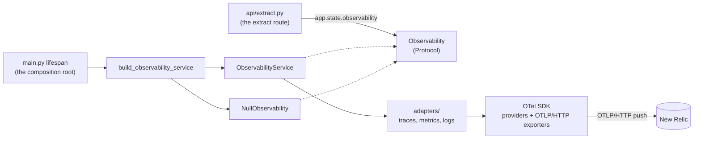
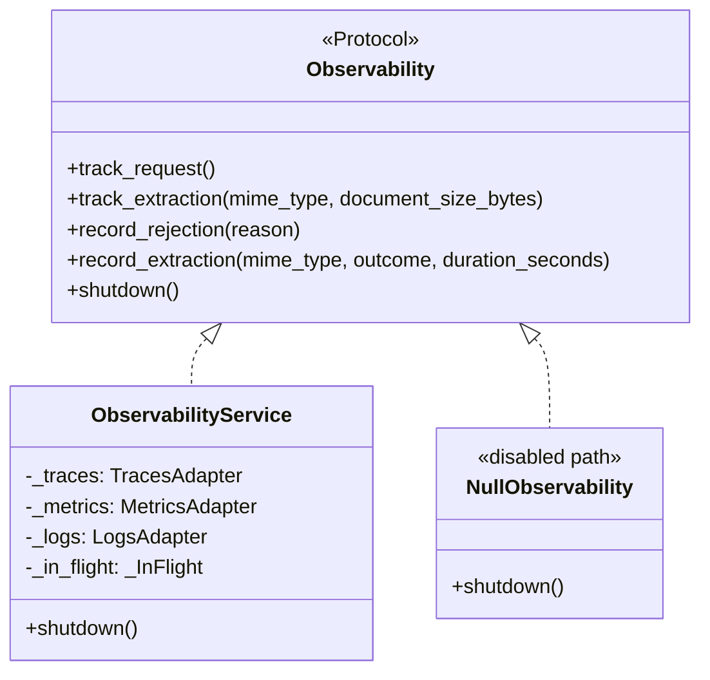
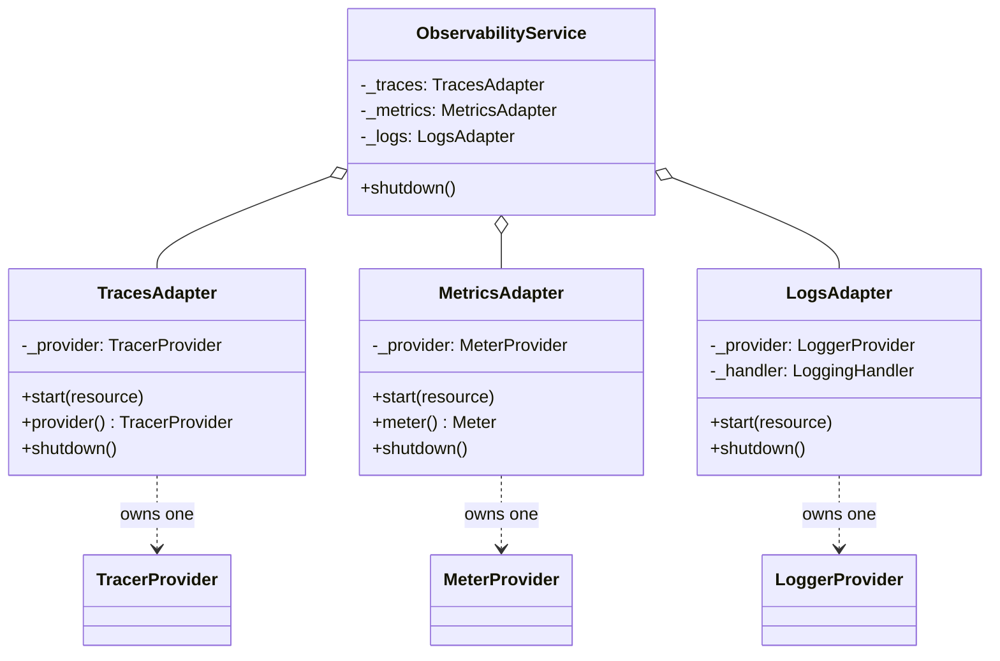
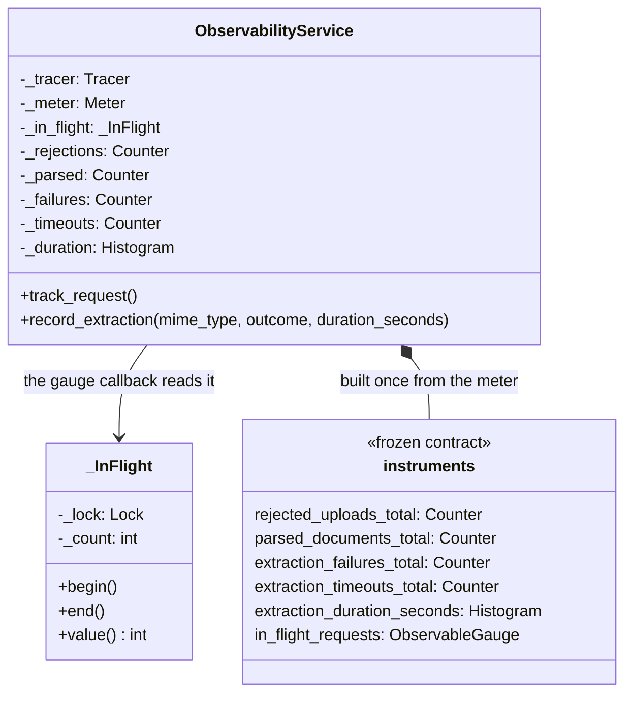
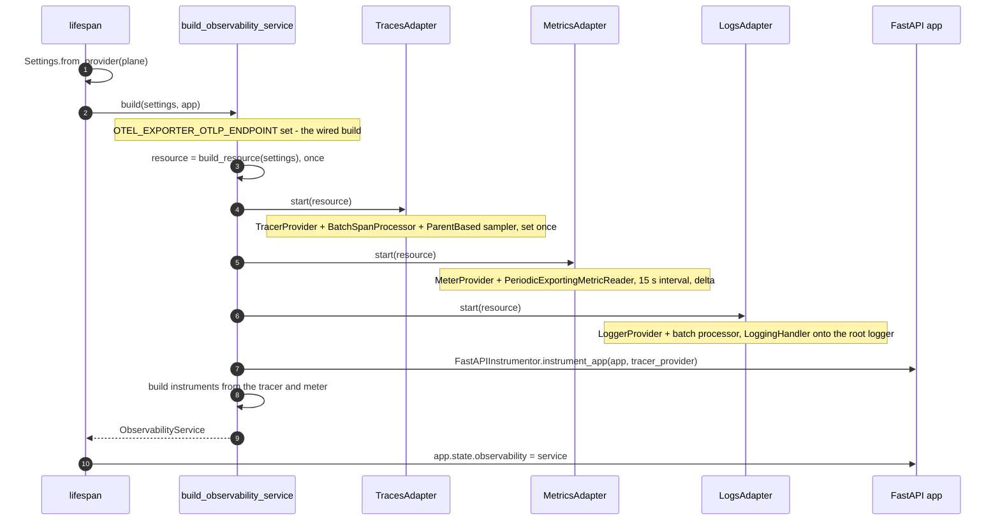
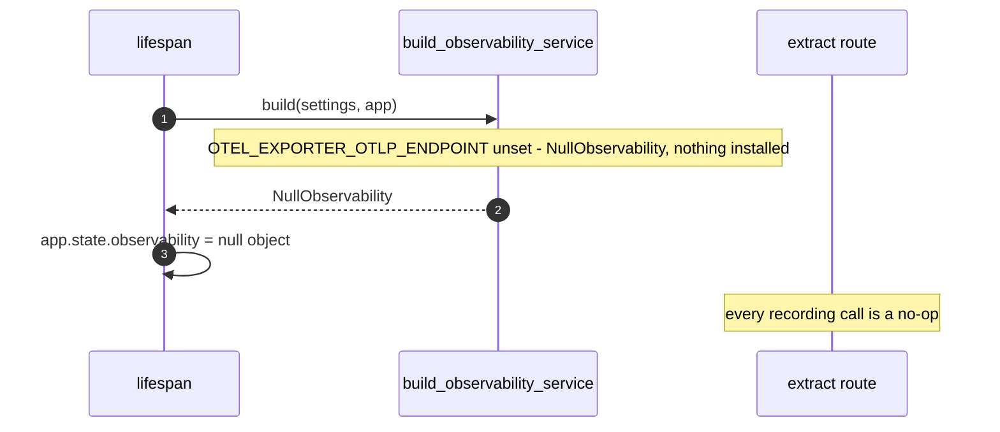
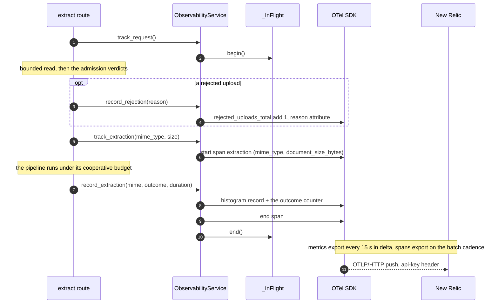
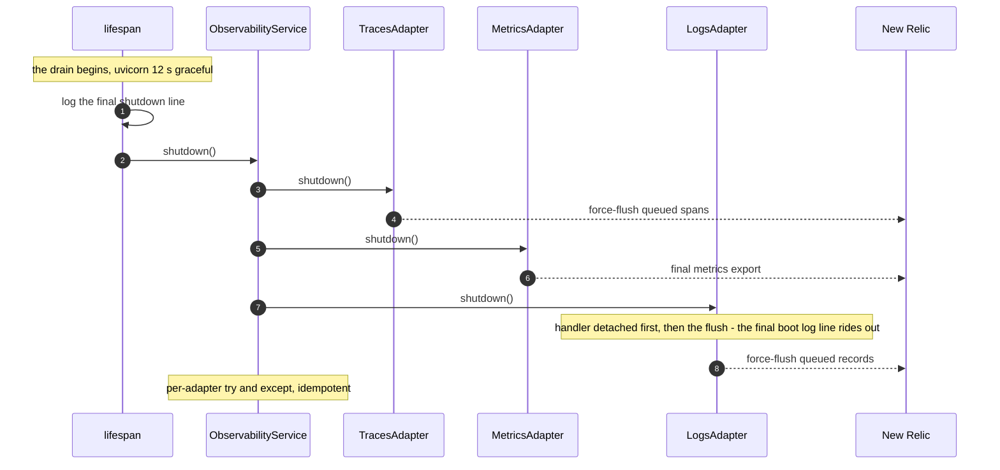

# Observability Class Design

How document-parser builds and drives its observability pipeline. What is
monitored — the instruments, their names and attribute vocabularies — is the
contract in [../observability.md](../observability.md); requirements live in
[../requirements.md](../requirements.md) (NFR-5).

**Status: landed — the resource, adapters, factory, boot wiring, and the
route's verdict sites are built and verified (unit seam and live push at a
local receiver, both planes).**

## Package layout

```
app/observability/
  __init__.py        # exports: build_observability_service, Observability, NullObservability
  contract.py        # Observability Protocol + NullObservability + vocabularies (no otel imports)
  service.py         # ObservabilityService + build_observability_service
  resource.py        # build_resource — pure
  otlp.py            # per-signal endpoint paths + api-key header — pure
  adapters/
    __init__.py
    traces.py        # TracesAdapter
    metrics.py       # MetricsAdapter
    logs.py          # LogsAdapter
```

The layout mirrors `app/config/`: external-system integrations live under
`adapters/` (there: dotenv, SSM, Secrets Manager; here: the OTel SDK signal
adapters), composition lives in a factory, and the typed contract is the seam
callers depend on. Two deliberate deviations: no `factories/` subpackage — one
factory earns no directory, so `build_observability_service` sits beside the
class it builds — and `otlp.py` stays at the package top, because it is shared
wiring consumed by all three adapters, not one adapter's business.

## Dependency view



The rule this view encodes: `opentelemetry` imports live inside
`app/observability` alone — in `service.py`, `resource.py`, `otlp.py`, and the
adapters; `contract.py` imports none. The route sees only the `Observability`
Protocol through `app.state`, the same direct call pattern it already uses for
`validation_service` and `extraction_service`. Configuration flows in typed
(`Settings`), never re-parsed inside the package. Nothing outside the package
imports it except through `__init__.py`'s exports.

## Seam view

The app-facing contract and its two realizations:



The seam holds exactly five methods — four recordings plus `shutdown`, because
the object on `app.state.observability` is the one object main.py drains. The
vocabularies it speaks are frozen Literals: `RejectionReason` is
`too_large | unsupported_type | corrupt | malformed`, `ExtractionOutcome` is
`ok | truncated | timeout | unreadable`. `record_extraction` folds the four
outcome instruments: one call per attempt, the service owns the mapping, and
the route cannot record an inconsistent pair. The two brackets are
exception-safe context managers, not begin/end pairs — nothing to forget.
`NullObservability` exists so the route keeps one code path with no
`if endpoint` branches anywhere.

`ObservabilityService` records and shuts down its own adapters — one class,
one lifecycle. Splitting a dedicated telemetry implementation out of it would
add an indirection hop on every recording call for no caller it serves: the
route calls the service the way it calls the validation service.

## Lifecycle view

The three signal adapters and the single contract they answer:



The adapters are explicit fields, not a registry and not a Protocol: three
fixed signals with fixed roles read top to bottom, and a fourth signal would
edit the factory anyway. What they share is the uniform
`start(resource)` / `shutdown()` shape the factory relies on — and the test
seam is constructor injection (in-memory exporters), not interface
substitution. Each adapter owns exactly one SDK provider, starts against the
shared `Resource`, and is started once: the provider installs are global
singletons, so a double start is a wiring bug and fails the boot loudly.

## Instrument view

What the service builds from the injected tracer and meter:



Tracer and meter arrive injected, never read back from the module globals —
that is what makes the in-memory-exporter tests possible without the network.
`in_flight_requests` samples the counter at export time — the
observable-gauge callback reads `_InFlight.value()`; no scrape-time refresh
logic, no pool internals. The counter is guarded, not because the event loop
races but because a thawing Lambda instance may not share a thread.
`track_request` emits no span of its own — the FastAPI instrumentation already
owns the request span; the bracket only feeds the gauge.

## Boot — enabled



- The `Resource` is built once and handed to every provider — three providers
  each building their own is how `service.name` splits across New Relic
  dashboards.
- The factory is the composition root of the package and its only branch
  point; a service that needed a second `initialize()` phase after
  construction would create a half-built state between the two — the factory
  returns ready or fails the boot, matching `ConfigFactory.create` and
  `build_default_service`.
- The logging handler rides alongside `main.py`'s `basicConfig` stdout
  handler; the root's INFO level stays the gate.
- `instrument_app` is explicit — no `opentelemetry-instrument` launcher, no
  distro: env-driven auto-wiring fights the planes and hides the tested
  surface (the same rationale that rejected Mangum).
- A failure mid-build (a provider refusing to install, say) fails the boot;
  nothing serves afterward, so no rollback of already-started adapters — the
  process is going down either way.

## Boot — disabled



NFR-5 reads "without it nothing is emitted" as a build choice, not runtime
checks: the disabled build installs no SDK providers at all — stronger than
no-op meters, zero SDK objects — and the route keeps one code path.

## Request — the verdict sites



- `track_request` brackets the whole handler — rejections included: the gauge
  counts requests in flight, not successes.
- Durations are wall time around the extract call (`perf_counter`): a doomed
  parse lands ≈ budget + one page, and the histogram shows exactly that shape.
- `mime_type` is the sniffed MIME the admission gate returned, never the
  declared Content-Type; `document_size_bytes` is the post-multipart
  document length, recorded on the same attempt span for per-mime size
  charts; the `reason` / `status` / `error_type` vocabularies
  are the contract's [outcome mapping](../observability.md#what-each-verdict-records).

## Shutdown — the drain



- The flush order is spans → metrics → logs, and the final boot log line is
  queued **before** the logs flush so it rides out with them.
- Exporter timeouts are capped (~5 s per flush): three flushes must fit inside
  the 12 s graceful drain the Dockerfile bounds.
- One adapter's failed flush never skips the others (per-adapter try/except);
  shutdown is idempotent.
- An OTLP export failure never reaches the request path: the SDK logs it to
  its internal stderr logger. A lost export is a lost batch, not a 5xx.

## Config validators

The five fields live on `Settings` beside the bounds (values and seeding in
[../observability.md](../observability.md#config)); the package never parses
the environment itself.

- `otel_exporter_otlp_endpoint: str | None` — the NFR-5 gate; its presence
  flips the factory to the wired build.
- `new_relic_license_key: str` — an endpoint without a key fails the boot on
  the same path as `API_KEY`'s minimum length; an unset endpoint is a
  legitimate disabled boot in every plane.
- `otel_service_name: str` (default `document-parser`), `otel_service_version:
  str | None` (default `dev` when unset), `otel_trace_sample_ratio: float`
  (default `1.0`, validator: `0 < ratio ≤ 1`).

## Export shape

- **Interval**: 15 s (`PeriodicExportingMetricReader`) — the old scrape
  cadence.
- **Temporality**: delta for counters and histograms — the New Relic OTLP best
  fit for pushed data.
- **Transport**: OTLP/HTTP protobuf, gzip compression on.
- **Sampling**: `ParentBased(TraceIdRatioBased(ratio))`, default 100% — the
  ratio knob dials down without a code change.
- **Resource**: `service.name` (default `document-parser`), `service.version`
  (optional, `dev` when unset), `deployment.environment.name` (the flick:
  dev/prod).

## Logs

- `basicConfig` (INFO, stdout) stays; the OTel handler adds a destination —
  the double copy is intentional (Lambda ships stdout anyway).
- Every record through the handler carries its trace/span ids automatically:
  New Relic correlates logs with traces with no custom formatter.
- Uvicorn's loggers (`propagate=False`) stay stdout-only — the request spans
  already carry latency and status; this is a deliberate scope cut.

## Instrumentation surface

- **FastAPI ASGI instrumentation only** — the request spans the existing
  alerts query.
- **No boto3 / httpx instrumentation**: boto3 runs once at boot for the config
  planes, and instrumenting it would paint boot-time root spans over the
  service picture; there is no outbound HTTP in the request path.
- **One manual span** — `extraction`, created inside `track_extraction`; the
  domain never imports OTel.
- **The pull model's machinery does not return**: the `/api/v1/metrics` route,
  `prometheus-client`, the multiprocess registry, and the gunicorn
  `child_exit` hook were dropped with the old build-out and survive only in
  git history.

## Testing

- The adapters accept injected exporters (in-memory span, metric, and log
  exporters) — the tests assert names, attributes, and flush behavior without
  the network.
- Unit: resource attributes, the per-signal paths, the settings validators
  (endpoint-without-key fails the boot; the ratio bounds), instrument
  names/attributes against the inventory, the in-flight bracket, and the null
  build installing no providers.
- Integration: the extract matrix (401/413/415/422/200/504) passes unchanged
  with telemetry live, each verdict advancing its counter — telemetry never
  alters the wire contract.
- Verified with the service's standard commands: `ruff check`, `pytest`,
  `docker build`.

## Infra follow-on (outside this service)

- The collector's document-parser scrape slot (`metrics_path:
  /api/v1/metrics`, pointing at the old deployed build) is dead either way and
  is removed in an **infra pull request** — this build adds nothing to the
  collector.
- The load rig's `OTEL_EXPORTER_OTLP_ENDPOINT` keeps pointing wherever its
  OTLP receiver lives — the collector's, or New Relic's directly; config, no
  code.
- The Lambda target has no runtime to scrape: the scrape entry's removal there
  is a consequence of the deployment, not a separate action.
