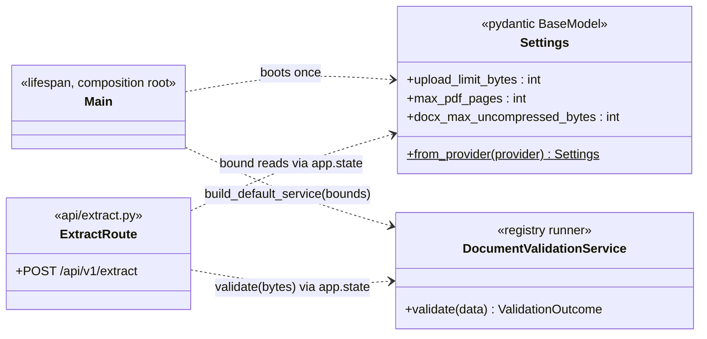
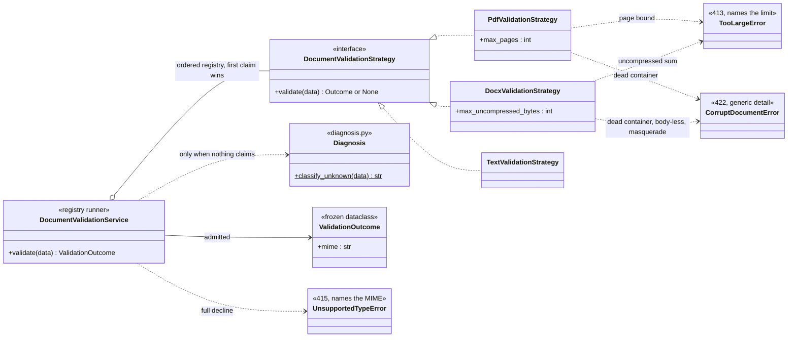
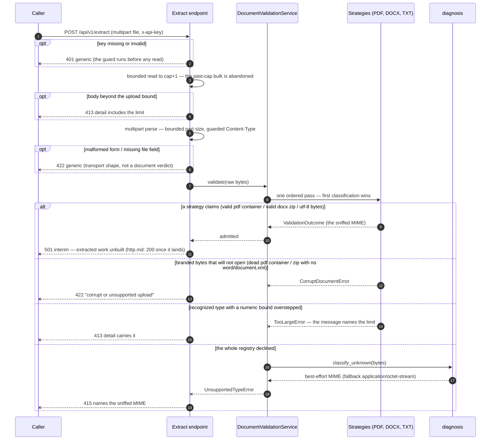

# Upload Validation Design

How document-parser decides what makes it past the extract gate. Requirements
live in [requirements.md](../requirements.md) (FR-2 formats, FR-5 clear
rejections, the numeric bounds); the wire answers are defined in
[http.md](../http.md), and the bounds arrive as settings fields resolved by the
plane selection described in [config.md](config.md).

**Status: built — the staged gate and its rejections are the live path;
admitted uploads still answer the interim 501 until the extraction chunk
lands (http.md owns the eventual 200/504 contract).**

## The layered model

One rule governs the whole thing: **each upload is judged at the cheapest
layer that can answer truthfully about it, and never dragged deeper than it
needs to be.** Transport never opens containers; strategies never parse text.
Four stages, in order:

1. **Transport** (`app/api/extract.py`) — rules that are true of the request,
   not the document. The 401 guard runs before the body is read at all; the
   bounded read proves a size breach at cap+1 while abandoning the bulk
   (NFR-4), starlette's multipart parser turns the capped body into the single
   `file` field, and a malformed form, an absent `file` field, or a missing
   `Content-Type` all share the generic 422 — transport-shape failures are not
   document judgments and get no document diagnosis.
2. **Admission** (`diagnosis.py` + the registry) — the magic prefix is a
   *claim*, not a verdict: `b"%PDF-"` means "probably a pdf", nothing more.
   The registry walks the strategies in order and the first classification
   wins — deterministic, never a vote. Nothing claimed means
   `UnsupportedTypeError` whose detail names a best-effort sniffed MIME
   (`classify_unknown`, fallback `application/octet-stream`) for the 415 body.
3. **Content** (inside the strategies) — branding is cheap, so it cannot
   carry the admission alone: the container is opened before its word is
   taken. PDF opens with pypdf; DOCX opens with the stdlib `zipfile` and
   additionally requires `word/document.xml` — any PK-branded archive
   (PPTX, XLSX, a bare zip) is a corrupt document, not an admitted mimetype.
4. **Per-type bounds** (also inside the strategies) — page count and
   uncompressed member sizes are read from container structure, before a
   single content byte or page is parsed. A zip bomb's reputation comes from
   metadata, so reading it costs nothing and terminates immediately.

## Components

The components split cleanly in two: the composition shell — boot and state,
who builds what and who reads it — and the validation core, the strategy
machinery that runs one ordered pass.

### The composition shell

### The validation core

## One request's judgment path

## Judgment contract

| Case | Verdict | Wire answer | Decided by |
|------|---------|-------------|-----------|
| Key missing or invalid | no request | 401, generic (the two are indistinguishable) | auth guard, before the read |
| Body over the upload cap | no request | 413, detail names the limit | bounded read (cap+1 proves the breach) |
| Malformed multipart / missing `file` | no upload | 422, generic | route (multipart integrity) |
| PDF-branded bytes whose container opens, pages ≤ bound | admitted pdf | 501 interim | pdf strategy |
| PDF-branded bytes that raise on open | corrupt | 422, generic (a corrupt file cannot be branded) | pdf strategy |
| PDF containers with more pages than the bound | too large | 413, names the N-page limit | pdf strategy, before any page parse |
| PK-branded zip with `word/document.xml`, sum ≤ bound | admitted docx | 501 interim | docx strategy |
| PK-branded zip that cannot open — or a zip without the body part (PPTX/XLSX masquerade) | corrupt | 422, generic | docx strategy |
| PK-branded bytes that are not a zip at all | corrupt | 422, generic | docx strategy |
| UTF-8-decodable bytes, including the empty body | admitted txt | 501 interim | text strategy, registered last |
| Nothing claimed the bytes | unsupported | 415, names the diagnosed MIME (fallback `application/octet-stream`) | registry + diagnosis |

Detail strings are deliberately shaped, per http.md: 415 names what the bytes
are, 413 names what they exceed, and 422 stays generic because a corrupt file
cannot be branded any further — more precise corrupt details would leak
confidence the service does not have. The declared `Content-Type` header and
the filename are metadata only and never get a vote (http.md decision 4).

## Bounds and their fail-closed chain

The defaults live in one place (`app/validation/models.py`), are resolved
once per boot by `Settings` (env keys `MAX_PDF_PAGES`,
`DOCX_MAX_UNCOMPRESSED_BYTES`, `UPLOAD_LIMIT_BYTES`), and are carried by
`build_default_service` into the strategies. An unset, non-numeric, or
non-positive seed falls back to the safe default — **only the credential may
fail the boot**; a bad bound cannot stop the service, and a zero or negative
bound can never stand in.

> Bounds note (Lambda target decision): the upload and DOCX-uncompressed
> defaults below have since moved to 3 MiB / 30 MiB — the deployment survey
> and the why live in [../requirements.md](../requirements.md) (Numeric
> bounds, "Why the numbers moved"). The ratios and enforcement points in this
> LLD are unchanged; only the default values it records are stale.

| Bound | Default | Checked | Enforced by |
|-------|---------|---------|-------------|
| Upload size | 10 MiB | at cap+1, bulk abandoned | transport (`_read_bounded`, multipart `max_part_size`) |
| PDF pages | 1,000 | page count | pdf strategy, before any page work |
| DOCX uncompressed size | 100 MiB | summed member `file_size` | docx strategy, zip metadata only |

The at-the-line admit is part of the contract each strategy tests: a document
exactly at a bound is admitted, one page or byte over is rejected.

## File layout

| File | Role |
|------|------|
| `app/validation/models.py` | the vocabulary leaf: `ValidationOutcome`, the three typed rejections, and the bound defaults both settings and strategies consume |
| `app/validation/diagnosis.py` | decline-only MIME sniffing for the 415 body; never consulted on an admitted path |
| `app/validation/strategies/base.py` | the strategy seam: outcome for recognized bytes, `None` for a foreign type |
| `app/validation/strategies/pdf.py` | pdf admission: claim on `b"%PDF-"`, container open, page bound |
| `app/validation/strategies/docx.py` | docx admission: claim on the zip header, mandatory body part, uncompressed bound |
| `app/validation/strategies/text.py` | txt admission: decodability is the only credential, empty body included |
| `app/validation/service.py` | registry runner (first claim wins) + `build_default_service` composing the bound-carrying production registry |
| `app/api/extract.py` | the transport layer: auth → bounded read → multipart → registry pass → typed-error→HTTP mapping |
| `app/main.py` | composition root: settings bounds → `build_default_service` → `app.state.validation_service` |

Supporting a new format is one strategy module plus one registry entry (FR-2);
text stays last or it would claim every decodable upload before the
magic-prefixed types got their turn.

## Settled decisions

- **Sniffed over declared**: the magic-byte claim decides admission; headers
  and filenames are metadata. The strategy pattern exists exactly so new types
  slot in without touching the decision loop.
- **Open before trust**: branding proves coincidence, the container proves usability.
  Requiring `word/document.xml` is what turns "a zip" into "a document" —
  without it, masquerading OOXML would be admitted on a shared two-byte prefix.
- **Judge cheap, fail early**: each stage answers only questions it can settle
  at its own cost — transport bytes, magic, container structure, then numeric
  bounds — so oversized uploads cost nothing and corrupt ones cost one open.
- **Deterministic classification, never a vote**: one ordered pass, first
  claim wins, decline is the tombstone that triggers diagnosis.
- **Two honest details**: the 415 names the MIME, the 413 names the limit,
  and the corrupt 422 stays generic — precision where truth is knowable,
  humility where it is not.
- **Fail-closed bounds with single-sourced defaults**: garbage seeds land on
  safe defaults (the bound defaults in `models.py` are the single source),
  and the bounds travel settings → composition root → strategies, so tests
  can inject tiny limits without materializing hundred-megabyte documents.
- **Typed rejections ride the registry as exceptions**: hard verdicts are not
  outcome fields; the strategies throw, the route maps thrown → HTTP. Adding
  a rejection type touches the vocabulary and one `except`, nothing else.
- **The interim 501 is honest**: an admitted upload has *not* been extracted;
  answering 200 stub text or 204 would promise work that never happened. The
  200 contract belongs to the extraction chunk.

## Non-goals

- **Extraction-time judgments** — the 10 s processing budget → 504, the output
  cap with its `truncated` flag, worker-pool saturation and readiness
  shedding. They live with the extraction chunk; http.md already owns their
  wire contract, and their settings fields land with their consumers
  (consume-first).
- **Content judgment beyond opening the container** — no AV scanning, no OCR,
  no format auto-repair, no text sampling at the validation layer.
- **Per-caller negotiation** — no `Accept`-driven type selection; the caller's
  declared MIME never overrides the sniff.
- **Anything beyond PDF / DOCX / TXT** (requirements.md's out-of-scope list) —
  a new format arrives as one strategy module, or it does not arrive.
