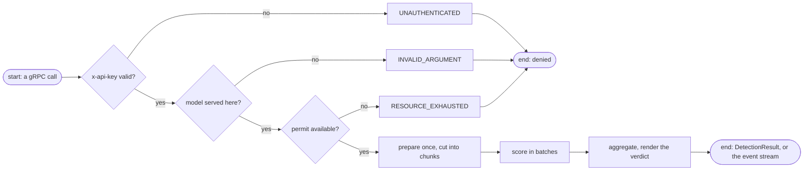

# Inference — Documentation

**The service in one sentence:** a stateless gRPC service that turns submitted text into an AI-vs-human verdict, either as one answer (`Detect`) or as a streamed document analysis (`AnalyzeDocument`).

It pulls two pinned ONNX models at boot, loads one runtime per enabled model, and serves both RPCs over the `inference.v1` contract. There is no database, no queue, and no session state — a request is self-contained.

## New to inference?

1. **[Quick Start](getting-started/quickstart.md)** — boot the service and make your first call.
2. **[Architecture](concepts/architecture.md)** — the four parts and the seams between them.
3. **[RPC reference](reference/rpc-api.md)** — every field, event, and error code.

## Documentation by topic

| Document | What you'll learn | When to read |
| --- | --- | --- |
| **Getting started** | | |
| [Quick Start](getting-started/quickstart.md) | boot, health check, first RPC, reflection | first hour |
| [Configuration](getting-started/configuration.md) | every knob, dev/prod planes, numeric bounds | before deploying |
| **Concepts** | | |
| [Architecture](concepts/architecture.md) | ports and adapters, boot wiring, per-model runtimes | understanding the code |
| [Request flow](concepts/request-flow.md) | auth, admission, batching, streaming, error mapping | debugging a call |
| [Analysis pipeline](concepts/pipeline.md) | tokenize once, aligned cuts, score, aggregate | understanding the verdict |
| [Models and artifacts](concepts/models.md) | pull, revision checks, load, warmup, CPU/GPU | model or device questions |
| [Observability](concepts/observability.md) | spans, metrics, and the env gate | wiring dashboards |
| **Guides** | | |
| [Testing](guides/testing.md) | unit, integration, load, coverage | changing the code |
| [Secrets](guides/secrets.md) | tfctl planes and `secrets.toml` | deploying to prod |
| **Reference** | | |
| [RPC API](reference/rpc-api.md) | contract, fields, events, errors | writing a client |
| [Make targets](reference/make.md) | every command in the Makefile | daily use |

The design record lives in [specification/](../specification/README.md). The k6 rig manual lives in [tests/load/README.md](../tests/load/README.md).

## The request path at a glance



Two components never serve a request directly: config is resolved once at boot, and observability only observes the others.

## Project structure

```
services/inference/
  app/                  live code
    main.py             process entry point
    boot.py             plane, artifacts, models, runtimes
    config/             typed Settings and the dev/prod planes
    serving/            gRPC server, auth, servicer, wire mapper
    inference/          the analysis use case, preprocessing, engine, aggregation
    models/             pull and load planes
    observability/      OTel seam, exporters, instruments
  api/proto/            inference.v1 contract
  infra/                compose stacks and env templates
  mk/                   Makefile fragments
  tests/                unit, integration, and k6 load suites
  specification/        design record
  docs/                 this documentation
```

## Quick reference

| Fact | Value |
| --- | --- |
| Port | `50051` (`GRPC_PORT`) |
| Contract | `inference.v1.AIService`, `api/proto/ai_service.proto` |
| Methods | `Detect` (unary), `AnalyzeDocument` (server-streaming) |
| Auth | `x-api-key` metadata; health and dev reflection are open |
| Models | `spark` (default), `flare`; `ENABLED_MODELS` chooses per process |
| Confidence | 0–100 percentages on the wire |
| Text bound | `1,000,000` characters (`MAX_TEXT_CHARS`) |

## Next steps

- **[Quick Start](getting-started/quickstart.md)** — get it running.
- **[Configuration](getting-started/configuration.md)** — tune it.
- **[Design record](../specification/README.md)** — why it is built this way.
