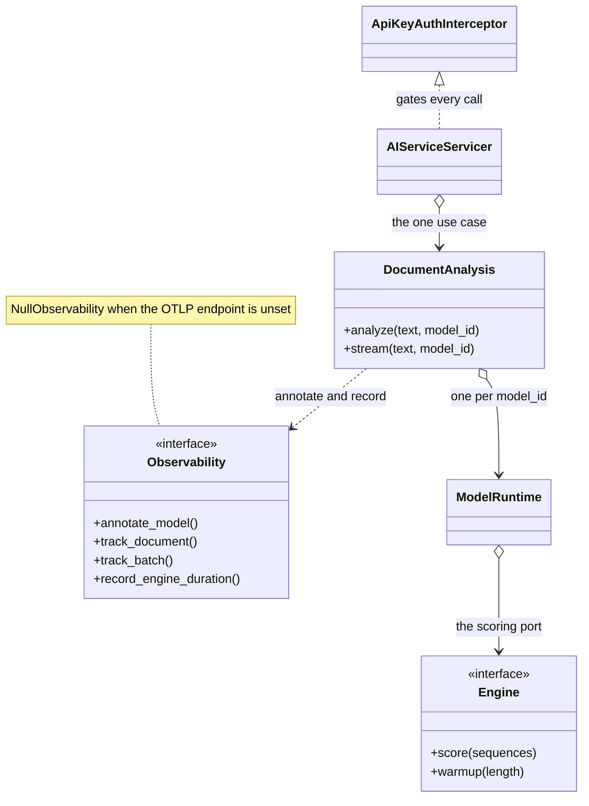
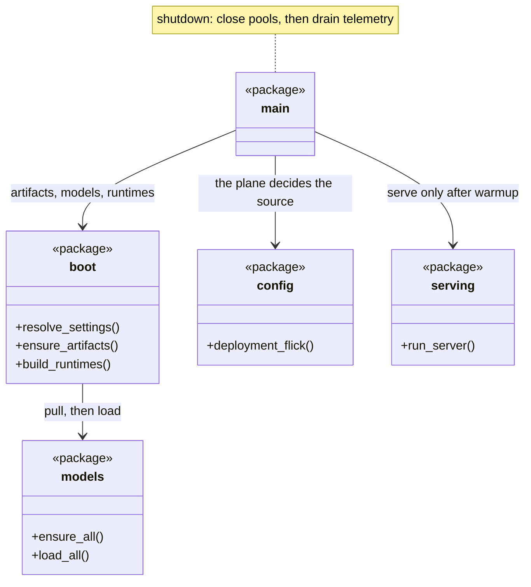
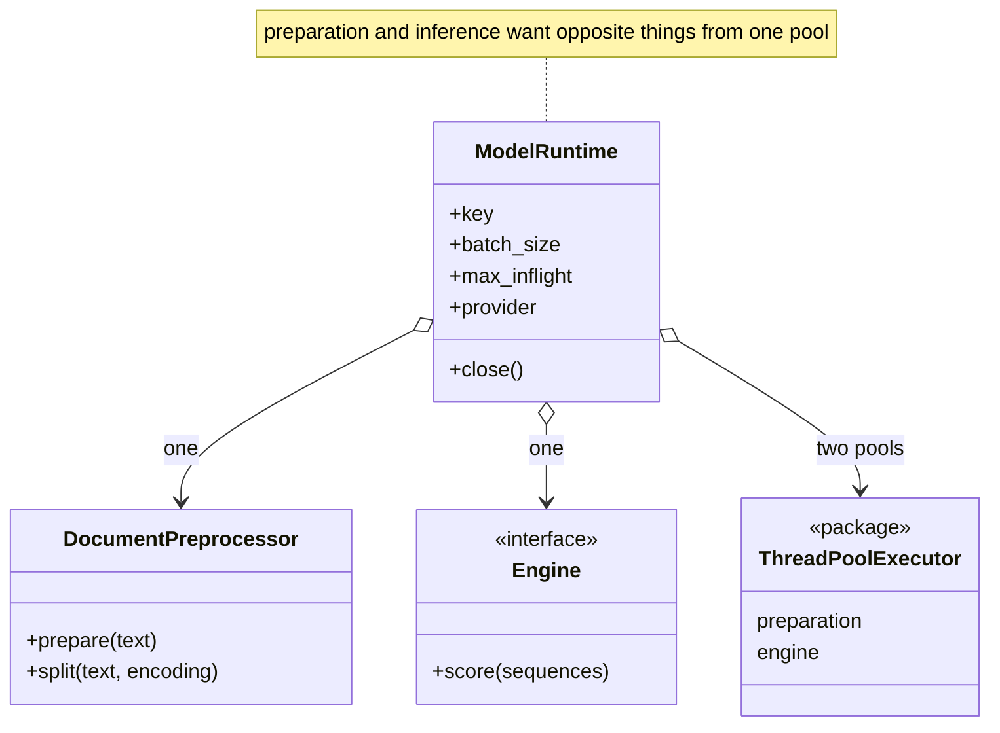
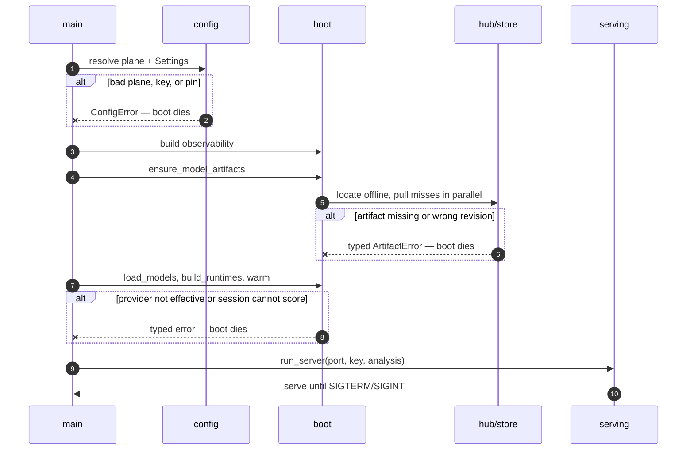

# Architecture

Four parts, two seams, and one runtime bundle per model. The code lives entirely under `app/`; inner layers never import the wire or the cloud SDKs.

## The four parts

| Part | Directory | Responsibility |
| --- | --- | --- |
| Config | `app/config/` | resolve one typed `Settings` from dev or prod |
| Models | `app/models/` | pull and verify artifacts, build offline sessions |
| Inference | `app/inference/` | prepare text, score, aggregate — no I/O |
| Serving | `app/serving/` | auth, gRPC wire, health, reflection |

Observability (`app/observability/`) wraps the whole request as a seam; `app/boot.py` wires the parts at startup.

## The two seams

The diagrams below are deliberately small: each answers one question.

**What the outer world touches.** Serving depends on the analysis use case; the use case depends on ports, not on ONNX or Hugging Face.

**What the boot wires.** Each package is a step in `main.py`, in this order.

**What a `model_id` resolves to.** One runtime owns its own preprocessor, engine, batch width, and two pools.

## Boot sequence

A boot that cannot configure, pull, load, or warm a model dies before the port is bound.

## Where things live

- `app/main.py` — the process entry point and shutdown order.
- `app/boot.py` — the sequence above, as plain functions.
- `app/serving/server.py` — interceptors, registration, graceful drain.
- `app/inference/analysis.py` — the use case behind both RPCs.

## Next

- **[Request flow](request-flow.md)** — what happens to one call.
- **[Analysis pipeline](pipeline.md)** — what happens to one document.
- **[Design: runtime model](../../specification/design.md)** — why these seams.
