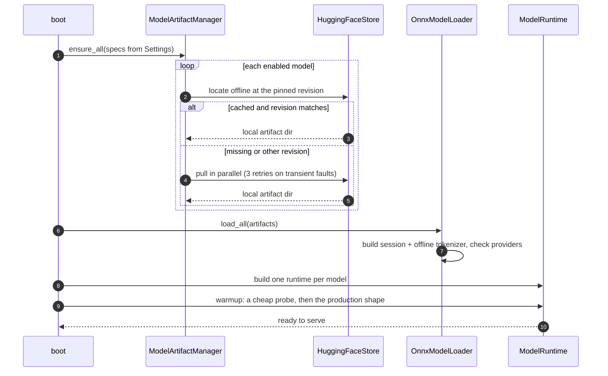
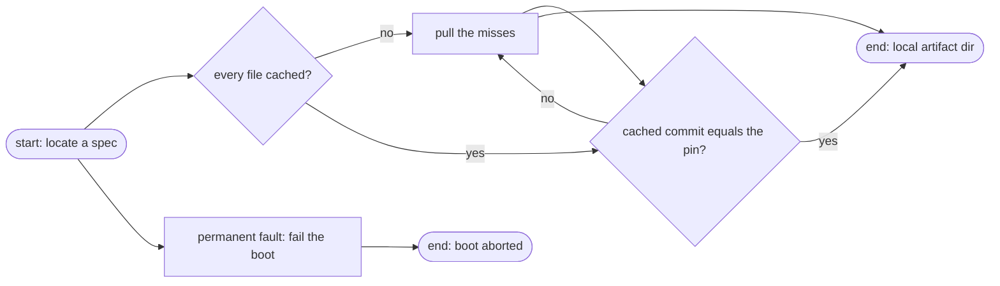

# Models and Artifacts

Two ONNX models are pinned by git SHA, pulled before serving, verified against that SHA, loaded offline, and warmed before the port is bound. A failure at any step kills the boot.

## Which models run

`ENABLED_MODELS` is the only lever. Default `spark`; `flare`, `spark`, or both. A process that serves one model pulls, loads, and warms only that model — this is what makes one-model-per-card deployments expressible. An unknown `model_id` on a call answers `INVALID_ARGUMENT`.

| Key | Artifact | Default directory |
| --- | --- | --- |
| `spark` | fp16 bert-base | `onnx/fp16` |
| `flare` | fp32 bert-large | `onnx/fp32` |

## Pull → verify → load → warm



## The revision check

A hub cache returns a file even when it belongs to another commit. Cached files are checked against the pinned SHA, so a volume that outlived a revision bump re-pulls instead of serving the old build.



Pulls for missing models run in parallel with daemonic workers; the first failure aborts the boot without waiting for a sibling's multi-gigabyte download.

## On disk

```
MODEL_CACHE_DIR/
  spark/
    onnx/fp16/         model.onnx, tokenizer.json, tokenizer_config.json
  flare/
    onnx/fp32/         model.onnx, tokenizer.json, tokenizer_config.json
```

Mount a volume at `MODEL_CACHE_DIR` (`./models` by default) to keep restarts cheap. Sessions and tokenizers are built strictly from these local files — the loader never contacts the hub.

## Provider verification

`INFERENCE_PROVIDERS` is an ordered preference list. The loader checks that every requested provider appears in the session's effective providers; a silent fallback to CPU fails the boot rather than looking healthy in every dashboard. ORT appends CPU as a fallback tail, so the check compares by presence, not equality.

## CPU and GPU

| | CPU image (default) | GPU image |
| --- | --- | --- |
| Build target | `cpu` | `gpu` |
| Runtime package | `onnxruntime` | `onnxruntime-gpu` |
| Providers | `CPUExecutionProvider` | CUDA-first list from `compose.gpu.yml` |
| Device reservation | none | NVIDIA device requested by Compose |

`make build IMAGE=gpu` and `make up IMAGE=gpu` use the overlay. If the requested device is unavailable, boot fails at provider verification — it does not quietly degrade.

## Next

- **[Configuration](../getting-started/configuration.md)** — every model knob.
- **[Analysis pipeline](pipeline.md)** — how the loaded session is used.
- **[Design: models](../../specification/models.md)** — the decisions and their rationale.
