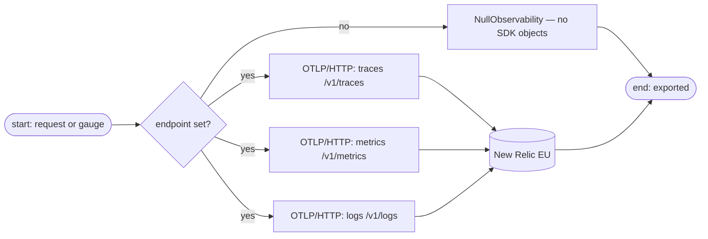
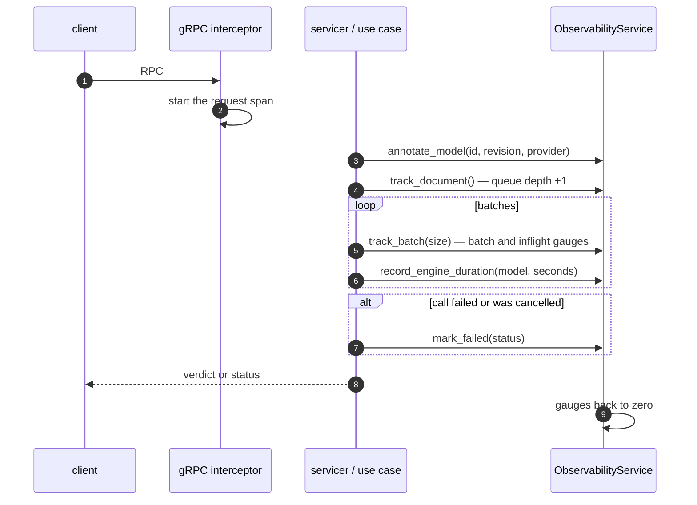

# Observability

Telemetry is a seam, not a requirement. With no `OTEL_EXPORTER_OTLP_ENDPOINT` installed, the service wires `NullObservability` and creates zero SDK objects. With an endpoint set, it builds the full OTel stack or fails the boot.

## How signals leave

Exports are gzip-compressed with the New Relic license key in an `api-key` header. Metrics use DELTA histogram temporality; traces respect `OTEL_TRACE_SAMPLE_RATIO`.

## What is recorded

| Signal | Name | Shape |
| --- | --- | --- |
| Gauge | `inference_batch_size` | width of the last batch |
| Gauge | `inference_queue_depth` | documents admitted and in progress |
| Gauge | `inference_inflight_chunks` | chunks currently on the engine |
| Histogram | `inference_engine_duration_seconds` | one forward pass, attribute `model` |

Span attributes: `model.id`, `model.revision`, `inference.provider`. The gRPC instrumentation owns the request span; the service only decorates it. Health and reflection traffic is filtered out, so the panels show inference calls only.

Failures are marked explicitly. The gRPC instrumentation treats only some statuses as errors, so the service marks the live span failed for every contract code — otherwise `INVALID_ARGUMENT` and `RESOURCE_EXHAUSTED` would reach the board as successes.

## One request, observed

## Shutdown

On shutdown the service closes the model runtimes' pools first, then drains telemetry in order: spans, metrics, logs. Each adapter's drain is guarded and idempotent, so a failed flush is logged rather than blocking exit.

## Resource

`service.name` and `service.version` come from settings; both `deployment.environment` and `deployment.environment.name` carry the resolved plane (`dev` or `prod`). Logs keep stdout as a baseline and attach an OTel handler when enabled.

## Next

- **[Configuration](../getting-started/configuration.md)** — the telemetry knobs.
- **[Design: observability](../../specification/observability.md)** — the inventory and export contract.
