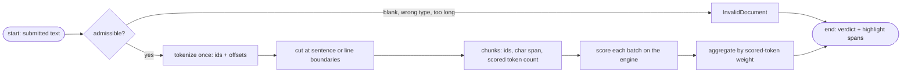
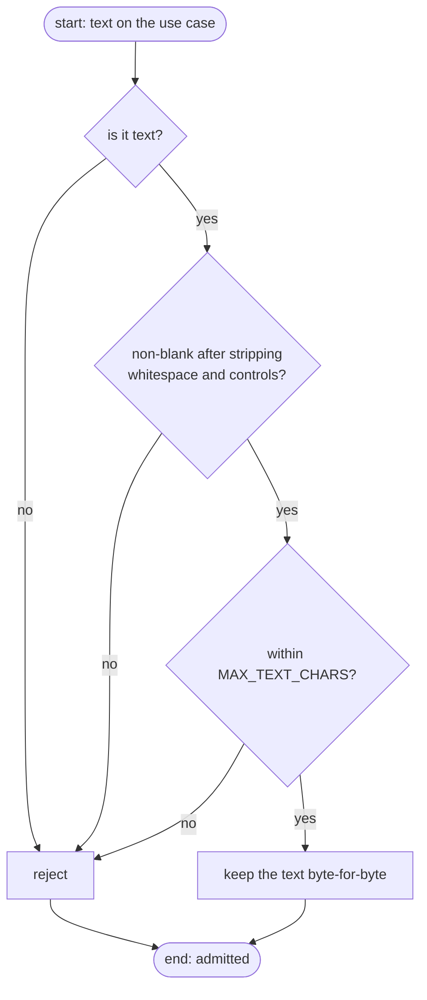
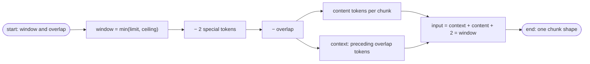
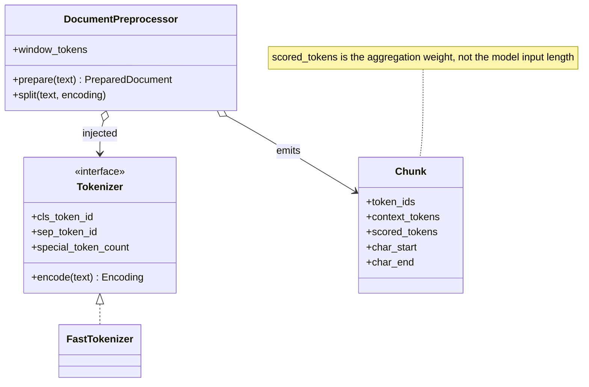
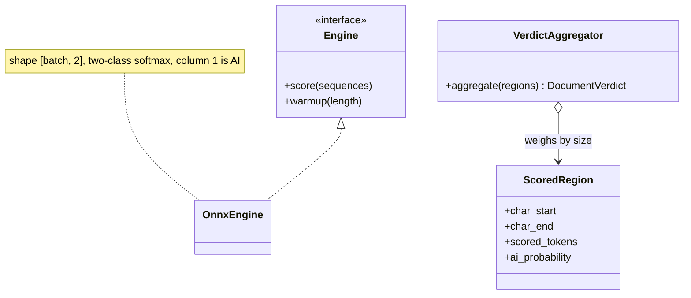
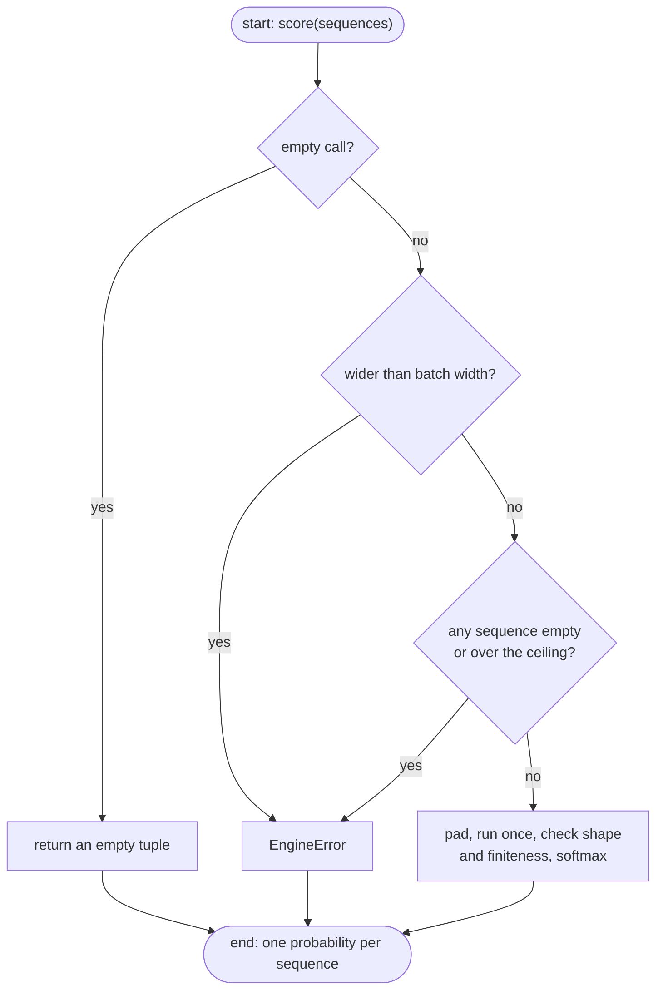

# Analysis Pipeline

One document is admitted, tokenized once, cut into chunks, scored in batches, and aggregated into one verdict. The text is never rewritten — the highlight spans must still point into the text the client sent.

## The whole path

## Admission

Over-limit text is rejected, never truncated: a truncated document is a different document.

## One tokenization, aligned cuts

The tokenizer returns token IDs and their character offsets in one call. The window is `min(CHUNK_TOKEN_LIMIT, model ceiling)`, and `content = window − 2 special tokens − overlap`.

Cuts prefer a sentence end (`.`, `!`, `?`) or the line break before the next token, but only when it lands in the upper half of the window — otherwise the content window would shrink too far. Chunks are contiguous; scored regions never overlap even when inputs carry context.

## The two cores

**Preparation's surface.** A narrow tokenizer port and one facade own admission and windowing.

**Scoring and verdict.** The engine returns one probability per chunk; the aggregator turns regions into a verdict.

## The engine's guards

A call the session cannot hold is refused, never truncated or attempted.

## The verdict

`VerdictAggregator` computes the weighted mean of region probabilities using `scored_tokens` as the weight, flips the flag at the threshold, and emits one highlight span per region in order. Spans from adjacent regions are not merged: a merged span would carry a weighted mean the client cannot re-derive the tone from.

## Next

- **[Models and artifacts](models.md)** — where the session and tokenizer come from.
- **[Design: pipeline](../../specification/pipeline.md)** — the decisions behind these rules.
