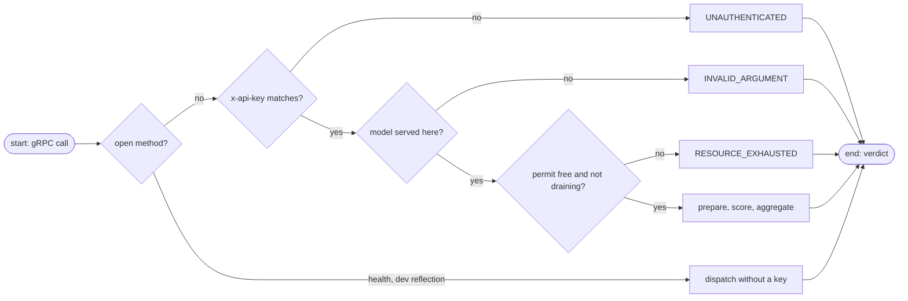
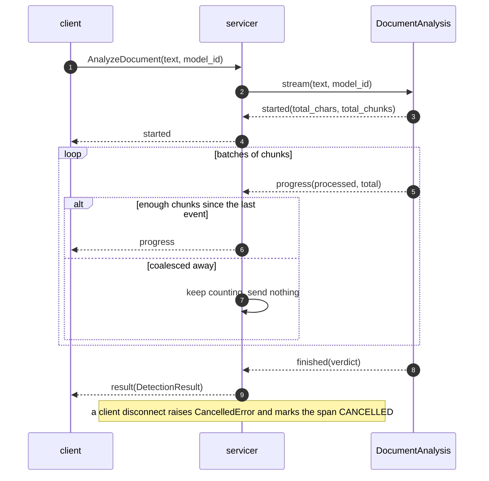
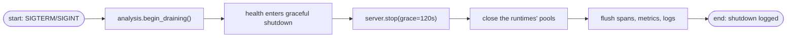

# Request Flow

One call passes through four gates before any model work happens. The gates are the same for both RPCs.

## The gates

The auth interceptor runs outermost so a rejected call still produces a trace. The key is compared with `hmac.compare_digest`; health and (in dev) reflection are exempt.

## Unary: `Detect`

One document in, one verdict out. `Detect` drives the same use case as the stream and simply waits for its final event.

```mermaid
sequenceDiagram
    autonumber
    participant C as client
    participant I as auth interceptor
    participant V as servicer
    participant A as DocumentAnalysis
    participant R as ModelRuntime

    C->>I: Detect(text, model_id, x-api-key)
    I->>V: dispatch
    V->>V: normalize model_id (empty means spark)
    V->>A: analyze(text, model_id)
    A->>R: admit: check draining + permit
    A->>R: prepare on the preparation pool
    R-->>A: chunks with ids and char spans
    loop each batch
        A->>R: score on the engine pool
        R-->>A: one probability per chunk
    end
    A->>A: aggregate the scored regions
    A-->>V: DocumentVerdict
    V-->>C: DetectionResult (percentages)
    note over A: the permit is released in a finally block, even on cancellation
```

## Streaming: `AnalyzeDocument`

The same work, reported as events. Progress is coalesced to at most 20 events; the last one is always sent.

## Errors on the wire

| Cause | gRPC status | Detail |
| --- | --- | --- |
| Missing or wrong key | `UNAUTHENTICATED` | `Missing or invalid API key` |
| Blank, over-limit, or unknown model | `INVALID_ARGUMENT` | the reason, capped at 500 chars |
| Model at capacity or service draining | `RESOURCE_EXHAUSTED` | the reason, capped at 500 chars |
| Any other failure | `INTERNAL` | `Internal Inference Error` only |

Internal faults are logged with a stack trace but never echoed to the client.

## Draining

On SIGTERM or SIGINT the server stops admitting work, then lets in-flight documents finish within a 120-second grace period.

## Next

- **[Architecture](architecture.md)** — the components these calls cross.
- **[Analysis pipeline](pipeline.md)** — the work inside `prepare` and `score`.
- **[RPC API](../reference/rpc-api.md)** — the fields and event shapes.
