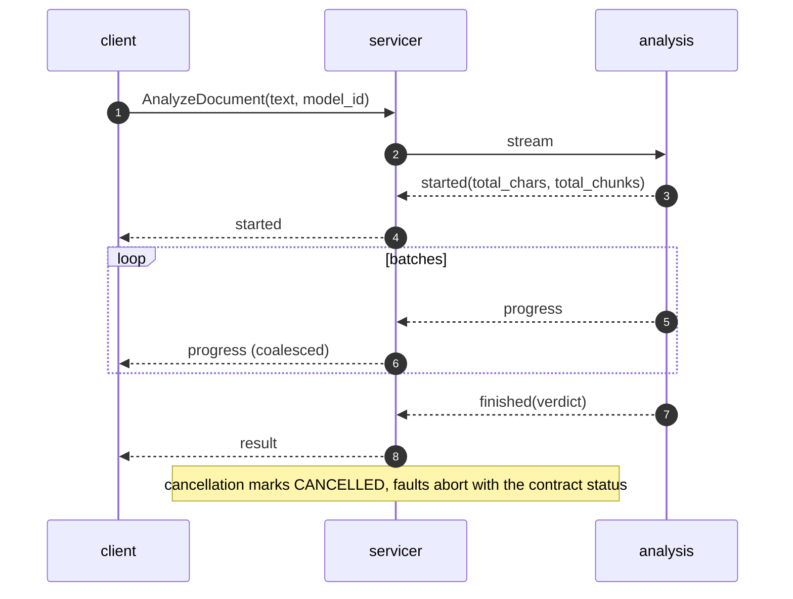

# Inference — API Contract

The wire contract for `inference.v1.AIService`, implemented in `api/proto/ai_service.proto`, `app/serving/`, and pinned by `tests/unit/serving/test_contract.py`. The user-facing version is [docs/reference/rpc-api.md](../docs/reference/rpc-api.md).

## Scope

| In scope | Out of scope |
| --- | --- |
| Both RPCs, their messages, and event order | Web-side adaptation to `inference.v1` |
| `x-api-key` gate and open methods | Telemetry dashboards |
| Submission bound, error codes, units, offsets | Chunking, engine, and batching internals |

## The contract

```proto
service AIService {
  rpc Detect (DetectRequest) returns (DetectionResult) {}
  rpc AnalyzeDocument (AnalyzeDocumentRequest) returns (stream AnalyzeDocumentEvent) {}
}
```

Both requests carry `text` and `model_id`. `DetectionResult` carries `model_id`, `is_ai_generated`, `confidence_score`, `ai_confidence`, `human_confidence`, and repeated `HighlightSpan{char_start, char_end, ai_confidence}`. The event oneof is `started → progress → result`, with `result` carrying the same `DetectionResult`.

## Pinned semantics

| Topic | Rule |
| --- | --- |
| Package | `inference.v1`, versioned from the start |
| Model id | empty → `spark`; supplied values trimmed and lowercased; the canonical key is echoed |
| Units | all confidences are 0–100 percentages rounded to one decimal |
| `confidence_score` | mirrors the winning side's confidence |
| Offsets | `char_start`/`char_end` are character offsets into the submitted text, which is never rewritten |
| Spans | one per scored region, in order; adjacent spans are not merged |
| Progress | at most 20 events; the last is always sent |
| Health | `SERVING` for `''` and `inference.v1.AIService`; open without a key |
| Reflection | dev only, open, advertising `inference.v1.AIService` |

## Errors

| Status | Cause | Detail |
| --- | --- | --- |
| `UNAUTHENTICATED` | missing or wrong `x-api-key` | `Missing or invalid API key` |
| `INVALID_ARGUMENT` | blank/over-limit text, unknown model | reason, capped at 500 chars |
| `RESOURCE_EXHAUSTED` | model at capacity or draining | reason, capped at 500 chars |
| `INTERNAL` | any other failure | `Internal Inference Error` |

Every denied or failed call marks the live span failed so contract codes count toward the error share.

## Event lifecycle



## Codegen and consumers

`make proto` generates stubs into `app/serving/generated/`; they are gitignored and regenerated in the Docker build. The web BFF still carries a hand-synced `aidetection` copy, so its `aidetection.AIService` probes no longer resolve against this server — that adaptation is a web-side slice.

## Decisions

| Decision | Choice | Rationale |
| --- | --- | --- |
| Versioned package | `inference.v1` | a rename later costs the same; version now |
| Message names | match their RPCs | engine vocabulary stays off the wire |
| Shared result | one message for unary and stream | one shape for clients to parse |
| No `label` | derived from `is_ai_generated` | avoid two sources of truth |
| `model_id` echo | canonical key | display names stay client-side |
| Auth | `x-api-key` only | one consumer; no Bearer/JWT path |
