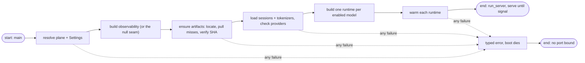

# Inference — Design

Module layout, runtime model, and the decisions behind them. Requirements live in [requirements.md](requirements.md); the wire contract in [api-contract.md](api-contract.md); the slice designs in [pipeline.md](pipeline.md), [models.md](models.md), and [observability.md](observability.md).

## Module layout

```
services/inference/
  app/
    main.py                 # entry point; shutdown order
    boot.py                 # plane → artifacts → models → runtimes → serve
    config/                 # Settings, factories, dev/prod providers
    serving/                # auth interceptor, servicer, wire mapper, server
    inference/
      analysis.py           # the use case behind both RPCs
      preprocessing/        # admission, tokenizer port, chunking
      engine/               # Engine port, ONNX adapter, errors
      postprocessing/       # regions, verdict, aggregator
      runtime.py            # one model's bundle and two pools
    models/
      pulling/              # specs, artifact store, parallel manager
      loading/              # offline session + tokenizer, provider check
    observability/          # Observability seam, OTLP adapters, instruments
  api/proto/                # inference.v1
  infra/                    # compose stacks and env templates
  mk/                       # Makefile fragments
  tests/                    # unit, integration, load
```

Dependencies point inward: serving depends on the analysis use case; the use case depends on ports; only the adapters import ONNX Runtime, Hugging Face, or AWS.

## Runtime model

Boot is fail-closed and strictly ordered. No port is bound until every model can score.



## Concurrency

| Layer | Width | Purpose |
| --- | --- | --- |
| gRPC server | `MAX_INFLIGHT_REQUESTS` (8) | outer handler bound |
| Per-model semaphore | `MAX_CONCURRENT_BATCHES` (2) | admission; shed when locked |
| Preparation pool | unbounded | tokenization and windowing off-loop |
| Engine pool | `MAX_CONCURRENT_BATCHES` (2) | forward passes; matches the permit |

Because the permit and the engine pool share a width, an admitted document never queues behind another batch in the pool.

## Error taxonomy

| Plane error | Wire status | Detail policy |
| --- | --- | --- |
| `InvalidDocument`, `UnknownModelError` | `INVALID_ARGUMENT` | caller's reason, capped at 500 chars |
| `OverloadedError` | `RESOURCE_EXHAUSTED` | caller's reason, capped at 500 chars |
| `ConfigError`, artifact/model errors | boot failure | process exits before serving |
| `EngineError`, `PostprocessingError`, anything else | `INTERNAL` | generic `Internal Inference Error`; full trace in logs |

## Config planes

`ENV_TYPE=prod` selects prod; dev otherwise. Dev reads `infra/.env` with env vars winning. Prod reads Secrets Manager and SSM, requires `AWS_REGION`, and rejects a key seeded on both planes. All values validate into one `Settings` at boot. See [references/config.md](references/config.md).

## Measurements

CPU box, 8 cores, pinned artifacts (flare fp32 bert-large, spark fp16 bert-base):

| Observation | Value | Consequence |
| --- | --- | --- |
| One forward pass, 512 tokens | ~2.9 s (spark) | streaming exists so a client sees progress |
| Preparation at 1M chars | 0.4–1.3 s | well under 1% of inference; no parallel pipeline needed |
| Chunks at 1M chars | 303 | one highlight span per region stays small |
| Peak threads, one session in flight | 14 | two loaded models oversubscribe; hence one model per process on a card |

These are dev-box numbers, not throughput claims for a device.

## Testing strategy

Unit tests mirror `app/` with fakes for tokenizer, session, and store. Integration tests boot the real server on a gRPC channel with stub models. The load rig asserts the rejection matrix and stream shape against a manifest-generated corpus. Coverage gate: 95%. See [docs/guides/testing.md](../docs/guides/testing.md).

## Decisions

| Decision | Choice | Rationale |
| --- | --- | --- |
| Layering | use case + ports, adapters at the edge | no cloud or ONNX import reaches the domain of the use case |
| Runtimes | one bundle per model | makes `ENABLED_MODELS` and one-model-per-card a data change |
| Warmup | cheap probe, then production shape | catches a corrupt artifact in milliseconds, not minutes |
| Two pools | preparation and inference separate | tokenization is light and blocking; scoring is heavy and blocking |
| Boot order | fail closed before bind | a half-ready server is worse than no server |
