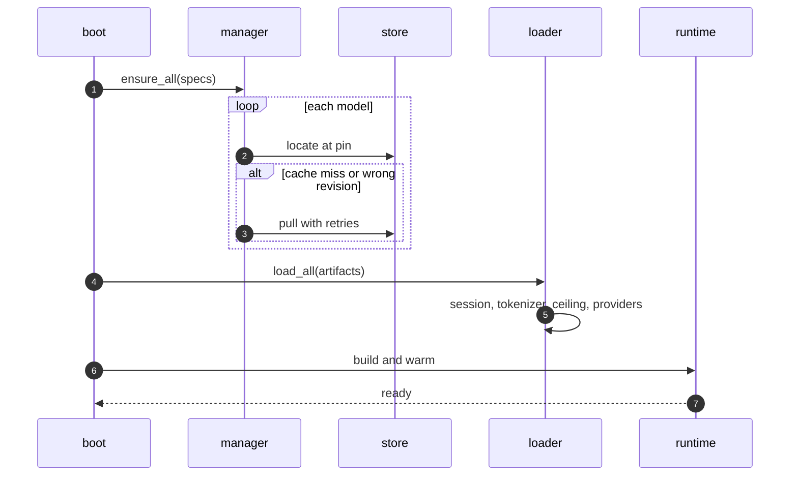

# Inference — Models and Artifacts

The pull, verification, load, and warmup planes. Implemented in `app/models/` and `app/boot.py`; the beginner-facing version is [docs/concepts/models.md](../docs/concepts/models.md).

## Scope

| In scope | Out of scope |
| --- | --- |
| Pinned pull specs and the offline artifact store | Artifact pruning and garbage collection |
| Parallel pulls and fail-fast abort | Hub authentication beyond `HF_TOKEN` |
| Offline session and tokenizer construction | Model fine-tuning and export |
| Provider verification, ceiling cross-check, warmup | Device placement Terraform |

## Artifact contract

Each `ModelSpec` carries repo, full 40-character revision, in-repo artifact directory, and file list. `MODEL_CACHE_DIR` is the local root; a volume mount keeps restarts cheap. `flare` is fp32 bert-large under `onnx/fp32`; `spark` is fp16 bert-base under `onnx/fp16`.

## Pull

`HuggingFaceStore.locate` walks every file and reads its cached download metadata. A file must be cached **and** carry the pinned commit; otherwise the spec is a miss. `ModelArtifactManager` probes all specs offline, then pulls misses in parallel with one daemonic worker per model. The first failure aborts the boot without waiting for a sibling's download.

`HuggingFaceStore.pull` retries transient faults three times with linear backoff. Auth failures, offline mode, missing entries, and permanent filesystem errors are not retried.

## Load

`OnnxModelLoader` walks keys in sorted order. For each: build one `InferenceSession` from `model.onnx` with fresh `SessionOptions` (intra-op threads optional), construct the tokenizer with `local_files_only=True`, read the declared length from `tokenizer_config.json` when present, and verify providers.

The configured ceiling governs; the artifact's declared length is a cross-check, never the source — one pinned artifact declares none. A ceiling above the declared length fails the boot.

## Provider verification

Every requested provider must appear in the session's effective providers; a missing one raises `ModelLoadError`. ORT appends CPU as a fallback tail, so the check is by presence, not equality. A silent CPU fallback would report healthy while running at the wrong speed.

## Warmup

`OnnxEngine.warmup` runs an 8-pad-id probe (milliseconds; catches a corrupt artifact) and then a full production-shape call. A runtime that cannot score dies before the port is bound.

## Sequence

## CPU and GPU

The `gpu` image swaps `onnxruntime` for `onnxruntime-gpu` and requests an NVIDIA device through Compose. `INFERENCE_PROVIDERS` is an ordered preference list; verification makes a missing device a boot failure rather than a quiet CPU fallback.

## Decisions

| Decision | Choice | Rationale |
| --- | --- | --- |
| Pull identity | full SHA, verified on disk | a stale volume must not serve an old build |
| Missing models | pull in parallel, fail fast | cold boots stay reasonable; faults surface immediately |
| Retries | transient only, 3 attempts | no retry loops on auth or disk-full |
| Tokenizer | offline from the artifact | no hub dependency at load time |
| Ceiling source | configured, cross-checked | one artifact does not declare a length |
| Providers | verify effective, fail closed | no silent CPU fallback |
| Warmup | probe then production shape | cheap artifact check and real kernel warmup |
| Enabled models | a settings list | one model per process is expressible as configuration |
