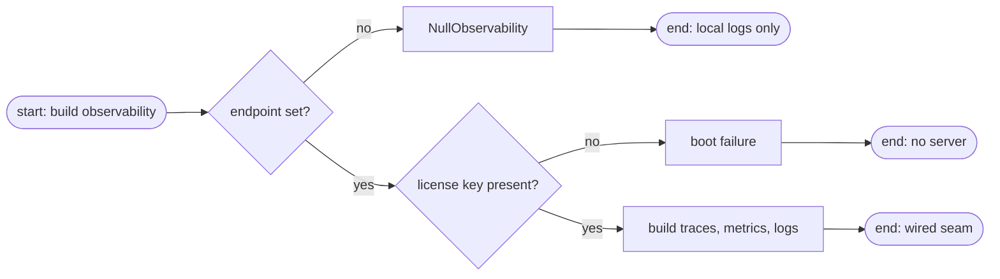

# Inference — Observability

The telemetry contract: what is emitted, under what gate, and what the New Relic board depends on. Implemented in `app/observability/`; user-facing version in [docs/concepts/observability.md](../docs/concepts/observability.md).

## Scope

| In scope | Out of scope |
| --- | --- |
| The `Observability` seam and the null seam | Dashboard and alert authoring |
| OTLP/HTTP export to New Relic EU | Log aggregation outside OTel |
| Metric and span vocabulary | Capacity planning from dev-box numbers |

## The gate

`OTEL_EXPORTER_OTLP_ENDPOINT` is the switch. Unset installs `NullObservability` and no SDK objects. Set requires `NEW_RELIC_LICENSE_KEY`; if the key is missing after validation the boot fails rather than exporting unauthenticated data.

## Export

| Signal | Path | Notes |
| --- | --- | --- |
| Traces | `/v1/traces` | sampled at `OTEL_TRACE_SAMPLE_RATIO` |
| Metrics | `/v1/metrics` | DELTA histogram temporality, 15 s period |
| Logs | `/v1/logs` | OTel handler on the root logger; stdout remains |

All three use gzip and an `api-key` header carrying the New Relic license key. Exporters flush with a 5-second timeout.

## Instrument inventory

| Name | Kind | Attributes | Source |
| --- | --- | --- | --- |
| `inference_batch_size` | ObservableGauge | — | width of the last batch |
| `inference_queue_depth` | ObservableGauge | — | documents admitted and running |
| `inference_inflight_chunks` | ObservableGauge | — | chunks on the engine |
| `inference_engine_duration_seconds` | Histogram | `model` | one forward pass |

Span attributes: `model.id`, `model.revision`, `inference.provider`, folded onto the ambient request span before admission so a shed request still carries its model. Health and reflection traffic is filtered out of the gRPC interceptor.

These names are frozen: the dashboards and alerts in `observability/` depend on them. Renaming one is a migration, not an edit.

## Failure accounting

The gRPC instrumentation marks only some statuses as failed, so the service marks the live span failed for every contract code — `UNAUTHENTICATED`, `INVALID_ARGUMENT`, `RESOURCE_EXHAUSTED`, `INTERNAL`, and `CANCELLED`. Without this the board's error share would miss most client-visible failures.

## Resource and shutdown

Resource attributes: `service.name`, `service.version`, and both `deployment.environment` and `deployment.environment.name` with the resolved plane.

Shutdown drains spans → metrics → logs. Each adapter's drain is guarded and idempotent; a failed flush is logged and does not block exit. The process closes runtime pools first, then drains telemetry.

## Decisions

| Decision | Choice | Rationale |
| --- | --- | --- |
| Gate | endpoint presence | disabled telemetry creates zero SDK objects |
| One service class | no split telemetry layer | no caller wants an extra hop |
| Gauges for depth | observable callbacks | thread-safe against pooled work |
| Duration attribute | `model` key only | series survive a revision bump |
| Explicit failure marking | every contract status | the error share must be honest |
| Traffic filter | exclude health and reflection | probes must not pollute panels |
