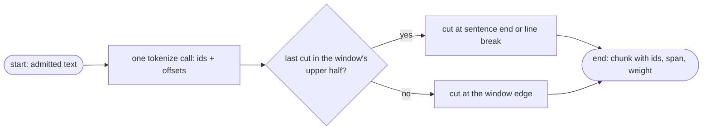

# Inference — Analysis Pipeline

The design of preparation, overlap, scoring, and aggregation. Implemented in `app/inference/`; requirements in [requirements.md](requirements.md); the beginner-facing version is [docs/concepts/pipeline.md](../docs/concepts/pipeline.md).

## Scope

| In scope | Out of scope |
| --- | --- |
| Admission, one-pass tokenization, boundary cuts | gRPC error mapping |
| Optional context overlap | Model pull and session construction |
| Batch guards, softmax, warmup shape | GPU placement |
| Region weighting, threshold, highlight spans | Web-side rendering |

## Preparation

Admission rejects non-text, blank, and over-limit submissions. The submitted text is never rewritten: rewriting would shift every character offset away from the request text the contract measures against.

One tokenizer call returns IDs and offsets. The window is `min(CHUNK_TOKEN_LIMIT, model ceiling)`; it must be at least 64 tokens. `content = window − 2 special tokens − overlap`.

A cut is allowed after `.`, `!`, `?` or at the line break before the next token. Chunks are contiguous; an optional overlap adds preceding tokens to a chunk's model input without overlapping its scored region.

## Overlap

`CHUNK_TOKEN_OVERLAP` counts tokens shared with the previous chunk, not stride. The context prefix sits between `[CLS]` and the content, so the input length stays exactly the window. Overlap is off by default; reading (A) — inputs overlap, scored regions do not — keeps the contract's spans disjoint and the aggregation a plain weighted mean.

## Engine

`Engine.score(sequences)` is synchronous and returns one AI probability per sequence in order. `OnnxEngine` is the only adapter that imports ONNX Runtime.

| Guard | Rule |
| --- | --- |
| Empty call | return an empty tuple |
| Width | at most `batch_size` sequences |
| Length | no empty sequence; none over the model's declared ceiling |
| Output | shape `[batch, 2]`, finite logits |
| Probability | two-class softmax; column 1 is AI |

Anything else raises `EngineError` — no truncation, no silent degradation. Warmup runs an 8-pad-id probe, then a full production-shape call.

## Aggregation

`VerdictAggregator` weights each region by `scored_tokens` (content tokens only, not context or special tokens), takes the weighted mean, and flips the flag at `ai_detection_threshold`. One highlight span per region, in order; no merging, because a merged span's weighted mean cannot be re-derived by the client and can flip the displayed tone.

## Decisions

| Decision | Choice | Rationale |
| --- | --- | --- |
| Tokenize once | the chunk carries ids | two passes could disagree on normalization |
| Never rewrite text | validate only | offsets must address the submitted text |
| Aligned cuts | boundary in the upper half | avoids arbitrary cuts without shrinking windows |
| Overlap meaning | shared tokens, not stride | the inverse quantity invites semantic mistakes |
| No stride weights | weight by scored tokens | regions are non-overlapping; the old patch has no referent |
| No first-chunk bias | size weight only | an opening bias tilts every document |
| No span merge | one per region | preserves each region's own probability |
| Refuse, never truncate | guards in the engine | a truncated sequence is not the document admitted |

## Non-goals

A hierarchical or document-level model, a token ceiling beyond `MAX_TEXT_CHARS`, and per-region AI/human flags on the wire.
