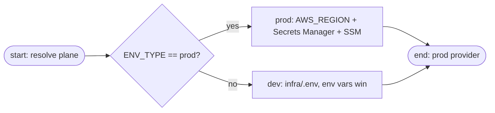

# Config Resolution Design

How `ENV_TYPE`, the dev and prod providers, and `Settings` become one validated boot contract. Requirements live in [../requirements.md](../requirements.md); the runtime view in [../design.md](../design.md); the user-facing table in [../../docs/getting-started/configuration.md](../../docs/getting-started/configuration.md).

## Plane selection

Only an exact `prod` in `ENV_TYPE` selects prod. Anything else — unset, empty, a file value, a typo — is dev. The choice never comes from a file or an AWS call.

## Source precedence

| Plane | Order | Notes |
| --- | --- | --- |
| dev | process env → `infra/.env` → defaults | `DOTENV_PATH` overrides the file path; a missing file is an empty plane |
| prod | Secrets Manager → SSM → defaults | secret keys and parameters must not overlap |

`ConfigFactory.create(plane)` builds the provider. `Settings.from_provider(provider)` reads and validates every field once; no module reads the environment afterwards.

## Fail-closed rules

| Input | Behavior |
| --- | --- |
| Bad `GRPC_PORT`, log level, text limit, chunk limit | fall back to the default |
| Bad batch width, concurrency, threshold, threads | fall back to the default |
| Overlap | negative or unparseable → 0 |
| `ENABLED_MODELS` | unknown name, empty, or duplicate → boot failure; canonical order enforced |
| Provider names | unknown → boot failure; at least one required |
| Model revisions | not a 40-char lowercase SHA → boot failure |
| `API_KEY` | shorter than 16 → boot failure |
| OTLP endpoint set without a license key | boot failure |
| A key seeded on both planes | boot failure |

The rule is simple: a knob that can be safely ignored falls back; an identity or credential that cannot be guessed fails the boot.

## Field groups

| Group | Fields |
| --- | --- |
| Transport | `api_key`, `grpc_port`, `log_level` |
| Admission | `max_text_chars`, `max_inflight_requests` |
| Chunking | `chunk_token_limit`, `chunk_token_overlap` |
| Batching | `inference_batch_size`, per-model batch sizes, `max_concurrent_batches` |
| Models | `enabled_models`, per-model repo/revision/dir/ceiling, `model_cache_dir` |
| Execution | `inference_providers`, `ort_intra_op_threads` |
| Verdict | `ai_detection_threshold` |
| Telemetry | `otel_*`, `new_relic_license_key` |

## File layout

| File | Role |
| --- | --- |
| `app/config/settings.py` | the typed `Settings` and all validators |
| `app/config/provider.py` | the `ConfigProvider` port |
| `app/config/factories/` | dev/prod provider construction and the AWS client |
| `app/config/adapters/` | dotenv, Secrets Manager, and SSM reads |
| `app/config/errors.py` | the config-plane error vocabulary |

## Decisions

| Decision | Choice | Rationale |
| --- | --- | --- |
| Plane source | process env only | a file must not silently flip a prod boot |
| Validation site | `Settings` | one place decides what a bad value means |
| Fallback vs failure | safe knobs fall back, identities fail | no half-configured secret or model pin |
| Provider names | pure strings in `Settings` | the config plane never imports ONNX Runtime |
| Read once | no later env reads | the running process has one source of truth |
