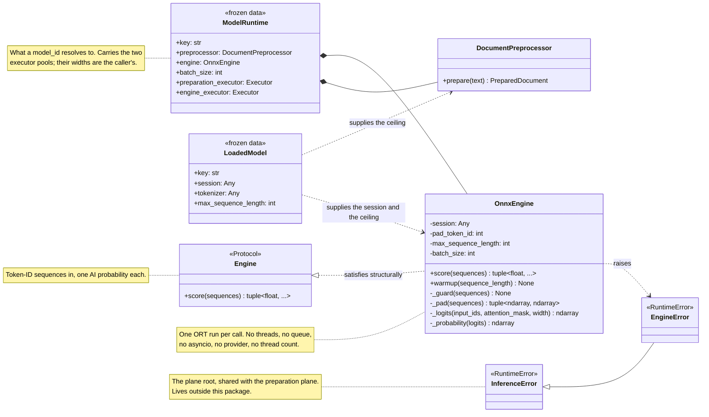
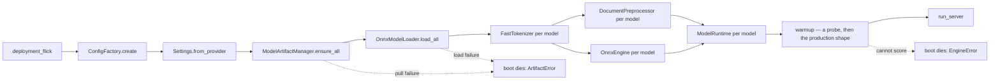
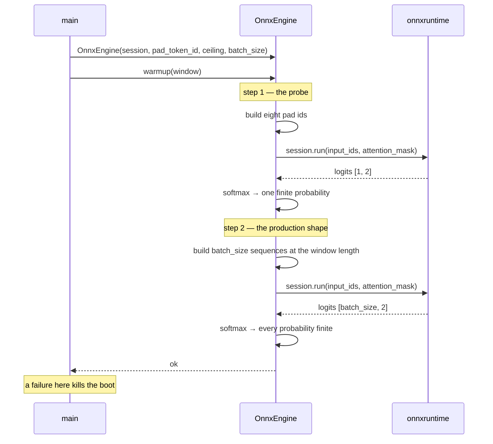
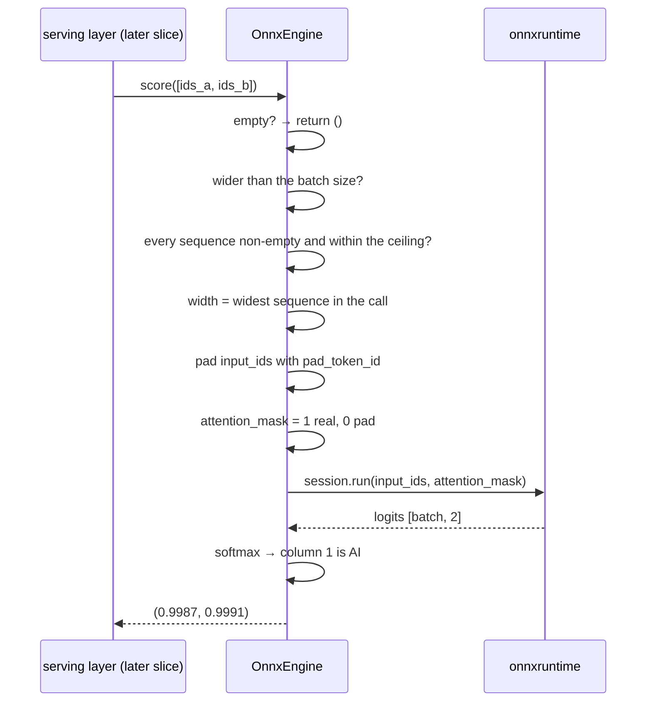
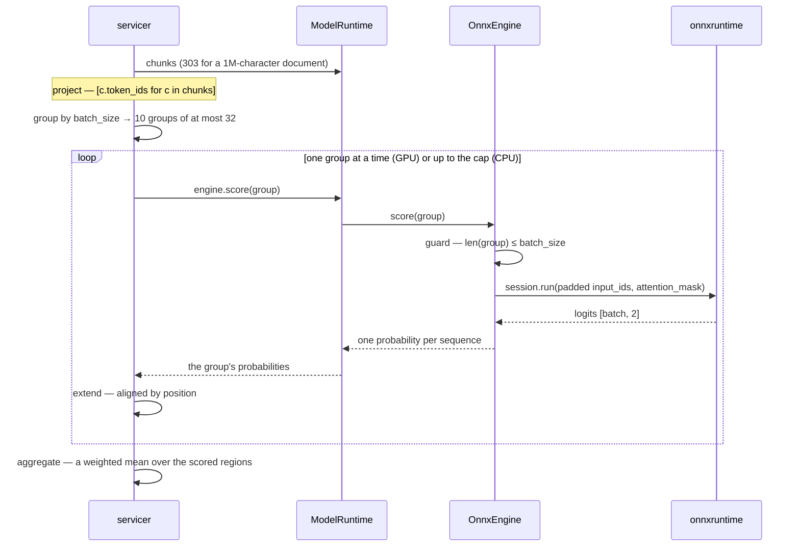
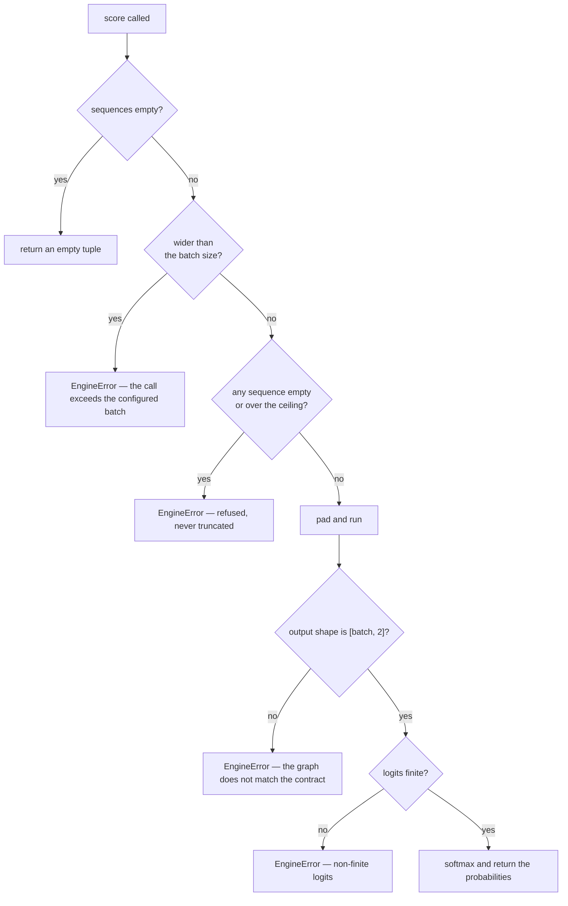

# Inference — Engine (design reference)

Status: design reference for the engine slice, implemented in
`app/inference/engine/` (the port, the ONNX adapter, the raiser),
`app/inference/errors.py` (the plane's error root), the `pad_token_id`
member added to the tokenizer port, `app/inference/runtime.py` (the
per-model bundle and its two executor pools), the `window_tokens` property
on the preprocessor, and the boot wiring in `app/main.py`. The adapter's
scoring and its warmup are implemented; the fail-closed boot that
depends on them is wired and pinned by a unit test.

The engine is the middle of the pipeline: preparation hands it token-ID
sequences, it hands back one AI probability per sequence. It is the only
part of the service that talks to ONNX Runtime at inference time, and it
is deliberately ignorant of everything else — no chunks, no characters, no
documents, no threads, no queues.

The quarantined `services/inference/slop/` tree is the reference draft. Its
`engines/` package held two per-model classes behind an async port, fed by
a queue-and-worker batching proxy, and re-tokenized every chunk's text.

The GPU story — the batch economics, the concurrency model, the executor
pools, the deployment shape — lives in the companion reference
(`inference-gpu.md`). Every measurement below was taken on a CPU-only dev
box, and §"What the GPU changes" states which of them do not survive the
move.

---

## Measured baseline

Every number below was measured against the pulled artifacts in this tree
(flare = fp32 bert-large, spark = fp16 bert-base), on 8 CPU cores with no
GPU (`onnxruntime.get_available_providers()` returns `AzureExecutionProvider`
and `CPUExecutionProvider` only; no `nvidia-smi`, no `/dev/nvidia*`). They
are the basis for the design decisions in §11.

These are **dev-box** measurements. They describe the shape of the work and
the behaviour of the libraries — not production capacity. The absolute
throughput figures say nothing about a GPU host and must not be read as
such; §11.15 records the matrix that settles the hardware-dependent knobs,
and `inference-gpu.md` carries the GPU method.

### The artifacts' actual signature

Both models declare the same two inputs and one output:

| Model | Inputs | Output |
| --- | --- | --- |
| flare | `input_ids` int64 `[batch, sequence]`, `attention_mask` int64 `[batch, sequence]` | `logits` float32 `[batch, 2]` |
| spark | `input_ids` int64 `[batch, sequence]`, `attention_mask` int64 `[batch, sequence]` | `logits` float32 `[batch, 2]` |

Both are `ModernBertForSequenceClassification` with `id2label {0: HUMAN,
1: AI}`. There is no `token_type_ids`. **One probability per chunk — there
is no token-level output, so the contract's `highlight_spans` are chunk-
coarse by construction.** No artifact in the tree yields finer attribution.

### Tokenizer facts

| Fact | flare | spark |
| --- | --- | --- |
| `cls_token_id` / `sep_token_id` / `pad_token_id` | 50281 / 50282 / 50283 | 50281 / 50282 / 50283 |
| `num_special_tokens_to_add(pair=False)` | 2 | 2 |
| declared sequence length | `max_length` = 512 | `model_max_length` = 8192 |

### Timing and concurrency (dev box, 8 cores, CPU EP)

One 512-token sequence, single run: spark ≈ 0.9–2.1 s, flare ≈ 2.7–2.9 s.
A 1,000,000-character document is ~303 chunks, which is minutes of engine
time — the streaming RPC exists for exactly this.

Eight chunks of 512 tokens, four strategies:

| Strategy | spark | flare |
| --- | --- | --- |
| 8 × batch 1, sequential | 11.2 s → 0.71 seq/s | 21.8 s → 0.37 seq/s |
| 1 × batch 8 | 12.3 s → 0.65 seq/s | 21.6 s → 0.37 seq/s |
| 2 × batch 4, concurrent | 9.5 s → 0.84 seq/s | 22.0 s → 0.36 seq/s |
| 4 × batch 2, concurrent | 8.5 s → 0.94 seq/s | 19.9 s → 0.40 seq/s |
| 8 × batch 1, concurrent | 8.5 s → 0.94 seq/s | 20.3 s → 0.39 seq/s |

**On this box, the batch shape barely matters; concurrency does.** One
batch of 8 ≈ eight singles, because a batch is executed as one parallel
region anyway. Running several runs concurrently is up to **+32%** for the
base model, which a single 512-token sequence does not saturate, and +5%
for the large model, which is already compute-bound.

**That conclusion is a property of the CPU execution provider, and it does
not survive the move to a GPU.** On a device, batch width becomes the
primary throughput knob and concurrency becomes overhead — the opposite
inversion. §"What the GPU changes" states the economics; the companion
reference (`inference-gpu.md`) carries the full treatment.

### What the GPU changes

Three effects, none of which the CPU execution provider has:

| Effect | What happens on a device | Why it does not apply on the CPU EP |
| --- | --- | --- |
| **Weight re-read** | Every run reads the model's weights from device memory. flare is 335M parameters — 1.34 GB at fp32 — so a 24 GB card spends ~2.2 ms per weight sweep at ~600 GB/s. A batch amortises that sweep over N sequences. | The CPU EP's weights sit in the host's cache and are re-read by the same cores that do the arithmetic; there is no separate bandwidth budget to amortise |
| **Kernel launch overhead** | A BERT-large forward is ~24 layers × ~8–12 ops ≈ 250–300 device launches at ~5 µs each — ~1.5–2.5 ms of overhead **per run, independent of batch size**. Thirty-two separate runs pay it thirty-two times; one run of thirty-two pays it once. | The CPU EP has no launch phase; its "overhead" is thread scheduling inside the intra-op pool |
| **Small-GEMM under-utilisation** | At batch 1 × 512 tokens a 125 TFLOPS device runs at single-digit percent of peak, because the GEMMs are too small to fill it. | The CPU EP parallelises *within* a run, so a single 512-token sequence already occupies all eight cores |

The inversion that follows:

| | Batch width | Concurrent runs | Where the win is |
| --- | --- | --- | --- |
| **CPU** | 1–2 (batch 8 was the *worst* measured above) | 4–8 (the measured +32%) | concurrency |
| **GPU** | 16–64 | 1 | batch width |

The same knob means opposite things on the two hardware paths, which is
why the batch size is a configuration value and never a code default
(§8, §11).

The memory envelope follows from the same arithmetic:

```
device memory ≈ concurrent_runs × batch_size × per_sequence_activation
              + model weights
```

Concurrency multiplies activation memory. A device that holds one batch of
32 comfortably may not hold four concurrent batches of 32 — and four
concurrent runs on one device time-slice anyway, so the extra memory buys
no throughput.

### Library behaviour that shaped the design

| Observation | Consequence |
| --- | --- |
| ORT releases the GIL during `session.run` (verified: a ticker thread kept ticking throughout a 1.8 s run — 796 ticks/s against an idle rate of 905/s) | the engine can be synchronous and still be overlapped by the caller via `asyncio.to_thread` |
| One session in flight peaks at 14 process threads; two sessions with two runs in flight peak at 21, on 8 cores | each session carries its own intra-op pool sized to the machine — two loaded models oversubscribe the box. Owned by the loading plane (§9) |
| A `session.run` on one session is safe from several threads | concurrent requests against one session are legal, bounded by the caller's knob |
| A device host does not need the intra-op pool sized to the machine — the device does the arithmetic | `ORT_INTRA_OP_THREADS` belongs at 1–2 on a GPU host and at the core count on a CPU host. The knob is the loading plane's (§9) |

### Calibration of the shipped artifacts

Every text tried — `"hello"`, `"I went to the shop and bought milk"`, a
Python function, an academic paragraph, a model-written outline — scores
`p_ai ∈ [0.9875, 1.0]`. The logit margin varies 4.4 → 18.5 and carries the
signal, but a two-class softmax is monotonic in that margin, so **no
resolution is recoverable by any transform.** The artifacts label
everything AI. This is a property of the artifacts, not of the hardware,
and it gates every quality question in the pipeline (see §11.14).

### Context sensitivity

The same 510-token region scored with 0 / 64 / 128 / 256 tokens of
preceding context prepended:

| Context added | spark `p_ai` | spark margin | flare `p_ai` | flare margin |
| --- | --- | --- | --- | --- |
| none | 0.999993 | 11.815 | 1.000000 | 16.841 |
| +64 | 0.999984 | 11.040 | 1.000000 | 16.497 |
| +128 | 0.999955 | 10.018 | 1.000000 | 17.114 |
| +256 | 0.999962 | 10.173 | 1.000000 | 17.702 |

The verdict does not move (`p_ai` shifts by ≤ 0.00004); the raw margin
drifts by roughly ±0.8 logits. On these artifacts, context does not change
the outcome. The overlap sweep in the companion reference
(`inference-overlap.md`) therefore needs a detector that discriminates
before it can mean anything.

---

## 1. Scope

| In scope | Out of scope (later slices) |
| --- | --- |
| The engine port: token-ID sequences in, AI probabilities out | The dispatcher, the concurrency fan-out, the stream producer |
| The ONNX Runtime adapter: padding, attention mask, softmax | The batching proxy — deferred to the GPU slice; the CPU measurement that deferred it does not transfer (`inference-gpu.md`) |
| The plane's error root and the engine's raiser | Telemetry / New Relic instruments |
| The `pad_token_id` member on the tokenizer port | Provider options, thread counts, device ids (the loading plane) |
| `warmup()` and the fail-closed boot | Aggregation of chunk scores into a verdict (postprocessing) |
| The batch-size guard: the adapter refuses a call wider than its configured batch | The grouping of chunks into batches — the caller decides, per §6 |
| The per-model runtime bundle and its two executor pools | The width of the pools — a serving-slice decision, bounded by the bundle |
| Boot wiring: build one engine per loaded model, warm it, fail closed | The gRPC servicer and its registration |
| Unit tests + this design reference | A document-level or hierarchical model |

---

## 2. Mapping from the quarantined tree

| slop name | Design name | Module | Responsibility |
| --- | --- | --- | --- |
| `engines/base.py` — `BaseEngine.softmax` / `sigmoid` / `decode_logits` | `OnnxEngine._probability` | `app/inference/engine/onnx.py` | The draft's base class held a softmax, a sigmoid and three accepted output shapes. Only the two-class softmax survives, folded into the adapter — the draft's `(N,)` and `(N,1)` tolerances are dropped |
| `engines/flare.py` — `FlareEngine.predict_batch` | `OnnxEngine.score` | `app/inference/engine/onnx.py` | The draft re-tokenized each chunk's text and truncated at its own `max_length=256`. The engine now consumes the IDs preparation produced and truncates nothing |
| `engines/spark.py` — `SparkEngine.predict_batch` | **Deleted** | — | It fed a pickled sklearn TF-IDF vectorizer. Spark now ships an HF tokenizer and an ONNX transformer, so the per-model engine dies — one uniform adapter serves both artifacts |
| `ports/outbound/inference.py` — `ISyncBatchInferenceEngine` | `Engine` | `app/inference/engine/engine.py` | Narrowed from `predict_batch(texts)` to one method over token-ID sequences |
| `ports/outbound/inference.py` — `IAsyncInferenceEngine` | **Deleted** | — | The draft's async engine and the batching proxy's async wrapper. The engine is synchronous; the caller offloads it |
| `batcher.py` — `BatchingProxy` | **Deferred to the GPU slice** | — | The queue, the linger timer, the health snapshot and the shutdown drain buy nothing measurable on CPU (§ baseline). That justification is CPU-scoped and does not transfer: on a device the batch width is the throughput knob, and filling a batch from a queue of chunks arriving out of several requests is what a device needs. It is the next slice after the GPU lands, and it lands with the servicer, where the contract's queue semantics already live (`inference-gpu.md`) |
| `src/infrastructure/config/settings.py` — `batch_size_for(model_key)` | `Settings.batch_size_for(model_key)` | `app/config/settings.py` | The idea survives — one batch size per model — but the draft's override tuned the proxy's queue depth, which is a different quantity. Here it overrides the engine's guard, and a global knob sits beside it as the fallback |
| `batching/processor.py` | **Deleted** | — | Belonged to the proxy |
| `engines/*.warmup` | `OnnxEngine.warmup` | `app/inference/engine/onnx.py` | The draft warmed each engine at boot. The warmup now proves the session executes before traffic is served, and then warms the production shape the service will actually use |
| `engines/flare.py` — `max_length: int = 256` | **Deleted** | — | The window belongs to preparation. The engine is handed the model's declared ceiling and refuses anything longer |
| `domain/exceptions.py` — `InferenceError` | `InferenceError` | `app/inference/errors.py` | Graduated from the draft's domain package to the plane root; the engine's failure joins it |
| `domain/exceptions.py` — `InferenceError` raised by the engines | `EngineError` | `app/inference/engine/errors.py` | A typed, single-name failure for every engine fault |

---

## 3. Components

### `app/inference/errors.py` — the plane root

```python
class InferenceError(RuntimeError):
    """Root of the inference plane's failures; catch this for blanket handling."""
```

The preparation plane already had a raiser. This is where it graduates: one
root for the plane, so the serving slice maps one tree — `InvalidDocument`
to `INVALID_ARGUMENT`, `EngineError` to `INTERNAL`.

```text
app/inference/errors.py             InferenceError(RuntimeError)          ← the plane root
app/inference/preprocessing/errors.py
                                   PreprocessingError(InferenceError)
                                     └── InvalidDocument
app/inference/engine/errors.py     EngineError(InferenceError)
```

`PreprocessingError` and `InvalidDocument` keep their names and their file;
only their base class changes, so the finished preparation reference stays
accurate.

### `app/inference/engine/engine.py` — the port

```python
class Engine(Protocol):
    def score(self, sequences: Sequence[Sequence[int]]) -> tuple[float, ...]:
        """One AI probability per token-id sequence, in the same order."""
        ...
```

One method. The whole contract. No configuration, no lifecycle, no health,
no shutdown.

### `app/inference/engine/onnx.py` — the adapter

```python
class OnnxEngine:
    """Satisfies Engine structurally; the only module in this package that imports onnxruntime."""

    def __init__(
        self,
        session: Any,
        pad_token_id: int,
        max_sequence_length: int,
        batch_size: int,
    ) -> None: ...

    def score(self, sequences: Sequence[Sequence[int]]) -> tuple[float, ...]: ...
    def warmup(self, sequence_length: int) -> None: ...
    def _guard(self, sequences: Sequence[Sequence[int]]) -> None: ...
    def _pad(self, sequences: Sequence[Sequence[int]]) -> tuple[np.ndarray, np.ndarray]: ...
    def _logits(self, input_ids: np.ndarray, attention_mask: np.ndarray, width: int) -> np.ndarray: ...
    def _probability(self, logits: np.ndarray) -> np.ndarray: ...
```

Four constructor arguments: the session, the pad token id, the model's
declared ceiling, and the batch size. **No provider, no device, no thread
count** — none of those are the engine's business.

The warmup takes the production sequence length as an argument because the
engine cannot know it: `spark` declares a ceiling of 8192 tokens while the
chunk window is 512, and warming at the ceiling would be both the wrong
shape and an enormous allocation. The caller — the runtime bundle's
preprocessor, through `window_tokens` — owns the window; the engine owns the
width.

The batch size is the one exception, and it earns its place by being a
**guard rather than a policy**. The adapter refuses a call wider than
`batch_size` instead of attempting it, because the attempt is what fails:
on the CPU an over-wide call is merely slow, while on a device it is an
allocation the card may not be able to satisfy, and a failed allocation
inside the runtime can leave the session's arena in a state the next call
has to recover from. A typed `EngineError` naming the limit is a better
answer than either.

The engine still runs **one ORT run per call**. It does not split a wide
call into narrower ones: the caller needs each group's results separately
to stream progress (§6), and a guard makes the caller's obligation
explicit rather than silently correcting it.

The knob's value is hardware-dependent and is settled by measurement (§8,
`inference-gpu.md`); the guard itself is a contract, not a policy.

### `app/inference/engine/errors.py` — one raiser

```python
class EngineError(InferenceError):
    """The engine could not produce a score for a well-formed request."""
```

Every engine fault is an `EngineError`: an over-length or empty sequence, a
malformed output, a non-finite logit, a failed session run, a session that
cannot execute a valid input. There is no fallback path and no default
score — a broken artifact is a boot failure, not a runtime surprise.

### `app/inference/preprocessing/tokenizer.py` — one member added

```python
class Tokenizer(Protocol):
    """The tokenizer surface the plane needs; nothing else."""

    cls_token_id: int
    sep_token_id: int
    pad_token_id: int          # ← new: the engine pads batches with it
    special_token_count: int

    def encode(self, text: str) -> Encoding:
        ...
```

`FastTokenizer` reads it alongside the other three. The engine takes a
plain `pad_token_id: int` rather than the port, so `app/inference/engine/`
imports nothing from the preparation plane and the package stands alone.
The composition reads the id through the tokenizer boundary, which keeps the
HF calling convention in one module.

### `app/inference/runtime.py` — the per-model bundle

```python
@dataclass(frozen=True)
class ModelRuntime:
    """One model's runtime: what a model_id resolves to."""

    key: str
    preprocessor: DocumentPreprocessor
    engine: OnnxEngine
    batch_size: int
    preparation_executor: Executor
    engine_executor: Executor
```

The bundle exists because the engine slice and the servicer slice need the
**same** tokenizer: the engine needs `pad_token_id` and the preprocessor
needs the encoding, and wrapping one HF tokenizer twice would build two
objects over one artifact. It also resolves the preparation reference's
deferred "the preprocessor registry attaches with the servicer" — the
servicer no longer builds it, it consumes it.

The two executors are separate pools, and the separation is deliberate:

| Pool | Work | Releases the GIL | Sized by |
| --- | --- | --- | --- |
| `preparation_executor` | tokenizing, planning, encoding chunks | yes (Rust) | the CPU cores — generous |
| `engine_executor` | `session.run` | yes | the device: **one** worker on a GPU, four to eight on a CPU |

A shared pool lets a burst of long tokenizations occupy every slot and
starve the engine, which leaves the device idle while threads churn. The
width of the engine pool is a serving-slice decision; the bundle carries
the pools so the sizing sits next to the model it belongs to.

---

## 4. Class diagram



The diagram is deliberately small. `LoadedModel` is the only type that
crosses in from another package, and only two of its four fields are used:
the session and the ceiling. `key` and `tokenizer` are not the engine's
business — the tokenizer reaches the composition through the preprocessor
and the `pad_token_id` the loader reads.

### Boundary rules this diagram encodes

1. **`Engine` is one method wide.** `score` is the whole contract.
   `warmup` is on the adapter, not the port, because nothing depends on its
   outcome except the boot.
2. **The engine never sees a chunk.** No `Chunk`, no `PreparedDocument`, no
   `DocumentPreprocessor` appears in this diagram, and the package imports
   none of them. The caller extracts `chunk.token_ids` and zips the results
   back by index.
3. **No `onnxruntime` or `transformers` above the adapter.** `OnnxEngine`
   imports `onnxruntime` and `numpy`. `transformers` appears nowhere in
   `app/inference/engine/`; the HF calling convention lives in
   `FastTokenizer`.
4. **The engine is provider-, thread- and device-agnostic.** It holds a
   session, not a provider name. The hardware never reaches this package.
   The batch size is a *width*, not a device claim: the engine knows how
   wide a call it can hold, not what is holding it.
5. **One ORT run per call.** No internal thread pool, no queue, no batching
   inside the engine. Concurrency is the caller's decision; the engine runs
   what it is handed, when it is handed it.
6. **One error root for the plane.** `InferenceError` is the root;
   `PreprocessingError` and `EngineError` are its two leaves.
7. **The tokenizer port carries exactly what the plane needs.** `pad_token_id`
   is the one member added, and only the engine's padding needs it.
8. **The guard bounds one call; the executor bounds how many calls run at
   once.** Neither alone is the limit, and the two multiply into the
   device's memory budget. The engine knows its own width; the caller owns
   the depth.
9. **The concurrency limit is per device, not per model.** Two models
   sharing one card, each limited to a single run, still put two runs on
   that card at once.

---

## 5. Boot flow



The warmup is not decoration. It is the guarantee that **the service never
accepts traffic it cannot serve**: a model that loads but cannot score — a
corrupt graph, a provider that cannot execute it — dies the boot rather
than failing the first request.



The warmup is two steps, and the second is the one that matters on a GPU.

**The probe** is the reference's original design: the pad token is a real
vocabulary entry, so it exercises the whole graph on a valid eight-token
sequence at negligible cost — milliseconds against the ~2.9 s a full
512-token sequence costs. Its output is meaningless and discarded; only the
fact that it ran matters. It fails the boot fast on a corrupt artifact. The
probe is built from the pad id alone — the engine holds no other vocabulary
id, and the reference is explicit that it takes no tokenizer (§11.1), so the
sequence is eight pad ids rather than the draft's `[CLS] + six pads + [SEP]`.
Both exercise the same graph path; the output is discarded either way.

**The production-shape run** warms the kernels the service will actually
use. On the CPU the probe is enough, because the shape barely changes the
cost. On a GPU it is not: the runtime selects algorithms per shape and
pays a first-call cost to load them, so a probe at eight tokens leaves the
first real batch paying the cold-start bill. A run at the configured batch
width and the model's window length pays it at boot instead, where it
belongs.

Its cost is one real forward pass per model — seconds on a GPU, which the
boot can afford, against minutes of the first request paying it.

---

## 6. Sequence diagrams

### Score one group



Note what is absent: no tokenizer call, no text, no chunk. Preparation
already paid the tokenization; the engine's whole job is the forward pass
and the softmax.

### From chunks to forward passes

The caller owns the grouping. The engine receives one group and answers
for it; the shape of the call is the caller's decision because the caller
owns the streaming contract.



Two properties make this cheap. The projection is a list comprehension:
`Chunk.token_ids` is already a `tuple[int, ...]`, so no conversion and no
rebuild is needed. And the results come back **in the order they were
handed over**, so the caller aligns them by position rather than by
carrying an identifier through the run.

The groups are independent — chunk 0–31 and chunk 32–63 do not depend on
each other — so nothing forces them to be sequential. Whether they run
concurrently is a hardware decision: on a device, concurrent runs on one
card time-slice and multiply the activation memory, so they run one at a
time; on the CPU, overlapping them is the measured +32%.

### The failure paths



### The method contract

```python
def score(self, sequences: Sequence[Sequence[int]]) -> tuple[float, ...]:
    """One AI probability per token-id sequence, in the same order.

    Preconditions
        len(sequences) <= the configured batch size
        every sequence is non-empty and no longer than the model's ceiling

    Postconditions
        len(result) == len(sequences)
        every value is a finite float in [0.0, 1.0]

    Raises
        EngineError  a call wider than the batch size, an over-length or
                     empty sequence, a malformed output, or a failed
                     session run
    """
```

```python
def warmup(self, sequence_length: int) -> None:
    """Prove the session executes: a cheap probe, then the production shape.

    Preconditions
        1 <= sequence_length <= the model's ceiling

    Raises
        EngineError  the probe or the production-shape run could not score
    """
```

A sequence longer than the ceiling is **refused, never truncated** — a
silently shortened sequence is a different input than the caller meant.
Preparation already guarantees the bound; the check is a guard against a
future caller bypassing it.

The same reasoning applies to the batch size, with one addition: an
over-wide call is not merely a different input, it is one the device may
not be able to hold. It is refused rather than attempted.

---

## 7. Artifact consumption

The layout is the pulling reference's §7 layout; nothing changes on disk.

```
MODEL_CACHE_DIR/
├── flare/
│   └── onnx/fp32/          ← tokenizer.json + tokenizer_config.json +
│                              special_tokens_map.json + model.onnx(+data)
└── spark/
    └── onnx/fp16/          ← the same, plus config.json
```

The engine reads **no files**. It receives a session, a pad token id, a
ceiling and a batch size. `tokenizer_config.json` was already read by the
loader for the declared sequence length; the pad id arrives through the
tokenizer boundary the loader built.

**The window is fixed, so the chunks are near-uniform.** Preparation emits
every chunk at the same window length except the first (no context prefix)
and the last (possibly short). That is what makes the engine's "pad to the
widest sequence in the call" rule cheap, and it is also why the engine
needs no length bucketing or sorting: the batch it receives is already
close to uniform.

**The artifact's precision is a larger lever than the batch size.** flare
ships as fp32 and spark as fp16. On a GPU, fp32 runs at roughly half the
fp16 tensor-core rate, so an fp16 build of flare would roughly double the
large model's throughput and halve its activation memory — a bigger win
than any batch tuning, and an **artifact** decision rather than an engine
one. It is raised with the model owner alongside the calibration question
(§11.14). Until it lands, the batch ceiling is computed against fp32.

---

## 8. Configuration surface

**This slice adds one knob, and it is the batch size.** That is a change
from the previous draft of this reference, which added none. The batch
size used to belong to the serving slice because the caller grouped the
chunks; it now also bounds the engine, because the engine has to refuse a
call it cannot hold.

| Field | Env key | Default | Lands in | Why |
| --- | --- | --- | --- | --- |
| `inference_providers` | `INFERENCE_PROVIDERS` | `CPUExecutionProvider` | loading plane (done) | provider selection is the loader's job |
| `ort_intra_op_threads` | `ORT_INTRA_OP_THREADS` | `0` | loading plane (done) | thread sizing is the loader's job |
| `chunk_token_limit` | `CHUNK_TOKEN_LIMIT` | `512` | preparation plane (done) | the window is preparation's job |
| `chunk_token_overlap` | `CHUNK_TOKEN_OVERLAP` | `0` | preparation plane (companion reference) | the overlap is preparation's job |
| `max_text_chars` | `MAX_TEXT_CHARS` | `1000000` | preparation plane (done) | admission, not inference |
| `inference_batch_size` | `INFERENCE_BATCH_SIZE` | `8` | **this slice** | the engine's guard — the widest call it accepts |
| `flare_batch_size` | `FLARE_BATCH_SIZE` | unset → global | **this slice** | the per-model override |
| `spark_batch_size` | `SPARK_BATCH_SIZE` | unset → global | **this slice** | the per-model override |
| `max_inflight_requests` | `MAX_INFLIGHT_REQUESTS` | — | serving slice | admission is the caller's |
| `max_concurrent_batches` | `MAX_CONCURRENT_BATCHES` | — | serving slice | the width of the engine pool is the caller's |

`Settings.batch_size_for(model_key)` resolves the per-model override
against the global value, so an unset override inherits it.

**The default is the CPU-safe value, not a claim about the GPU.** The
measured CPU behaviour says batch shape barely matters but a long single
run holds a thread longer and hurts tail latency, so small-and-concurrent
wins there. The GPU sweep will move it up. A default is never the answer
to a hardware question — it is the value that is safe until the
measurement arrives.

`INFERENCE_BATCH_SIZE`, `FLARE_BATCH_SIZE` and `SPARK_BATCH_SIZE` must be
added to `secrets.toml`'s `[ssm].keys` and to `infra/.env.example`, or
they never reach prod. `INFERENCE_PROVIDERS` and `ORT_INTRA_OP_THREADS`
are **still missing** from `[ssm].keys` — a config-plane gap that predates
this slice and that the GPU move makes urgent, since without them prod
cannot request a device at all.

The engine is otherwise knob-free on purpose: it scores what it is given.
Everything that varies by hardware or by document lives one layer out, and
the batch size is the single exception because the engine has to refuse a
call it cannot hold.

---

## 9. Dependencies

- **`numpy` is promoted to a direct dependency.** It is already installed as
  a transitive dependency of `onnxruntime`, but the adapter imports it, so
  the declaration should say so. `poetry lock` refreshes the content hash.
- **`onnxruntime`** (CPU build) is already declared. The CUDA wheel arrives
  with the GPU slice and must never be installed alongside the CPU wheel.
  The GPU wheel is a superset — it falls back to the CPU provider — so one
  image serves both node types, at the cost of the CPU wheel's marginally
  leaner install.
- **`transformers` is not imported** by `app/inference/engine/`. The engine
  never tokenizes.
- **The GPU path is untouched by this slice.** Provider options — `device_id`,
  `enable_cuda_graph`, `use_tf32` — belong to the loading plane, which
  constructs the session. The engine consumes the session it is handed and
  is indifferent to how it was built.
- **The oversubscription finding is the loading plane's to fix.** Two loaded
  models with two concurrent runs peaked at 21 process threads on 8 cores
  (measured), because each session carries its own intra-op pool sized to
  the machine. `SessionOptions.use_per_session_threads = False` (one shared
  pool) or an explicit `ORT_INTRA_OP_THREADS` is the fix, and it lands
  there — not here. On a GPU host the same knob belongs at 1–2 rather than
  at the core count, because the device does the arithmetic.

---

## 10. Testing

- **`tests/unit/inference/engine/test_onnx.py`** — the adapter, with a fake
  session injected at the module (the technique
  `tests/unit/models/loading/test_loader.py` already uses):
  - the empty call returns an empty tuple and touches no session
  - padding: the width is the widest sequence in the call, the pad id fills
    the tail, the mask is 1 for real tokens and 0 for padding
  - the softmax takes column 1 of a `[batch, 2]` output
  - a wrong output shape → `EngineError`
  - non-finite logits → `EngineError`
  - an empty sequence → `EngineError`
  - a sequence longer than the ceiling → `EngineError`, and the session is
    not called
  - a call wider than the batch size → `EngineError` naming the limit, and
    the session is not called
  - a call exactly at the batch size → accepted
  - a failed `session.run` → `EngineError` wrapping the cause
  - the probabilities come back in the order the sequences were handed over
  - the softmax survives a large logit margin
  - `warmup` runs the probe and then the production shape, and accepts a
    valid result at both
  - a session that raises on warmup → `EngineError`
  - a warmup length above the ceiling, or below one token → `EngineError`
- **`tests/unit/inference/engine/test_engine.py`** — the port: the protocol
  surface, that `OnnxEngine` satisfies it structurally, and that the warmup
  lives on the adapter and not on the port.
- **`tests/unit/inference/test_main.py`** — the boot's warmup step: every
  model is warmed at the preprocessor's window, and a model that cannot score
  raises out of the step, which is the fail-closed guarantee.
- **`tests/unit/inference/test_runtime.py`** — the bundle: it carries the
  preprocessor, the engine and the batch size for one model; the two
  executors are distinct objects; the batch size is the resolved per-model
  value.
- **`tests/unit/config/test_settings.py`** — the knobs: the global default
  passes through, a per-model override wins over it, an unparseable or
  non-positive value fails closed to the global default, and
  `batch_size_for` resolves an unknown key to the global value.
- **`tests/unit/inference/preprocessing/test_tokenizer.py`** — the new
  member: the adapter reads `pad_token_id`, and the shipped tokenizers
  report 50283.
- **`tests/unit/inference/preprocessing/test_preprocessor.py`** — the
  `window_tokens` property: it reads the smaller of the knob and the model's
  ceiling, the same window the chunks are cut to.
- **Artifact-backed tests** (`tests/unit/inference/engine/test_onnx_artifacts.py`,
  skipped when `models/` is absent, as the preparation tests already do):
  score a three-token sequence against each shipped graph and assert one
  finite probability in `[0,1]`. **The observed values are reported, not
  asserted** — see §11.13. The sequence is three tokens long on purpose:
  the test proves the input names, the dtype and the output shape, and stays
  small on any host.

**No test may encode a batch size, a throughput figure or a latency.** The
batch size's *default* is hardware-dependent by construction, so a test
that pinned it would fail on a different host and would mislead whoever
read it. The guard tests use a fake session and an explicit batch size, so
they are deterministic; the configuration tests pin the *resolution rules*,
not the values.

Run with `make test-unit`; `make test-integration` when the boot changed.

---

## 11. Defaults taken (override if any read wrong)

1. **The engine takes a plain `pad_token_id: int`, not the tokenizer port**,
   so `app/inference/engine/` imports nothing from the preparation plane
   and the package stands alone. The alternative — passing the port — keeps
   one tokenizer object flowing through the composition but couples the
   package to a sibling for the sake of one integer.
2. **`PreprocessingError` and `InvalidDocument` keep their names and their
   file**; only their base class changes to `InferenceError`. The
   alternative — one plane-level `app/inference/errors.py` holding all four
   errors, mirroring `app/models/errors.py` — is cleaner on paper but edits
   the finished preparation reference's module map.
3. **The engine is synchronous.** No `async` anywhere in the package. ORT
   releases the GIL, so the caller offloads it with `asyncio.to_thread`.
4. **One ORT run per call.** The engine does not split its input across
   threads and does not own a pool. Concurrency is the caller's; the
   measurements put the gain there, not in the batch shape. **This holds on
   the CPU and inverts on a GPU** (§"What the GPU changes") — which is why
   the batch size is a knob and not a constant.
5. **Strict `[batch, 2]` output shape.** The draft's `(N,)` and `(N,1)`
   tolerances are dropped: both artifacts agree, and a divergent one is a
   broken artifact, not something to degrade around at runtime.
6. **Padding is to the widest sequence in the call**, not to a fixed
   bucket. Compute-honest today, and cheap here because preparation emits
   a fixed window. If CUDA graphs are enabled later in the loading plane,
   they require static shapes and this rule becomes fixed-shape buckets — it
   moves with them, deliberately, not by accident.
7. **A plain `tuple[float, ...]`** — no named result type. The caller zips
   results back to chunks by index, and a wrapper would add a field nothing
   reads.
8. **`warmup()` is on the adapter, not the port**, because only the boot
   depends on its outcome. It takes the production sequence length as an
   argument: the engine holds the model's ceiling, not the chunk window, and
   the two differ (`spark` declares 8192, the window is 512).
9. **The warmup has two steps: a probe, then the production shape.** The
   probe input is eight pad ids — the pad token is a real vocabulary entry,
   so the graph runs end to end for a few milliseconds, and a corrupt
   artifact fails the boot in milliseconds rather than seconds. The
   production-shape run warms the kernels the service will actually use,
   which is what a GPU needs and the CPU does not.
10. **An over-length sequence is refused, never truncated.**
11. **No fallback path and no default score.** Every engine fault is an
    `EngineError`.
12. **One knob lands in this slice: the batch size.** The previous draft
    added none, on the reasoning that the caller groups the chunks so the
    knob belongs to the caller. That reasoning holds for the *grouping*,
    which is still the caller's, but the engine also has to refuse a call
    wider than it can hold — and that bound is the same number. The
    in-flight limits stay in the serving slice.
13. **The tests pin correctness, never throughput.** No assertion may
    encode a seq/s figure, a latency, or a preferred batch size — those are
    machine-dependent, they would fail on a different host, and they would
    mislead whoever reads them. The artifact-backed tests report observed
    values instead.
14. **The shipped artifacts' calibration is an open question, and it gates
    every quality decision downstream.** Every text scores ~99.9% AI, so no
    window, no overlap and no aggregation rule can be evaluated against
    them — the verdict is AI by construction. This must be raised with the
    model owner (is the label mapping inverted? is the export degenerate? is
    there a working build?) before the pipeline's quality decisions are
    settled. The engine is unaffected either way: it returns raw
    probabilities and applies no threshold.
15. **The hardware-dependent knobs are measured on the prod host, not
    derived from a dev box.** The matrix that settles them:

    ```text
    provider:    CPU | CUDA+CPU-fallback   (plus a per-node placement check)
    batch size:  1, 8, 32, 64              (per model)
    concurrency: 1, 2, 4 runs in flight
    measure:     seq/s, p50/p95 per chunk, GPU util, CPU%, process threads
    ```

    From that: `INFERENCE_BATCH_SIZE`, `MAX_INFLIGHT_REQUESTS`,
    `ORT_INTRA_OP_THREADS`, `ORT_INTER_OP_THREADS`, per-model limits. The
    values live in the config plane; nothing in the code hard-codes them.
    The GPU method and the selection rule are in `inference-gpu.md`.
16. **An over-wide call is refused, not attempted.** On the CPU an
    over-wide call is slow; on a device it is an allocation the card may
    not satisfy, and a failed allocation can leave the session's arena in a
    state the next call must recover from. A typed `EngineError` naming the
    limit is the better answer.
17. **The engine does not split a wide call.** The caller needs each
    group's results separately to stream progress, and a guard makes the
    caller's obligation explicit rather than silently correcting it.
18. **The batch size is a configuration value, never a code default.** The
    same knob means opposite things on the two hardware paths: 1–2 with
    high concurrency on the CPU, 16–64 with one run at a time on a device.
19. **Two executor pools, never one.** A shared pool lets a burst of long
    tokenizations occupy every slot and starve the engine, leaving the
    device idle while threads churn. Preparation is CPU work and releases
    the GIL; the engine is device work and does not.
20. **The concurrency limit is per device, not per model.** Two models
    sharing one card, each limited to a single run, still put two runs on
    that card at once — so the limit belongs to the device, which is the
    loading plane's `device_id` and the deployment's business.
21. **An in-flight run cannot be cancelled.** The runtime has no
    cancellation, so an abandoned request spends its whole engine budget on
    results nobody will read, and with one worker it stalls every other
    request behind it. The remedy is at the serving boundary: cancel
    between groups rather than during one, and keep a spare worker.
22. **The batch ceiling is computed against the artifacts as they ship.**
    flare is fp32, and an fp16 build would roughly double its throughput
    and halve its activation memory. That is an artifact decision raised
    with the model owner, not an engine one — but until it lands, every
    number here is the fp32 number.
