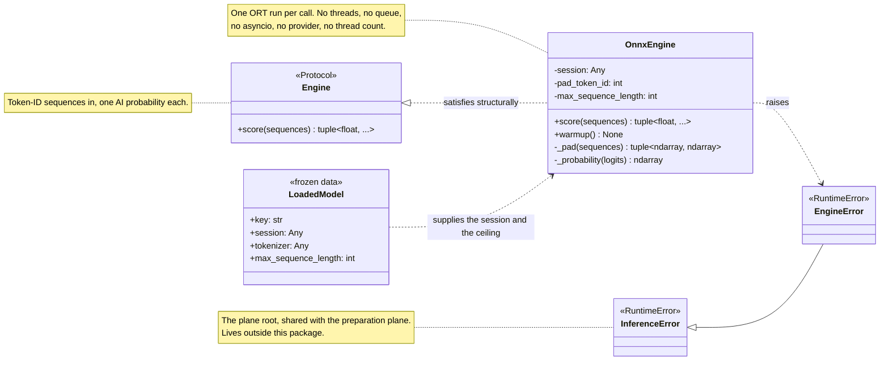
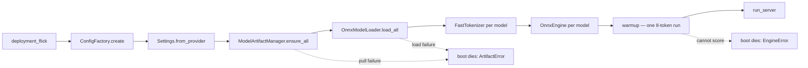
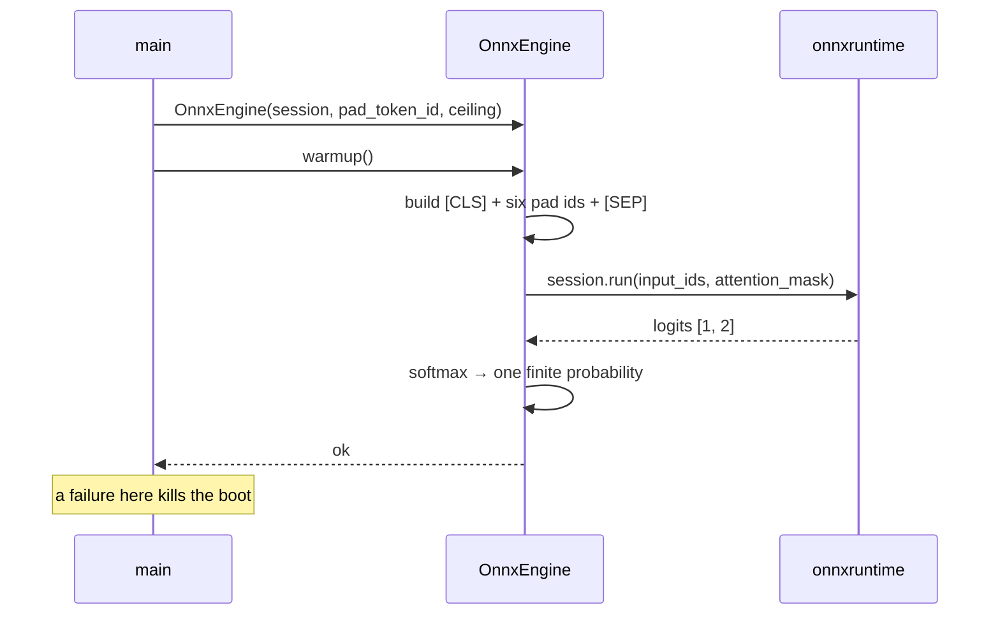
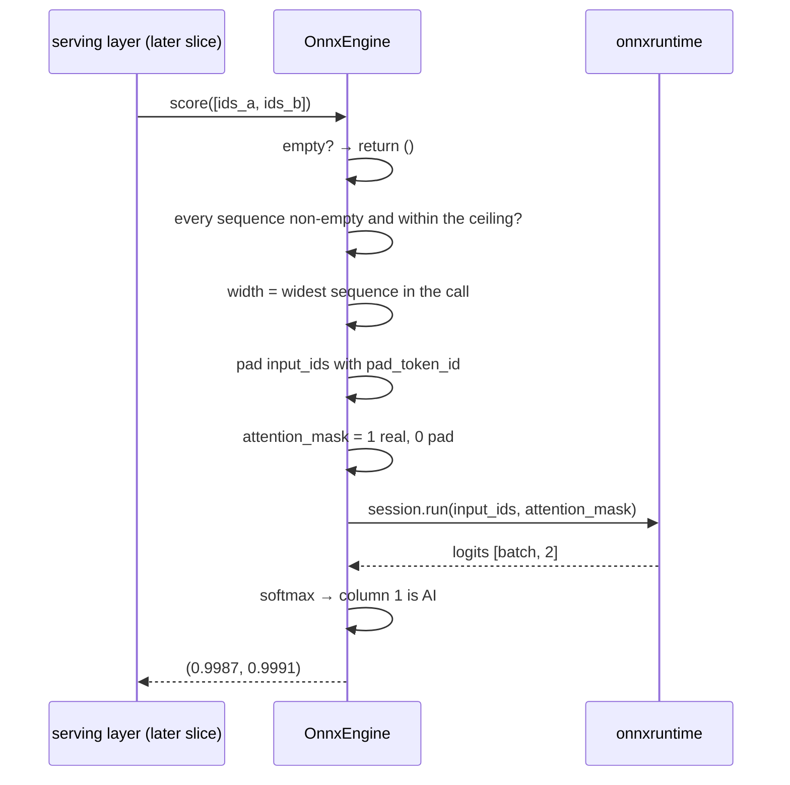
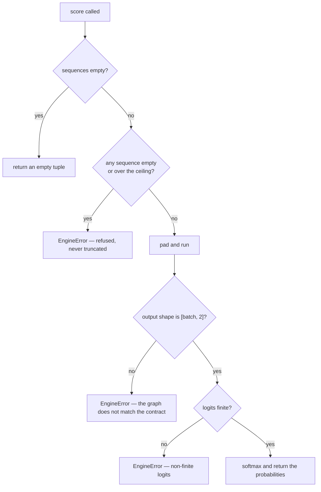

# Inference — Engine (design reference)

Status: design reference for the engine slice, implemented in
`app/inference/engine/` (the port, the ONNX adapter, the raiser),
`app/inference/errors.py` (the plane's error root), the `pad_token_id`
member added to the tokenizer port, and the boot wiring in `app/main.py`.

The engine is the middle of the pipeline: preparation hands it token-ID
sequences, it hands back one AI probability per sequence. It is the only
part of the service that talks to ONNX Runtime at inference time, and it
is deliberately ignorant of everything else — no chunks, no characters, no
documents, no threads, no queues.

The quarantined `services/inference/slop/` tree is the reference draft. Its
`engines/` package held two per-model classes behind an async port, fed by
a queue-and-worker batching proxy, and re-tokenized every chunk's text.

---

## Measured baseline

Every number below was measured against the pulled artifacts in this tree
(flare = fp32 bert-large, spark = fp16 bert-base), on 8 CPU cores with no
GPU (`onnxruntime.get_available_providers()` returns `AzureExecutionProvider`
and `CPUExecutionProvider` only; no `nvidia-smi`, no `/dev/nvidia*`). They
are the basis for the design decisions in §11.

These are **dev-box** measurements. They describe the shape of the work and
the behaviour of the libraries — not production capacity. The absolute
throughput figures say nothing about a GPU host and must not be read as
such; §10 records the matrix that settles the hardware-dependent knobs.

### The artifacts' actual signature

Both models declare the same two inputs and one output:

| Model | Inputs | Output |
| --- | --- | --- |
| flare | `input_ids` int64 `[batch, sequence]`, `attention_mask` int64 `[batch, sequence]` | `logits` float32 `[batch, 2]` |
| spark | `input_ids` int64 `[batch, sequence]`, `attention_mask` int64 `[batch, sequence]` | `logits` float32 `[batch, 2]` |

Both are `ModernBertForSequenceClassification` with `id2label {0: HUMAN,
1: AI}`. There is no `token_type_ids`. **One probability per chunk — there
is no token-level output, so the contract's `highlight_spans` are chunk-
coarse by construction.** No artifact in the tree yields finer attribution.

### Tokenizer facts

| Fact | flare | spark |
| --- | --- | --- |
| `cls_token_id` / `sep_token_id` / `pad_token_id` | 50281 / 50282 / 50283 | 50281 / 50282 / 50283 |
| `num_special_tokens_to_add(pair=False)` | 2 | 2 |
| declared sequence length | `max_length` = 512 | `model_max_length` = 8192 |

### Timing and concurrency (dev box, 8 cores, CPU EP)

One 512-token sequence, single run: spark ≈ 0.9–2.1 s, flare ≈ 2.7–2.9 s.
A 1,000,000-character document is ~303 chunks, which is minutes of engine
time — the streaming RPC exists for exactly this.

Eight chunks of 512 tokens, four strategies:

| Strategy | spark | flare |
| --- | --- | --- |
| 8 × batch 1, sequential | 11.2 s → 0.71 seq/s | 21.8 s → 0.37 seq/s |
| 1 × batch 8 | 12.3 s → 0.65 seq/s | 21.6 s → 0.37 seq/s |
| 2 × batch 4, concurrent | 9.5 s → 0.84 seq/s | 22.0 s → 0.36 seq/s |
| 4 × batch 2, concurrent | 8.5 s → 0.94 seq/s | 19.9 s → 0.40 seq/s |
| 8 × batch 1, concurrent | 8.5 s → 0.94 seq/s | 20.3 s → 0.39 seq/s |

**The batch shape barely matters; concurrency does.** One batch of 8 ≈ eight
singles, because a batch is executed as one parallel region anyway. Running
several runs concurrently is up to **+32%** for the base model, which a
single 512-token sequence does not saturate, and +5% for the large model,
which is already compute-bound. The same knob is what keeps a GPU fed.

### Library behaviour that shaped the design

| Observation | Consequence |
| --- | --- |
| ORT releases the GIL during `session.run` (verified: a ticker thread kept ticking throughout a 1.8 s run — 796 ticks/s against an idle rate of 905/s) | the engine can be synchronous and still be overlapped by the caller via `asyncio.to_thread` |
| One session in flight peaks at 14 process threads; two sessions with two runs in flight peak at 21, on 8 cores | each session carries its own intra-op pool sized to the machine — two loaded models oversubscribe the box. Owned by the loading plane (§9) |
| A `session.run` on one session is safe from several threads | concurrent requests against one session are legal, bounded by the caller's knob |

### Calibration of the shipped artifacts

Every text tried — `"hello"`, `"I went to the shop and bought milk"`, a
Python function, an academic paragraph, a model-written outline — scores
`p_ai ∈ [0.9875, 1.0]`. The logit margin varies 4.4 → 18.5 and carries the
signal, but a two-class softmax is monotonic in that margin, so **no
resolution is recoverable by any transform.** The artifacts label
everything AI. This is a property of the artifacts, not of the hardware,
and it gates every quality question in the pipeline (see §11.14).

### Context sensitivity

The same 510-token region scored with 0 / 64 / 128 / 256 tokens of
preceding context prepended:

| Context added | spark `p_ai` | spark margin | flare `p_ai` | flare margin |
| --- | --- | --- | --- | --- |
| none | 0.999993 | 11.815 | 1.000000 | 16.841 |
| +64 | 0.999984 | 11.040 | 1.000000 | 16.497 |
| +128 | 0.999955 | 10.018 | 1.000000 | 17.114 |
| +256 | 0.999962 | 10.173 | 1.000000 | 17.702 |

The verdict does not move (`p_ai` shifts by ≤ 0.00004); the raw margin
drifts by roughly ±0.8 logits. On these artifacts, context does not change
the outcome. The overlap sweep in the companion reference
(`inference-overlap.md`) therefore needs a detector that discriminates
before it can mean anything.

---

## 1. Scope

| In scope | Out of scope (later slices) |
| --- | --- |
| The engine port: token-ID sequences in, AI probabilities out | The dispatcher, the concurrency fan-out, the stream producer |
| The ONNX Runtime adapter: padding, attention mask, softmax | The batching proxy (measured: no CPU gain; see §11.3) |
| The plane's error root and the engine's raiser | Telemetry / New Relic instruments |
| The `pad_token_id` member on the tokenizer port | Provider options, thread counts, device ids (the loading plane) |
| `warmup()` and the fail-closed boot | Aggregation of chunk scores into a verdict (postprocessing) |
| Boot wiring: build one engine per loaded model, warm it, fail closed | The gRPC servicer and its registration |
| Unit tests + this design reference | A document-level or hierarchical model |

---

## 2. Mapping from the quarantined tree

| slop name | Design name | Module | Responsibility |
| --- | --- | --- | --- |
| `engines/base.py` — `BaseEngine.softmax` / `sigmoid` / `decode_logits` | `OnnxEngine._probability` | `app/inference/engine/onnx.py` | The draft's base class held a softmax, a sigmoid and three accepted output shapes. Only the two-class softmax survives, folded into the adapter — the draft's `(N,)` and `(N,1)` tolerances are dropped |
| `engines/flare.py` — `FlareEngine.predict_batch` | `OnnxEngine.score` | `app/inference/engine/onnx.py` | The draft re-tokenized each chunk's text and truncated at its own `max_length=256`. The engine now consumes the IDs preparation produced and truncates nothing |
| `engines/spark.py` — `SparkEngine.predict_batch` | **Deleted** | — | It fed a pickled sklearn TF-IDF vectorizer. Spark now ships an HF tokenizer and an ONNX transformer, so the per-model engine dies — one uniform adapter serves both artifacts |
| `ports/outbound/inference.py` — `ISyncBatchInferenceEngine` | `Engine` | `app/inference/engine/engine.py` | Narrowed from `predict_batch(texts)` to one method over token-ID sequences |
| `ports/outbound/inference.py` — `IAsyncInferenceEngine` | **Deleted** | — | The draft's async engine and the batching proxy's async wrapper. The engine is synchronous; the caller offloads it |
| `batcher.py` — `BatchingProxy` | **Deferred** | — | The queue, the linger timer, the health snapshot and the shutdown drain buy nothing measurable on CPU (§ baseline). Revisit with a GPU |
| `batching/processor.py` | **Deleted** | — | Belonged to the proxy |
| `engines/*.warmup` | `OnnxEngine.warmup` | `app/inference/engine/onnx.py` | The draft warmed each engine at boot. The warmup now proves the session executes before traffic is served |
| `engines/flare.py` — `max_length: int = 256` | **Deleted** | — | The window belongs to preparation. The engine is handed the model's declared ceiling and refuses anything longer |
| `domain/exceptions.py` — `InferenceError` | `InferenceError` | `app/inference/errors.py` | Graduated from the draft's domain package to the plane root; the engine's failure joins it |
| `domain/exceptions.py` — `InferenceError` raised by the engines | `EngineError` | `app/inference/engine/errors.py` | A typed, single-name failure for every engine fault |

---

## 3. Components

### `app/inference/errors.py` — the plane root

```python
class InferenceError(RuntimeError):
    """Root of the inference plane's failures; catch this for blanket handling."""
```

The preparation plane already had a raiser. This is where it graduates: one
root for the plane, so the serving slice maps one tree — `InvalidDocument`
to `INVALID_ARGUMENT`, `EngineError` to `INTERNAL`.

```text
app/inference/errors.py             InferenceError(RuntimeError)          ← the plane root
app/inference/preprocessing/errors.py
                                   PreprocessingError(InferenceError)
                                     └── InvalidDocument
app/inference/engine/errors.py     EngineError(InferenceError)
```

`PreprocessingError` and `InvalidDocument` keep their names and their file;
only their base class changes, so the finished preparation reference stays
accurate.

### `app/inference/engine/engine.py` — the port

```python
class Engine(Protocol):
    def score(self, sequences: Sequence[Sequence[int]]) -> tuple[float, ...]:
        """One AI probability per token-id sequence, in the same order."""
        ...
```

One method. The whole contract. No configuration, no lifecycle, no health,
no shutdown.

### `app/inference/engine/onnx.py` — the adapter

```python
class OnnxEngine:
    """Satisfies Engine structurally; the only module in this package that imports onnxruntime."""

    def __init__(
        self,
        session: Any,
        pad_token_id: int,
        max_sequence_length: int,
    ) -> None: ...

    def score(self, sequences: Sequence[Sequence[int]]) -> tuple[float, ...]: ...
    def warmup(self) -> None: ...
    def _pad(self, sequences: Sequence[Sequence[int]]) -> tuple[np.ndarray, np.ndarray]: ...
    def _probability(self, logits: np.ndarray) -> np.ndarray: ...
```

Three constructor arguments: the session, the pad token id, and the model's
declared ceiling. **No provider, no device, no thread count, no batch
size** — none of those are the engine's business.

### `app/inference/engine/errors.py` — one raiser

```python
class EngineError(InferenceError):
    """The engine could not produce a score for a well-formed request."""
```

Every engine fault is an `EngineError`: an over-length or empty sequence, a
malformed output, a non-finite logit, a failed session run, a session that
cannot execute a valid input. There is no fallback path and no default
score — a broken artifact is a boot failure, not a runtime surprise.

### `app/inference/preprocessing/tokenizer.py` — one member added

```python
class Tokenizer(Protocol):
    """The tokenizer surface the plane needs; nothing else."""

    cls_token_id: int
    sep_token_id: int
    pad_token_id: int          # ← new: the engine pads batches with it
    special_token_count: int

    def encode(self, text: str) -> Encoding:
        ...
```

`FastTokenizer` reads it alongside the other three. The engine takes a
plain `pad_token_id: int` rather than the port, so `app/inference/engine/`
imports nothing from the preparation plane and the package stands alone.
The composition reads the id through the tokenizer boundary, which keeps the
HF calling convention in one module.

---

## 4. Class diagram



The diagram is deliberately small. `LoadedModel` is the only type that
crosses in from another package, and only two of its four fields are used:
the session and the ceiling. `key` and `tokenizer` are not the engine's
business.

### Boundary rules this diagram encodes

1. **`Engine` is one method wide.** `score` is the whole contract.
   `warmup` is on the adapter, not the port, because nothing depends on its
   outcome except the boot.
2. **The engine never sees a chunk.** No `Chunk`, no `PreparedDocument`, no
   `DocumentPreprocessor` appears in this diagram, and the package imports
   none of them. The caller extracts `chunk.token_ids` and zips the results
   back by index.
3. **No `onnxruntime` or `transformers` above the adapter.** `OnnxEngine`
   imports `onnxruntime` and `numpy`. `transformers` appears nowhere in
   `app/inference/engine/`; the HF calling convention lives in
   `FastTokenizer`.
4. **The engine is provider-, thread- and device-agnostic.** It holds a
   session, not a provider name. The hardware never reaches this package.
5. **One ORT run per call.** No internal thread pool, no queue, no batching
   inside the engine. Concurrency is the caller's decision; the engine runs
   what it is handed, when it is handed it.
6. **One error root for the plane.** `InferenceError` is the root;
   `PreprocessingError` and `EngineError` are its two leaves.
7. **The tokenizer port carries exactly what the plane needs.** `pad_token_id`
   is the one member added, and only the engine's padding needs it.

---

## 5. Boot flow



The warmup is not decoration. It is the guarantee that **the service never
accepts traffic it cannot serve**: a model that loads but cannot score — a
corrupt graph, a provider that cannot execute it — dies the boot rather
than failing the first request.



The pad token is a real vocabulary entry, so the warmup exercises the whole
graph on a valid eight-token sequence at negligible cost — milliseconds
against the ~2.9 s a full 512-token sequence costs. Its output is
meaningless and discarded; only the fact that it ran matters.

---

## 6. Sequence diagrams

### Score one group



Note what is absent: no tokenizer call, no text, no chunk. Preparation
already paid the tokenization; the engine's whole job is the forward pass
and the softmax.

### The failure paths



### The method contract

```python
def score(self, sequences: Sequence[Sequence[int]]) -> tuple[float, ...]:
    """One AI probability per token-id sequence, in the same order.

    Preconditions
        every sequence is non-empty and no longer than the model's ceiling

    Postconditions
        len(result) == len(sequences)
        every value is a finite float in [0.0, 1.0]

    Raises
        EngineError  an over-length or empty sequence, a malformed output,
                     or a failed session run
    """
```

A sequence longer than the ceiling is **refused, never truncated** — a
silently shortened sequence is a different input than the caller meant.
Preparation already guarantees the bound; the check is a guard against a
future caller bypassing it.

---

## 7. Artifact consumption

The layout is the pulling reference's §7 layout; nothing changes on disk.

```
MODEL_CACHE_DIR/
├── flare/
│   └── onnx/fp32/          ← tokenizer.json + tokenizer_config.json +
│                              special_tokens_map.json + model.onnx(+data)
└── spark/
    └── onnx/fp16/          ← the same, plus config.json
```

The engine reads **no files**. It receives a session, a pad token id and a
ceiling. `tokenizer_config.json` was already read by the loader for the
declared sequence length; the pad id arrives through the tokenizer boundary
the loader built.

---

## 8. Configuration surface

**This slice adds no knobs.** That is deliberate.

| Field | Env key | Lands in | Why not here |
| --- | --- | --- | --- |
| `inference_providers` | `INFERENCE_PROVIDERS` | loading plane (done) | provider selection is the loader's job |
| `ort_intra_op_threads` | `ORT_INTRA_OP_THREADS` | loading plane (done) | thread sizing is the loader's job |
| `chunk_token_limit` | `CHUNK_TOKEN_LIMIT` | preparation plane (done) | the window is preparation's job |
| `chunk_token_overlap` | `CHUNK_TOKEN_OVERLAP` | preparation plane (companion reference) | the overlap is preparation's job |
| `max_text_chars` | `MAX_TEXT_CHARS` | preparation plane (done) | admission, not inference |
| batch size | `INFERENCE_BATCH_SIZE` | **serving slice** | the *caller* groups chunks, so the knob belongs to the caller |
| in-flight requests | `MAX_INFLIGHT_REQUESTS` | **serving slice** | admission is the caller's |

The engine is knob-free on purpose: it scores what it is given. Everything
that varies by hardware or by document lives one layer out.

---

## 9. Dependencies

- **`numpy` is promoted to a direct dependency.** It is already installed as
  a transitive dependency of `onnxruntime`, but the adapter imports it, so
  the declaration should say so. `poetry lock` refreshes the content hash.
- **`onnxruntime`** (CPU build) is already declared. The CUDA wheel arrives
  with the GPU slice and must never be installed alongside the CPU wheel.
- **`transformers` is not imported** by `app/inference/engine/`. The engine
  never tokenizes.
- **The GPU path is untouched by this slice.** Provider options — `device_id`,
  `enable_cuda_graph`, `use_tf32` — belong to the loading plane, which
  constructs the session. The engine consumes the session it is handed and
  is indifferent to how it was built.
- **The oversubscription finding is the loading plane's to fix.** Two loaded
  models with two concurrent runs peaked at 21 process threads on 8 cores
  (measured), because each session carries its own intra-op pool sized to
  the machine. `SessionOptions.use_per_session_threads = False` (one shared
  pool) or an explicit `ORT_INTRA_OP_THREADS` is the fix, and it lands
  there — not here.

---

## 10. Testing

- **`tests/unit/inference/engine/test_onnx.py`** — the adapter, with a fake
  session injected at the module (the technique
  `tests/unit/models/loading/test_loader.py` already uses):
  - the empty call returns an empty tuple and touches no session
  - padding: the width is the widest sequence in the call, the pad id fills
    the tail, the mask is 1 for real tokens and 0 for padding
  - the softmax takes column 1 of a `[batch, 2]` output
  - a wrong output shape → `EngineError`
  - non-finite logits → `EngineError`
  - an empty sequence → `EngineError`
  - a sequence longer than the ceiling → `EngineError`, and the session is
    not called
  - a failed `session.run` → `EngineError` wrapping the cause
  - `warmup` runs exactly one session call and accepts a valid result
  - a session that raises on warmup → `EngineError`
- **`tests/unit/inference/engine/test_engine.py`** — the port: the protocol
  surface, and that `OnnxEngine` satisfies it structurally.
- **`tests/unit/inference/preprocessing/test_tokenizer.py`** — the new
  member: the adapter reads `pad_token_id`, and the shipped tokenizers
  report 50283.
- **Artifact-backed tests** (skipped when `models/` is absent, as the
  preparation tests already do): score a real chunk and assert one finite
  probability in `[0,1]` per sequence, and that the result matches the
  tokenizer's own vocabulary. **The observed values are reported, not
  asserted** — see §11.13.
- **Integration** — the boot fails when a model cannot score. That is the
  fail-closed guarantee, and it is the one behaviour worth pinning at the
  boot boundary.

Run with `make test-unit`; `make test-integration` when the boot changed.

---

## 11. Defaults taken (override if any read wrong)

1. **The engine takes a plain `pad_token_id: int`, not the tokenizer port**,
   so `app/inference/engine/` imports nothing from the preparation plane
   and the package stands alone. The alternative — passing the port — keeps
   one tokenizer object flowing through the composition but couples the
   package to a sibling for the sake of one integer.
2. **`PreprocessingError` and `InvalidDocument` keep their names and their
   file**; only their base class changes to `InferenceError`. The
   alternative — one plane-level `app/inference/errors.py` holding all four
   errors, mirroring `app/models/errors.py` — is cleaner on paper but edits
   the finished preparation reference's module map.
3. **The engine is synchronous.** No `async` anywhere in the package. ORT
   releases the GIL, so the caller offloads it with `asyncio.to_thread`.
4. **One ORT run per call.** The engine does not split its input across
   threads and does not own a pool. Concurrency is the caller's; the
   measurements put the gain there, not in the batch shape.
5. **Strict `[batch, 2]` output shape.** The draft's `(N,)` and `(N,1)`
   tolerances are dropped: both artifacts agree, and a divergent one is a
   broken artifact, not something to degrade around at runtime.
6. **Padding is to the widest sequence in the call**, not to a fixed
   bucket. Compute-honest today. If CUDA graphs are enabled later in the
   loading plane, they require static shapes and this rule becomes
   fixed-shape buckets — it moves with them, deliberately, not by accident.
7. **A plain `tuple[float, ...]`** — no named result type. The caller zips
   results back to chunks by index, and a wrapper would add a field nothing
   reads.
8. **`warmup()` is on the adapter, not the port**, because only the boot
   depends on its outcome.
9. **The warmup input is `[CLS] + six pad ids + [SEP]`** — the pad token is
   a real vocabulary entry, so the graph runs end to end for a few
   milliseconds.
10. **An over-length sequence is refused, never truncated.**
11. **No fallback path and no default score.** Every engine fault is an
    `EngineError`.
12. **No knobs in this slice.** The batch size and the in-flight limits
    belong to the serving slice, and their values are hardware-dependent
    and belong in the config plane, not in a code default.
13. **The tests pin correctness, never throughput.** No assertion may
    encode a seq/s figure, a latency, or a preferred batch size — those are
    machine-dependent, they would fail on a different host, and they would
    mislead whoever reads them. The artifact-backed tests report observed
    values instead.
14. **The shipped artifacts' calibration is an open question, and it gates
    every quality decision downstream.** Every text scores ~99.9% AI, so no
    window, no overlap and no aggregation rule can be evaluated against
    them — the verdict is AI by construction. This must be raised with the
    model owner (is the label mapping inverted? is the export degenerate? is
    there a working build?) before the pipeline's quality decisions are
    settled. The engine is unaffected either way: it returns raw
    probabilities and applies no threshold.
15. **The hardware-dependent knobs are measured on the prod host, not
    derived from a dev box.** The matrix that settles them:

    ```text
    provider:    CPU | CUDA+CPU-fallback   (plus a per-node placement check)
    batch size:  1, 8, 32, 64
    concurrency: 1, 2, 4 runs in flight
    measure:     seq/s, p50/p95 per chunk, GPU util, CPU%, process threads
    ```

    From that: `INFERENCE_BATCH_SIZE`, `MAX_INFLIGHT_REQUESTS`,
    `ORT_INTRA_OP_THREADS`, `ORT_INTER_OP_THREADS`, per-model limits. The
    values live in the config plane; nothing in the code hard-codes them.
