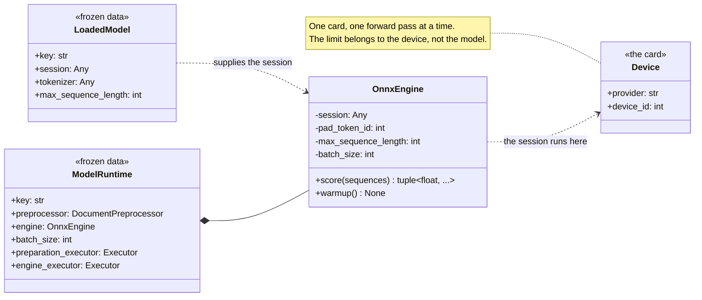
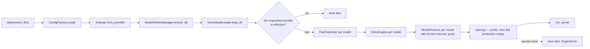
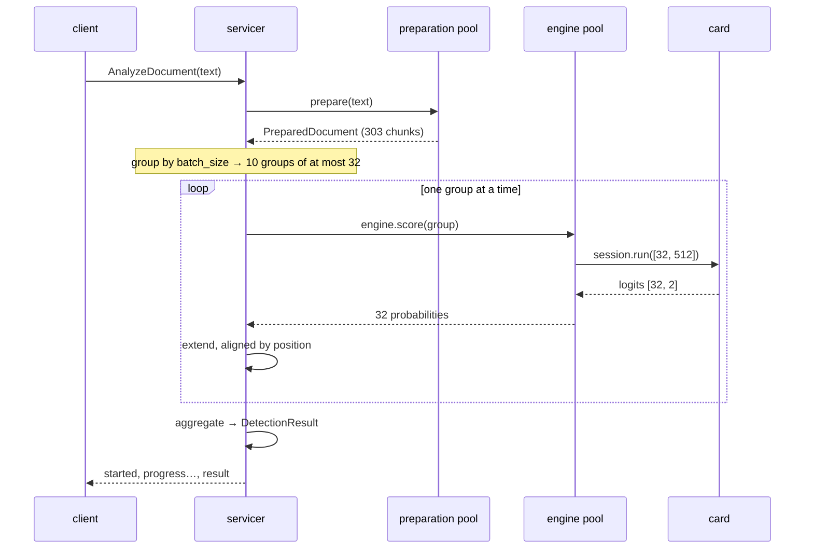
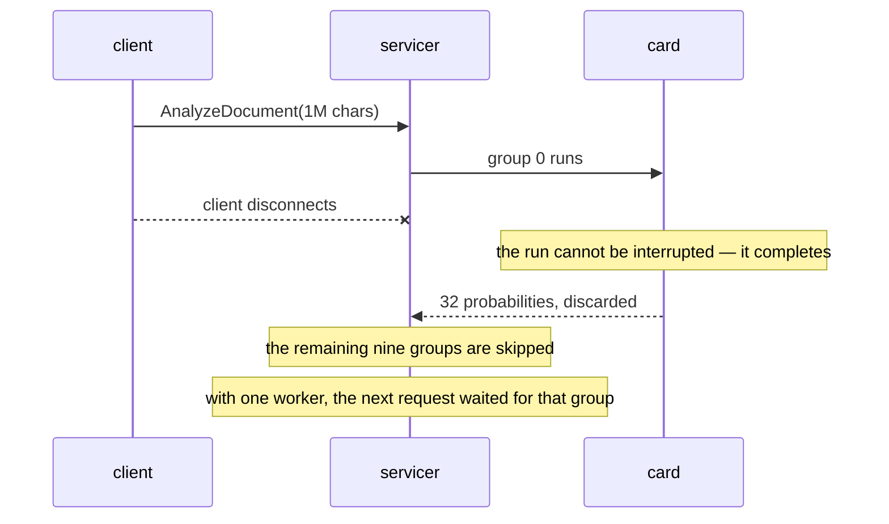

# Inference — GPU (design reference)

Status: design reference for the GPU slice. It covers the batch economics,
the concurrency model, the executor pools, the deployment shape and the
prerequisites that have to land before any of it runs. The engine's own
contract is in the companion reference (`inference-engine.md`); this
document is about the hardware the engine runs on and what that hardware
changes.

The premise is a deployment with a GPU, not the dev box. Every measurement
in `inference-engine.md` was taken on 8 CPU cores with no device, and
**the two most consequential conclusions in that reference do not survive
the move.** This document says which ones, why, and what replaces them.

Nothing here changes the engine's port, its adapter's arithmetic or the
preparation plane's rules. The engine is deliberately indifferent to how
its session was built; this document is mostly about what has to be built
*around* it.

---

## Measured baseline

### The CPU measurement, restated

From `inference-engine.md`, on 8 CPU cores with the CPU execution provider:

| Strategy | spark | flare |
| --- | --- | --- |
| 8 × batch 1, sequential | 11.2 s → 0.71 seq/s | 21.8 s → 0.37 seq/s |
| 1 × batch 8 | 12.3 s → 0.65 seq/s | 21.6 s → 0.37 seq/s |
| 2 × batch 4, concurrent | 9.5 s → 0.84 seq/s | 22.0 s → 0.36 seq/s |
| 4 × batch 2, concurrent | 8.5 s → 0.94 seq/s | 19.9 s → 0.40 seq/s |
| 8 × batch 1, concurrent | 8.5 s → 0.94 seq/s | 20.3 s → 0.39 seq/s |

The conclusion drawn from it was *"the batch shape barely matters;
concurrency does"*, and it is correct — **for the CPU execution provider.**
The reason is structural: the CPU EP parallelises *within* one run across
the eight cores, so a batch of eight is executed as one parallel region
and costs about what eight singles cost.

### The three effects a device has and a CPU does not

| Effect | On a device | On the CPU EP |
| --- | --- | --- |
| **Weight re-read** | Every run re-reads the weights from device memory. flare is 335M parameters — 1.34 GB at fp32 — so a 24 GB card spends ~2.2 ms per weight sweep at ~600 GB/s. A batch amortises that sweep over N sequences. | The weights sit in the host's cache and are re-read by the same cores doing the arithmetic; there is no separate bandwidth budget to amortise |
| **Kernel launch overhead** | A BERT-large forward is ~24 layers × ~8–12 ops ≈ 250–300 device launches at ~5 µs each — ~1.5–2.5 ms of overhead **per run, independent of batch size**. Thirty-two separate runs pay it thirty-two times; one run of thirty-two pays it once. | There is no launch phase; the overhead is thread scheduling inside the intra-op pool |
| **Small-GEMM under-utilisation** | At batch 1 × 512 tokens a 125 TFLOPS device runs at single-digit percent of peak — the GEMMs are too small to fill it. | One 512-token sequence already occupies all eight cores |

### The inversion

| | Batch width | Concurrent runs | Where the win is |
| --- | --- | --- | --- |
| **CPU** | 1–2 — batch 8 was the *worst* measured | 4–8 — the measured +32% | concurrency |
| **GPU** | 16–64 | 1 | batch width |

The same knob means opposite things on the two hardware paths. This is the
single most important consequence of the move, and it is why the batch
size is a configuration value with a CPU-safe default rather than a
constant chosen once.

### The memory envelope

```
device memory ≈ concurrent_runs × batch_size × per_sequence_activation
              + model weights
```

Concurrency multiplies activation memory. A card that holds one batch of
32 comfortably may not hold four concurrent batches of 32 — and four
concurrent runs on one card time-slice anyway, so the extra memory buys
no throughput.

### Why the dev box cannot settle any of this

The dev box has no device: `onnxruntime.get_available_providers()` returns
`AzureExecutionProvider` and `CPUExecutionProvider` only. Every number the
batch size and the concurrency limit depend on is a property of the card,
the model and the runtime build. **They are measured on the prod host.**
What the dev box can settle is the shape of the code — which is what the
engine reference does.

---

## 1. Scope

| In scope | Out of scope |
| --- | --- |
| The batch economics, and why the CPU conclusions invert | The engine's contract and arithmetic (`inference-engine.md`) |
| The batch-size knob: one value per model, and the method that settles it | The grouping of chunks into batches — the caller owns it |
| The concurrency model: three levels, two executor pools, the per-device limit | The servicer, its admission control and its progress events |
| The provider prerequisites: fail closed on a silent CPU fallback | The loading plane's provider options — `device_id`, `enable_cuda_graph`, `use_tf32` |
| The `onnxruntime-gpu` wheel swap | The Terraform that places the tasks on the cards |
| The deployment shape: one model per card | The batching proxy — the next slice, described in §11 |
| The cancellation gap and its remedy | The window size, the overlap and the aggregation rule |
| The sweep method | A claim about the throughput numbers — they do not exist yet |

## 2. Mapping from the quarantined tree

| slop name | Design name | Module | Responsibility |
| --- | --- | --- | --- |
| `BatchingProxy` — a queue of per-chunk predictions | **Deferred to the next slice** | — | The draft queued *texts* one at a time and grouped them at run time. The new pipeline already hands the engine whole token-ID groups, so the queue's job is narrower: pooling chunks **across** requests so a small document can still fill a batch. It lands with the servicer, where the contract's queue semantics live |
| `BatchingProxy.max_concurrent_batches` | `max_concurrent_batches` | serving slice | The draft's semaphore becomes the width of the engine executor pool. Same quantity, a different mechanism |
| `BatchingProxy.batch_timeout` (the linger) | the linger, later | next slice | Only meaningful once the queue pools across requests. A per-request grouping needs no linger — it would only add latency |
| `settings.batch_size_for(model_key)` | `Settings.batch_size_for(model_key)` | `app/config/settings.py` | **Kept.** One batch size per model, with a global fallback. The draft's per-model override was on the proxy's queue depth; here it overrides the engine's guard |
| `session_options.py` — the ORT session tuning | the loading plane's knobs | `app/models/loading/` | `ORT_INTRA_OP_THREADS` already exists. The draft's `ORT_INTER_OP_THREADS`, `ORT_GRAPH_OPT_LEVEL` and `ORT_EXECUTION_MODE` are candidates for the GPU slice, not for this one |
| the draft's `INFERENCE_MAX_WORKERS` | the engine executor's width | `app/inference/runtime.py` | The draft sized one pool for everything. The new design has two pools, because preparation and inference want opposite things from one |

## 3. Components

### The batch size — one value per model

Two models, two shapes:

| Model | Architecture | Artifact | Per-sequence activation | The trade |
| --- | --- | --- | --- | --- |
| flare | bert-large, 335M | **fp32** | several times spark's | compute-heavy, so it saturates sooner — a smaller batch is enough, and fp32's memory argues for one too |
| spark | bert-base, 110M | fp16 | small | launch-overhead-bound, so it gains the most from a wide batch |

The starting sweep, at the production 512-token window on a 24 GB card:

| Model | Batch sweep | Concurrency | Likely winner |
| --- | --- | --- | --- |
| flare | 8, 16, 32, 64 | 1 | 16–32 |
| spark | 16, 32, 64, 128 | 1 | 32–64 |

**These are sweep points, not answers.** The selection rule and the method
are in §10.

### The two executor pools

| Pool | Work | Releases the GIL | Sized by |
| --- | --- | --- | --- |
| `preparation_executor` | tokenizing, planning, encoding chunks | yes (Rust) | the CPU cores — generous |
| `engine_executor` | `session.run` | yes | the device: **one** worker on a GPU, four to eight on a CPU |

Two pools, never one. A shared pool lets a burst of long tokenizations
occupy every slot and starve the engine, which leaves the card idle while
threads churn. The pools are per model and live on the runtime bundle, so
the sizing sits next to the model it belongs to.

**The default executor is a trap.** `asyncio.to_thread` uses the loop's
default `ThreadPoolExecutor`, whose width is `min(32, os.cpu_count() + 4)`.
On a GPU host with 8 vCPUs that is **12 workers** — enough to put twelve
concurrent forward passes on one card, which multiplies the activation
memory twelve-fold and buys no throughput, because the card time-slices
them anyway. The engine pool is therefore explicit and sized, and the
caller uses `run_in_executor(model.engine_executor, ...)`, not
`asyncio.to_thread`.

### The concurrency limits

Three levels, and they stack:

| # | Limit | Knob | Bounds |
| --- | --- | --- | --- |
| 1 | Requests in flight | `maximum_concurrent_rpcs` on the gRPC server | the work admitted |
| 2 | Blocking calls at once | the engine executor's width, per model | threads, and the device's memory |
| 3 | Groups per request | a per-request cap in the dispatcher | one request's share of the pool |

Limit 1 is best placed on the gRPC server itself, where exceeding it
produces `RESOURCE_EXHAUSTED` natively — the status the contract already
specifies for a saturated pool.

Limit 3 exists for fairness: without it, a 1M-character document (303
chunks, ten groups) occupies every worker in the pool while a 500-character
document (one group) waits behind it.

### The limit is per device, not per model

flare and spark have **separate sessions** but would share one card. Two
executors of one worker each still put two concurrent runs on that card —
the contention and the doubled memory return, across models.

Three ways out, in order of preference:

| Option | Effect |
| --- | --- |
| **One model per card** | cleanest — each model gets its own card and its own limit of one, and the two scale independently |
| One executor shared across both models | one run at a time on the shared card, but the models also serialise against each other |
| `device_id` per session (the loading plane) | two cards, two models, no contention |

One model per card is the recommendation, and the reason is not only
scaling: it is that the concurrency accounting becomes honest. A limit that
is per model but that a device can break is not a limit.

### Sequential or concurrent within a request

The groups are independent — chunk 0–31 and chunk 32–63 do not depend on
each other, and the results are realigned by position — so nothing forces
them to be sequential.

| | Device | CPU |
| --- | --- | --- |
| Within a request | **one group at a time** — concurrent runs on one card time-slice and multiply the activation memory | **up to the per-request cap** — overlapping independent runs is the measured +32% |

This is the difference between two shapes of the same call, and it is a
caller decision, not an engine one.

### The provider check must fail closed

Today `OnnxModelLoader._log_effective_providers` only **warns** when the
effective provider list is missing a requested one, and the runtime warns
rather than raises. So on a host without the GPU wheel, or with a provider
the build does not carry:

> `INFERENCE_PROVIDERS=CUDAExecutionProvider` boots healthy, serves
> traffic, and runs on the CPU at a small fraction of the speed — while the
> health check reports `SERVING`.

On a GPU service that is a silent production incident that looks healthy
in every dashboard. The requested provider must be **effective** or the
boot must fail. That is the loading plane's fix, and it is a prerequisite,
not an enhancement.

### The wheel swap

`onnxruntime-gpu` replaces `onnxruntime` and must never be installed
alongside it. The GPU wheel is a superset — it falls back to the CPU
provider — so one image serves both node types, at the cost of the CPU
wheel's marginally leaner install. The runtime version is pinned at 1.31.1,
which requires CUDA 12.x and cuDNN 9.x.

### The artifact precision is the larger lever

flare ships as **fp32**. On a device, fp32 runs at roughly half the fp16
tensor-core rate — or about twice that with TF32 enabled. An **fp16 build
of flare** would roughly double the large model's throughput and halve its
activation memory, which is a bigger win than any batch tuning and moves
the batch ceiling with it.

That is an artifact decision, not an engine one: `FLARE_MODEL_DIR` pins
the build directory and the repo pins the revision, so a new build is a
new artifact and a new revision. It is raised with the model owner
alongside the calibration question (`inference-engine.md` §11.14) — and
that question is the more important one, because a detector that labels
everything AI is not worth twice the speed.

Until an fp16 build lands, every number here is the fp32 number.

## 4. Class diagram



The diagram carries one idea: **the concurrency limit belongs to the
device.** A model cannot know it is sharing a card, and a per-model limit
that a card can break is not a limit.

## 5. Boot flow



The provider check is the one step the CPU boot does not have. It sits
**after the load**, because the effective provider list is only knowable
once a session exists, and **before the bundle is built**, because a card
that is not there makes the whole deployment pointless — better to learn
that at boot than to serve traffic at a fraction of the speed.

## 6. Sequence diagrams

### One request, one card



At any instant: one thread occupied, one forward pass in flight, one
request's worth of the card. Other requests interleave at the `await`
points — they do not run in parallel.

### The cancellation gap



The runtime has no cancellation, so an abandoned request spends its whole
engine budget on results nobody will read. With one worker on the card, it
stalls every other request behind it. The remedy is at the serving
boundary: **cancel between groups rather than during one**, and keep a
spare worker so an abandoned run does not block the queue.

## 7. Artifact consumption

Nothing changes on disk. The layout is the pulling reference's §7 layout.

**The window is fixed, which is what makes batching cheap.** Preparation
emits every chunk at the same window length except the first (no context
prefix) and the last (possibly short). So a batch is already near-uniform
and needs no length bucketing or sorting — the preparation plane's fixed
window is what removes that work from the engine.

**The artifact's precision bounds the batch ceiling.** flare's fp32 build
has roughly twice the activation footprint of an fp16 one at the same
sequence length, so its ceiling is correspondingly lower. See §3.

## 8. Configuration surface

| Field | Env key | Default | Role |
| --- | --- | --- | --- |
| `inference_batch_size` | `INFERENCE_BATCH_SIZE` | `8` | The engine's guard — the widest call it accepts; the global fallback for the per-model overrides |
| `flare_batch_size` | `FLARE_BATCH_SIZE` | unset → global | The per-model override |
| `spark_batch_size` | `SPARK_BATCH_SIZE` | unset → global | The per-model override |
| `inference_providers` | `INFERENCE_PROVIDERS` | `CPUExecutionProvider` | Provider preference — **must be effective, or the boot fails** |
| `ort_intra_op_threads` | `ORT_INTRA_OP_THREADS` | `0` | The intra-op pool; 1–2 on a card, the core count on a CPU host |
| `max_inflight_requests` | `MAX_INFLIGHT_REQUESTS` | — | The gRPC server's `maximum_concurrent_rpcs` |
| `max_concurrent_batches` | `MAX_CONCURRENT_BATCHES` | — | The width of the engine executor pool: **1 on a card** |
| `ort_device_id` | `ORT_DEVICE_ID` | `0` | Which card the session binds to — the loading plane's, and the lever that makes "one model per card" expressible |

**The default is the CPU-safe value.** The measured CPU behaviour says
batch shape barely matters but a long single run holds a thread longer and
hurts tail latency, so small-and-concurrent wins there. The sweep moves it
up. A default is never the answer to a hardware question.

`INFERENCE_PROVIDERS` and `ORT_INTRA_OP_THREADS` are **missing from
`secrets.toml`'s `[ssm].keys`** today, so prod cannot request a device at
all. That gap predates this document and is a prerequisite for it. The new
knobs need the same treatment.

## 9. Dependencies

- **`onnxruntime-gpu` replaces `onnxruntime`.** Never both. The GPU wheel
  is a superset and falls back to the CPU provider, so one image serves
  both node types.
- **The runtime version is pinned** at 1.31.1, which requires CUDA 12.x and
  cuDNN 9.x. The image's CUDA and cuDNN versions are part of the runtime
  contract, not of the application.
- **No new application dependency.** The engine, the loader and the config
  plane all work with either wheel. The only change is which wheel the
  image installs.
- **The engine's imports do not change.** `onnxruntime` appears in exactly
  one module, the loader — and the engine adapter imports it only for its
  types.

## 10. Testing

**The sweep is not a test.** It is a measurement to run once, on the prod
host, with the real artifacts. It produces the batch size, the
concurrency limit and the intra-op thread count.

### The method

```text
provider:    CUDAExecutionProvider, on the target card
window:      512 (the production chunk window)
batch size:  1, 8, 32, 64, 128        (per model)
concurrency: 1                         (the card serialises anyway)
measure:     chunks/s, p50/p95 per chunk, peak device memory,
             device utilisation %, host RSS
```

### The selection rule

> **The smallest batch within ~95% of the best observed throughput.**

A wider batch only costs memory and adds tail latency to the final partial
batch — a 303-chunk document is ten runs of 32 and one of 15, and that
last run is paid for in full. Beyond the knee, the batch buys nothing the
narrower one did not already buy.

### What is pinned in code

Nothing about throughput, latency or the batch size's value. Those are
machine-dependent; a test that encoded them would fail on a different
host and would mislead whoever read it. The tests pin the **rules**:

- the guard refuses an over-wide call and does not touch the session
- the per-model override resolves against the global fallback
- the executor pools are distinct objects and are per model
- the boot fails when the requested provider is not effective
- the warmup runs the production shape

## 11. Defaults taken (override if any read wrong)

1. **The batch size is one value per model, with a global fallback.**
   flare is the large model in fp32 and gets the narrower batch; spark is
   small and fp16 and gets the wider one.
2. **The default batch size is the CPU-safe value (8), not a GPU claim.**
   It is the value that is safe until the sweep arrives.
3. **One concurrent forward pass per card.** Concurrent runs on one card
   time-slice and multiply the activation memory; they buy no throughput
   and cost the memory budget. On the CPU the same knob is 4–8, because
   there the concurrency is the win.
4. **The concurrency limit is per device, not per model.** Two models
   sharing a card each limited to one run still put two runs on the card.
   The cleanest resolution is one model per card.
5. **Two executor pools, never one.** Preparation is CPU work that
   releases the GIL; the engine is device work that does not. Sharing a
   pool lets tokenization starve the card.
6. **The engine pool is explicit, and `asyncio.to_thread` is not used for
   it.** The default executor's width is a function of the vCPU count, and
   on a GPU host that is the wrong number in the dangerous direction.
7. **The requested provider must be effective, or the boot fails.** A
   silent fallback to the CPU is a silent 30× slowdown that reports itself
   as healthy.
8. **The warmup runs the production shape.** The eight-token probe proves
   the graph executes; only a run at the real batch width and window
   length pre-warms the kernels the service will use.
9. **Cancellation happens between groups, never during one.** The runtime
   cannot interrupt a run, so the remedy is at the serving boundary. A
   spare worker keeps an abandoned run from blocking the queue.
10. **The artifact's precision is left as it ships.** flare stays fp32
    until an fp16 build exists. It is the larger lever, but it is an
    artifact decision and the model owner's to make.
11. **The calibration question outranks the throughput question.** A
    detector that labels everything AI is not worth twice the speed, and
    no batch size or concurrency limit changes that. The GPU budget is
    better spent on a detector that discriminates.
12. **The batching proxy stays deferred to the next slice.** It is where
    small documents get a full batch, and it belongs with the servicer
    where the contract's queue semantics already live. Until it lands,
    the GPU is filled by large documents alone.
