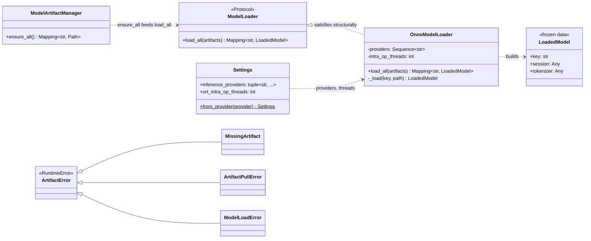
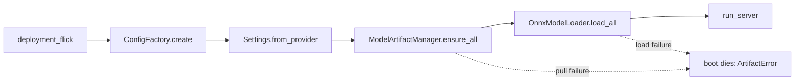
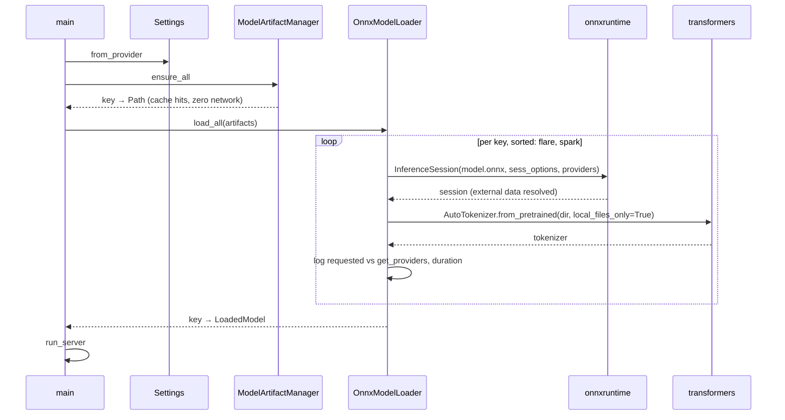
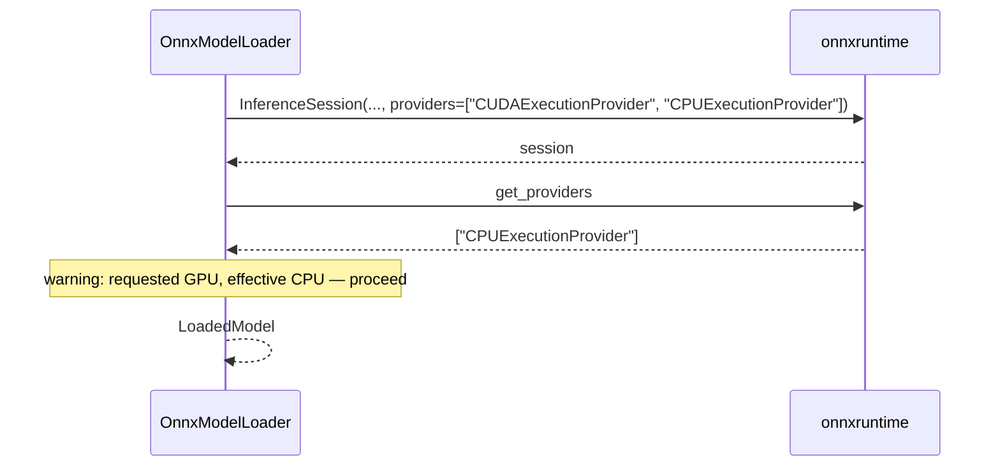
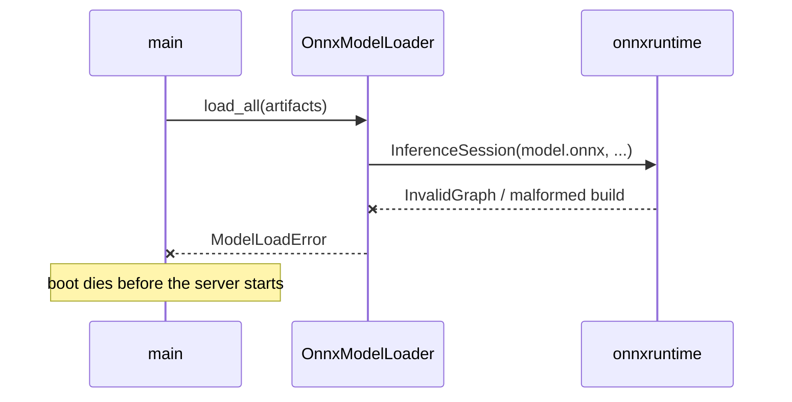

# Inference — Model Loading (design reference)

Status: design reference for the model-loading slice, implemented in
`app/models/loader.py` (port), `app/models/onnx.py` (adapter), and the
`app/main.py` boot wiring.

The quarantined `services/inference/slop/` tree is the reference draft. Its
`HuggingFaceLoader` mixed pulling, ONNX session building, tokenizer loading,
and provider verification. The pulling slice already carved pulling out; this
slice builds the remainder, consuming what `ensure_all()` produced.

Both models are ModernBERT ONNX exports — flare is fp32 bert-large, spark is
fp16 bert-base — and both ship HF-format tokenizers (`tokenizer.json`). One
uniform load path serves both; no per-model branches.

---

## 1. Scope

| In scope | Out of scope (later slices) |
| --- | --- |
| ONNX session building from the pulled artifact dir | Engines (`predict_batch`) and the engine contract |
| HF tokenizer construction, strictly offline | Batching proxy and warmup (warmup needs dummy inputs — engine-adjacent) |
| Effective-provider verification and logging | Chunking (planner, sliding window, aggregation) |
| Boot wiring: load after pull, before serve; fail-closed | gRPC health gating on model readiness |
| Config knobs: providers, intra-op threads | Telemetry / New Relic provider-fallback metrics |
| Unit tests + this design reference | Artifact checksums / integrity verification |
| | Pruning old revisions / garbage collection |
| | GPU (onnxruntime-gpu) — CPU-only this slice |

## 2. Mapping from the quarantined loader

| slop name | Design name | Module | Responsibility |
| --- | --- | --- | --- |
| `HuggingFaceLoader._load_spark` / `_load_flare` | One uniform `_load(key, path)` | `app/models/onnx.py` | Both builds share `model.onnx` + an HF tokenizer; the per-model if/else dies |
| `hf_hub_download` / `snapshot_download` + offline fallback | **Deleted** | — | Loading consumes `ensure_all()`'s paths; the hub lives only in the pull plane |
| `RestrictedUnpickler` | **Deleted** | — | Both models ship HF tokenizers; no pickle in the load path |
| `build_session_options` | Settings knobs + fresh `SessionOptions` per session | `app/config/settings.py`, `app/models/onnx.py` | Providers + intra-op threads only; `0` = leave ORT's default |
| `provider_verifier.verify_providers` | Provider logging inside the adapter | `app/models/onnx.py` | Requested vs effective; warning on mismatch; no telemetry hooks |

## 3. Components

### `app/models/loader.py` — the port + result

```python
@dataclass(frozen=True)
class LoadedModel:
    key: str
    session: Any    # ort.InferenceSession; typed by the serving slice's engine contract
    tokenizer: Any  # HF fast tokenizer

class ModelLoader(Protocol):
    def load_all(self, artifacts: Mapping[str, Path]) -> Mapping[str, LoadedModel]:
        """Build every pulled model; first failure aborts with ModelLoadError."""
```

The loader never sees the hub, the repo, or the revision — the path is the
contract. `ensure_all()`'s output (`key → <root>/<key>/<artifact_dir>`) is
`load_all()`'s input, unchanged.

### `app/models/onnx.py` — the adapter

Named after what it consumes, mirroring the plane's library-named-adapter
convention (`huggingface.py`). The only module importing `onnxruntime` and
`transformers`.

```python
_ONNX_MODEL_FILENAME = "model.onnx"

class OnnxModelLoader:
    """Satisfies ModelLoader structurally; runtime failures surface as ModelLoadError."""

    def __init__(self, providers: Sequence[str], intra_op_threads: int = 0) -> None: ...

    def load_all(self, artifacts: Mapping[str, Path]) -> Mapping[str, LoadedModel]:
        # Sorted keys for deterministic logs; fail-fast on the first failure.

    def _load(self, key: str, path: Path) -> LoadedModel: ...
```

Three shared steps, composed once:

1. **Session step** — `ort.InferenceSession(str(path / _ONNX_MODEL_FILENAME),
   sess_options, providers=list(self._providers))`. A fresh `SessionOptions`
   per session (they are not safe to share). `intra_op_num_threads` set only
   when `> 0`; `0` leaves ORT's default.
2. **Tokenizer step** — `AutoTokenizer.from_pretrained(str(path),
   local_files_only=True)`. Strictly offline: ModernBERT resolves from
   `tokenizer_config.json` without `trust_remote_code`. A hub round-trip in
   the load path is a bug.
3. **Verify step** — log requested vs `session.get_providers()` plus load
   duration, per model. Mismatch → loud warning, proceed (see defaults).

External data (`model.onnx.data`) resolves automatically: ORT reads it
relative to the onnx file, and the pull contract lands both in the same dir.
No special handling; verified once during implementation.

### `app/models/errors.py` — one more raiser

```
ArtifactError (root, RuntimeError) — catch this for blanket handling
├── MissingArtifact        (pull plane)
├── ArtifactPullError      (pull plane)
└── ModelLoadError         session build or tokenizer load failed
```

`ModelLoadError` joins the existing tree so `main.py` catches `ArtifactError`
once around pull + load. Checksum/shape verification stays a future
`ArtifactIntegrityError` (pulling reference, §3).

### `app/config/settings.py` — two knobs

```python
_EXECUTION_PROVIDERS = frozenset({
    "CPUExecutionProvider",
    "CUDAExecutionProvider",
    "TensorrtExecutionProvider",
    "ROCMExecutionProvider",
})

inference_providers: tuple[str, ...] = ("CPUExecutionProvider",)
ort_intra_op_threads: int = 0
```

- `inference_providers`: before-validator splits CSV, strips, drops empties,
  dedupes preserving order. Any unknown name, or an empty result, raises —
  fail-closed: a typo'd provider kills the boot instead of silently handing
  you CPU. Pure string constants; `settings.py` never imports onnxruntime.
- `ort_intra_op_threads`: the existing `_positive_int_or_default(value,
  default=0)`. Garbage or `<= 0` → `0` = leave ORT's default. This knob earns
  its place because two sessions each grabbing every core oversubscribes a
  pod. Nothing else from slop's knob surface (inter-op, graph-opt level,
  execution mode, mem pattern, cpu arena) is wired until a profile demands it.

## 4. Class diagram



Boundary rules: `loader.py` imports nothing heavy — the port and the result
stay pure. Only `onnx.py` imports `onnxruntime` and `transformers`, exactly as
only `huggingface.py` imports `huggingface_hub`. Wiring happens once, in
`main.py`.

## 5. Boot flow



`InferenceSession` and `AutoTokenizer` are blocking; the boot runs them on the
loop before the server starts, so there is nothing to starve — the same
rationale as the pull plane. Sequential is fine at boot; parallelizing two
session builds is a trivial later win.

## 6. Sequence diagrams

### Boot: warm volume, both models



### Provider mismatch: loud warning, proceed



### Permanent load failure: fail-closed boot



## 7. Artifact consumption

The pulling reference's §7 layout is what the loader reads; nothing changes on
disk.

```
MODEL_CACHE_DIR/
├── flare/
│   └── onnx/fp32/          ← ensure_all path; model.onnx + model.onnx.data +
│                              tokenizer.json + tokenizer_config.json +
│                              special_tokens_map.json
└── spark/
    └── onnx/fp16/          ← same, plus config.json
```

- `load_all()` input is exactly `ensure_all()` output: `key →
  <root>/<key>/<artifact_dir>`.
- Hub bookkeeping (`.cache/huggingface/`) is never touched by the loader.
- `model.onnx` is hardcoded in the adapter — the artifact-build contract, the
  same file name the pull specs already pin.

## 8. Configuration surface

Env keys are the uppercase field names (`Settings.from_provider` contract).

| Field | Env key | Default | Role |
| --- | --- | --- | --- |
| `inference_providers` | `INFERENCE_PROVIDERS` | `CPUExecutionProvider` | CSV of ORT execution providers, order = preference |
| `ort_intra_op_threads` | `ORT_INTRA_OP_THREADS` | `0` (ORT default) | Per-session intra-op threads; `0` = leave ORT's default |

## 9. Dependencies

- `onnxruntime` (CPU build) and `transformers` added to
  `services/inference/pyproject.toml`; `transformers` pulls `tokenizers`.
  Verify wheels exist for the pinned Python `^3.14` before pinning.
- `onnxruntime` is CPU-only; the CUDA EP requires `onnxruntime-gpu`, which
  arrives with the GPU slice, not this one.
- The only ORT surface used: `InferenceSession`, `SessionOptions`,
  `get_providers`. Slop's `GraphOptimizationLevel`/`ExecutionMode` maps stay
  unwired.

## 10. Testing

- `tests/unit/models/test_loader.py` — monkeypatch
  `onnxruntime.InferenceSession` and `transformers.AutoTokenizer` at the
  adapter module (the same technique `test_huggingface.py` uses for the hub):
  - happy path: session built with providers + options, tokenizer called with
    `local_files_only=True`, returns `key → LoadedModel`
  - `intra_op_threads=0` leaves ORT's default threads untouched
  - session build failure → `ModelLoadError` carrying the model key
  - tokenizer failure → `ModelLoadError` carrying the model key
  - provider mismatch logs a warning and proceeds
  - fail-fast: first failure aborts the walk
- `tests/unit/config/test_settings.py` — provider CSV split/strip/dedupe with
  order preserved, unknown provider → `ValueError`, blank → `ValueError`,
  garbage threads → `0`, valid threads pass through.
- No integration tests this slice — loading needs real ORT and real
  artifacts; the integration tree drives the production boot only. Run with
  `make test-unit`.

## 11. Defaults taken (override if any read wrong)

1. Uniform load path for both models — no per-model branches; a future
   divergence adds per-key step overrides, not subclasses.
2. Loading is strictly offline (`local_files_only=True` everywhere); the pull
   plane owns every hub interaction.
3. Provider mismatch → loud warning, proceed — not fail-closed. Revisit if a
   config/pod mismatch should kill the boot instead.
4. Settings validates provider names against a pure-string frozenset; config
   never imports onnxruntime.
5. Intra-op threads only; inter-op, graph-opt level, execution mode, and mem
   pattern stay out until a profile demands them.
6. Warmup is deferred to the serving slice — it needs dummy input
   construction, which is engine-adjacent, not loading.
7. `LoadedModel.session` / `.tokenizer` are `Any` until the serving slice
   defines the engine contract that types them.
8. Sorted-key iteration for deterministic load logs.
9. A fresh `SessionOptions` per session; never shared across sessions.
10. `model.onnx` is the hardcoded artifact-build contract in the adapter.
