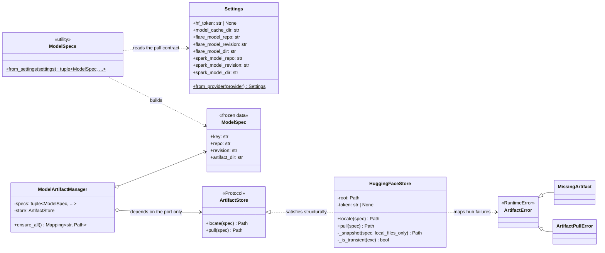
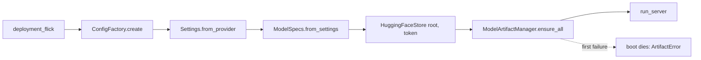
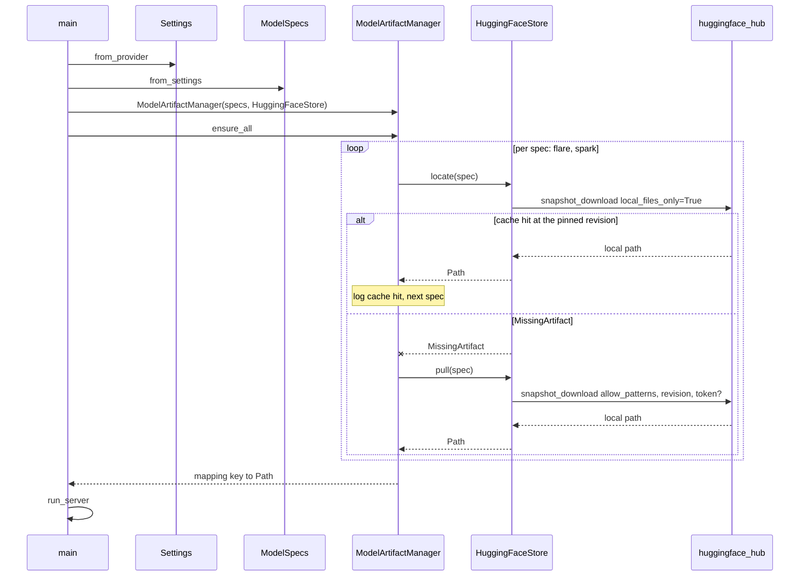
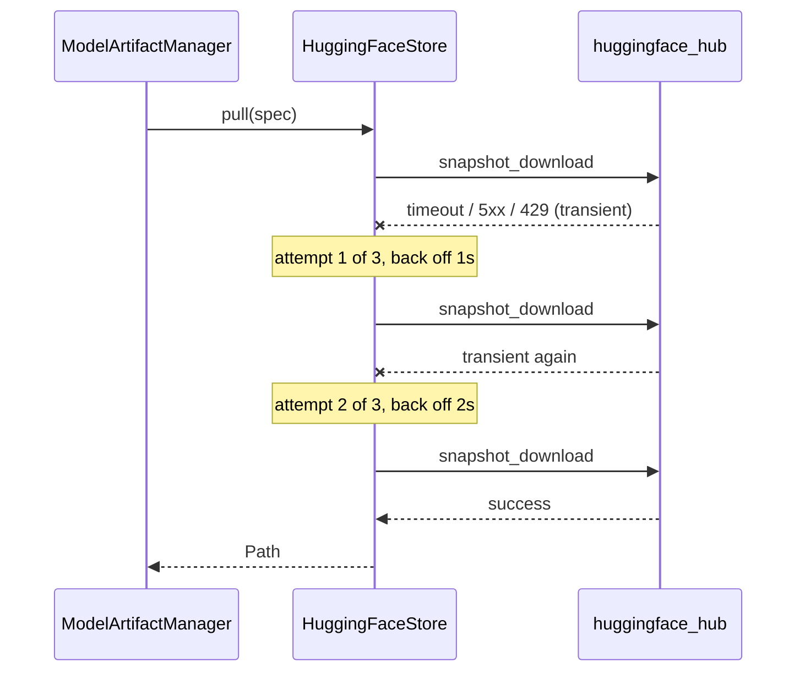
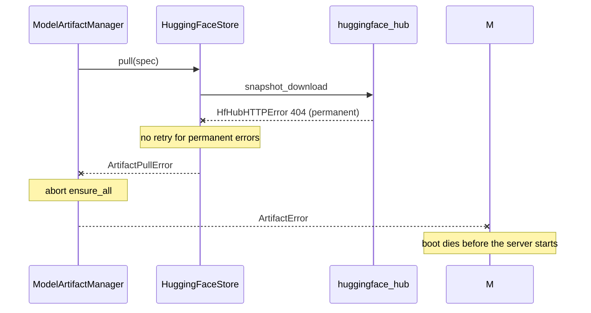

# Inference — Model Pulling (design reference)

Status: design reference for the model-pulling slice. Not yet implemented; the
`app/` service today is the config plane plus the health-only gRPC bootstrap.

The quarantined `services/inference/slop/` tree is the reference draft. Its
`HuggingFaceLoader` mixed pulling, ONNX session building, tokenizer
unpickling, and provider verification. This slice splits the pulling concern
out and builds only that.

---

## 1. Scope

| In scope | Out of scope (later slices) |
| --- | --- |
| Per-model pull specification (repo, pinned revision, artifact dir) | ONNX session building, tokenizer unpickling |
| "Do we need to pull?" check against the local volume | gRPC health gating on model readiness |
| Hub pull with auth, transient-error retries, typed failures | Provider verification and telemetry |
| Storing artifacts under the volume root | Pruning old revisions / garbage collection |
| Boot wiring: pull before the server starts | Multi-pod shared-volume fan-in |

## 2. Mapping from the rough LLD

| Rough LLD name | Design name | Module | Responsibility |
| --- | --- | --- | --- |
| Model artifact manager (orchestrator) | `ModelArtifactManager` | `app/models/pulling/manager.py` | Decides cache-hit vs pull per spec; fail-fast orchestration |
| Model config class | `ModelSpec` + `ModelSpecs.from_settings` | `app/models/pulling/spec.py` | Pure data: key, repo, revision, artifact dir |
| HF adapter (pull, auth, disk) | `HuggingFaceStore` | `app/models/pulling/huggingface.py` | The only module that imports `huggingface_hub` |
| "Check if we need to pull" | `ArtifactStore.locate()` probe | `app/models/pulling/store.py` | Typed port; the manager never touches the hub |

## 3. Components

### `app/models/pulling/spec.py` — `ModelSpec`

Frozen pydantic model, no I/O. The revision SHA validation already lives in
`Settings` (`_revisions_are_full_pinned_shas`), so the spec stays thin.

```python
class ModelSpec(BaseModel, frozen=True):
    key: str          # "spark" | "flare"
    repo: str         # "kpisolkar24/detect-ai-spark"
    revision: str     # pinned 40-char git SHA
    artifact_dir: str # in-repo dir, e.g. "onnx/fp16"
```

`ModelSpecs.from_settings(settings) -> tuple[ModelSpec, ...]` builds one spec
per model from the Settings pull contract.

### `app/models/pulling/store.py` — the port

```python
class ArtifactStore(Protocol):
    def locate(self, spec: ModelSpec) -> Path:
        """Offline resolve; raises MissingArtifact when absent."""

    def pull(self, spec: ModelSpec) -> Path:
        """Fetch from the hub; returns the local artifact dir."""
```

### `app/models/pulling/manager.py` — `ModelArtifactManager`

Holds specs + store. `ensure_all()` walks each spec: `locate` first (cache
hit → log and skip), `pull` on miss. First failure aborts the walk and raises
a typed error — the boot dies before serving, matching `main.py`'s existing
fail-closed posture. The workers that pull in parallel are daemonic: a failure
must not wait out a sibling's multi-gigabyte download before the process can
exit.

### `app/models/pulling/huggingface.py` — `HuggingFaceStore`

- Constructor takes `root: Path` + `token: str | None`, wired from Settings in
  `main.py`. No env reads inside the adapter.
- `locate`: an offline probe that never reaches the hub. Each file's
  recorded commit hash — the hub's own download metadata, written beside the
  file — is compared against the pinned revision; a file that is not cached, or
  that belongs to another commit, is a `MissingArtifact`. The hub hands back a
  cached file even when it came from another commit, so without this check a
  volume that outlived a revision bump would keep serving the old build under
  the new pin.
- `pull`: `hf_hub_download` per file with the pinned revision, 3 attempts with
  linear backoff. Transient errors (timeouts, 5xx, 429) retry; permanent ones
  (401/403/404, disk) do not. Hub errors are mapped to the typed vocabulary
  below — callers never see `HfHubHTTPError`.
- Auth: the token is passed only when set; public repos need none.
- Free from the hub: per-file locks, `.incomplete` partial-download resume,
  ETag HEADs when a revision is already cached.

### Error vocabulary (`app/models/errors.py`)

Two raisers in this slice (adapter + manager), so a shared module is
justified, matching the `app/config/errors.py` pattern.

```
ArtifactError (root, RuntimeError) — catch this for blanket handling
├── MissingArtifact     locate() probe: not present at that revision (control signal, not a crash)
├── ArtifactPullError   pull failed after retries: auth, repo missing, disk full
└── ArtifactIntegrityError  (future) checksum / shape verification
```

## 4. Class diagram



Boundary rules: `ModelSpecs` and `ModelArtifactManager` import nothing from
`huggingface_hub`. Only `HuggingFaceStore` does. Wiring happens once, in
`main.py`.

## 5. Boot flow



`snapshot_download` is blocking; the boot runs it on the loop before the
server starts, so there is nothing to starve. If a later slice ever needs
in-request pulls, that call moves behind `asyncio.to_thread` — the store
stays synchronous by design.

## 6. Sequence diagrams

### Boot: mixed cache states



### Pull with transient retries



### Pull with a permanent failure: fail-closed boot



## 7. On-disk layout

`pull` uses hub `local_dir` mode, not the default `~/.cache/huggingface` blob
store: the loader slice wants plain file paths for ONNX Runtime and
`BertTokenizerFast.from_pretrained`, and the volume itself is the persistence
boundary.

```
MODEL_CACHE_DIR/                 ./models dev | mounted volume docker | /models EKS EBS
├── flare/
│   ├── onnx/fp32/               artifact_dir mirrored from the repo
│   │   └── ...                  build files at the pinned revision
│   └── .cache/huggingface/      hub bookkeeping: revisions, ETags, locks
└── spark/
    ├── onnx/fp16/
    │   └── ...
    └── .cache/huggingface/
```

- `pull(spec)` returns `<root>/<key>/<artifact_dir>` — the path the loader
  slice will consume.
- `.cache/huggingface/` is hub-owned; never read or cleaned by service code.
- Interrupted pulls resume: the hub finishes `.incomplete` files on the next
  probe/pull; a partially downloaded dir never reports as a cache hit.
- `models/` is already in `services/inference/.gitignore`.

## 8. Volume compatibility

The only contract is a directory path from Settings.

| Plane | Mount | `MODEL_CACHE_DIR` |
| --- | --- | --- |
| dev | plain directory inside the checkout | unset → `./models` (default) |
| docker | external/named volume | `/models` |
| EKS prod | EBS PV (RWO) mounted at `/models` | `/models` (seeded via tfctl/SSM) |

One EBS volume is RWO → one pod, so there is no cross-pod stampede to worry
about at this scale; the hub's per-file locks cover single-process re-entrancy.

## 9. Configuration surface

Env keys are the uppercase field names (`Settings.from_provider` contract).

| Field | Env key | Default | Role |
| --- | --- | --- | --- |
| `model_cache_dir` | `MODEL_CACHE_DIR` | `./models` | Volume root |
| `hf_token` | `HF_TOKEN` | `None` | Private-repo auth; blank seed = unset |
| `enabled_models` | `ENABLED_MODELS` | `spark` | The models this process serves — `spark`, `flare`, or both. It filters the specs, so a process pulls, loads and answers for exactly these. One model per process is what makes the one-model-per-card shape expressible |
| `flare_model_repo` / `revision` / `dir` | `FLARE_MODEL_*` | pinned | Flare pull contract |
| `spark_model_repo` / `revision` / `dir` | `SPARK_MODEL_*` | pinned | Spark pull contract |

## 10. Dependencies

- `huggingface_hub` added to `services/inference/pyproject.toml` — nothing in
  the live app depends on it yet; only quarantined `slop/` does.
- slop's hub imports came from the 0.x era (`huggingface_hub.utils`); verify
  the 1.x import paths (`huggingface_hub.errors`) when pinning.

## 11. Testing

- `tests/unit/models/pulling/test_specs.py` — specs built from settings; one per model;
  values flow through unchanged.
- `tests/unit/models/pulling/test_manager.py` — stub store: hit skips the pull, miss
  pulls, first failure aborts the walk; returns key→path mapping.
- `tests/unit/models/pulling/test_huggingface.py` — hub functions monkeypatched at the
  module attribute: transient retries then success, permanent error → no retry,
  token pass-through, probe behavior, returned path shape.
- No integration tests this slice — pulling needs real network; the
  integration tree drives the production boot only.
- Run with `make test-unit`.

## 12. Defaults taken (override if any read wrong)

1. Whole-dir snapshot per spec (`allow_patterns=[f"{artifact_dir}/*"]`), not
   an explicit file list — assumes `onnx/fp32` / `onnx/fp16` dirs hold only
   the build. Verify repo contents during implementation; add `ignore_patterns`
   for junk if needed.
2. Probe-first: a warm volume boots with zero network calls.
3. Boot-time pull, not lazy pull at first inference.
4. Layout keyed by model key (`<root>/<key>/`), not repo suffix, so two builds
   from one repo cannot collide.
