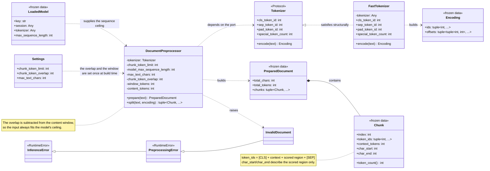
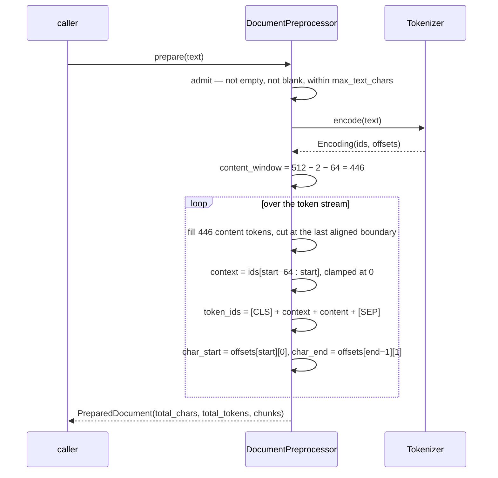
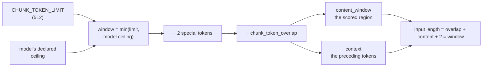
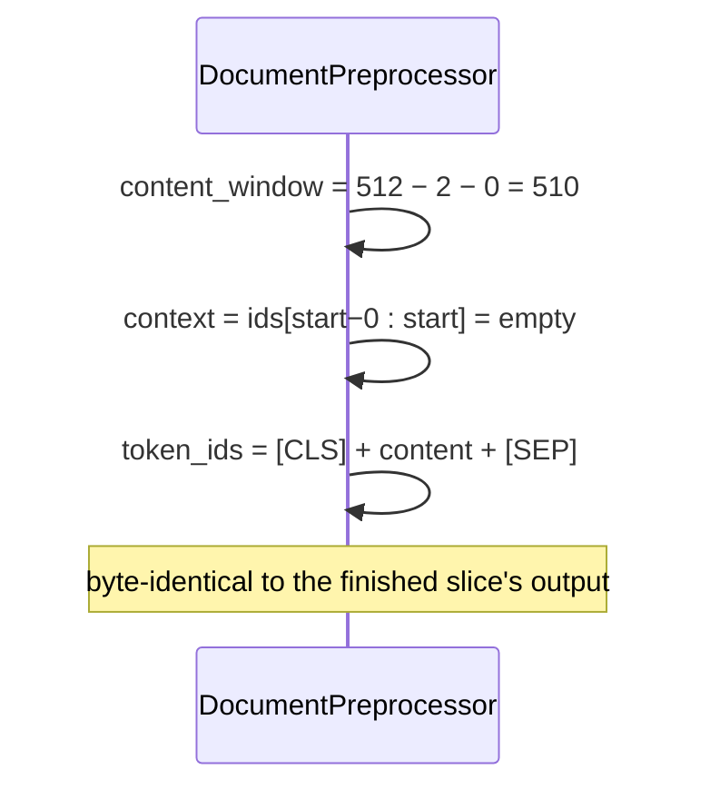
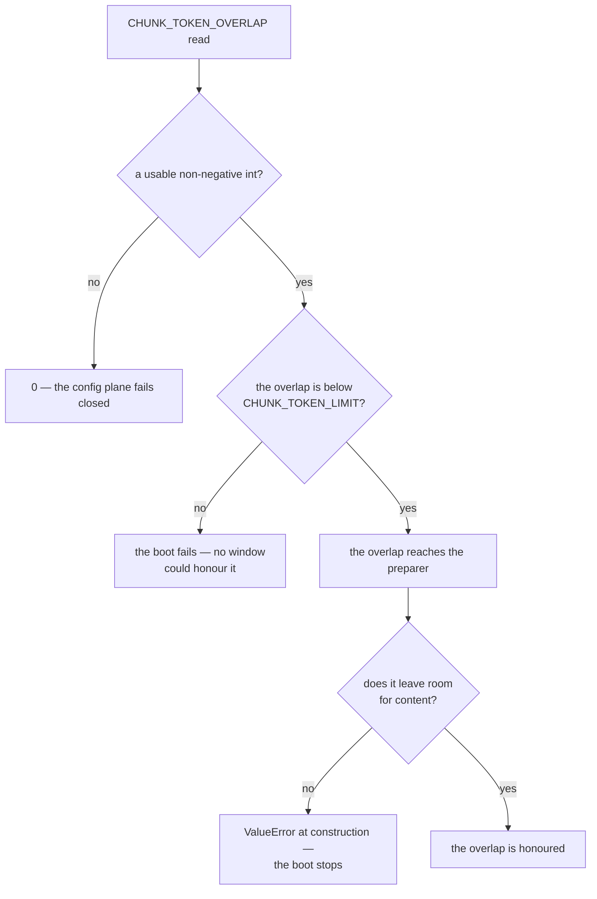

# Inference — Chunk Overlap (design reference)

Status: design reference for the overlap amendment to the preparation
plane, implemented in `app/config/settings.py` (the `chunk_token_overlap`
knob), `app/inference/preprocessing/chunk.py` (the `context_tokens` member
added to `Chunk`) and `app/inference/preprocessing/preprocessor.py` (the
context-prefix construction and the validation of the knob).

This is an amendment to the finished preparation slice, not a replacement
of it. The chunking rule, the cut points and the admission bounds are
unchanged. What changes is that a chunk's **model input may now carry
tokens of preceding context**, and that the amount is a config value
rather than a fixed decision.

The quarantined `services/inference/slop/` tree had a `CHUNK_TOKEN_STRIDE`
knob — a fixed-stride sliding window over a uniform grid. It was deleted
when the preparation slice replaced sliding with boundary-aligned cuts.
This reference reintroduces the *idea* of overlap, with a different
mechanism and a different purpose.

---

## Measured baseline

Every number below was measured against the pulled artifacts in this tree
(flare = fp32 bert-large), on 8 CPU cores with no GPU. The token count —
1,000,000 characters → 154,472 tokens — is the preparation reference's own
figure and is reproduced here so the chunk arithmetic is traceable.

### How often does a cut land somewhere arbitrary?

A "hard cut" is a chunk boundary that is neither a sentence end nor a line
start — the case where content could in principle be split mid-sentence.
Measured with the real preprocessor over the real flare tokenizer:

| Input | Chunks | Hard cuts |
| --- | --- | --- |
| 11 prose documents (the inference specs, the web docs, `AGENTS.md`) | 92 | **0 (0.0%)** |
| Source code with no sentence marks | 5 | 0 (0.0%) — the line-start rule catches it |
| One 4,000-character run-on sentence | 2 | **1 (100%)** |
| Minified JSON, no punctuation | 12 | **11 (100%)** |

So on prose the boundary is *always* natural. The residual case is text
with neither sentence punctuation nor line breaks, or a single sentence
longer than the window.

### What context is worth

The same 510-token region scored with 0 / 64 / 128 / 256 tokens of
preceding context prepended moved `p_ai` by ≤ 0.00004 and the raw logit
margin by roughly ±0.8 logits. On the shipped artifacts, **context does
not change the verdict** — because those artifacts label everything AI
(the engine reference's baseline: `p_ai ∈ [0.9875, 1.0]` across every text
tried). The sweep this knob exists to enable therefore needs a detector
that discriminates before it can mean anything.

### The chunk arithmetic

1,000,000 characters → 154,472 tokens. `content_window = 512 − 2 −
overlap`, so the overlap is paid for in *fewer scored tokens per chunk* and
therefore in *more chunks*:

| Overlap | Content window | Chunks (≈) | vs today |
| --- | --- | --- | --- |
| 0 | 510 | 303 | — |
| 32 | 478 | 324 | +7% |
| 64 | 446 | 347 | +14% |
| 128 | 382 | 405 | +34% |
| 256 | 254 | 609 | +101% |

Chunk counts are `ceil(tokens / content_window)`; the alignment rule can
add a few. These are engine-time costs: every extra chunk is another
forward pass.

---

## 1. Scope

| In scope | Out of scope |
| --- | --- |
| The `chunk_token_overlap` knob: fail-closed to 0 when unparseable, a boot failure when out of range | Overlapping **scored regions** (see §2) |
| The context prefix in a chunk's model input | The aggregation rule (postprocessing) |
| `Chunk.context_tokens` — how much of the input is context | The window size itself (`CHUNK_TOKEN_LIMIT`) |
| The reduced content window that pays for the context | Any change to the engine (it is unaffected) |
| The restated round-trip test | A change to the cut rule or the boundary set |

---

## 2. Two readings of "overlap"

The knob has two possible meanings, and they are not the same thing.

**(A) The model input overlaps; the scored regions stay disjoint.**
Each chunk's *input* is `overlap` tokens of preceding context followed by
its own region. The chunk's **scored region** is still its own region, and
the regions continue to tile the document exactly.

**(B) The scored regions overlap.** The classic sliding window: every
region is scored more than once and the scores are averaged over the
coverage.

| | (A) input overlaps | (B) regions overlap |
| --- | --- | --- |
| Scored regions | disjoint, tile the document | overlap → coverage-weighted merge |
| Aggregation | stays a plain weighted mean | needs the draft's delta-array |
| The contract's non-overlapping `highlight_spans` | falls out for free | still satisfiable, with more machinery |
| A sentence split anywhere? | the **scored** region never is; the context prefix starts mid-sentence on purpose | yes, the region edges cut mid-sentence |
| What it isolates | whether context helps the model | context *and* score-averaging at once |

**This reference implements (A).** It answers the question the knob exists
to ask — *does the model judge better with context?* — without changing
the aggregation at the same time, and it keeps the property the finished
preparation slice earned: no sentence is ever split in the **scored**
region. (B) remains available later, and the aggregation change it requires
is confined to postprocessing.

The context prefix, on the other hand, does start mid-sentence — on purpose.
It is the tail of the previous chunk's scored region, cut at an arbitrary
token index, so the model reads one *contiguous* stream of text: the
sentence the chunk opens in the middle of, carried in from behind. A
boundary-snapped context is not reachable inside a fixed token budget:
snapping forward lands on the previous chunk's own cut, which yields a
one-token context, and snapping backward extends the context past the knob
and past the model's ceiling. The "no split sentence" property that matters
is the one on the scored side, because that is what the contract's spans
point at.

Note what (A) does **not** buy: it does not give the model more of the
document than one window holds. A 510-token chunk with 64 tokens of
overlap still shows the model 510 tokens. **Overlap buys context at the
seams; the window buys document context** — spark declares 8,192, flare
512. They are different levers, and the window is the one that answers
"how do I judge a 1,000,000-character document".

### The budget is shared

The overlap and the scored content come out of the same budget: the content
window is `window − special_token_count − overlap`, so a chunk's input
always fits the model's declared ceiling — and the price of the context is
fewer scored tokens per chunk, and therefore more chunks (the baseline table
above).

So the knob moves two things at once: more context for the model, and less
content per chunk to judge. A sweep that holds `CHUNK_TOKEN_LIMIT` fixed
does **not** hold the scored region fixed, and therefore measures the two
together and cannot say which one moved the verdict.

A clean sweep holds the *scored* region fixed and lets the input grow:
`CHUNK_TOKEN_LIMIT = 512 + overlap` keeps 510 scored tokens per chunk while
the context grows. That needs a window larger than the model's declared
ceiling, so it is possible on spark (8,192) and impossible on flare (512,
where the loader clamps the window to the model's own limit). **The knob
means something slightly different on each model**, and only spark can
answer "does the context help?" on its own.

---

## 3. Mapping from the quarantined tree

| slop name | Design name | Module | Responsibility |
| --- | --- | --- | --- |
| `CHUNK_TOKEN_STRIDE` | `chunk_token_overlap` | `app/config/settings.py` | The draft's stride is the inverse quantity, and it slid over a uniform grid. The knob here counts **tokens shared with the previous chunk**, and the grid stays aligned to sentence boundaries |
| `chunking/sliding_window.py` — `build_sliding_chunks` | **Deleted** | — | A fixed stride over arbitrary token positions. The cut rule of the preparation slice still decides where a chunk ends |
| `chunking/planner.py` — stride arithmetic | folded into `DocumentPreprocessor` | `app/inference/preprocessing/preprocessor.py` | The content window shrinks by the overlap; the context prefix is prepended to the input |
| `domain/models.py` — `DocumentChunk` | `Chunk` | `app/inference/preprocessing/chunk.py` | The draft carried text and no IDs. `Chunk` now also carries `context_tokens` |
| `application/services/aggregation.py` — the delta-array merge | **Not needed** | — | Under (A) the scored regions stay disjoint, so the plain weighted mean still applies |

---

## 4. Components

### `app/config/settings.py` — the knob

```python
# The chunk overlap: tokens shared with the previous chunk, so a chunk's
# model input carries context its scored region does not. 0 = no overlap.
CHUNK_TOKEN_OVERLAP_DEFAULT = 0
```

```python
chunk_token_overlap: int = CHUNK_TOKEN_OVERLAP_DEFAULT
```

The knob has two rules, and each lives where it can be seen.

**An unparseable value fails closed to 0**, following the `grpc_port` and
`chunk_token_limit` pattern: a garbage or negative value becomes 0, so a
bad seed never widens or shrinks the window unpredictably. Zero is a legal
value here — it is the default and the identity — so the coercion is
non-negative, not positive.

**An out-of-range value fails the boot.** A value the window could never
honour is a misconfiguration, not an unparseable seed, and the house
pattern for a parseable value that contradicts a contract is a boot
failure: an unknown provider name and a malformed model revision both take
the boot down rather than falling back to something else. Silently running
with no overlap when the operator asked for one is the same lie as silently
running on the CPU when CUDA was requested.

The config plane can bound the overlap against the only window it can see:
the window is `min(CHUNK_TOKEN_LIMIT, the model's ceiling)`, so it can never
exceed `CHUNK_TOKEN_LIMIT`, and no model could honour an overlap at or
above it.

```text
chunk_token_overlap=1919 is not usable: the chunk window is at most
CHUNK_TOKEN_LIMIT=512 tokens, so the overlap must be less than it
```

That bound is necessary, not sufficient. The exact one needs the model's
ceiling, which only the preparer has: there an overlap that would leave no
room for content **fails loudly**, raising `ValueError` at construction,
exactly as an unusable window already does, so the boot stops rather than
producing meaningless chunks. The largest usable overlap is
`window − special_token_count − 1`:

| Window | The largest usable overlap |
| --- | --- |
| 512 (flare's declared ceiling, and the default limit) | 509 |
| 8192 (spark's declared ceiling, with the limit raised to match) | 8189 |

Nothing clamps. A silent clamp is a lie about what the knob is doing.

### `app/inference/preprocessing/chunk.py` — one member added

```python
@dataclass(frozen=True)
class Chunk:
    """One analysable window: the token IDs to feed the model and the text span they came from."""

    index: int
    token_ids: tuple[int, ...]   # includes [CLS] ... [SEP]; may carry a context prefix
    context_tokens: int           # leading tokens that are context, not scored
    char_start: int               # the scored region only
    char_end: int                 # the scored region only

    @property
    def token_count(self) -> int:
        """The sequence length the model sees, special tokens included."""
        return len(self.token_ids)
```

`char_start` / `char_end` continue to describe **the scored region**, so
the regions still tile the request text and the contract's non-overlapping
spans still fall out. `context_tokens` says how much of `token_ids` is
context, so a consumer can tell where the scored region begins inside the
input.

The field is not decoration: the chunk's `token_ids` is now a *mixture* —
the context and the scored content are one sequence of IDs — and without a
marker the chunk cannot say which part of it was judged. The producer
publishes the split rather than leaving the consumer to reconstruct it. It
is a count and not a span: the context's character span is not carried,
because nothing needs it. The scored region already has one, and the
context is only ever the tokens immediately before it.

### `app/inference/preprocessing/preprocessor.py` — the arithmetic

```python
def __init__(
    self,
    tokenizer: Tokenizer,
    chunk_token_limit: int,
    model_max_sequence_length: int,
    max_text_chars: int,
    chunk_token_overlap: int = 0,
) -> None:
    ...
    window = min(chunk_token_limit, model_max_sequence_length)
    if window < MIN_SEQUENCE_LENGTH:
        raise ValueError(...)
    self._window_tokens = window
    self._content_tokens = window - tokenizer.special_token_count - chunk_token_overlap
    if self._content_tokens < 1:
        raise ValueError(...)   # the overlap left no room for content
```

The content window shrinks by the overlap, so the **input always fits the
model's ceiling**: `overlap + content_window + specials == window`.

The chunk itself:

```python
context_start = max(0, start - self._overlap)
context_ids = ids[context_start:start]

token_ids = (
    self._tokenizer.cls_token_id,
    *context_ids,
    *ids[start:end],
    self._tokenizer.sep_token_id,
)
char_start = offsets[start][0]
char_end = offsets[end - 1][1]
context_tokens = len(context_ids)
```

The first chunk of a document has no preceding context, so its
`context_tokens` is 0 — the prefix is clamped at the document start.

---

## 5. Class diagram



The engine package does not appear in this diagram, and it is not affected:
it receives token-ID sequences and never learns where they came from.

---

## 6. Sequence diagrams

### Preparing with an overlap of 64



### The arithmetic, in one picture



### Overlap 0 is the identity



### The fail-closed path



---

## 7. Configuration surface

| Field | Env key | Default | Role |
| --- | --- | --- | --- |
| `chunk_token_overlap` | `CHUNK_TOKEN_OVERLAP` | `0` | Tokens of preceding context carried in a chunk's model input; `0` is the current behaviour |
| `chunk_token_limit` | `CHUNK_TOKEN_LIMIT` | `512` | The total sequence length per chunk, special tokens included — unchanged, and the ceiling the overlap is subtracted from |

`CHUNK_TOKEN_OVERLAP` must be added to `secrets.toml`'s `[ssm].keys` or it
never reaches prod, exactly as `CHUNK_TOKEN_LIMIT` was, and to
`infra/.env.example` for the dev plane. The field has to exist before the
seeded value does anything: `from_provider` is consume-first, so a seeded
key with no matching field is silently ignored.

The knob is **inert until the artifacts discriminate** — with everything
scoring ~99.9% AI, every overlap value yields the same document verdict.
That is the point of making it a knob: the sweep becomes a config change
once a working detector exists.

---

## 8. Testing

- **`tests/unit/config/test_settings.py`** — the knob: the default is 0, a
  valid value passes through, an unparseable or negative value fails closed
  to 0, and an out-of-range value fails the boot. `0` is a *legal* seed
  here, unlike every other knob: the "invalid seed" list for the others
  includes `"0"`, and this one must not.
- **`tests/unit/inference/preprocessing/test_preprocessor.py`** — the
  construction and the arithmetic:
  - the content window is the window minus the special tokens minus the
    overlap
  - the input length never exceeds the window, and is exactly the window for
    every chunk but the first
  - an overlap that leaves no content room fails at construction, with the
    numbers in the message
  - the overlap is honoured when it is usable
- **The overlap-0 identity** — with the knob at 0, the preprocessor's
  output is identical to the finished slice's: the same chunk count, the
  same token ids, the same char spans, and `context_tokens == 0` everywhere.
  This is the non-regression test, and it is the one that must not be
  dropped.
- **The context prefix** — the chunk's input begins with `overlap` tokens
  of the preceding content; the first chunk of a document has none; the
  prefix is clamped at the document start.
- **The scored region is untouched** — `char_start` / `char_end` describe
  the scored region only, and consecutive chunks still tile the text with
  no gap and no overlap, whatever the knob says.
- **The restated round-trip test** — the artifact-backed assertion becomes:

  ```text
  decode(token_ids[1 : 1+context_tokens])      == text[char_start − context_chars : char_start]
  decode(token_ids[1+context_tokens : −1])     == text[char_start : char_end]
  ```

  With `context_tokens == 0` the second half is the finished slice's
  assertion unchanged, and the first is vacuous.
- **The sweep itself is not a test.** It is a measurement to run once a
  detector discriminates: hold the document set, the model and
  `CHUNK_TOKEN_LIMIT` fixed, sweep `CHUNK_TOKEN_OVERLAP ∈ {0, 32, 64,
  128}`, and compare the document verdict, the per-chunk score
  distribution and the chunk count.

---

## 9. Defaults taken (override if any read wrong)

1. **The knob counts overlap, not stride.** `CHUNK_TOKEN_OVERLAP` is the
   number of tokens shared with the previous chunk; stride is
   `window − overlap` and stays internal. The draft's `CHUNK_TOKEN_STRIDE`
   named the inverse quantity, and resurrecting that name for a different
   semantic is how overlaps get shipped.
2. **(A), not (B): the model input overlaps, the scored regions do not.**
   The regions stay disjoint, so the aggregation stays a plain weighted
   mean, the contract's non-overlapping spans still fall out, and no
   sentence is split anywhere. (B)'s coverage-weighted merge is available
   later and is confined to postprocessing.
3. **The default is 0** — the finished slice's behaviour, byte-identical.
   The knob exists to make the strategy a config decision, not to change
   the default.
4. **A bad value fails closed to 0; an unusable one fails the boot.** A
   garbage or negative overlap becomes 0 in the config plane. An overlap at
   or above `CHUNK_TOKEN_LIMIT` fails the boot there, because the window
   can never exceed the limit. An overlap that leaves no room for content
   raises `ValueError` at construction — only the preparer knows the
   model's ceiling, and a boot that stops beats a boot that serves
   meaningless chunks. Nothing clamps.
5. **The overlap is subtracted from the content window**, so the input
   always fits the model's declared ceiling and the knob can never push a
   chunk past the model's trained length.
6. **`Chunk.context_tokens` is a count, not a span.** The scored region is
   already described by `char_start` / `char_end`; the count says where
   the scored region begins inside the input, which is all a consumer
   needs. It is not decoration either: `token_ids` is a mixture of context
   and scored content, and the chunk publishes the split.
7. **The context is clamped at the document start**, so the first chunk
   has no prefix and `context_tokens == 0`.
8. **The cut rule is untouched.** The overlap changes what a chunk's input
   contains, not where a chunk ends. Sentence and line boundaries still
   decide the scored regions. One consequence moves with it: the
   half-window floor that guards against a chunk per short sentence is
   expressed in terms of the content window, so a larger overlap lowers
   that floor.
9. **The secondary boundary set is not part of this change.** Adding
   commas, semicolons and colons to the soft boundaries would reduce hard
   cuts at zero compute cost and is a separate, smaller amendment to the
   same file.
10. **The engine is unaffected and stays that way.** It receives token-ID
    sequences; where they came from is not its concern. The window, the
    overlap and the aggregation are all upstream or downstream of it.
11. **The knob is a cost knob before it is a quality knob.** At an overlap
    of 64 a 1,000,000-character document goes from 303 to 347 chunks —
    about 14% more engine time, which is about a minute more on spark's CPU
    path. At 256 it doubles. Nobody should enable it casually.
12. **Nothing consumes the knob at the boot yet.** The preparer registry
    lands with the servicer slice, so `CHUNK_TOKEN_OVERLAP` is read by
    `Settings` and nothing else until then. The config plane's guard is
    therefore the only live validation in prod for now, which is why it
    belongs there and not only in the preparer.
