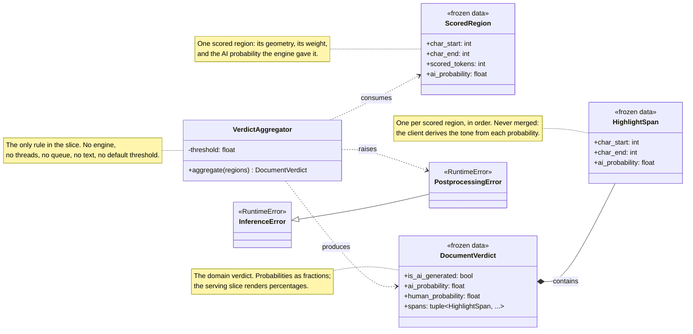
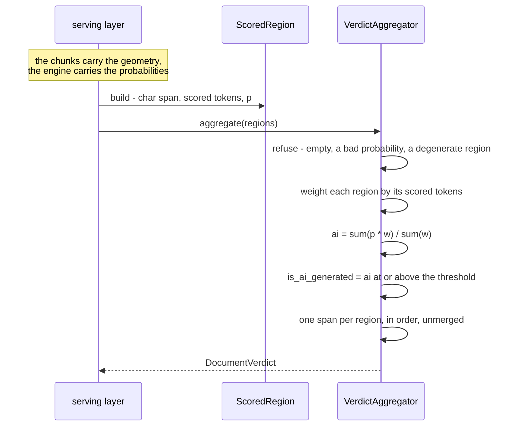
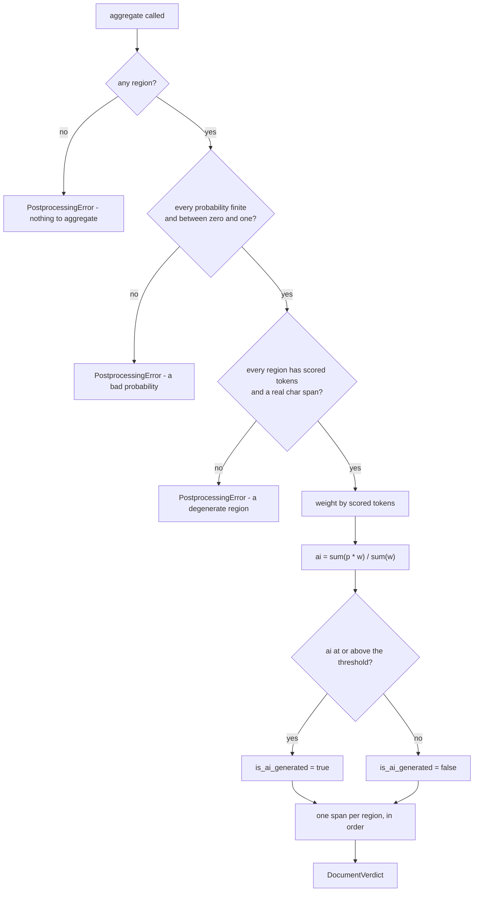
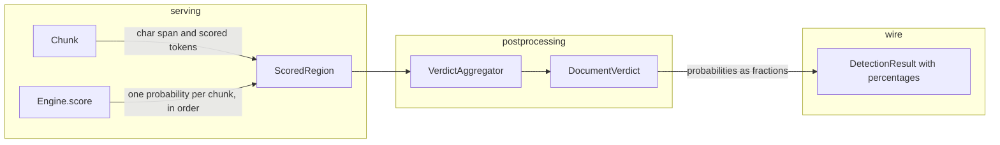

# Inference — Postprocessing (design reference)

Status: design reference for the postprocessing slice, implemented in
`app/inference/postprocessing/` (the results, the aggregator, the raiser),
`app/inference/preprocessing/chunk.py` (the `scored_tokens` member added to
`Chunk`), `app/inference/preprocessing/preprocessor.py` (the count filled in),
`app/config/settings.py` (the `ai_detection_threshold` knob), `secrets.toml`
and `infra/.env.example` (the knob's declaration), and the unit tests.

The quarantined `services/inference/slop/` tree is the reference draft. Its
`application/services/aggregation.py` held a `ResultAggregator` that weighted
chunks by a stride heuristic, gave the first chunk extra weight on purpose,
and merged same-label spans into one. This slice replaces it with one rule:
the scored regions of a document, weighted by their own size, in, one verdict
out.

This slice delivers the item the preparation reference deferred — "result
aggregation and highlight-span merging" (`inference-preprocessing.md` §1).

---

## Measured baseline

Every number below is carried from the sibling references; nothing here was
re-measured. They are the basis for the decisions in §11.

| Measurement | Value | Source |
| --- | --- | --- |
| Every text's `p_ai`, across every artifact and every text tried | 0.9875 – 1.0 | engine reference, §"Calibration" |
| 1,000,000 chars → tokens (flare tokenizer) | 154,472 (~6.5 chars/token) | preprocessing reference |
| 1,000,000 chars → chunks at a 510-content window | 303 | preprocessing reference |
| 1,000,000 chars → spans at the same window | 303 — one per region | this slice, §3 |

Two of those numbers decide this slice's open questions.

**The characters-per-token ratio is ~6.5.** The two candidate weights — the
region's characters and the region's tokens — therefore differ by a nearly
constant factor across English prose, and the aggregate is nearly identical
under either. They part company only where the ratio varies *within* one
document: code, tables, mixed scripts. The slice takes the token weight
because the scored region is defined in tokens (§11.1), and the ratio is
recorded here so the choice is not mistaken for a large effect.

**The artifacts label everything AI.** Every text scores above 0.9875, so
the aggregate is always above 0.9875, the verdict is always AI, and every
span is AI-toned. **No aggregation rule can be validated against the shipped
artifacts.** The rules are pinned by unit tests over synthetic probabilities
(§10), and the threshold stays a knob until the model owner answers the
calibration question the engine reference raised (§11.14 there).

**The span count is bounded by the chunk count.** A 1M-character document
yields 303 regions and therefore 303 spans — under 10 KB on the wire, which
is why the spans are not merged (§11.6).

---

## 1. Scope

| In scope | Out of scope (later slices) |
| --- | --- |
| The results: `ScoredRegion`, `HighlightSpan`, `DocumentVerdict` | The dispatcher: chunk → engine batches, the executor offload, cancellation |
| The aggregator: the weighted mean, the threshold, the spans | The gRPC servicer, the streaming, the error mapping |
| The plane's raiser: `PostprocessingError` | The telemetry / New Relic instruments |
| The `scored_tokens` member on `Chunk` | The engine's contract — unchanged, and unaware of this slice |
| The `ai_detection_threshold` knob | The web-side adaptation to the contract's percentages |
| The contract surface: what the verdict renders to | A document-level or hierarchical model |
| Unit tests + this design reference | |

---

## 2. Mapping from the quarantined tree

| slop name | Design name | Module | Responsibility |
| --- | --- | --- | --- |
| `aggregation.py` — `ResultAggregator.aggregate` | `VerdictAggregator.aggregate` | `app/inference/postprocessing/aggregation.py` | The draft weighted by a stride heuristic and gave the first chunk extra weight; the new aggregator weights each region by its own scored tokens |
| `aggregation.py` — `min(stride, token_count)` weight | **Deleted** | — | It patched the double-count of a fixed-stride sliding window. The live tree cuts non-overlapping scored regions, so the patch has no referent |
| `aggregation.py` — "the first chunk gets more weight because it typically contains the introduction" | **Deleted** | — | The draft's own note says it biased every document toward its opening. A size weight replaces it |
| `aggregation.py` — `_build_highlight_spans` (the interval overlay over every boundary) | `VerdictAggregator` — one span per region | `app/inference/postprocessing/aggregation.py` | The draft covered the whole text; the new rule emits one span per scored region, in order |
| `aggregation.py` — `_append_span` (merge same-label neighbours) | **Deleted** | — | A merged span carries a weighted mean, and the client re-derives the tone from that mean — so a merge can flip the tone (§11.7) |
| `aggregation.py` — `label_threshold: float = 0.5` (a constructor default) | `Settings.ai_detection_threshold` | `app/config/settings.py` | The threshold becomes a config-plane value. The aggregator holds no default |
| `domain/models.py` — `DocumentScore`, `HighlightSpan` | `DocumentVerdict`, `HighlightSpan` | `app/inference/postprocessing/results.py` | The draft's `DocumentScore` carried one probability; the new verdict carries the flag and both sides |
| `domain/models.py` — `DocumentChunk` | `ScoredRegion` | `app/inference/postprocessing/results.py` | The slice takes its own input type and imports nothing from preparation (§11.3) |
| `domain/exceptions.py` — `InvalidInputError` | `PostprocessingError` | `app/inference/postprocessing/errors.py` | Graduated to the plane root, as the engine's raiser was |
| `chunking/` — the fixed-stride sliding window | **Not applicable** | — | The draft's `chunk_stride` was the stride its weights corrected for. The live tree has no stride, so the aggregator has no stride either |

---

## 3. Components

### `app/inference/postprocessing/results.py` — the results

```python
@dataclass(frozen=True)
class ScoredRegion:
    """One scored region of a document, and the AI probability the engine gave it."""

    char_start: int
    char_end: int
    scored_tokens: int
    ai_probability: float


@dataclass(frozen=True)
class HighlightSpan:
    """One region's place in the request text, and its own AI probability."""

    char_start: int
    char_end: int
    ai_probability: float


@dataclass(frozen=True)
class DocumentVerdict:
    """One document's verdict: the flag, both sides, and the regions that produced them."""

    is_ai_generated: bool
    ai_probability: float
    human_probability: float
    spans: tuple[HighlightSpan, ...]
```

Three types, not one. The region is the **input** and carries a weight; the
span is the **output** and does not; the verdict is the **result**. Folding
the region and the span into one type would drag the weight into the wire
shape, and folding the verdict into the span would lose the document-level
flag.

`human_probability` is carried rather than derived at the edge: the verdict
is self-contained, and the caller never has to know it is a two-class
softmax.

### `app/inference/postprocessing/aggregation.py` — the rule

```python
class VerdictAggregator:
    """One rule: the scored regions of a document, in, one verdict out."""

    def __init__(self, threshold: float) -> None:
        if isinstance(threshold, bool) or not isinstance(threshold, (int, float)):
            raise TypeError("the threshold must be a number")
        if not 0.0 <= float(threshold) <= 1.0:
            raise ValueError(f"the threshold is {threshold}; it must lie in [0.0, 1.0]")
        self._threshold = float(threshold)

    def aggregate(self, regions: Sequence[ScoredRegion]) -> DocumentVerdict:
        if not regions:
            raise PostprocessingError("there are no scored regions to aggregate")
        total_weight = 0
        weighted_sum = 0.0
        for region in regions:
            self._guard(region)
            total_weight += region.scored_tokens
            weighted_sum += region.scored_tokens * region.ai_probability
        ai_probability = weighted_sum / total_weight
        return DocumentVerdict(
            is_ai_generated=ai_probability >= self._threshold,
            ai_probability=ai_probability,
            human_probability=1.0 - ai_probability,
            spans=tuple(
                HighlightSpan(
                    char_start=region.char_start,
                    char_end=region.char_end,
                    ai_probability=region.ai_probability,
                )
                for region in regions
            ),
        )
```

One implementation, so **no port**. The engine carries a `Protocol` because a
second engine was plausible; this slice has one rule and one caller, and a
single-implementation abstraction would be decoration.

The threshold arrives as a constructor argument and the class holds no
default: a threshold is a calibration answer, and calibration is not settled
(§"Measured baseline"). The config plane owns the value (§8).

### `app/inference/postprocessing/errors.py` — the raiser

```python
class PostprocessingError(InferenceError):
    """The scored regions could not be aggregated into a verdict."""
```

One raiser for every fault the aggregation can hit: no regions, a
probability that is not finite or out of range, a region with no scored
tokens, a region whose character span does not advance. It hangs from the
plane root (`app/inference/errors.py`), beside `PreprocessingError` and
`EngineError`, so the serving slice maps one tree.

A bad *threshold* is not one of these faults: it is a configuration error
found at construction. A threshold that is not a number raises `TypeError`
and one outside the unit interval raises `ValueError` — the Python
convention, and the house lint's own rule about raising a type error for a
type fault.

### `app/inference/preprocessing/chunk.py` — the amendment

```python
@dataclass(frozen=True)
class Chunk:
    index: int
    token_ids: tuple[int, ...]   # includes [CLS] ... [SEP]; may carry a context prefix
    context_tokens: int           # leading tokens that are context, not scored
    scored_tokens: int            # the region's own tokens: the weight
    char_start: int               # the scored region only
    char_end: int                 # the scored region only

    @property
    def token_count(self) -> int:
        """The sequence length the model sees, special tokens included."""
        return len(self.token_ids)
```

`scored_tokens` is the count of tokens the region contributed — `end - start`
in the preprocessor's cut — and it is the **weight**, not `token_count`.

`token_count` is context + content + the two special tokens, so weighting by
it would count the overlap context twice and let the aggregate drift as
`CHUNK_TOKEN_OVERLAP` moves. The draft's `min(stride, token_count)` was
exactly a patch for that double-count in a sliding window; the patch died
with the window, and this member is the honest replacement.

The invariant is exact:

```text
scored_tokens + context_tokens + special_token_count == token_count
```

and it is pinned by a test (§10).

This is an amendment to a finished slice, not a replacement of it. The
chunking rule, the cut points and the admission bounds are unchanged; only
the region's size becomes readable. The `Chunk` class block and the class
diagram are updated in `inference-preprocessing.md` and `inference-overlap.md`,
which is where the member is documented.

---

## 4. Class diagram



**Boundary rules this diagram encodes**

1. **`ScoredRegion` is the slice's own input type.** The package imports
   nothing from `app/inference/preprocessing/` — the same discipline the
   engine set when it took token-id sequences instead of chunks. The caller
   builds the regions; the aggregator never sees a `Chunk`.
2. **`scored_tokens` is the weight, and it counts content only** — not
   `token_count`, which is context + content + the two special tokens.
3. **The region is not the span.** The region carries a weight; the span does
   not. The aggregator is the only thing that turns one into the other.
4. **One implementation, so no port.**
5. **The verdict stays in fractions.** The contract's 0–100 percentages and
   the one-decimal rounding are the wire's business (§7).
6. **The threshold is a constructor argument.** The class holds no default,
   and the composition reads it from the config plane.
7. **One error root for the plane.** `InferenceError` is the root;
   `PreprocessingError`, `EngineError` and `PostprocessingError` are its
   leaves.
8. **Nothing in this diagram knows about the engine, the tokenizer, the
   documents, or the text.** The slice's whole input is a list of scored
   regions.

---

## 5. Boot flow

There is no boot wiring in this slice. The aggregator is process-wide — it
holds no model state, and the threshold is a single global knob — so it is
built once by the serving slice's composition and handed to the servicer at
registration. Wiring it into `main.py` now would create a value nobody
holds (§11.9).

The knob lands in this slice; its consumer lands with the servicer. The
engine reference already declares `MAX_INFLIGHT_REQUESTS` and
`MAX_CONCURRENT_BATCHES` the same way (§8 there): the config plane carries a
knob ahead of the slice that reads it.

---

## 6. Sequence diagrams

### Aggregate one document



Note what is absent: no engine call, no tokenizer, no text, no chunk. The
caller has already paid for all of that; the aggregator's whole job is the
weighted mean, the threshold and the spans.

### The failure paths



### The seam



The caller pairs chunk *i* with probability *i* and builds the regions. The
engine's contract guarantees the pairing is safe: `score` returns one value
per sequence, in the order the sequences were handed over.

---

## 7. The contract surface

The slice consumes no artifacts and touches no files. What it owes the wire
is the mapping below, and the serving slice is what renders it.

| Contract field | Source | Rule |
| --- | --- | --- |
| `model_id` | the request | the canonical echo, unchanged |
| `is_ai_generated` | `verdict.is_ai_generated` | `ai_probability >= threshold`; the threshold comes from the config plane |
| `ai_confidence` | `verdict.ai_probability` | `round(p * 100, 1)` — a percentage, one decimal |
| `human_confidence` | `verdict.human_probability` | `100.0 - round(p * 100, 1)` — so the two sum to exactly 100.0 |
| `confidence_score` | the two | the winning side: `ai_confidence` when `is_ai_generated`, otherwise `human_confidence` |
| `highlight_spans` | `verdict.spans` | one per scored region, in order, unmerged; `char_start`/`char_end` in Unicode scalars; `ai_confidence` the region's own percentage |

**The rounding is at the edge.** The verdict keeps full precision, because
the threshold compares against the raw probability and a rounded value would
put the flag and the number it was derived from out of step.

**The offsets are Unicode scalars.** The chunk's character spans already are
(they come from the tokenizer's offset mapping), and the contract pins the
unit. A JavaScript client converts scalars to UTF-16 indices in one mapper.

**The spans carry no label.** The contract dropped the field because the
client derives it — the web's mapper reads each span's own confidence and
tones the span itself (`apps/web/features/chat/services/inference-service.ts`).
A span that travelled without a probability could not be toned, so the
regions of both classes must reach the wire; that is why the rule is *one
span per region* and not *one span per AI region*.

---

## 8. Configuration surface

**This slice adds one knob, and it is the threshold.**

| Field | Env key | Default | Lands in | Why |
| --- | --- | --- | --- | --- |
| `ai_detection_threshold` | `AI_DETECTION_THRESHOLD` | `0.5` | **this slice** | the verdict's cutoff; a calibration answer, so it is a knob and never a constant |

The knob must be added to `secrets.toml`'s `[ssm].keys` and to
`infra/.env.example`, or it never reaches prod.

The value is a **probability in [0,1]**, not a percentage: it is compared
against the raw probability, before the wire's rendering (§7).

A bad value fails closed to the default, the `grpc_port` pattern: an
unparseable string, a non-number, or a value outside [0.0, 1.0] resolves to
`0.5`. A threshold outside the unit interval is meaningless, and a silent
fallback beats a boot that dies on a typo in a seeded value.

The default `0.5` is the house convention, not a measurement: the web's own
mapper derives its per-span tone at `0.5`, and the contract pins no other
cutoff. The artifacts score everything above 0.9875, so the default is
untestable against them today (§"Measured baseline").

---

## 9. Dependencies

**None.** The slice uses the standard library only — `dataclasses`, `math`,
`collections.abc`. No numpy, no onnxruntime, no transformers.

The slice reads no files and opens no sessions. Its whole input is a list of
scored regions.

---

## 10. Testing

- **`tests/unit/inference/postprocessing/test_aggregation.py`** — the rule,
  over synthetic regions (the artifacts cannot validate it, §"Measured
  baseline"):
  - the weighted mean: known regions with known weights and probabilities
    produce the exact expected probability
  - a light region counts less than a heavy one — the same probability in a
    10-token region and a 1,000-token region does not aggregate the same
  - **no first-chunk bias** — two regions, one short and one long, aggregate
    by size alone; the draft's "the first chunk gets more weight" heuristic
    is gone
  - the threshold is inclusive: a probability exactly at the threshold is AI
  - a probability below the threshold is Human
  - one span per region, in the region's order, each carrying that region's
    own probability
  - adjacent regions are **not** merged — two regions in a row stay two spans
  - the spans' character spans are the regions' character spans
  - no regions → `PostprocessingError`
  - a probability above 1.0, below 0.0, `NaN` or infinite →
    `PostprocessingError`
  - a region with zero scored tokens → `PostprocessingError`
  - a region whose `char_end` does not advance past `char_start` →
    `PostprocessingError`
  - a threshold outside [0.0, 1.0] → `ValueError` at construction
  - a threshold that is not a number → `TypeError` at construction
  - the verdict's `human_probability` is `1 - ai_probability`
- **`tests/unit/inference/preprocessing/test_chunk.py`** and
  **`test_preprocessor.py`** — the amendment:
  - `scored_tokens` counts the region's content tokens only — not `[CLS]`,
    not `[SEP]`, not the context prefix
  - the invariant: `scored_tokens + context_tokens + special_token_count ==
    token_count`
  - with an overlap set, the context prefix is excluded from `scored_tokens`
- **`tests/unit/config/test_settings.py`** — the knob: the default passes
  through, an unparseable or out-of-range value fails closed to the default,
  and a value in range is honoured.

**No test may encode a threshold's effect on the shipped artifacts**, a
throughput figure, or a latency. The calibration is unsettled, so a test
that pinned a verdict on a real artifact would encode a broken model's
behaviour.

Run with `make test-unit`.

---

## 11. Defaults taken (override if any read wrong)

1. **The weight is the region's scored tokens.** The alternative — the
   region's characters — differs by a nearly constant factor in English
   prose (~6.5 chars/token) and agrees with the token weight wherever the
   ratio is stable within a document. The token weight is taken because the
   scored region is *defined* in tokens, and because it is the model's own
   unit: the aggregate then reads as "what the model saw, averaged".
2. **`scored_tokens` is added to `Chunk` rather than derived in the
   aggregator.** Deriving it would mean the aggregator knowing the special-
   token count and the context length — preparation's knowledge — or
   weighting by `token_count` and double-counting the overlap context. One
   member on the type that owns the arithmetic is the cheaper side of that
   trade.
3. **The slice takes its own input type.** `ScoredRegion` rather than
   `Chunk`: the package imports nothing from preparation, the caller builds
   the regions in one projection, and the slice is testable without a
   tokenizer. The alternative — importing `Chunk` — saves one type and
   couples the two packages.
4. **There is no port.** One rule, one caller. A `Protocol` here would have
   one implementation and no second.
5. **The threshold is a config value with a fail-closed default of 0.5.**
   The alternative — fixing it in the aggregator — would make a calibration
   answer a code constant, and the artifacts cannot calibrate it today.
6. **The spans are one per region and never merged.** The draft merged
   same-label neighbours; a merged span carries a weighted mean, and the
   client re-derives the tone from that mean — so a merge flips the tone
   whenever the server's threshold differs from the client's. Not merging
   keeps every region's own probability intact. The cost is one span per
   chunk (303 spans, under 10 KB, for a 1M-character document).
7. **The regions of both classes reach the wire.** The contract dropped the
   label because the client derives it, and the web's mapper derives a tone
   from each span's own confidence. A span without a probability could not
   be toned, so an AI-only span list would leave the client's "Human"
   branch dead and the UI's "Human-Likely" legend unfulfilled.
8. **The verdict keeps fractions; the wire renders percentages.** The
   threshold compares against the raw probability, and a rounded value would
   put the flag and the number it came from out of step.
9. **No boot wiring in this slice.** The aggregator is process-wide and
   nothing holds it until the servicer lands, so `main.py` gains no dead
   value. The knob lands now; its consumer lands with the servicer.
10. **The rules are pinned by synthetic probabilities, never by the shipped
    artifacts.** Every text scores above 0.9875 on them, so an artifact-
    backed test would pin a broken model's behaviour and the verdict would
    be AI for every input.
11. **`human_confidence` is rendered as `100.0 - round(ai * 100, 1)`** so the
    two percentages sum to exactly 100.0. The alternative — rounding the
    complement independently — can leave them a tenth apart.
12. **The offset unit is inherited, not re-derived.** The chunk's character
    spans are Unicode scalars already; the slice copies them.
