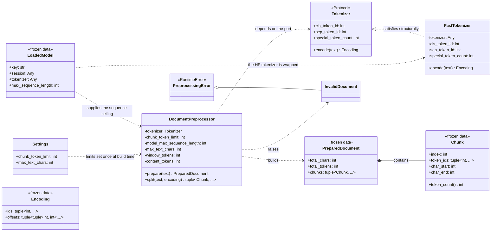
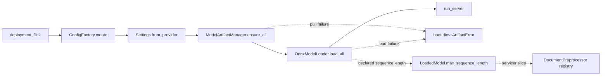
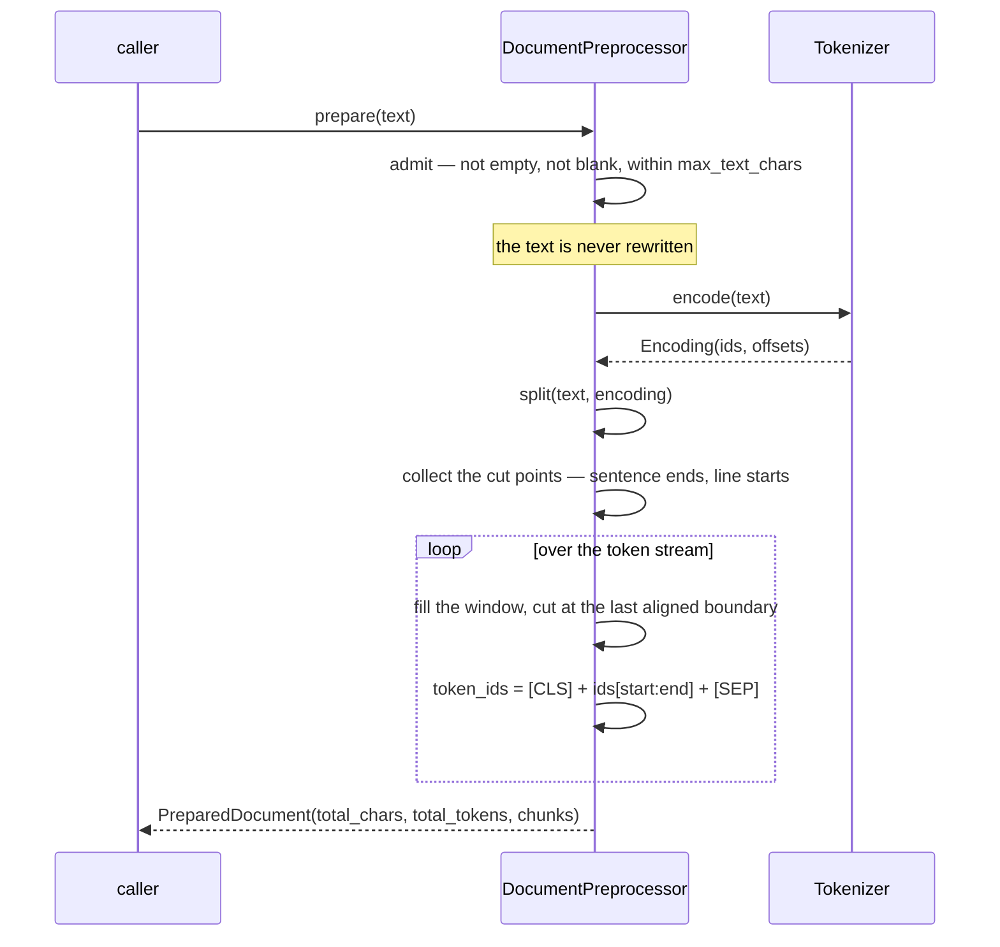
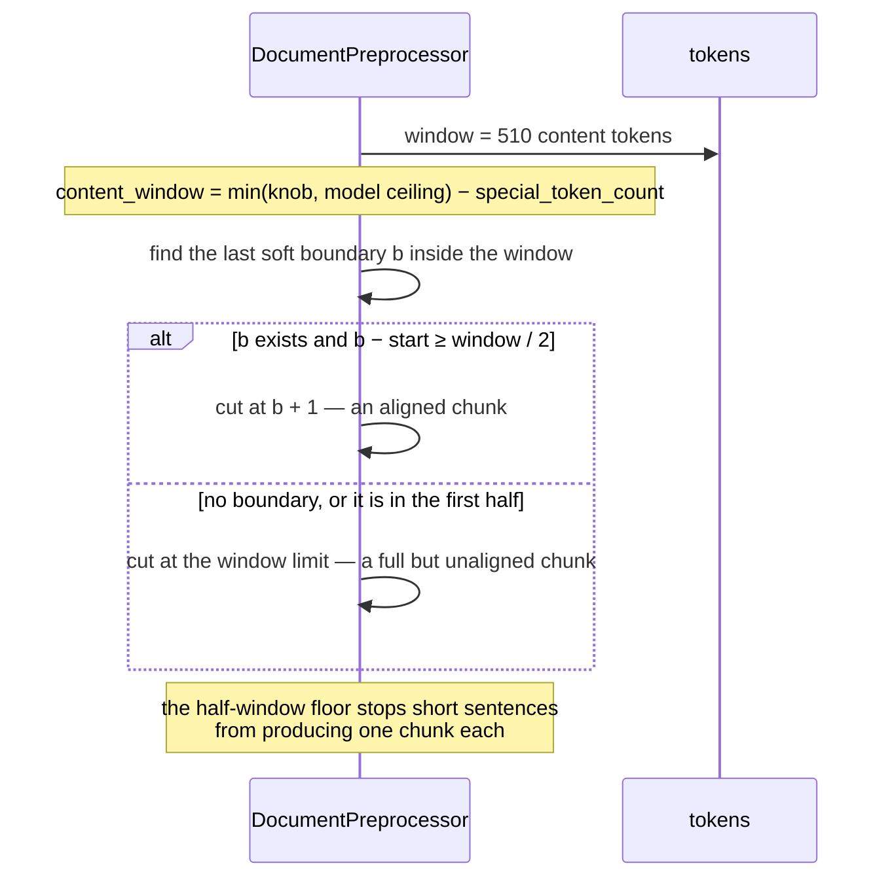
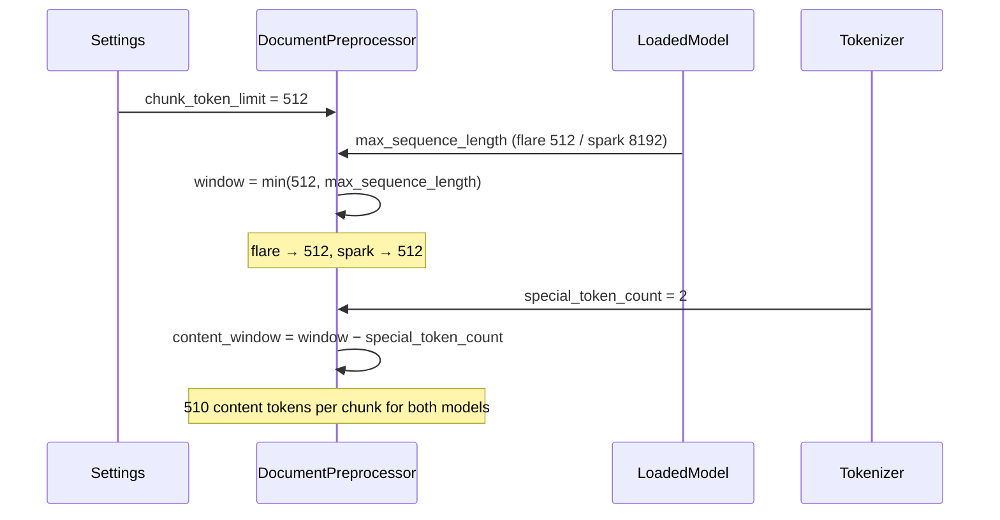
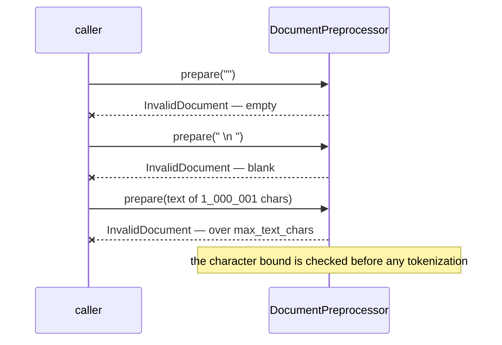
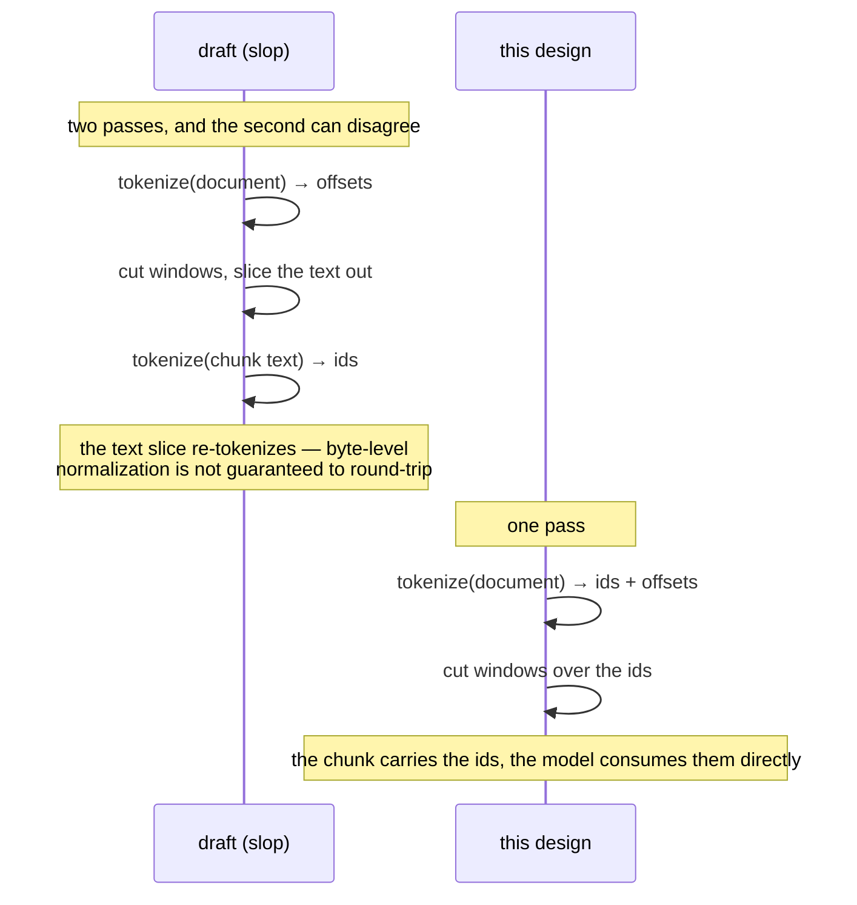

# Inference — Preprocessing (design reference)

Status: design reference for the preprocessing slice, implemented in
`app/inference/preprocessing/` (the facade, the tokenizer port and its
adapter, the results), `app/models/loading/` (the declared sequence
ceiling), and the `chunk_token_limit` knob.

The quarantined `services/inference/slop/` tree is the reference draft. Its
`chunking/` package held a fixed-stride sliding window over token offsets,
selected a tokenizer by `callable(tokenizer)` duck-typing, and let the engine
re-tokenize each chunk's text — so the same text was tokenized twice per
request and the two passes could disagree. It also rewrote the submission
(control characters to spaces, then stripped) before chunking, which shifted
every character offset away from the request text the contract's
`HighlightSpan` ranges are measured against. This slice redoes the
preparation around one observation the draft never made: the shipped
tokenizers already know where every token lives in the text, so the boundary
of a chunk can be *chosen* rather than *slid*.

---

## Measured baseline

Every number below was measured against the pulled artifacts in this tree
(flare = fp32 bert-large, spark = fp16 bert-base), on 8 CPU cores. They are
the basis for the design decisions in §11.

| Measurement | Value |
| --- | --- |
| 1,000,000 chars → tokens (flare tokenizer) | 154,472 (~6.5 chars/token) |
| Tokenize + offset mapping, 1M chars | 0.4–1.3 s (one blocking Rust call) |
| Boundary scan over 220k tokens, pure Python | 0.09 s |
| Boundary scan over 220k tokens, numpy | 0.08 s, of which 0.07 s builds the `int32` array |
| Chunk planning, 244 chunks | 0.5 ms |
| Per-chunk encoding (slice + specials), 244 chunks | 1.7 ms |
| Two concurrent tokenizations of 1M chars | 0.64 s wall vs 0.50 s for one — **the Rust tokenizer releases the GIL** |
| `tokenizer.decode(chunk_ids[1:-1])` vs `text[char_start:char_end]` | **exact** |
| Token offsets are contiguous | zero gaps across the whole document; whitespace is absorbed into the following token's span (`" beta"`), and a newline is its own token |
| ORT CPU inference (batch 8, seq 510) | spark 1457 ms/seq, flare 3224 ms/seq |
| 1M chars → chunks at a 512-token window | 303 → **~7 min (spark) / ~16 min (flare) on CPU** |

Chunk counts at 1M chars (154,472 tokens):

| Window | Stride | Chunks |
| --- | --- | --- |
| 510 content | 510 (no overlap) | 303 |
| 510 content | 384 (draft's sliding window) | 402 |
| 254 content | 192 (draft's sliding window) | 604 |

---

## 1. Scope

| In scope | Out of scope (later slices) |
| --- | --- |
| Admission validation: non-empty, non-blank, within `MAX_TEXT_CHARS` | The Python servicer and its registration on the server |
| One-pass tokenization with character offsets | The engine contract (`predict_batch`), batching, ORT tensor construction |
| Boundary-aligned chunk planning (no overlap, no stride) | Result aggregation and highlight-span merging |
| Chunk encoding to token IDs with the model's special tokens | Telemetry / New Relic instruments |
| Per-model sequence-window derivation (`LoadedModel.max_sequence_length`) | The `onnxruntime-gpu` wheel — CPU-only this slice |
| Config knob: `chunk_token_limit` | The boot wiring of the preprocessor registry (lands with the servicer) |
| Unit tests + this design reference | A document token ceiling — `MAX_TEXT_CHARS` is the only admission bound |

## 2. Mapping from the quarantined tree

| slop name | Design name | Module | Responsibility |
| --- | --- | --- | --- |
| `chunking/protocol.py` — `TokenChunker` | `Tokenizer` | `app/inference/preprocessing/tokenizer.py` | A narrow port: the tokenizer surface preparation actually needs, and nothing else |
| `chunking/bert_chunker.py` — `BertTokenChunker` | `FastTokenizer` | `app/inference/preprocessing/tokenizer.py` | The only module that knows the HF calling convention; adapts a tokenizer to the `Tokenizer` port |
| the draft's implicit `(ids, offsets)` pair | `Encoding` | `app/inference/preprocessing/tokenizer.py` | A named frozen type for the tokenizer's output; the draft returned a loose pair whose order meant nothing |
| `chunking/regex_chunker.py` — `RegexTokenChunker` | **Deleted** | — | It existed only because the draft's spark model shipped a pickled sklearn vectorizer; both models ship HF tokenizers now |
| `chunking/sliding_window.py` — `build_sliding_chunks` | **Deleted** | — | A fixed-stride window over a uniform grid; replaced by boundary-aligned cuts (§3) |
| `chunking/planner.py` — `ChunkPlanner` | `DocumentPreprocessor.split` | `app/inference/preprocessing/preprocessor.py` | Folded in: the draft's planner was a wrapper carrying four positional config arguments and had exactly one caller |
| `chunking/factory.py` — `build_chunk_planner` | **Deleted** | — | The draft selected a strategy by `callable(tokenizer)`; a mis-shaped tokenizer silently degraded to the regex path |
| `text_pipeline.py` — `TextPreparationPipeline` | `DocumentPreprocessor` | `app/inference/preprocessing/preprocessor.py` | Admission + tokenization + windowing in one object; the draft's validator and planner were separate and both reconfigurable |
| `validation.py` — `InputValidator.validate` | admission inside `DocumentPreprocessor.prepare` | `app/inference/preprocessing/preprocessor.py` | The draft **rewrote** the text (`re.sub` then `.strip()`), shifting every character offset; this one validates and never mutates |
| `domain/models.py` — `DocumentChunk` | `Chunk` | `app/inference/preprocessing/chunk.py` | Carries token IDs and a character span; the draft carried text and no IDs |
| `CHUNK_TOKEN_STRIDE` | **Deleted** | — | Overlap is gone: aligned chunks are contiguous and non-overlapping by construction (§11.3) |
| `MAX_GLOBAL_TOKENS` | **Deleted** | — | No token ceiling this slice; `MAX_TEXT_CHARS` remains the only admission bound |
| `engines/flare.py`, `engines/spark.py` — re-tokenizing chunk text | **Deleted** | — | The draft tokenized the document for offsets and then tokenized each chunk's text again; the engine now consumes the IDs preparation already produced |
| `composition/container.py` — planner registry | **Deferred** | — | The registry has no consumer until the servicer exists (§11.9) |

## 3. Components

### `app/inference/preprocessing/errors.py` — one raiser

```
PreprocessingError (root, RuntimeError) — catch this for blanket handling
└── InvalidDocument      the submission cannot be analysed
```

`InvalidDocument` covers the three admission failures — not a string, empty or
blank, or over the character bound. It is an input fault, not a service
fault: the servicer maps it to `INVALID_ARGUMENT`.

### `app/inference/preprocessing/chunk.py` — the two results

```python
@dataclass(frozen=True)
class Chunk:
    """One analysable window: the token IDs to feed the model and the text span they came from."""

    index: int
    token_ids: tuple[int, ...]   # includes [CLS] ... [SEP]
    char_start: int              # Unicode scalar offset into the request text
    char_end: int

    @property
    def token_count(self) -> int:
        """The sequence length the model sees, special tokens included."""
        return len(self.token_ids)


@dataclass(frozen=True)
class PreparedDocument:
    """One prepared submission: the document's totals, plus the chunks it was windowed into."""

    total_chars: int
    total_tokens: int
    chunks: tuple[Chunk, ...]
```

`total_chars` is the request's scalar count, matching the contract's
`AnalyzeDocumentStarted.total_chars`. It is carried explicitly rather than
derived from `chunks[-1].char_end`, because that derivation only holds while
the chunks tile the text — and every reader would have to know that.
`total_tokens` is the document's token count *before* windowing, which no
chunk can supply.

### `app/inference/preprocessing/tokenizer.py` — the port, the adapter, and the encoding

```python
@dataclass(frozen=True)
class Encoding:
    """A tokenized document: the content tokens and where each one sits in the text."""

    ids: tuple[int, ...]
    offsets: tuple[tuple[int, int], ...]


class Tokenizer(Protocol):
    """The tokenizer surface preparation needs; nothing else."""

    cls_token_id: int
    sep_token_id: int
    special_token_count: int

    def encode(self, text: str) -> Encoding:
        """Token IDs without special tokens, plus each token's character span."""
        ...


class FastTokenizer:
    """Satisfies Tokenizer structurally; the only module that knows the HF calling convention."""

    def __init__(self, tokenizer: Any) -> None: ...

    def encode(self, text: str) -> Encoding: ...
```

`FastTokenizer` is the boundary that keeps `transformers` out of the rest of
the package, exactly as `OnnxModelLoader` is the only module that knows
ONNX Runtime. The adapter calls the tokenizer once, with
`add_special_tokens=False`, `return_offsets_mapping=True`, `truncation=False`
— the special tokens are added later, by `split`, once per chunk.

`special_token_count` comes from the tokenizer
(`num_special_tokens_to_add(pair=False)`) and is 2 for both shipped
tokenizers (`[CLS]`, `[SEP]`). It is read rather than assumed, because
`split` needs it for two things: the window arithmetic, and the bracketing of
each chunk's IDs.

The three members are not incidental. `split` builds
`[CLS] + ids[start:end] + [SEP]`, so it needs the two IDs and the count. The
alternative — leaving the bracketing to the engine — would put the "+2" in two
places at once: preparation saying "510 content tokens per chunk" while the
engine says "sequence length 512". Preparation owns the window, so preparation
owns the specials.

### `app/inference/preprocessing/preprocessor.py` — the facade

```python
class DocumentPreprocessor:
    """Admission, tokenization and windowing for one model."""

    def __init__(
        self,
        tokenizer: Tokenizer,
        chunk_token_limit: int,
        model_max_sequence_length: int,
        max_text_chars: int,
    ) -> None: ...

    def prepare(self, text: str) -> PreparedDocument: ...

    def split(self, text: str, encoding: Encoding) -> tuple[Chunk, ...]: ...
```

The constructor resolves the window once and rejects an unusable one:

```
window = min(chunk_token_limit, model_max_sequence_length)   # total sequence length
if window < MIN_SEQUENCE_LENGTH: raise ValueError(...)
content_window = window - tokenizer.special_token_count
```

`MIN_SEQUENCE_LENGTH` is 64 — below that a window holds too little text for
the model to say anything, and a misconfigured knob should fail loudly rather
than silently produce meaningless chunks.

`prepare` runs three steps and stops at the first failure:

1. **Admit.** Not a string, empty, blank, or longer than
   `max_text_chars` → `InvalidDocument`. The bound is a *character* bound and
   is checked before any tokenization, so an oversized submission costs
   nothing.
   Blank means *no analysable content*: whitespace-only (Unicode whitespace,
   as `str.strip()` sees it) and control-character-only alike. The rule is
   `not text.strip() or not text.strip(_BLANK_CHARS)`, where `_BLANK_CHARS`
   is the ASCII whitespace and control set — so `"\x00"` and `" \x00 "` are
   refused while `"a\x00b"` is admitted.
   The text is **never rewritten**. The draft replaced control characters with
   spaces and stripped the result, which moved every subsequent character
   offset — `HighlightSpan` would then point into the sanitized text rather
   than the request text the contract measures against.
2. **Tokenize.** One call through the `Tokenizer` port.
3. **Window.** Hand the text and the encoding to `split`.

`split` is the chunking rule, and it takes the text alongside the encoding
because the rule reads characters. The algorithm, in order:

1. **The cut points.** One walk over the token spans. A cut may follow
   token *i* when:
   - its span **ends** on `.`, `!` or `?` — the next token starts a new
     sentence;
   - the next token's span **starts** with `\n` — the next token starts a new
     line or paragraph.

   The gaps between token spans are not used for this: the shipped byte-level
   tokenizers absorb whitespace into the following token's span, so the spans
   are contiguous and there are no gaps to find. The rule reads the characters
   the spans point at instead.
2. **The cut.** Walk the token stream from the start. Fill a window of
   `content_window` content tokens. If the window ends before the document
   does, look for the **last** soft boundary inside it. Cut there if that
   boundary is at least half a window in; otherwise cut hard at the window
   limit. The half-window floor is what stops a document of short sentences
   from producing a chunk per sentence — it prefers an aligned cut, but never
   at the cost of a mostly-empty chunk.
3. **The chunk.** `token_ids = ([cls] + ids[start:end] + [sep])`, with
   `char_start = offsets[start][0]` and `char_end = offsets[end - 1][1]`.
   Because the offsets are contiguous, consecutive chunks tile the request text
   with no gap and no overlap — which is what makes the contract's
   "non-overlapping `highlight_spans`" fall out for free.

Every step is deterministic: the same text and the same window always produce
the same chunks.

`split` is public because it is a legitimate operation on its own —
windowing an already-encoded document — and because it is where the chunking
rules live, which is where the tests should reach them. A test can build an
`Encoding` by hand and call `split` with no tokenizer and no model files.

### `app/models/loading/loader.py` — one field added

```python
@dataclass(frozen=True)
class LoadedModel:
    key: str
    session: Any
    tokenizer: Any
    max_sequence_length: int   # the model's declared sequence ceiling
```

The ceiling is a property of the *model*, so it belongs with the model, not
with the chunker. It lets one `chunk_token_limit` knob serve both models with
no per-model branches: flare declares 512, spark declares 8192, and the
preprocessor takes the smaller of the two.

### `app/models/loading/onnx.py` — where the ceiling comes from

The loader already reads the artifact directory, so it already knows where
`tokenizer_config.json` is.

```python
_TOKENIZER_CONFIG_FILENAME = "tokenizer_config.json"

def _max_sequence_length(self, key: str, path: Path) -> int:
    config_path = path / _TOKENIZER_CONFIG_FILENAME
    try:
        config = json.loads(config_path.read_text(encoding="utf-8"))
    except (OSError, ValueError) as error:
        raise ModelLoadError(
            f"{key}: unreadable {_TOKENIZER_CONFIG_FILENAME} in {path}: {error}"
        ) from error
    if not isinstance(config, dict):
        raise ModelLoadError(f"{key}: {_TOKENIZER_CONFIG_FILENAME} in {path} is not an object")
    declared = config.get("max_length") or config.get("model_max_length")
    if isinstance(declared, bool) or not isinstance(declared, int) or declared <= 0:
        raise ModelLoadError(f"{key}: no usable sequence length in {config_path}")
    return declared
```

`max_length` wins over `model_max_length` because it is the length the model
was trained at; `model_max_length` is only the position-embedding ceiling.
For the shipped artifacts: **flare 512**, **spark 8192** (flare declares
`max_length`, spark declares only `model_max_length`).

A missing, malformed, or lengthless `tokenizer_config.json` fails the boot
with `ModelLoadError` — the same fail-closed posture as a missing
`model.onnx`. The read sits outside the session/tokenizer try block, so the
message names the model once rather than nesting inside the load failure.

### `app/config/settings.py` — one knob

```python
chunk_token_limit: int = 512
```

The total sequence length per chunk, **including** the two special tokens —
the same units as `max_length` in the tokenizer config, and the same units as
flare's declared 512. `512` therefore means 510 content tokens per chunk.

A bad value fails closed to the default, following the `grpc_port` pattern.

## 4. Class diagram



Boundary rules: `split` is pure — it reads the text and the encoding and
returns chunks, touching no service state. `tokenizer.py` is the only module
that knows the HF calling convention. `preprocessor.py` owns admission and
composes the two. Nothing under `app/inference/preprocessing/` imports `onnxruntime`,
and nothing under `app/inference/preprocessing/` imports `transformers`.

## 5. Boot flow

The preprocessing registry is **not** wired in this slice — it has no consumer
until the servicer exists (§11.9). The flow below is the boot as it stands,
with the attachment point marked.



`LoadedModel.max_sequence_length` is derived during the load step, so a
malformed `tokenizer_config.json` still fails the boot in this slice. The
registry itself attaches where the servicer lands.

## 6. Sequence diagrams

### Prepare: one submission, end to end



### The cut rule



### The clamp: one knob, two models



### Admission failures



### One tokenization, not two

The draft tokenized the document to obtain offsets and then tokenized each
chunk's text again to build the model's inputs. This slice does it once.



## 7. Artifact consumption

The layout is the pulling reference's §7 layout; nothing changes on disk. The
preprocessing slice adds one read to it.

```
MODEL_CACHE_DIR/
├── flare/
│   └── onnx/fp32/          ← tokenizer.json + tokenizer_config.json +
│                              special_tokens_map.json + model.onnx(+data)
└── spark/
    └── onnx/fp16/          ← the same, plus config.json
```

- `tokenizer_config.json` is read by the **loader** now, for
  `max_length` / `model_max_length`. It is already in both pull specs' file
  lists, so nothing changes in the pull contract.
- `tokenizer.json` and `special_tokens_map.json` are read by the tokenizer
  itself, offline, as the load slice already established.
- The preprocessing slice reads **no files**. It receives a tokenizer and a
  sequence ceiling.

## 8. Configuration surface

Env keys are the uppercase field names (the `Settings.from_provider`
contract).

| Field | Env key | Default | Role |
| --- | --- | --- | --- |
| `chunk_token_limit` | `CHUNK_TOKEN_LIMIT` | `512` | Total sequence length per chunk, special tokens included; clamped down to the model's declared ceiling |
| `max_text_chars` | `MAX_TEXT_CHARS` | `1000000` | The admission bound, in Unicode scalars (existing knob, now enforced by the preparer) |

`CHUNK_TOKEN_LIMIT` must be added to `secrets.toml`'s `[ssm].keys` or it never
reaches prod. `MAX_TEXT_CHARS` is already there.

Separately, `INFERENCE_PROVIDERS` and `ORT_INTRA_OP_THREADS` are missing from
`secrets.toml`, so the provider list cannot be set in prod at all. That is a
config-plane gap, not a preprocessing one, but it is where the GPU story
starts: ONNX Runtime already falls back to CPU when a requested provider is
unavailable (verified — it warns, it does not raise), so
`INFERENCE_PROVIDERS=CUDAExecutionProvider,CPUExecutionProvider` on a host
with the GPU wheel uses the GPU, and the same line on a host without it uses
the CPU. The GPU wheel itself arrives with the engine slice.

## 9. Dependencies

- `numpy` is **not** promoted. The cut rule is neighbour-aware — a cut follows
  token *i* when its span ends a sentence, or when token *i+1*'s span opens a
  line — so a vectorized form needs a shifted view and a validity mask, and
  comes out longer than the plain walk. Measured on 220k tokens: 0.09 s in pure
  Python against 0.08 s with numpy, of which 0.07 s is building the `int32`
  array. The memory argument does not hold either: `Encoding.offsets` already
  holds the tuples, so the array *adds* 1.24 MB rather than saving 17 MB.
  numpy stays a transitive dependency of `onnxruntime` until the
  postprocessing slice earns it — that slice aggregates per-token scores into
  spans, which is where the arrays actually pay.
- `transformers` is not new — the load slice already depends on it. The
  preprocessing package never imports it; the adapter receives the tokenizer
  by injection.
- The only tokenizer surface used: `cls_token_id`, `sep_token_id`,
  `num_special_tokens_to_add(pair=False)`, and one call with
  `add_special_tokens=False`, `return_offsets_mapping=True`,
  `truncation=False`. The draft's `return_tensors="np"`, `padding=True` and
  `truncation=True` belong to the engine slice, not this one.

## 10. Testing

- `tests/unit/inference/preprocessing/test_preprocessor.py` — the facade. The
  constructor's contract and the window clamp, then the admission rules and
  the chunking rule. The rule's cases are driven by hand-built `Encoding`
  values, with no tokenizer and no model files:
  - the constructor holds its explicit contract
  - the window is the smaller of the knob and the model's ceiling
  - a window below `MIN_SEQUENCE_LENGTH` fails at construction
  - `InvalidDocument` joins the `PreprocessingError` tree
  - `prepare` admits, tokenizes once, and returns the totals and the chunks
  - empty, blank and non-string submissions → `InvalidDocument`
  - a submission over `max_text_chars` → `InvalidDocument`, and no
    tokenization is attempted
  - the text reaches the tokenizer unmodified
  - the window is never exceeded; every chunk's content token count is within
    the window
  - chunks are contiguous and non-overlapping: chunk *k*'s `char_end` equals
    chunk *k+1*'s `char_start`
  - an aligned cut is taken when the last soft boundary is in the upper half
    of the window
  - a hard cut is taken when no boundary qualifies — a document with no
    sentence punctuation at all
  - the half-window floor holds: a document of very short sentences does not
    produce one chunk per sentence
  - a single-chunk document
  - the special tokens bracket the content exactly once
- `tests/unit/inference/preprocessing/test_chunk.py` — the results:
  - `Chunk` and `PreparedDocument` are frozen pure data
  - `token_count` counts the sequence the model sees
- `tests/unit/inference/preprocessing/test_tokenizer.py` — the adapter:
  - the adapter holds its injected tokenizer and reads the special tokens
  - `encode` calls the tokenizer once, with no special tokens and one span
    per token
  - `Encoding` is frozen pure data
  - against the pulled artifacts in `models/`: `encode` returns IDs without
    special tokens and one span per token, the spans are contiguous and cover
    the text, `special_token_count` is 2
- `tests/unit/models/loading/test_loader.py` — the extended `LoadedModel`:
  - the declared sequence length is read from `tokenizer_config.json`
  - `max_length` wins over `model_max_length`; a missing, malformed, or
    lengthless config → `ModelLoadError`
- `tests/unit/config/test_settings.py` — the knob: a valid value passes
  through, garbage fails closed to 512.
- An end-to-end round-trip against the real tokenizer: for every chunk,
  `tokenizer.decode(chunk.token_ids[1:-1]) == text[chunk.char_start:chunk.char_end]`
  (verified exact against the shipped artifacts). This is the test that proves
  the offsets and the chunk boundaries agree with the text. The artifact-backed
  tests skip when `models/` is absent — it is gitignored, so a fresh clone has
  no artifacts to read.

No integration test this slice: the preprocessing package has no service
surface to boot. Run with `make test-unit`.

## 11. Defaults taken (override if any read wrong)

1. **One tokenization per request.** The chunk carries token IDs; the engine
   never re-tokenizes. The draft's double pass is the single largest source
   of waste in the quarantined tree.
2. **Boundary-aligned chunks, no stride knob.** The draft's overlap existed
   to stop arbitrary cuts losing content at a boundary; alignment solves the
   same problem and additionally makes the chunks non-overlapping, which the
   contract's `highlight_spans` require anyway.
3. **The half-window floor** (cut at the last boundary in the upper half of
   the window) is a compromise: aligned when it can be, full when it cannot.
   A stricter or looser floor is a one-constant change.
4. **The text is validated, never rewritten.** The draft's sanitization broke
   the offset contract. Blank means *no analysable content* — whitespace-only
   and control-character-only alike — so a control-character-only submission is
   refused; a submission that carries content between the controls is kept as
   it was sent.
5. **No token ceiling.** `MAX_TEXT_CHARS` is the only admission bound, so a
   1M-character submission is admissible and yields ~303 chunks — about 7
   minutes on CPU for spark and 16 for flare. That is what the streaming RPC
   is for, and it is why the CPU path is slow rather than wrong. Revisit if
   an engine-side budget is wanted; the token count is already carried on
   `PreparedDocument`.
6. **The window is 512 total (510 content + the two special tokens)**, which
   matches flare's declared `max_length`. It is the default, not a ceiling —
   `CHUNK_TOKEN_LIMIT` moves it.
7. **The model ceiling wins over the knob** when the model declares less
   (`min`). A knob above a model's training length cannot be honoured, so it
   is clamped rather than rejected.
8. **`LoadedModel.max_sequence_length` is read from the artifact's
   `tokenizer_config.json`**, not from the tokenizer object, because the
   loader already holds the artifact directory and `transformers`'s
   `init_kwargs` is an implementation detail.
9. **The preprocessor registry is not wired in this slice.** The only
   boot-relevant change — deriving the sequence ceiling — lands in the
   loader, which is already wired, so a malformed tokenizer config still
   fails the boot. The registry attaches with the servicer.
10. **The prep is a blocking, up-front step.** It costs 0.4–1.3 s at the
    character bound and 0.5 ms to plan. The draft's proposed
    preprocessing/inference parallel pipelines were dropped: the total
    preprocessing is well under 1% of an inference run, so overlapping it
    with inference buys nothing. What *does* matter is that the tokenization
    call blocks the event loop — the servicer slice should run it off-loop
    (`asyncio.to_thread`; the Rust tokenizer releases the GIL, verified) so
    one long submission does not stall the others. That is parallelism
    across requests, not within one.
11. **No tokenizer fallback path.** The draft selected a strategy by
    `callable(tokenizer)`; a mis-shaped tokenizer silently degraded to a
    regex chunker. Both shipped models have HF tokenizers, and a missing one
    is a load failure, not a runtime degradation.
12. **The chunking rule is one method, not a class.** `split` had exactly one
    caller, so it lives on the preprocessor rather than behind its own
    abstraction. It stays public and side-effect free, so the rules are
    testable against a hand-built `Encoding` with no model files.
13. **`split` takes the text alongside the encoding.** The rule reads
    characters, and offsets alone cannot say what a token is. The text
    therefore stays out of `Encoding`, which remains an honest tokenizer
    output, and reaches `split` as an argument.
14. **Preparation owns the special tokens.** `Chunk.token_ids` includes
    `[CLS]` and `[SEP]`, so `split` needs the two IDs and the count, which
    the `Tokenizer` port therefore exposes. The alternative — letting the
    engine bracket them — would put the "+2" in two places at once.
15. **The frozen data types hold tuples, not lists.** `Encoding`, `Chunk`
    and `PreparedDocument` are frozen dataclasses, and a frozen dataclass
    holding a list is only shallow-frozen. Tuples make the marker true.
16. **The cut scan is plain Python.** The rule is neighbour-aware, so the
    vectorized form needs a shifted view and a validity mask and comes out
    longer than the walk it replaces. Measured on 220k tokens: 0.09 s against
    0.08 s for numpy, of which 0.07 s is building the array. numpy stays a
    transitive dependency until the postprocessing slice earns it — that slice
    aggregates per-token scores into spans, which is where arrays pay.
17. **The artifact-backed tests skip when `models/` is absent.** The pulled
    artifacts are gitignored, so a fresh clone has none; the pure-logic tests
    carry the rules and the round-trip carries the proof where the artifacts
    are on the host.
