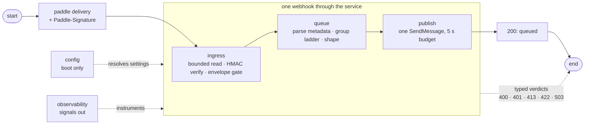

# Payment Webhook Documentation

Welcome to the payment-webhook documentation. This guide covers how the service takes a Paddle delivery and turns it into a durable event on the payment-events FIFO queue — and how to run, configure, test, and observe it.

**The service in one sentence:** a stateless Go/Gin gateway that accepts Paddle webhooks, verifies their HMAC signatures, and forwards the bodies byte-for-byte to SQS for `worker-payments` — nothing more. One delivery in, one enqueue out, no storage anywhere.

## New to the Payment Webhook?

Start here:

1. **[Quick Start](getting-started/quickstart.md)** — run the service locally and publish your first signed event
2. **[Architecture](concepts/architecture.md)** — how one webhook flows through the components
3. **[HTTP API](reference/http-api.md)** — the contract every delivery gets

## Documentation by Topic

### Getting Started

| Document | What You'll Learn | When to Read |
|----------|-------------------|--------------|
| [Quick Start](getting-started/quickstart.md) | The emulator, the secret, first run, first signature | First run, new machine |
| [Configuration](getting-started/configuration.md) | Config planes, every env key, fail-fast rules | Changing any setting |

### Concepts

| Document | What You'll Learn | When to Read |
|----------|-------------------|--------------|
| [Architecture](concepts/architecture.md) | Component map, request lifecycle, the runtime and boot models, the Lambda target | Understanding the system |
| [Validation](concepts/validation.md) | The admission gate: bounded read, HMAC verify, envelope gate | A webhook gets rejected |
| [Delivery](concepts/delivery.md) | SQS FIFO, message shaping, the group-key ladder, DLQ, cutover | A message is missing, misordered, or dead |
| [Observability](concepts/observability.md) | The OTel gate, signals, metric inventory | Dashboards or traces look odd |

### Guides

| Guide | What You'll Learn | When to Read |
|-------|-------------------|--------------|
| [Testing](guides/testing.md) | Unit, integration, and the k6 load rig | Verifying changes |
| [Secrets](guides/secrets.md) | How the Paddle secret and license key are stored, resolved, and provisioned | Provisioning or rotating credentials |

### Reference

| Document | What You'll Learn | When to Read |
|----------|-------------------|--------------|
| [HTTP API](reference/http-api.md) | Endpoints, request/response shapes, every status code | Writing or debugging a caller |
| [Make Commands](reference/make.md) | Every make target with its purpose and deep-dive doc | Any command-line work |

## The Request Path at a Glance



Two of the four components never serve a request directly: **config** is resolved once at boot and **observability** only emits signals around the other two.

## Project Structure

```
services/payment-webhook/
├── cmd/
│   └── api/main.go          boot: flick → config → publisher → observability → serve
├── internal/
│   ├── router/              gin engine — the /api/v1 group
│   ├── handlers/            the paddle face, the probes, the response rows
│   ├── validator/           bounded read, Paddle HMAC verifier, envelope gate
│   ├── events/              the one Paddle metadata parse
│   ├── queue/               message shaping, group ladder, SQS adapter
│   ├── config/              typed Config, dev/prod planes, fail-fast
│   ├── observability/       OTel facade: the null build or push to New Relic
│   └── server/              serve until SIGTERM, drain in-flight requests
├── infra/                   .env planes, compose files
├── tests/                   unit + integration + load (k6)
├── specification/           design history for maintainers
└── docs/                    this documentation
```

## Quick Reference

```bash
make env && make queue-up && make run    # local dev with the SQS emulator
make build && make up                    # docker
make test                                # the full go suite
make load-env && make load-test          # k6 load rig
```

`make help` prints the raw command index; [Make Commands](reference/make.md) is the annotated version.
