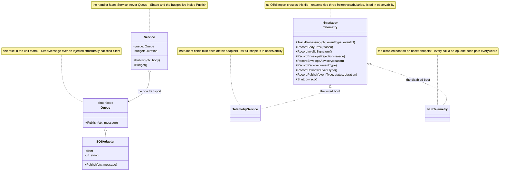
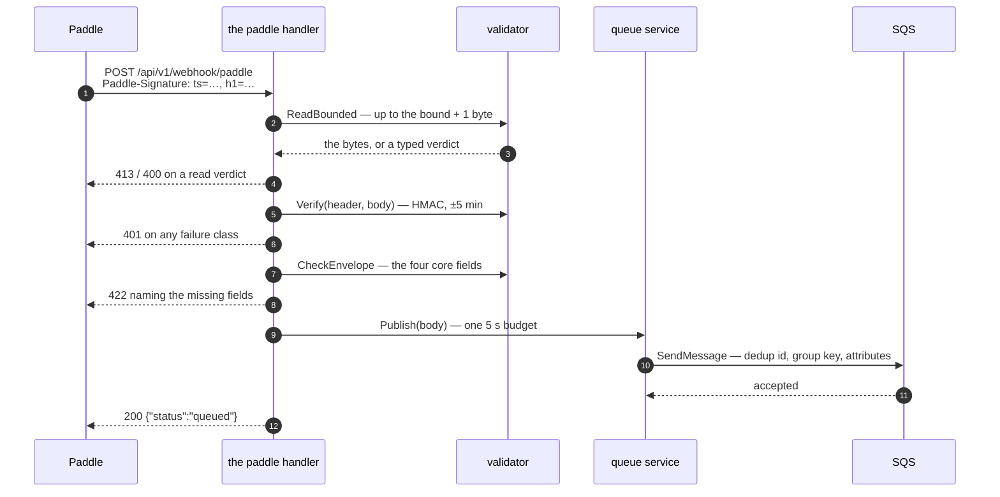
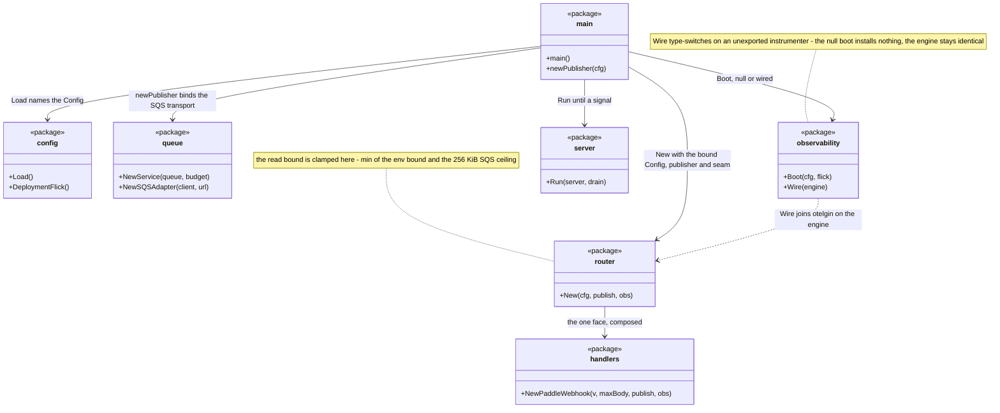
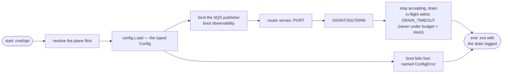

# Architecture

This document explains how one Paddle delivery becomes a durable event on the payment-events queue. Read the [Quick Start](../getting-started/quickstart.md) first if nothing is running yet.

## What this service is

A stateless webhook gateway: Paddle signs a delivery, the service verifies it, and the body is forwarded byte-for-byte to SQS. There is no database, no cache, no connection to hold — every request is self-contained, and one instance holds no state another needs. Concurrency comes from running more instances, not from anything inside one.

## The module map

```
internal/
├── router/          the gin engine — the /api/v1 group, probes + the single ingress
├── handlers/        the paddle face: bounded read, verify, envelope gate, one publish
│                    the probes and the response rows (200/400/413/503/500)
├── validator/       ReadBounded · the Paddle HMAC verifier · CheckEnvelope
├── events/          ParseEvent: the one Paddle metadata walk
├── queue/           the Message contract · Shape + the group ladder · the budget · SQS adapter
├── config/          typed Config + Resolve · dev/prod planes · fail-fast
├── observability/   the OTel facade: the null build or push to New Relic
└── server/          serve until SIGTERM, drain in-flight requests
```

The layering is strict and inward-facing: `router` orchestrates, `handlers` owns statuses, `validator`/`events`/`queue` own the three real jobs — checking, parsing, transporting — and `config`/`observability` serve them all. Nothing inside `queue` knows about HTTP.

## The two seams

The layering leaves exactly two seams between the request face and the outside world, each with one real realization per runtime and one fake in the unit matrix. The handler faces `Service` and `Telemetry` — never `Queue` internals or an SDK type.



## What happens on one delivery



The handler never touches AWS types or crypto: it bounds input, asks the validator three ordered questions, and maps the answer onto one response. Every delivery takes exactly this path — there is no second lane for known types or small bodies.

Questions the map answers, page by page:

- **Who may call, and what can fail?** → the [HTTP reference](../reference/http-api.md)
- **What can get in?** → [Validation](validation.md)
- **Where do events go, and in what order?** → [Delivery](delivery.md)
- **What does the boot read?** → [Configuration](../getting-started/configuration.md)
- **Where do signals go?** → [Observability](observability.md)

## How the boot wires it

The boot composes five of the eight internal packages in one straight line; composition happens once, top to bottom, before anything serves. (`handlers` arrives via the router, not `main`.)



## The runtime model: sequential, deliberately

There is **no executor, no worker pool, no connection machinery — anywhere**. The request path is strictly sequential: read → verify → gate → parse → enqueue → answer. Concurrency exists outside the process (Lambda instances, container replicas), never inside it.

- **The publish budget (5 s)** bounds every enqueue: `context.WithTimeout` wraps the one `SendMessage`, and a deadline maps to 503 with `Retry-After` at the budget's ceil. If SQS actually accepted the message before the deadline, the dedup id makes the ambiguity harmless ([Delivery](delivery.md)).
- **Health is a boot signal, not a runtime check.** `ready` means boot validation passed — config, credentials, queue URL. There is no broker connection to poll, so there is nothing to check at request time.

## The boot and shutdown lifecycle



Nothing is re-resolved per request: the config, the publisher, and the observability build all exist before the router serves anything, and on SIGTERM the drain guarantees in-flight enqueues finish inside the budget before exit.

## The deployment front door

AWS Lambda behind API Gateway, synchronous proxy integration — the same container image the local runtime uses, fronted by the Lambda Web Adapter, so the app, its config planes, and its tests stay unmodified across runtimes. The door shapes the numbers:

| Knob | Value | Why |
|------|-------|-----|
| Memory | 512 MB | constant-time HMAC over ≤ 256 KiB plus one `SendMessage` — no CPU-hungry phase |
| Function timeout | 10 s | above the 5 s budget, so the shaped 503 wins the race (a platform timeout would be an opaque 502) |
| API GW integration timeout | ≤ 29 s | above both; far under Lambda's 6 MB invocation ceiling at this service's body sizes |
| Cold starts | sub-second go binary + ~100 ms secrets fetch | invisible against webhook budgets; accepted |

## Canned probes

| Path | Healthy answer |
|------|----------------|
| `GET /api/v1/health` | 200 `{"status":"ok"}` |
| `GET /api/v1/ready` | 200 `{"status":"ready"}` |

Both are open endpoints and stay identical across runtimes, so callers can rely on them. Lambda has no probes — the platform owns availability — and they stay in the contract for local parity.
