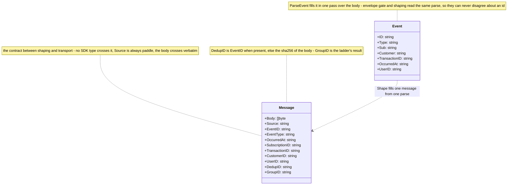
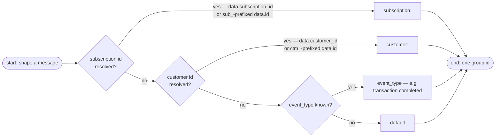
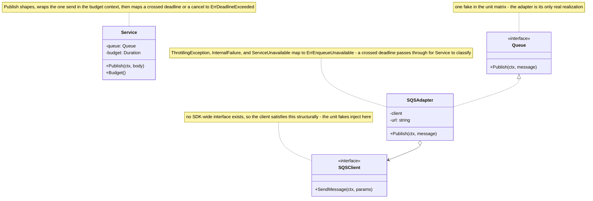
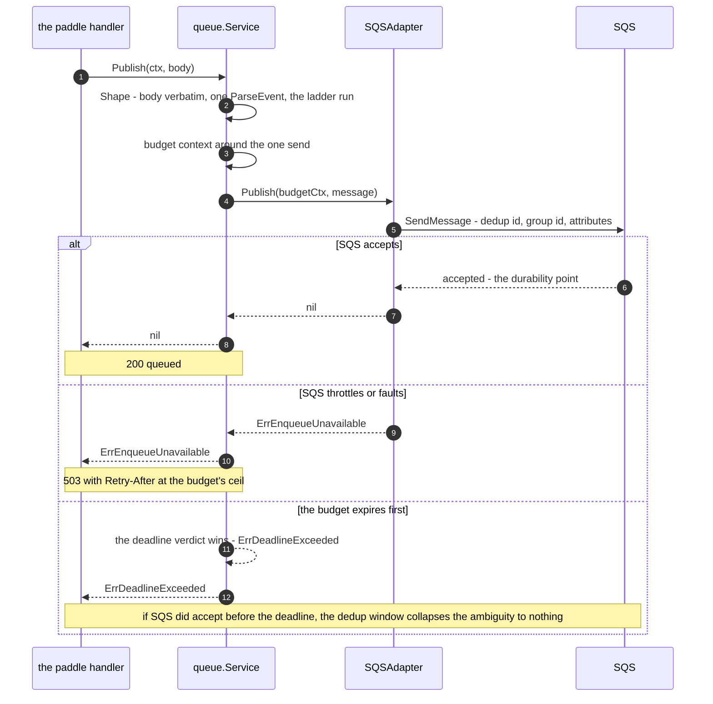
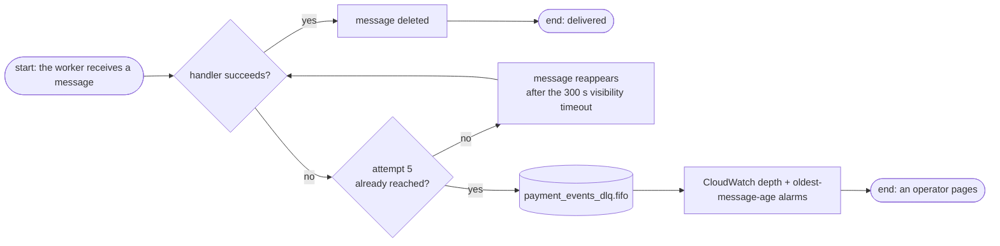

# Delivery

The queue contract: what a verified body becomes on SQS, in what order events arrive, and what happens to the ones that die. The wire side is [Validation](validation.md); the deployment front door is [Architecture](architecture.md).

## Why SQS FIFO

The brokers were measured before the call was made:

| Option | Verdict |
|--------|---------|
| **SQS FIFO** | chosen — one consumer; ordering + dedup native; DLQ via redrive |
| SQS Standard | viable fallback — but it silently drops the delivery-order guarantee the worker already runs against |
| SNS · EventBridge | rejected — nothing to fan out to, and no rules to route |
| RabbitMQ (Amazon MQ) · Kafka | rejected — cluster ops and partition plumbing for a webhook fan-in to one consumer |

The constraint that decided it: **the worker is out of this build's scope and unchanged.** RabbitMQ delivered in birth order today; FIFO preserves exactly that property while deleting the whole connection lifecycle — no reconnects, no publisher confirms. `SendMessage`'s 200 *is* the durability guarantee: the message sits on multi-AZ storage the moment the call returns.

## The queues

| Resource | Name | Type | Owner |
|----------|------|------|-------|
| Main queue | `payment_events.fifo` | FIFO | Terraform (IaC, pending) |
| Dead-letter queue | `payment_events_dlq.fifo` | FIFO | Terraform |
| Redrive policy | `maxReceiveCount = 5` on the main queue | — | Terraform |
| Visibility timeout | 300 s — must exceed the worker's slowest handler | — | Terraform |
| Retention | 14 days, both queues | — | Terraform |

The app knows exactly one queue parameter: `QUEUE_URL`, mandatory, boot-validated. Local runs point it at the ElasticMQ emulator; queue creation, redrive, and alarms are IaC — never runtime state.

## The message shape

The body crosses verbatim — the Paddle JSON, byte-for-byte, never altered by the metadata parse. Everything else rides `MessageAttributes` so the worker needs nothing beyond the body:

| SQS field | Value |
|-----------|-------|
| Body | the received bytes, verbatim |
| `MessageDeduplicationId` | the body's `event_id` — SQS honors it within the 5-minute dedup window |
| `MessageGroupId` | the group-key ladder below |
| `source` | `paddle` — constant; the gateway is Paddle-only |
| `event_type` | the body's `event_type`; `unknown` when a foreign shape defeats the parse |
| `event_id` · `occurred_at` | guaranteed by the envelope gate; `occurred_at` as the raw RFC3339 string — the worker's cross-entity ordering key |
| `subscription_id` · `transaction_id` · `customer_id` | the explicit field, or `data.id` when it carries the entity's `sub_`/`txn_`/`ctm_` prefix |
| `user_id` | `data.custom_data.user_id` — the app user the checkout propagated |

Blank optional ids **omit** their attribute — no empty string ever reaches SQS. Note: a body without `event_id` cannot pass the envelope gate, so the `sha256`-of-body dedup fallback only ever matters in the unit fakes — the real queue always dedups on an event id.

### The shapes behind the table

`Shape` and `GroupKey` are package-level functions — stateless, no boxes — so the diagram is the two data shapes they pass between: one `Event` parsed from the body, one `Message` leaving for SQS.

## The group-key ladder

One parse, one resolution order — groups are **per-entity ordering domains**, not burst correlation:

Two properties worth holding in your head:

- **Same-entity events never reorder.** Two updates to one subscription land on the same group and serialize — that is correctness for lifecycle transitions.
- **The creation burst spans groups, deliberately.** One checkout emits a dozen-plus webhooks (the `transaction.*`, `subscription.*`, `customer.*`, `address.*`, `payment_method.*` cluster) whose payloads share no single field — so no group id spans the burst, and one is not attempted. FIFO preserves Paddle's delivery order within each group; the worker rebuilds cross-entity order by comparing `occurred_at` (with `event_id` as the tiebreak) instead of trusting arrival position. The gateway ships both as attributes precisely so the worker needs nothing beyond the body.

### What dedup does and does not buy

Paddle's immediate retries collapse inside the 5-minute window; a retry spread across days re-reaches the worker — whose idempotency layer remains the ring-fenced backstop. The service never dedups itself.

## One publish, in code

The last hop as three shapes: the handler calls `Service`, which holds the transport behind a one-method seam.

## The dead-letter fate

The DLQ is a bounded shelf, not permanent storage: 14 days of retention (SQS's ceiling), guarded by a depth alarm **and** an age alarm so the page fires while dead events are still actionable. Replay is console/CLI move-back — the accepted operational surface.

## The worker contract (pending cutover)

`worker-payments` swaps `amqplib` for the SQS SDK against `payment_events.fifo` — long polling, record handlers and idempotency untouched. FIFO's per-subscription serialization replaces RabbitMQ's single-queue FIFO, so ordering input is equivalent or better. The `rabbitmq_connection_status` alert condition retires at cutover.

**Cancellation rides Paddle only.** The client's cancel path (deferred `apps/web` route) calls Paddle's API with `effective_from: "next_billing_period"`, and the worker reads exactly these:

| Paddle event | Signal | Worker effect |
|--------------|--------|---------------|
| `subscription.updated`, `scheduled_change.action = "cancel"` | `effective_from` at the next billing period | provisional cancel — entitlements keep serving until that date |
| `subscription.canceled` (Paddle's single-`l` spelling) | the change took effect at the billing date | permanent cancel |
| scheduled change cleared, or `subscription.resumed` | the user changed their mind mid-period | downgrade the provisional state — the cancel never happened |

## Cutover order (the no-loss invariant)

The consumer must exist before the producer's first publish, and RabbitMQ must drain before decommissioning:

1. Terraform provisions the FIFO queue + DLQ + redrive + alarms
2. `worker-payments` deploys the SQS consumer and begins polling (it idles on an empty queue)
3. This service publishes to SQS; RabbitMQ publication retires
4. Paddle's dashboard destination flips to `/api/v1/webhook/paddle`
5. The RabbitMQ queue drains; the broker, Amazon MQ, and the exporter scrape retire

The first event touches SQS only after step 2 — no gap where events would be accepted and lost.

## Next Steps

- **[Configuration](../getting-started/configuration.md)** — the `QUEUE_URL` contract and the emulators' bootstrap keys
- **[Observability](observability.md)** — what the *service itself* emits; queue-side numbers live in CloudWatch, in IaC
