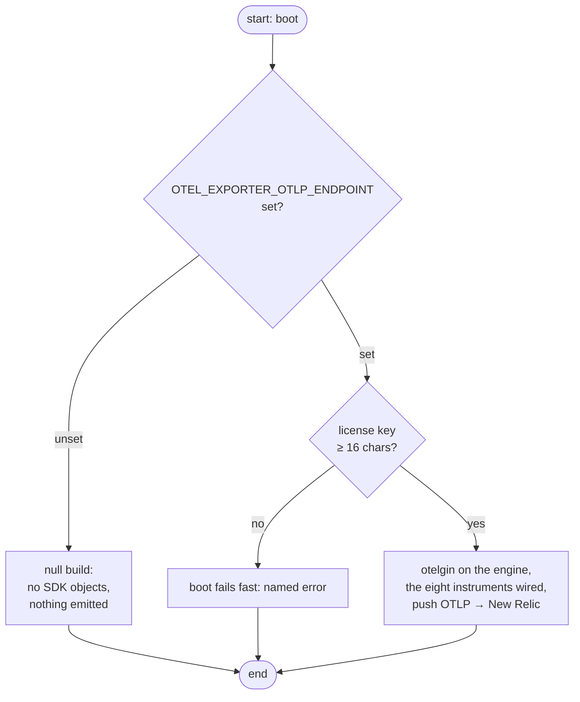
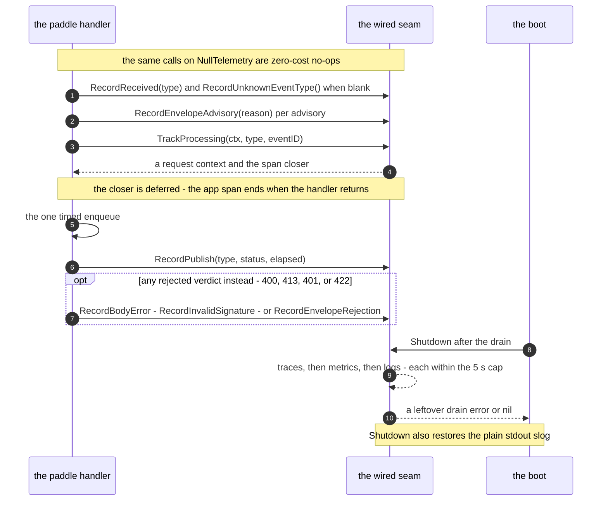
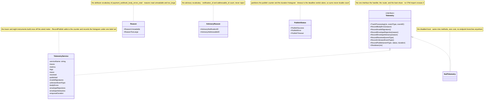
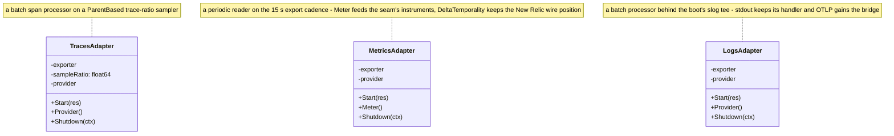

# Observability

The service exports logs, traces, and metrics — or nothing at all. There is no metrics endpoint and no partial state in between: the whole build is switched by one env var, `OTEL_EXPORTER_OTLP_ENDPOINT`.

## The gate

| Endpoint setting | What boots |
|------------------|------------|
| unset | the null build — no SDK objects created, every call a no-op |
| set | the full OTel pipeline; requires `NEW_RELIC_LICENSE_KEY` (≥ 16 chars) or **the boot fails** |

Unset is a *legitimate* configuration, not a degraded one — a disabled boot costs nothing, and the route keeps exactly one code path because the null build implements the same `Telemetry` seam as the wired one.

## Push, not pull

One pipeline, three signals, zero hops: the SDK exports traces, metrics, and logs directly to New Relic's native OTLP endpoint (`otlp.eu01.nr-data.net` for the EU account), authenticated with the **ingest license key** in the `api-key` header — never a user API key. HTTP/protobuf with gzip, 15 s metric cadence, delta temporality, parent-based sampling at `OTEL_TRACE_SAMPLE_RATIO`.

The reason for the exception path: a Lambda runtime cannot reach the compose stack's `otel-collector`, so this service — like document-parser — pushes straight to New Relic and owns the resource labels the collector used to upsert (`service.name`, `service.version`, `deployment.environment` from `ENV_TYPE`). Push is fire-and-forget from the request path: an export failure costs a batch, never a 5xx.

Dev may point the endpoint at any OTLP/HTTP receiver instead — a local collector on 4318 works on the same code path (a throwaway value for the license key is legitimate there); the boot demands only that a set endpoint arrive with a key.

## The metric inventory

Eight instruments, all landed. Names are a contract — dashboards and alerts query them by name, so a rename is a migration, not an edit.

| Instrument | Type | Attributes | Counts |
|------------|------|------------|--------|
| `payment_webhooks_received_total` | Counter | `event_type` | every accepted body |
| `payment_webhooks_unknown_event_type_total` | Counter | — | received bodies whose type defeated the parse |
| `payment_webhook_signatures_invalid_total` | Counter | — | every 401 |
| `payment_webhook_body_errors_total` | Counter | `reason` (`unreadable`, `too_large`) | every 400/413 |
| `payment_webhook_envelope_rejections_total` | Counter | `reason` (the missing field(s)) | every 422 |
| `payment_webhook_envelope_advisories_total` | Counter | `reason` (`notification_id`, `addressable_id`) | advisory-only oddities on queued bodies |
| `payment_events_published_total` | Counter | `event_type`, `status` | publish outcomes |
| `payment_events_enqueue_duration_seconds` | Histogram | `status` | publish cost in seconds |

`status` partitions `success` / `error` / `timeout` — timeout is the deadline verdict alone, so sums of the counters never double count. The HTTP route/error/latency panels ride **otelgin spans** (`http.route`, `http.status_code`), the same pattern document-parser dropped its HTTP instruments for.

## What each verdict records

The handler folds each verdict onto the seam as it happens; every rejection also logs at warning level (NFR-8) before it answers:

| Verdict | Call | Instruments touched |
|---------|------|---------------------|
| 400 / 413 | `record_body_error(reason)` | `payment_webhook_body_errors_total` |
| 401 | `record_invalid_signature()` | `payment_webhook_signatures_invalid_total` |
| 422 | `record_envelope_rejection(reason)` | `payment_webhook_envelope_rejections_total` |
| accepted, advisory | `record_envelope_advisory(reason)` ×n | `payment_webhook_envelope_advisories_total` |
| accepted | `record_received(event_type)` (+ unknown) | `payment_webhooks_received_total` (+ `…_unknown_event_type_total`) |
| 200 | `record_publish(event_type, "success", d)` | `payment_events_published_total` + duration |
| 503 · transport fault | `record_publish(event_type, "error", d)` | `payment_events_published_total` + duration |
| 503 · budget dead | `record_publish(event_type, "timeout", d)` | `payment_events_published_total` + duration |

Every accepted body also opens an application span under the otelgin route span, carrying `event_type` and `event_id` — the basis of per-event tracing in New Relic.

## One delivery, as signals

The verdict table above, as one live conversation on the 200 path — the rejection calls are the same functions, whichever row fires.

## Queue-side truth is not this service's

DLQ depth, oldest-message age, and retention are queue-level quantities on resources Terraform owns; they surface as CloudWatch alarms ([Delivery](delivery.md)), never as app-instrumented counters. Publishing observability stops where the enqueue SDK call ends.

## The shapes, small to large

`internal/observability` is the one facade both runtimes mount. Five files sit behind the seam: `interfaces.go` carries the seam and the three vocabularies (diagrammed below), `null.go` is the disabled boot's realization, `service.go` holds the frozen instrument names and every recording method, `boot.go` builds the gate — three gzip'd exporters, the adapters, the slog tee (`Wire` joins otelgin on the gin engine and no-ops on the null boot) — and `otlp.go`/`resource.go` carry the signal paths and identity labels.

### The seam, both realizations

### The adapters up close

Three adapters, one shape: an injected exporter, a provider built exactly once in `Start` against the shared resource, and a 5-second flush cap on the drain — a second `Start` is a wiring bug, not a no-op, and `Shutdown` restores `provider` to nil so it cannot double-drain.

## Next Steps

- **[Testing](../guides/testing.md)** — how the boot gate and the wire shapes are tested against a real receiver
- **[Configuration](../getting-started/configuration.md)** — the OTel key table
