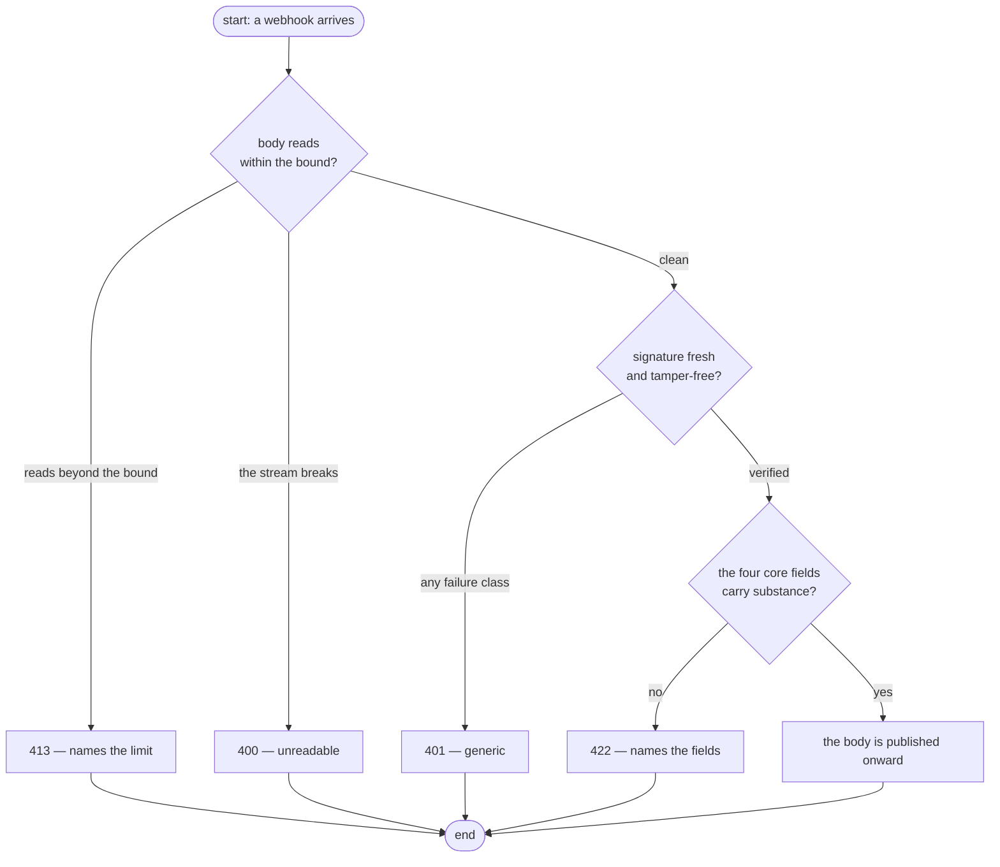
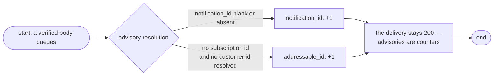

# Validation

This is the admission gate. Before a single body is *published*, it decides whether the delivery is trustworthy and carries the minimal shape the queue contract needs — in that order, and for that reason.

## The order is the contract

Three checks run in sequence, and each one's cost buys the next one's meaning:

| Order | Check | Who it protects |
|-------|-------|-----------------|
| 1 | the bounded read | the service — nothing processes an unbounded stream |
| 2 | the Paddle signature | the queue — nothing unverified reaches `SendMessage` |
| 3 | the envelope gate | the worker — nothing without `event_id`, `event_type`, `occurred_at`, and an object `data` gets published |

Everything past the gate never rejects: the event-type vocabulary, the data contents, and the deep payload shapes are the worker's interpretation. A recognizable-but-strange Paddle body is a legitimate delivery, not a rejection.

## Layer 1 — the bounded read

The body is read up to **bound + 1** bytes, where the bound is `min(MAX_BODY_BYTES, 256 KiB)`: the env key sets the raw limit (1 MiB default) and the router clamps it to SQS's per-message ceiling, so an unshippable body answers 413 instead of surfacing mid-publish as a send fault. The `+1` read proves an oversize body before the excess is consumed; a stream that breaks mid-read is 400, not magic.

## Layer 2 — the Paddle signature

One credential — `PADDLE_WEBHOOK_SECRET` — validates every delivery before any other work:

| Piece | Rule |
|-------|------|
| Header | `ts=<unix-seconds>;h1=<hex>` — both segment orders accepted; duplicates, extras, and a non-64-char-lowercase hex are malformed. The header's `ts` string frames the HMAC verbatim, never reformatted to an integer |
| Comparison | HMAC-SHA256 over `<ts>:<raw-body>`, recomputed and compared constant-time (`hmac.Equal`) |
| Freshness | `ts` within ±5 minutes of *now*, absolute — a stale **or future-dated** signature fails |
| Failure | one `ErrInvalid` class for all of it: missing, malformed, stale, or tampered — 401, generic, indistinguishable |

What a rejected delivery costs the event: nothing. Paddle treats any non-2xx as a failed delivery and retries for days on its own schedule, so a 401 delays an event rather than losing it.

## Layer 3 — the envelope gate

A verified body must carry the four core fields — `event_id` (non-blank string), `event_type` (non-blank string), `occurred_at` (RFC3339), `data` (an object). Absent, blank, null, and mistyped all fail the same gate under the field's own name; a body that never parses to an object has no envelope at all. A failure answers **422 naming the field(s)**, with no `Retry-After` — the caller produced an unusable payload, not a queue outage, and Paddle's retry (or a dashboard replay) gives the repair window.

Two oddities are advisory only and never reject:

- **no `notification_id`** — Paddle's delivery-layer id; the worker keys idempotency on `event_id`, not the delivery id, so the envelope it needs can grow without breaking this face
- **no addressable id** — the group ladder (see [Delivery](delivery.md)) resolves neither a subscription nor a customer id; known-but-unaddressable events are legitimate

Both land as counters ([Observability](observability.md)), never as rejections. Extra top-level keys are ignored — an open set, so Paddle can grow the envelope without breaking the gate.

## The admission flow

The gate sits behind one handler method — the flow above is `NewPaddleWebhook` read top to bottom; there is no alternate ordering anywhere in the surface.

## The advisory check, apart

Advisories see the same resolution the group ladder will run — envelope and shaping share one parse (`events.ParseEvent`), so they can never disagree about an id.

## The bounds on this page

Both bounds are env-configurable and fail closed — see [Configuration](../getting-started/configuration.md). The wire shapes every verdict produces are the [HTTP reference](../reference/http-api.md)'s status table.

## Next Steps

- **[Delivery](delivery.md)** — what a body that passed this gate becomes on the queue
- **[Testing](../guides/testing.md)** — the validator vectors this flow is pinned by
