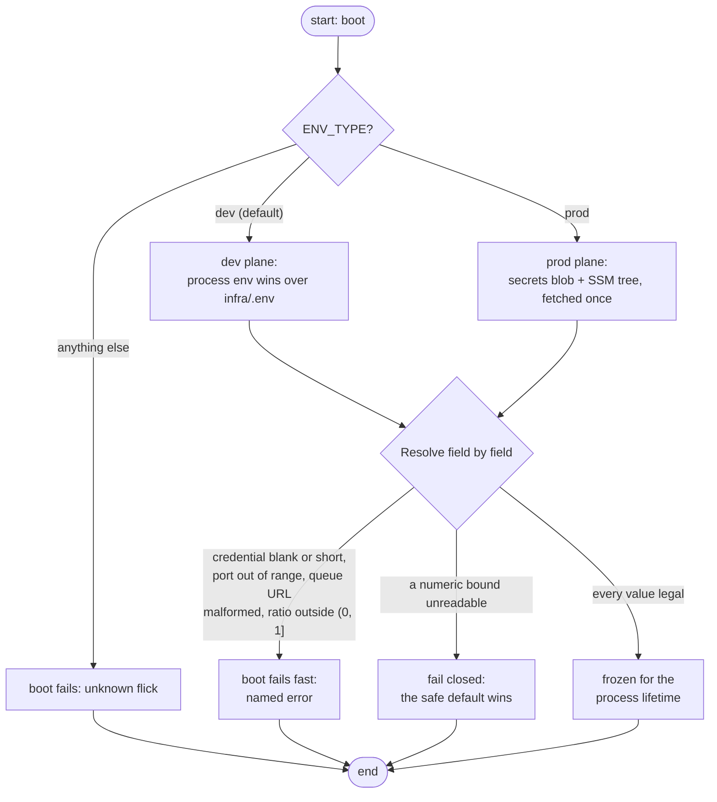

# Configuration

Every setting the service has is resolved **once at boot** from one place — a config plane — and is then frozen for the process lifetime. No request ever re-reads config, and no change takes effect until a restart.

## The plane flick

One env var decides which plane the boot reads — a two-position flick:

| `ENV_TYPE` | Plane |
|------------|-------|
| `dev` (default) | Developer plane |
| `prod` | Prod plane |
| anything else | **boot fails** — an unknown flick never serves |

## Developer plane

`DevSource` merges two sources, process environment winning over `infra/.env`:

- `infra/.env` — created by `make env` from the committed template; the compose stack feeds it to containers the same way (`env_file`)
- the process environment — so a container or a test run needs no file at all

A missing file at the default location is an empty plane (values then come from the environment); a malformed file fails the boot. Blank `KEY=` entries are dropped — an empty value can never win over a default.

## Prod plane

`ProdSource` fetches two disjoint AWS sources once, at boot:

- **Secrets Manager** — the JSON blob `detectai/payment-webhook/secrets` (the webhook secret, the license key)
- **SSM parameters** — plain settings under `/detectai/payment-webhook/`

Process env and dotenv never reach this path, so a stray variable cannot leak a value in. A key found in **both** AWS sources fails the boot loudly — they are disjoint by seeding contract. `AWS_REGION` and the endpoint overrides are bootstrap variables, not config; every AWS read builds through the SDK's default chain exactly once (see [the bootstrap table](#bootstrap-variables-config-owns-none-of-them)).

Binary compatibility instead of re-source: a key seeded after boot stays invisible until restart.

## Every key

Field names are the env keys, uppercased. Unknown keys are ignored (consume-first), so typos in unused keys degrade harmlessly. The credential is the only key with no default — its absence stops the boot.

| Key | What it controls | Default | Bad value behavior |
|-----|------------------|---------|--------------------|
| `ENV_TYPE` | plane selection | `dev` | **boot fails** |
| `PORT` | listen port | 8080 | **boot fails** outside 1–65535 |
| `PADDLE_WEBHOOK_SECRET` | the credential Paddle signs with — compared at every delivery | — | **boot fails** unless non-empty and ≥ 16 chars |
| `QUEUE_URL` | the payment-events FIFO endpoint | — | **boot fails** unless a well-formed http(s) queue URL |
| `MAX_BODY_BYTES` | raw request bound | 1 MiB | falls back to default |
| `PUBLISH_BUDGET` | the in-code enqueue budget | 5 s | falls back to default |
| `DRAIN_TIMEOUT` | graceful drain on SIGTERM | 10 s | falls back to default — then clamps up to never serve shorter than budget + 5 s slack |
| `OTEL_EXPORTER_OTLP_ENDPOINT` | the observability gate — see below | unset → nothing emitted | set without the key → **boot fails** |
| `NEW_RELIC_LICENSE_KEY` | ingest license key for the OTLP endpoint | unset | demanded only when the endpoint is set |
| `OTEL_SERVICE_NAME` | resource name attached to all signals | `payment-webhook` | falls back to default |
| `OTEL_SERVICE_VERSION` | resource version | `dev` | falls back to default |
| `OTEL_TRACE_SAMPLE_RATIO` | fraction of traces sampled, `(0, 1]` | 1.0 | **boot fails** |

Two notes on the read bound: a bad value falls closed to the 1 MiB default, and the router then clamps the effective bound to **min(`MAX_BODY_BYTES`, 256 KiB)** — SQS cannot carry more per message, so an unshippable body answers 413 before it ever wastes a publish budget.

The split that matters: **numeric bounds and identity fields fail closed** (an unreadable value falls back to the safe default, boot continues) — **credentials, the queue URL, the port, and the sample ratio fail the boot** (a half-configured instance never serves).

## How a boot resolves

## Bootstrap variables (config owns none of them)

| Key | Role |
|-----|------|
| `AWS_REGION` | the one region every AWS composition builds against |
| `AWS_ENDPOINT_URL_SQS` / `_SECRETS_MANAGER` / `_SSM` | SDK-native endpoint overrides — how local runs reach the emulators |
| `AWS_ACCESS_KEY_ID` / `AWS_SECRET_ACCESS_KEY` / `AWS_SESSION_TOKEN` | the credential trio, riding the SDK default chain |

`infra/.env.example` ships all of them so `set -a` sourcing and compose `env_file` carry them along; the compose `environment:` block carries only the trio, which is the one channel that lets a shell override a run's credentials without touching the file.

## Next Steps

- **[Secrets guide](../guides/secrets.md)** — provisioning the credentials this page reads
- **[Quick Start](quickstart.md)** — get a working local boot first
