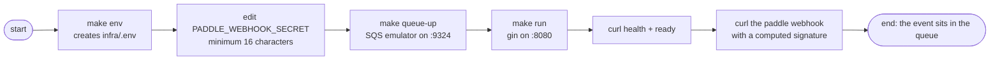

# Quick Start

Get the service running locally, then publish your first signed webhook. The whole loop is `make env` → `make queue-up` → `make run`.

## Steps

1. **Create the env file** — copies `infra/.env.example` to `infra/.env` if missing:

   ```sh
   make env
   ```

2. **Set a real webhook secret** by editing `infra/.env` — the boot enforces one rule: the value must be at least 16 characters (yes, the example placeholder legalistically passes that floor, which is exactly why it pays to replace it before anything real listens):

   ```ini
   PADDLE_WEBHOOK_SECRET=my-secret-16-chars-min
   ```

   In Paddle's dashboard this is the value the webhook destination pairs with — real traffic signs with the same string. The [secrets guide](../guides/secrets.md) covers where credentials live properly.

3. **Start the SQS emulator** — a local ElasticMQ on port 9324 (dashboard on 3001):

   ```sh
   make queue-up
   ```

   `QUEUE_URL` in `infra/.env` is written container-shaped (`host.docker.internal:9324`); host runs get it repainted to `localhost` automatically by `make run`.

4. **Run the service:**

   ```sh
   make run
   ```

5. **Verify with the probes** (no signature needed):

   ```sh
   curl http://localhost:8080/api/v1/health
   # {"status":"ok"}
   curl http://localhost:8080/api/v1/ready
   # {"status":"ready"}
   ```

6. **Publish your first signed webhook** — sign `<ts>:<raw body>` with the secret:

   ```sh
   SECRET=paddle-change-me-16-chars
   TS=$(date +%s)
   BODY='{"event_id":"evt_001","event_type":"subscription.created","occurred_at":"2026-01-01T00:00:00Z","data":{"subscription_id":"sub_001"}}'
   SIG=$(printf '%s:%s' "$TS" "$BODY" | openssl dgst -sha256 -hmac "$SECRET" | awk '{print $NF}')

   curl -X POST http://localhost:8080/api/v1/webhook/paddle \
     -H "Paddle-Signature: ts=$TS;h1=$SIG" \
     -H "Content-Type: application/json" \
     -d "$BODY"
   # {"status":"queued"}
   ```

   The emulator UI on `localhost:3001` now shows the message in `payment_events.fifo`, grouped under `subscription:sub_001`. Per Paddle's own schema, `canceled` takes a single `l`, exactly as Paddle's lifecycle events spell it.

## The first-run path



## Docker instead

```sh
make build
make up     # queue-up, then compose up detached
curl http://localhost:8080/api/v1/health
make down
```

The compose stack reads `infra/.env` wholesale, so the same config drives both ways of running — and the container reaches the emulator over `host.docker.internal` without any repainting.

## Next Steps

- **[Configuration](configuration.md)** — what every key does and what happens when one is wrong
- **[Validation](../concepts/validation.md)** — why a body can earn 413, 400, 401, or 422
- **[HTTP API](../reference/http-api.md)** — the full request/response contract

| Command | What it does |
|---------|--------------|
| `make help` | the full command index |
| `make test` | the full go suite |
| `make logs` | follow docker logs |
| `make down` | stop the docker stack |
