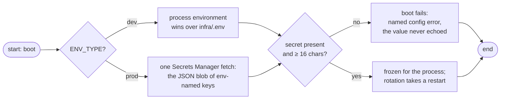

# Secrets

This service keeps secrets deliberately small: **one credential guards every webhook** — `PADDLE_WEBHOOK_SECRET`, the value Paddle signs with — plus the observability license key when telemetry is on. This page covers where each value lives per plane, how the runtime handles it, and how it is provisioned and rotated.

## Where each value lives

| Value | Dev plane | Prod plane | Load/e2e rig |
|-------|-----------|------------|--------------|
| `PADDLE_WEBHOOK_SECRET` | process env, or `infra/.env` (env wins) | Secrets Manager blob (`detectai/payment-webhook/secrets`) | `infra/.env.load` (must match the service's value) |
| `NEW_RELIC_LICENSE_KEY` | process env, or `infra/.env` | Secrets Manager blob — same JSON object | not needed |

Files that hold real values (`infra/.env`, `infra/.env.load`) are gitignored; only their committed templates (`.env.example`, `.env.load.example`) ever enter the repository.

## How the secret resolves at boot



Two things the resolution guarantees:

- **The boot validates the credential itself** — not just presence, but the 16-character floor. No request ever runs against a service whose credential was never checked.
- **The value is read once** and frozen for the process lifetime. Rotating the secret therefore needs a restart to take effect — see [rotation](#rotation) below.

## How the secret is checked at runtime

Every delivery carries Paddle's signature header; the verifier recomputes the HMAC and compares constant-time:

| Rule | Why |
|------|-----|
| `Paddle-Signature` is the only carrier | one credential, one comparison path to test |
| constant-time compare (`hmac.Equal`) | timing cannot be used to extract the secret byte by byte |
| missing vs stale vs tampered are indistinguishable in the response | the caller learns nothing by trying variants |
| rejections log at warning level without the attempted header or signature | an incident shows *what happened*, never *what the attacker typed* |
| probes stay open | monitoring does not need (or hold) the secret |

## Provisioning the prod secret

The seed lives in `infra/.env` (copied from `.env.example`) and the pipeline is driven through make targets — the `tfctl` stack seeds the Secrets Manager blob and refreshes the SSM tree from it:

```sh
make secrets-check        # validate infra/.env, preview the plane — no terraform, no AWS
make secrets-plan         # terraform plan against the selected plane
make secrets-apply        # apply (auto on the emulator plane, confirm on real AWS)
make secrets-verify       # read the live plane and match it against infra/.env (fingerprints only)
```

Every verb takes `PLANE=floci|aws` (default floci; `DRY_RUN=1` previews any verb). The payload seeded by that flow is a JSON object whose keys are the env names — `PADDLE_WEBHOOK_SECRET` and `NEW_RELIC_LICENSE_KEY` are simply entries in it. The prod plane resolves the *whole* blob at once at boot and treats secrets and SSM parameters as disjoint planes: a key seeded into both is an operator error the boot refuses to paper over. The full annotation is the [config spec](../../specification/references/config.md).

### Rotation

1. Update the value in the plane it lives in (`make secrets-apply` for prod; edit the file for dev).
2. Restart the service. Config is resolved **once** per boot, so a rotated key goes live exactly when a new instance starts — and never mid-flight.

For a real rotation, Paddle's dashboard and this secret must change together: the dashboard pairs its destination with one signing secret at a time.

## Hygiene checklist

- [ ] Real values only in gitignored files — never in templates, no matter how harmless they look
- [ ] `PADDLE_WEBHOOK_SECRET` is ≥ 16 characters (the boot enforces it; make it long anyway)
- [ ] Nothing echoes the credential into logs — the application layer already never does; keep your own tooling equally quiet
- [ ] Do not add a second webhook credential ("the same key in an `x-api-key` header too") — the internal-face credential retired with the rebuild; one secret, one header
- [ ] Rotate with *only* the documented apply + restart flow, so every component reads the same version

## Next Steps

- **[Configuration](../getting-started/configuration.md)** — the credential's validation table and plane rules
- **[Quick Start](../getting-started/quickstart.md)** — setting a local secret in the first-run flow
