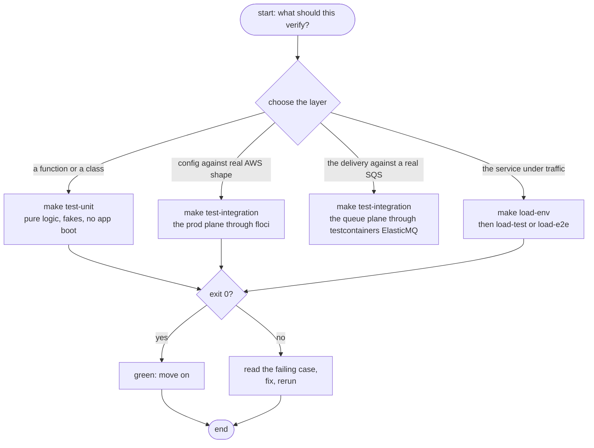
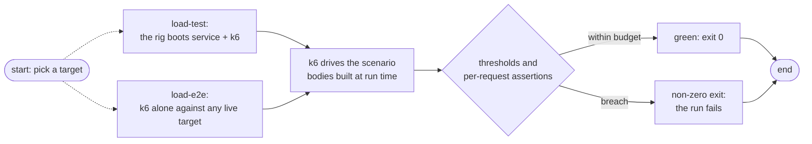

# Testing

Three layers, each answering a different question. The rule that keeps them honest: **unit tests hold pure logic with fakes; integration tests drive the real AWS planes; the load rig sends real traffic** — three trees with a hard boundary between them.

| Question | Layer | Command |
|----------|-------|---------|
| Does this function do the right math? | unit | `make test-unit` |
| Does the prod plane really read what seeding writes? | integration | `make test-integration` |
| Does the delivery really cross the queue as promised? | integration | `make test-integration` |
| How does the service behave under traffic? | load | `make load-test` / `make load-e2e` |

`make test` runs unit + integration together. Green means exit 0; `go test` and k6 alike propagate failures to the shell.



## Unit — fast and faked

One folder per component, black-box over the exported API. The suite pins the semantics the integration and load layers build on: the read bound's legality at exactly `max`, the signature classes, the envelope gate's verdicts, the ladder's rungs, the budget mapping, and the SQS fault codes.

| Folder | Covers |
|--------|--------|
| `tests/unit/config/` | the dotenv grammar, env-over-file, the flick wiring, `Resolve`, the prod planes through fakes |
| `tests/unit/validator/` | bounded-read vectors; signature classes — fresh, stale, future, tampered, malformed fragments |
| `tests/unit/handlers/` | the face's status matrix — 200/400/401/413/422/503/500 over the real validator and a fake queue |
| `tests/unit/router/` | the mounting, the signed publish-through, the 256 KiB ceiling clamp |
| `tests/unit/queue/` | the ladder vectors, dedup fallback, budget mapping, FIFO message shape, fault mapping |
| `tests/unit/observability/` | null vs wired boot, resource identity, the delta wire shape — against an in-process OTLP receiver |

Two orderings the handler matrix exists to prove: an oversize body with a garbage signature still answers **413** (the bound precedes auth), and an unsigned envelope violation answers **401**, never 422 (auth precedes the gate).

## Integration — the prod planes against real AWS shape

`tests/integration/config` drives the prod read path through the seeded floci emulator (`:4566`) — the Secrets Manager blob and the SSM tree exactly as `make secrets-apply` ages them. It skips (not fails) when the emulator is down, so a green `make test` needs no running stack.

`tests/integration/queue` boots the whole app face against a live ElasticMQ: testcontainers starts the emulator (same `1.7.1` image and queue/conf shape as the shared dev fabric), the harness assembles config → SQS adapter → router exactly as `cmd/api` does, and drives real signed posts through HTTP. The rows it owns are the delivery contract the fakes cannot see: the body arriving byte-for-byte with its ids on message attributes, the group ladder landing on `MessageGroupId`, dedup collapsing repeats, in-group FIFO order, the 250 KiB / 256 KiB sizing edges, the full rejection matrix leaving the queue sealed, and a stopped emulator earning the outage verdict — 503 + `Retry-After`, the verdict Paddle retries on. It skips when Docker is absent, same grammar as the floci skip.

## Load + e2e — traffic, not tests

k6 suites under `tests/load/`. One file — `infra/.env.load` (copy the template `.env.load.example`) — configures *everything*, `SCENARIO` included; there are no CLI overrides, so one edit re-arms the runner. The [full rig manual](../../tests/load/README.md) lives beside the scenarios; this page is the map.

```sh
make load-env        # create infra/.env.load from the example
make load-test       # container rig: service + k6 on an isolated network
make load-e2e        # k6 alone, against whatever API_URL names
make load-down       # tear the rig down
```



### The two scenarios

| Scenario | Shape | Pass criteria |
|----------|-------|---------------|
| `smoke` | 1 VU, 1 iteration: health, one 200 per profile, the advisory row, the full rejection matrix | every request asserts its exact answer |
| `load` | `ramping-arrival-rate` shaped by `STAGES` — a ramp, a spike, or a `4h:2` soak (data, not code) | `p95 < 1000 ms`, `p99 < 2000 ms`, success ≥ 99% |

The smoke matrix maps the guards one to one: missing, stale, wrong-secret, and malformed signatures (401); an oversized raw body (413); then the gate's 422s — missing `event_id`, null `data`, non-RFC3339 `occurred_at`, and a body that never parses. A readiness `503` during load is recorded as backpressure, not a failure.

Subtlety: the service verifies with `infra/.env`'s secret while k6 signs with `.env.load`'s — the two files must carry the same value, and the defaults agree.

### The profiles

Every body is built at run time — deterministic Paddle-shaped envelopes padded to target, no RNG, no corpus — with unique `event_id`s per iteration so queue dedup never collapses the traffic, and a 64-slot subscription pool fanning the group keys out.

| Profile | Target | Wire answer at the default boot |
|---------|--------|---------------------------------|
| small / mid / large | 200 B → 64 KiB | 200 queued |
| near-limit | ~250 KiB | 200 queued — under the 256 KiB ceiling |
| oversize | ~284 KiB | 413 under every boot |

### The knobs

Knobs live in `infra/.env.load` with built-in defaults: `SCENARIO` and `STAGES`/`MAX_VUS` shape the run, `WEBHOOK_LOAD_PROFILES` picks the mix, `WEBHOOK_LOAD_EVENT_TYPES` rotates the payload types, `WEBHOOK_LOAD_POOL` sizes the fan-out, `API_URL`/`PADDLE_WEBHOOK_SECRET` aim and arm the runner, and the `WEBHOOK_LOAD_P95_MS`/`P99_MS`/`MIN_SUCCESS_RATE` trio carries the budget.

## Next Steps

- **[HTTP reference](../reference/http-api.md)** — every status the suites assert, in one table
- **[Configuration](../getting-started/configuration.md)** — the keys the different-bound boots move
- **[Make Commands](../reference/make.md)** — the annotated target index
