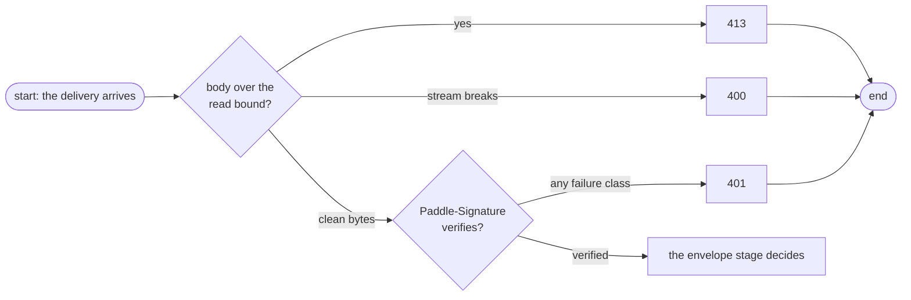
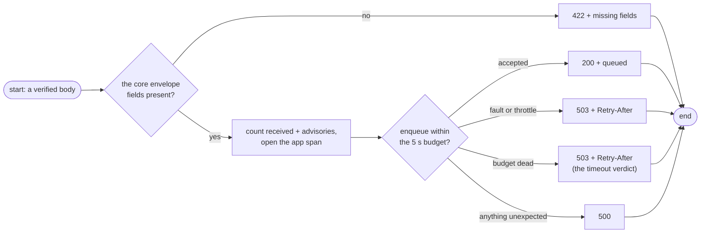

# HTTP API

The wire contract for every caller. Errors are always a JSON body like `{"error": "…"}`. There is no metrics endpoint by design; observability travels through the OTel pipeline ([Observability](../concepts/observability.md)).

## Endpoints

| Method + Path | Auth | Purpose |
|---------------|------|---------|
| `POST /api/v1/webhook/paddle` | required | Verify + queue a Paddle event |
| `GET /api/v1/health` | open | Liveness probe |
| `GET /api/v1/ready` | open | Readiness signal |

The `/api/v1` prefix shapes every route (probes included) and is part of the contract; 404/405 behave as the framework defaults them to.

## POST /api/v1/webhook/paddle — request

Paddle's webhook deliveries — and each element's rules:

| Input fact | Rule |
|------------|------|
| Credentials | `Paddle-Signature` header — `ts=<unix-seconds>;h1=<hex>`; verified constant-time against `PADDLE_WEBHOOK_SECRET` over `<ts>:<raw-body>`; `ts` must sit within **±5 minutes** of now |
| Authentication failures | always 401, generic — missing, malformed, stale, and tampered are indistinguishable; Paddle's retry machinery is the caller-side receipt |
| Body limit | read up to **min(`MAX_BODY_BYTES`, 256 KiB) + 1** bytes; anything more answers 413 before the excess is consumed |
| Body | the raw Paddle JSON — forwarded byte-for-byte on success |
| Envelope | after the signature passes: `event_id` and `event_type` (non-blank strings), `occurred_at` (RFC3339), `data` (an object) — else 422 naming the fields |

## Response — 200

```json
{"status": "queued"}
```

Emitted only after SQS accepts the `SendMessage` — the SDK response is the durability point: no pending-write semantics to explain away.

## The decision map

The read-and-authentication stage, then the envelope-and-delivery stage. Everything that fires before the envelope has a say:



The envelope and delivery stage — token-only decisions for verified bytes:



Errors are refused in request order — bound first, signature next, envelope last — so a single delivery never gets two rejections to disentangle.

## Status codes

| Code | When | Body detail |
|------|------|-------------|
| 200 | SQS accepted the message | `{"status":"queued"}` |
| 400 | Body unreadable or malformed during the bounded read | generic |
| 401 | Signature missing, malformed, stale, or tampered | generic — the failure classes are indistinguishable |
| 413 | Body larger than the effective bound | names the limit: `{"error":"request body exceeds 262144 bytes"}` |
| 422 | The envelope check failed | names the fields: `{"error":"payload rejected by the envelope check","missing":["event_id"]}` |
| 503 | Enqueue unavailable: SQS outage, throttling, or budget exceeded | `{"error":"queue unavailable","retryable":true}` + `Retry-After` at the budget's ceil (5 at the default) — the dedup id makes an accepted-but-late attempt harmless ([Delivery](../concepts/delivery.md)) |
| 500 | Unexpected error | generic |

404/405 and other framework defaults are untouched. A 401 never carries `WWW-Authenticate` — a rejected delivery is not an interactive-auth challenge. 429 does not appear: shedding is not this service's lever.

## Probes

| Path | 200 body |
|------|----------|
| `/api/v1/health` | `{"status":"ok"}` |
| `/api/v1/ready` | `{"status":"ready"}` |

## Error examples

```sh
# oversize body → 413 {"error":"request body exceeds 262144 bytes"}
# wrong or stale signature → 401 {"error":"unauthorized"}
# missing envelope field → 422 {"error":"payload rejected by the envelope check","missing":["occurred_at"]}
# queue outage → 503 {"error":"queue unavailable","retryable":true} + Retry-After: 5
```

## Next Steps

- **[Validation](../concepts/validation.md)** — why the gate answers what it answers, layer by layer
- **[Delivery](../concepts/delivery.md)** — where the 200 rests until the worker consumes it
- **[Testing](../guides/testing.md)** — the suites that pin every row above
