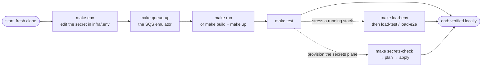

# Make Commands

Every verb of this service is a make target run from `services/payment-webhook`; `make help` prints the raw index, and this page is that index plus a purpose for each row. Targets live in five files under `mk/`, and the sections below follow the same order as a working day — set up, run, verify, then the deeper orbits.

## The lifecycle at a glance

Details: the [Quick Start](../getting-started/quickstart.md) walks the main line step by step.

## Local — `mk/local.mk`

| Target | What it does | Reach for it when |
|--------|--------------|-------------------|
| `make run` | sources `infra/.env` into the shell, repaints `QUEUE_URL` from `host.docker.internal` to `localhost`, runs the API | everyday development |
| `make env` | copies `infra/.env.example` → `infra/.env` **if missing** | first run; it never overwrites an existing file |
| `make tidy` | resolves and updates `go.mod`/`go.sum` | after pulling dependency changes |
| `make vet` | `go vet ./...` | before pushing anything |

## Docker — `mk/docker.mk`

| Target | What it does | Reach for it when |
|--------|--------------|-------------------|
| `make build` | builds the image (`detectai-payment-webhook`) | before `up`, or to test the Dockerfile |
| `make up` | `queue-up`, then compose up detached, building | same behavior as `make run`, no hot reload |
| `make down` | compose down — the emulator keeps running under its own verbs | when done with the stack |
| `make queue-up` | starts ElasticMQ (SQS on `:9324`, UI on `:3001`); a running emulator is left untouched, never recreated — its in-memory state would drop | before a local run that needs a queue |
| `make queue-down` | the emulator's compose down | cleaning up the emulator |
| `make logs` | compose logs `-f` | a running stack misbehaves |
| `make ps` | compose `ps` | is it even up? |
| `make clean` | down + queue-down + the networks/volumes of both compose projects | odd failures with nothing obviously changed |

## Tests — `mk/tests.mk`

| Target | What it does | Reach for it when |
|--------|--------------|-------------------|
| `make test` | the full suite, module-wide | before pushing anything |
| `make test-unit` | the black-box unit tree (`tests/unit`) | iterating on one validator, the ladder, or the fault mapping |
| `make test-integration` | the prod planes through the seeded floci emulator — skips when it is down | config plane wiring changed |

## Load and e2e — `mk/load.mk`

One `infra/.env.load` configures everything, the file's `SCENARIO` line included (`smoke` or `load`) — there are no CLI overrides, so: edit the file, rerun.

| Target | What it does | Reach for it when |
|--------|--------------|-------------------|
| `make load-env` | creates `infra/.env.load` from the template if missing | first run; the file is then the single lever for every knob |
| `make load-test` | container rig: service + k6 on an isolated network (the queue is the running emulator); k6's exit code survives the teardown | throughput, on your own private rig |
| `make load-e2e` | k6 alone, against whatever the file's `API_URL` names | a specific target — `make run`, a docker stack, a Lambda URL, prod |
| `make load-down` | removes the rig and any e2e-run leftovers | cleaning up after either run |

## Secrets — `mk/secrets.mk`

| Target | What it does | Reach for it when |
|--------|--------------|-------------------|
| `make secrets-check` | validates `infra/.env` and previews the plane/vars — no terraform | before anything else, always |
| `make secrets-plan` | terraform plan against the selected plane | reading what would change |
| `make secrets-apply` | terraform apply — auto on the emulator, interactive confirm on real AWS | making it real |
| `make secrets-auto-apply` | validate + plan, apply, verify — stops at the first failure | one-shot seeding |
| `make secrets-verify` | reads the live plane and matches it against `infra/.env`; values as lengths and fingerprints only | after apply, or whenever "is the seed actually right?" nags |
| `make secrets-drop-seeder` | detaches the seeder policy and deletes the role | leaving an account clean |
| `make secrets-clean` | terraform destroy — keeps the state bucket and ledger | wiping resources, keeping your place |
| `make secrets-destroy` | destroy, purge the state bucket, drop the seeder role | leaving no trace |
| `make secrets-session-clear` | drops the cached seeder session for this service | after a stale/failed MFA window |
| `make secrets-session-clear-all` · `-refresh-all` | drops (or mints fresh) seeder sessions across ready services | juggling several services per MFA code |
| `make secrets-test` | runs the `tools/tfctl` engine test suite | the tfctl driver changed |

Every target takes `PLANE=floci|aws` (default floci), plus `DRY_RUN=1` to preview any verb; `FORCE=1` applies to session-refresh-all and `FORCE_DELETE=1` to destroy. Where the values go and how they rotate is the [secrets guide](../guides/secrets.md)'s subject — this page only lists the levers.

## Targets make calls for you

`load-check` (rejects a missing `infra/.env.load`, a missing `infra/.env`, or an unknown `SCENARIO` before compose runs) fires as an order-only prerequisite of `load-test` and `load-e2e`; `load-down-remote` is the child cleanup verb `load-down` delegates to first. Neither needs to be invoked by hand — they are listed so the index matches `mk/` completely.

## Next Steps

- **[Quick Start](../getting-started/quickstart.md)** — the main line, step by step
- **[Testing](../guides/testing.md)** — what the test targets run and why
- **[Secrets](../guides/secrets.md)** — behind the secrets targets
