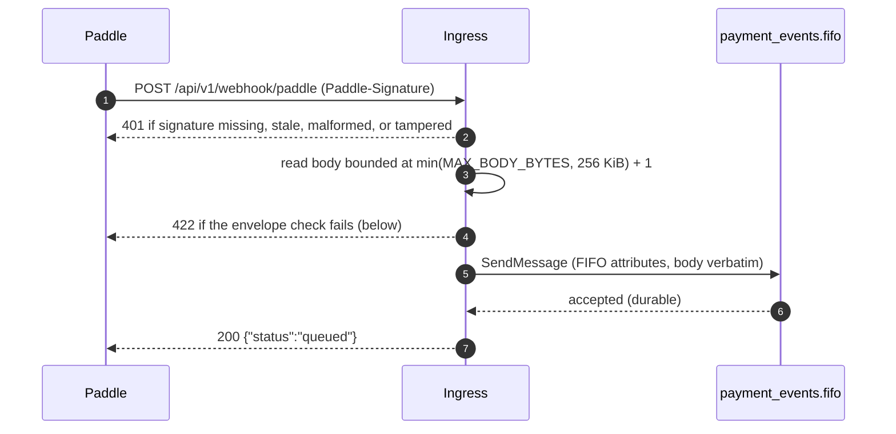

# HTTP Design

The wire contract for the payment-webhook service. Requirements live in [requirements.md](requirements.md); the queue-side contract in [messaging.md](messaging.md). The user-facing version of this page is [docs/reference/http-api.md](../docs/reference/http-api.md).

## The rebuild changed these, deliberately

1. **Paths moved under `/api/v1`** — ingress and probes alike, so a future version moves the whole surface with one prefix.
2. **The internal face retired** — `POST /api/v1/internal/events`, its `x-api-key` credential, and `API_KEY` are gone; every queued event has crossed the signature header and the envelope gate. Client-triggered cancellation rides Paddle's own lifecycle events ([messaging.md](messaging.md)).
3. **413/400 split** — oversized bodies answer 413 naming the limit; malformed/unreadable bodies answer 400 (the pre-rebuild gateway answered 400 for both).
4. **Error envelope stays `{"error": "…"}`** — Gin-native; callers need no schema changes.

Affected callers: the knock-on list in [requirements.md](requirements.md).

## Endpoints

| Method + Path | Auth | Purpose |
|---------------|------|---------|
| `POST /api/v1/webhook/paddle` | required | Validate + queue a Paddle event |
| `GET /api/v1/health` | open | Liveness probe |
| `GET /api/v1/ready` | open | Readiness signal |

The `/api/v1` prefix shapes every route and is part of the contract; the probes mount inside the same group as the ingress. There is **no metrics endpoint** — the service is observed exclusively through the OTel push pipeline ([observability.md](observability.md)).

## Request lifecycle



The single ingress owns one enqueue path; the alternate outcomes below are the same either way.

## Deployment front door

API Gateway → Lambda (container image via the Lambda Web Adapter). The door shapes the envelope numbers:

- **Body bound** `min(MAX_BODY_BYTES, 256 KiB)` against API GW's 10 MB request cap and Lambda's 6 MB invocation ceiling — the base64-inflated event payload (~1.33×) and the ~100-byte response sit far under both.
- API Gateway buffers the full request body before invoking; the bounded read enforces the boundary inside the service and answers 413 before buffering completes when the limit is exceeded.
- **Timeout stack**: function timeout (10 s) above the in-code publish budget (5 s); the API GW integration timeout (≤ 29 s) above both. The innermost shaped response wins — a deadline-exceeded enqueue answers the shaped 503 with `Retry-After` at the budget's ceil, and a platform kill is an opaque 502 the layering makes unreachable in practice (NFR-3).

## POST /api/v1/webhook/paddle

### Request

- `Paddle-Signature` header — `ts=<unix-seconds>;h1=<hex>`. The service recomputes HMAC-SHA256 over `<ts>:<raw-body>` with `PADDLE_WEBHOOK_SECRET` and compares in constant time.
- **Freshness window ±5 minutes** against `ts` — stale or future-dated signatures fail. Paddle's retry machinery is the caller-side response: failed deliveries retry for days on Paddle's own schedule, so a rejected webhook is not a lost event.
- The body is the raw Paddle JSON, forwarded byte-for-byte on success ([messaging.md](messaging.md)'s message contract).
- Enforcement: the body is read up to bound + 1 byte; anything larger answers 413 without consuming the excess.

### Response — 200

```json
{"status": "queued"}
```

Emitted only after SQS accepts the message — the SDK response is the durability point.

### Status codes

| Code | When | Body detail |
|------|------|-------------|
| 200 | SQS accepted the message | `{"status": "queued"}` |
| 400 | Body unreadable or malformed during the bounded read | generic |
| 401 | Signature missing, malformed, stale, or tampered | generic; failure classes indistinguishable |
| 413 | Body larger than the effective bound — `min(MAX_BODY_BYTES, 262144)` | includes the limit |
| 422 | The envelope check failed | names the missing fields: `{"error":"payload rejected by the envelope check","missing":[…]}`; no `Retry-After` — a caller-produced unusable payload, not a queue outage |
| 503 | Enqueue unavailable: SQS outage, throttling, or deadline exceeded | `{"error": "...", "retryable": true}` + `Retry-After` (budget ceil; 5 at the default) |
| 500 | Unexpected error | generic |

404/405 and other framework defaults are untouched. A 401 never inherits `WWW-Authenticate` — a rejected delivery is not an interactive-auth challenge.

### The envelope check

After the signature passes, the body must carry the minimal envelope the worker and FIFO ordering depend on: `event_id` (non-blank string), `event_type` (non-blank string), `occurred_at` (RFC3339), and `data` (a JSON object). Absent, blank, null, and mistyped all fail the same gate under the field's own name. Everything past that layer never rejects: the event_type vocabulary, data contents, and deep shapes stay the worker's interpretation (FR-7). Extra top-level keys are ignored — an open set, so Paddle can grow the envelope without breaking this face.

A verified body missing a core field answers **422** naming the fields, with no `Retry-After`: Paddle treats the delivery as failed and retries on its own schedule, and the dashboard replay re-delivers after a fix — envelope drift becomes a loud failure with a repair window instead of silent misprocessing downstream. Two oddities are advisory only and never reject: a missing/blank `notification_id` (the worker keys idempotency on `event_id`, not the delivery-layer id) and a `data` that resolves no subscription/customer id in the group-key ladder (known-but-unaddressable events are legitimate). Both land as counters ([observability.md](observability.md)).

## Liveness and readiness

| Path | 200 body |
|------|----------|
| `/api/v1/health` | `{"status": "ok"}` |
| `/api/v1/ready` | `{"status": "ready"}` |

The endpoints stay in the contract for local parity — Lambda has no probes; the platform owns availability. On the rebuilt service `ready` is a static signal: boot validation (config plane, credentials, queue URL) either passed or failed the process launch. The old `rabbitmq_connection_status`-gated readiness has no equivalent, because there is no long-lived connection to track.

## Resolved decisions

1. **One prefixed namespace, probes included** — one version prefix moves the whole surface together; probe tooling carries the version as part of the base URL rather than as a path exception.
2. **One credential, one header, one comparison path** — the internal face is gone, and with it the second credential; the Paddle signature header is the one authentication surface.
3. **413/400 split** — oversized and malformed are different caller failures (config vs payload); Paddle treats any 4xx identically, so nothing rides on the change beyond clarity.
4. **Unknown event types queue** — the gateway's job is transport, not vocabulary; the worker owns interpretation and the counter owns visibility (FR-7). A *missing/blank* `event_type` is 422 (it starves routing outright); an *unknown but present* value still queues.
5. **503 on enqueue failure, always with `Retry-After`** — SQS outage is rare, but throttling and short-lived 5xx exist; the shaped response plus the dedup window make the ambiguous case harmless (NFR-3).
6. **Error envelope stays `{"error": "…"}`** — Gin-native; document-parser's `{"detail"}` is a FastAPI convention, not a repo standard to copy.
7. **Freshness window ±5 min** — bounds replay of captured signatures; legitimate delivery latency sits comfortably inside.
