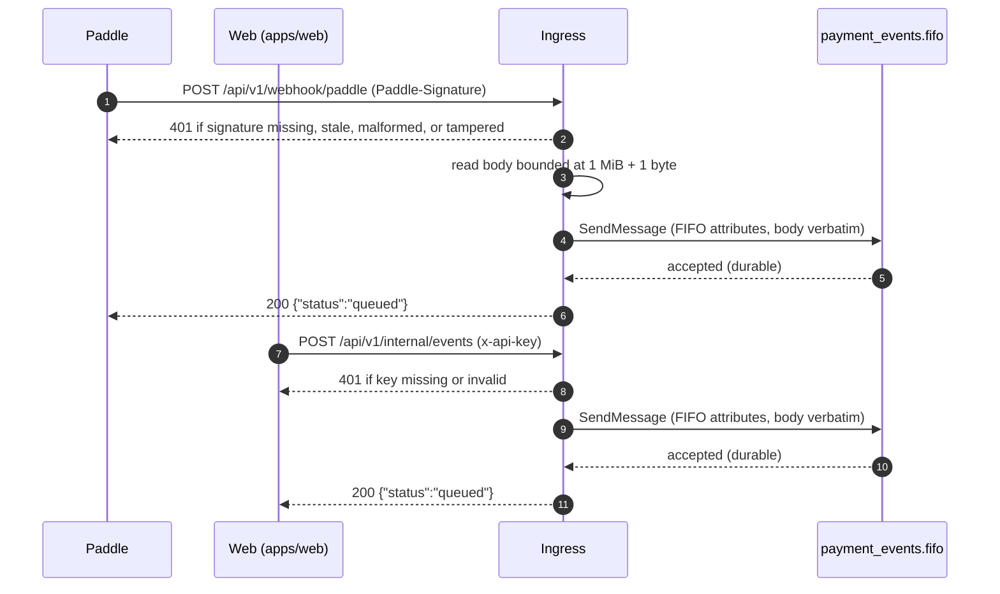

# HTTP Design

The wire contract for the payment-webhook service. Requirements live in [requirements.md](requirements.md) — this document specifies exactly how they are served — and the queue-side delivery contract in [messaging.md](messaging.md).

## Compatibility statement

This is a rebuild, and the wire surface changes deliberately; everything not named below is behavior-preserving:

1. **Paths move** — the two ingress endpoints gain the `/api/v1` prefix (`/webhook/paddle` → `/api/v1/webhook/paddle`, `/internal/events` → `/api/v1/internal/events`) for future versioning; the probes rename flat — `/healthz` → `/health`, `/readyz` → `/ready` — keeping probe-tool URLs free of version churn.
2. **The internal credential carries as `x-api-key`** (was `X-Internal-Key`), matching the document-parser scheme; the Paddle ingress keeps `Paddle-Signature` and its HMAC semantics exactly.
3. **Oversized bodies answer 413** naming the limit; malformed/unreadable bodies answer 400 — the pre-refactor gateway answered 400 for both, hiding the distinction.
4. Error envelope stays `{"error": "…"}` (Gin-native); callers need no schema changes.

Callers affected: the knock-on list in [requirements.md](requirements.md).

## Endpoints

| Method + Path | Auth | Purpose |
|---------------|------|---------|
| `POST /api/v1/webhook/paddle` | required | Validate + queue a Paddle event |
| `POST /api/v1/internal/events` | required | Validate + queue an event from `apps/web` |
| `GET /health` | open | Liveness probe |
| `GET /ready` | open | Readiness signal |

The `/api/v1` prefix shapes the two ingress endpoints and is part of their contract; the probes sit at the root and are version-free by convention. There is **no metrics endpoint** — the service is observed exclusively through the OTel push pipeline (see [observability.md](observability.md)).

### Request lifecycle



Both ingresses share one enqueue path; the alternate outcomes below are the same either way.

### Deployment front door

API Gateway → Lambda (container image via the Lambda Web Adapter). The door shapes the contract's envelope numbers:

- **Body bound 1 MiB** against API GW's 10 MB request cap and Lambda's 6 MB invocation ceiling — the base64-inflated event payload (1 MiB → ~1.33 MB) and the JSON response (~100 bytes) sit far under both.
- API Gateway buffers the full request body before invoking; the bounded read enforces the boundary inside the service and rejects at 413 before buffering completes when the limit is exceeded.
- **Timeout stack**: function timeout (10 s) above the in-code publish budget (5 s); the API Gateway integration timeout (≤ 29 s) above both. The innermost shaped response wins — a deadline-exceeded enqueue answers the shaped 503 with `Retry-After: 5`, and a platform kill is an opaque 502 the layering makes unreachable in practice ([requirements.md](requirements.md) NFR-3).

## POST /api/v1/webhook/paddle

### Request

- `Paddle-Signature` header — Paddle's format `ts=<unix-seconds>;h1=<hex>`. The service recomputes HMAC-SHA256 over `<ts>:<raw-body>` with `PADDLE_WEBHOOK_SECRET` and compares in constant time.
- **Freshness window ±5 minutes** against the `ts` value — a stale or future-dated signature is rejected as invalid (401). Paddle's retry machinery is the caller-side response: failed deliveries retry for days on Paddle's own schedule, so a rejected webhook is not a lost event.
- The body is the raw Paddle JSON, forwarded byte-for-byte on success (see the message contract in [messaging.md](messaging.md)).
- Enforcement: the body is read up to **1 MiB + 1 byte**; anything larger answers 413 without consuming the excess.

### Response — 200

```json
{"status": "queued"}
```

Emitted only after SQS accepts the message — the SDK response is the durability point (no pending-write semantics to explain away).

### Status codes

| Code | When | Body detail |
|------|------|-------------|
| 200 | SQS accepted the message | `{"status": "queued"}` |
| 400 | Body unreadable or malformed during the bounded read | generic |
| 401 | Signature missing, malformed, stale, or tampered | generic; failure classes indistinguishable |
| 413 | Body larger than 1 MiB | includes the limit |
| 503 | Enqueue unavailable: SQS outage, throttling, or deadline exceeded | `{"error": "...", "retryable": true}` + `Retry-After: 5` |
| 500 | Unexpected error | generic |

404/405 and other framework defaults are untouched. A 401 never inherits `WWW-Authenticate` (there is no interactive auth surface; the credential carries via one header and one comparison path, per [requirements.md](requirements.md)).

## POST /api/v1/internal/events

### Request

- `x-api-key` header — the shared secret `API_KEY`. Missing and invalid are rejected identically (401, generic), compared in constant time; the attempted value is never echoed in logs (NFR-8).
- The body is the web app's event JSON (`event_id`, `event_type`, `occurred_at`, `notification_id`, `data`), forwarded byte-for-byte on success.
- Body bound and 413 rule identical to the Paddle face.

### Response — 200 / status codes

Same envelope and table as the Paddle face minus the signature rules: 401 covers the key's missing/invalid cases, 503 covers the queue, 413/400 cover the body, 500 covers the unexpected.

## Liveness and readiness

| Path | 200 body | 503 body |
|------|----------|----------|
| `/health` | `{"status": "ok"}` | `{"status": "unavailable"}` |
| `/ready` | `{"status": "ready"}` | `{"status": "not_ready"}` |

The endpoints stay in the contract for local parity — Lambda has no probes; the platform owns availability and shedding. On the rebuilt service `ready` is a static signal: boot validation (config plane, credentials, queue URL) either passed or failed the process launch. The old `rabbitmq_connection_status`-gated readiness has no equivalent, because there is no long-lived connection to track.

## Resolved decisions and rationale

1. **Prefix on ingress, flat probes** — the two authenticated endpoints carry `/api/v1` (future versioning stays off the callers' critical path); the probes stay root-level and version-free, matching probe-tool expectations. document-parser versioned everything including probes; the differentiated shape is the deliberate reverse — the probe namespace never needs an API version.
2. **One credential, one header, one comparison path** — `x-api-key` only. `X-Internal-Key` carried the same secret in a second envelope whose cost was a second comparison path to test and a non-standard header name; the document-parser inheritance makes the compare constant-time in the same stroke (the pre-refactor gateway compared with `!=`).
3. **413/400 split** — an oversized body and a malformed body are different caller failures (config vs payload); document-parser already standardized the distinction, and Paddle treats any 4xx identically (failure → retry), so nothing rides on the change.
4. **Unknown event types queue** — the gateway's job is transport, not vocabulary. Rejecting an unknown `event_type` would let a Paddle schema evolution 400 the whole pipeline; the worker owns interpretation and the counter owns visibility (FR-7).
5. **503 on enqueue failure, always with `Retry-After: 5`** — the fast-fail contract survives. SQS being an AWS-managed service, "broker down" is rare, but throttling and short-lived 5xx exist; the shaped response plus the dedup window make the ambiguous "did it actually enqueue?" case harmless ([requirements.md](requirements.md) NFR-3).
6. **Error envelope stays `{"error": "…"}`** — Gin-native, the only shape every handler in a Go Gin service produces; document-parser's `{"detail": "…"}` is a FastAPI convention, not a repo standard to copy.
7. **Freshness window ±5 min kept** — recorded so it is not read as accidental: it bounds replay of captured signatures, and Paddle's clock-bound rejections are comfortably outside legitimate delivery latency.
