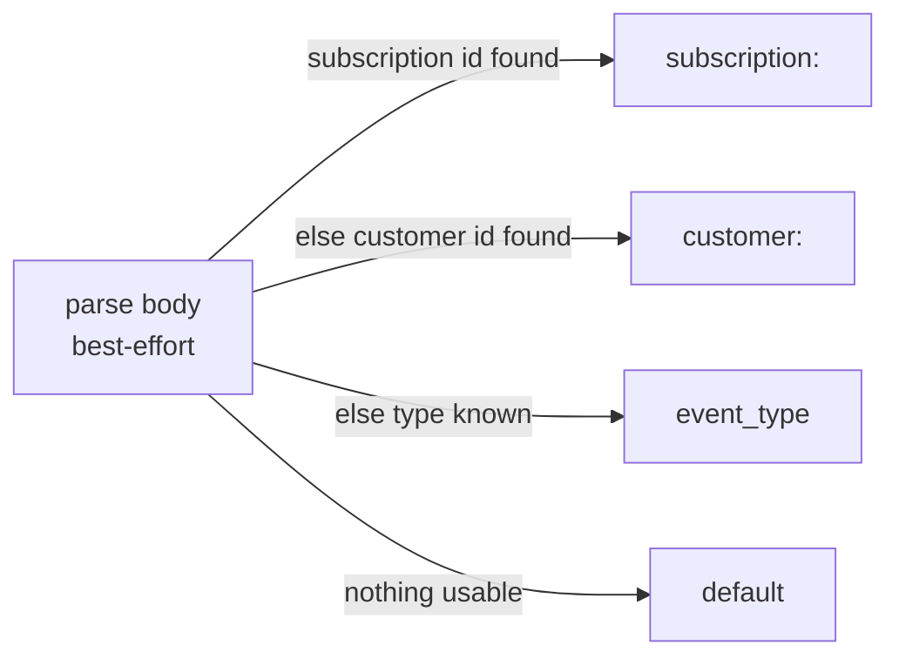

# Message Delivery

This document specifies the SQS contract — the queue decision, the message shape, dedup/group semantics, the DLQ, and what dies with RabbitMQ. Requirements live in [requirements.md](requirements.md); the wire contract in [http.md](http.md).

## Broker survey

SQS is the call, and the neighbors were measured before it was made:

| Option | Fit | Verdict |
|--------|-----|---------|
| **SQS FIFO** | one consumer; ordering + dedup native; DLQ via redrive | chosen |
| SQS Standard | ordering abandoned; worker absorbs duplicates/reordering | viable fallback — the worker's idempotency layer would carry it |
| SNS | fanout of one is fanout of one | rejected — nothing to fan out to |
| EventBridge | rule routing, schema registry, archive | rejected — no rules needed, adds a hop per event |
| RabbitMQ (Amazon MQ) | retained infra, TTL-retry topology, cluster ops | rejected — the entire connection lifecycle is a cost the rebuild deletes |
| Kafka / MSK | event-sourcing ambition, partition plumbing | rejected — overkill for webhook fan-in to one consumer |

The table recorded so the trade is visible: SQS removes cluster operation **and** halves the service's own complexity — no connection manager, no reconnect jitter, no publisher confirms, no quorum queue config. A `SendMessage` 200 is SQS's guarantee that the message is durable on multi-AZ hardware.

## Queue type: FIFO

Recorded so the choice survives its authors — this was the one open transport decision, and it was close:

| Aspect | Standard | FIFO (`payment_events.fifo`) |
|--------|----------|------------------------------|
| Ordering | none | strict per `MessageGroupId` |
| Dedup | none | `MessageDeduplicationId` honored within a 5-minute window |
| DLQ | redrive policy → standard DLQ | redrive policy → FIFO DLQ (must be FIFO) |
| Throughput | unlimited in practice | 300 msg/s default, 3,000/s in high-throughput mode |
| Fit | worker idempotency already absorbs duplicates | payment lifecycle ordering is a transport guarantee again |

Why FIFO, given the constraint that decided it: **the worker is out of scope and unchanged.** RabbitMQ delivered in birth order today; Standard SQS would silently drop that guarantee beneath a consumer the rebuild cannot simultaneously rewrite. FIFO preserves the delivery-order property the worker has always run against — and the dedup window absorbs Paddle's at-least-once retries inside the same envelope, making the worker's idempotency layer the *second* line of defense rather than the only one. Volume is payment lifecycle events — two digits per minute at the most — so FIFO's throughput ceilings are irrelevant, and cost per message is within rounding of Standard.

## Queues and wiring

| Resource | Name | Type | Owner |
|----------|------|------|-------|
| Main queue | `payment_events.fifo` | FIFO | Terraform (infra plane) |
| Dead-letter queue | `payment_events_dlq.fifo` | FIFO | Terraform |
| Redrive policy | maxReceiveCount = 5 on the main queue | — | Terraform |
| Visibility timeout | 300 s on the main queue | — | Terraform |
| Retention | 14 days, both queues | — | Terraform |

The service knows exactly one queue parameter: `QUEUE_URL`, mandatory, fail-fast at boot. Queue creation, redrive, alarms live in IaC — never service runtime state. Local runs point `QUEUE_URL` at LocalStack or any real SQS endpoint; there is no topology code on the app side to dry-run.

## Message shape

| SQS field | Value |
|-----------|-------|
| Body | The received JSON bytes **verbatim** — Paddle's payload or the web app's internal event, byte-for-byte (FR-4) |
| Content type implied | `application/json` (body is opaque bytes to SQS; the worker parses as today) |
| `MessageDeduplicationId` | Parsed `event_id` when present; otherwise SQS content-based dedup on the body. See the ladder below |
| `MessageGroupId` | The group-key ladder below |
| `MessageAttributes` — `source` | `paddle` or `internal` (String) |
| `MessageAttributes` — `event_type` | Best-effort parse; `unknown` when absent |
| `MessageAttributes` — `event_id` | Best-effort parse; attribute omitted when absent |

The body passthrough is deliberate: the gateway's job is transport with verification, not vocabulary. The worker keeps parsing the same wire shape it parses today; the moved contract is the queue, not the envelope. The prerequisite parse (event_id/event_type/group keys) touches the payload for metadata only — the forwarded bytes are never altered by it.

### Group-key ladder

Sequence:

1. **Subscription id** → group `subscription:<id>` — payment lifecycle events for one subscription never reorder. First hit among `data.subscription_id`, `data.subscriptionId`, `data.paddleSubscriptionId`, and `data.id` where the value is a `sub_…` id (Paddle Billing embeds subscription-id events as the object's own `id`).
2. **Customer id** → group `customer:<id>` — ordering for subscription-less internal events. First hit among `data.customer_id`, `data.customerId`, `data.userId`.
3. **`event_type`** when neither id resolves → per-type ordering; same-kind events still never interleave.
4. **`default`** when the body parses to nothing usable; dedup falls back to content-based.

The alias list lives in one place (`ParseEvent` in the domain) and is unit-tested against each source's real payload shape ([design.md](design.md)'s test plan). Unknown types with addressable ids still group correctly.

Two consequences worth naming:

- **Ordering cost is serialization within a group** — the ladder's first rung is narrow enough (one subscription) that throughput stays multi-stream across groups; only same-subscription events serialize, which is correctness for lifecycle transitions.
- **Dedup guarantees erode past 5 minutes** — Paddle retries spread over days are deduped only in-window; the worker's idempotency layer remains the ring-fenced backstop, as documented in [requirements.md](requirements.md)'s bounds table.

## What dies with RabbitMQ

| RabbitMQ construct | Role | Replacement |
|--------------------|------|-------------|
| `payment_events` quorum queue | main store | SQS multi-AZ durability behind `SendMessage`'s 200 |
| `payment_events_retry` (TTL 5 s) | delayed retry | SQS redrive (maxReceiveCount = 5, on the consumer side) — the retry knob moves to an *attempt budget*, not a TTL to wait |
| `payment_events_dlq` | manual inspection, keep forever | FIFO DLQ with 14-day retention plus depth/age alarms (bounded; see below) |
| Publisher confirms (5 s waiting) | durability handshake | `SendMessage` 200 — synchronous by definition |
| Connection manager, reconnect + jitter, channel lifecycle | broker session | no connection: SDK calls are stateless |
| `rabbitmq_connection_status` gauge driving readiness | health | readiness is a boot-validated static signal ([http.md](http.md)) |

### The DLQ story is bounded now, deliberately

| Aspect | RabbitMQ (old) | SQS (new) |
|--------|----------------|-----------|
| Retention | indefinite — "until manually cleared" | **14 days**, then lost |
| Safety net | indefinite holding made depth the only urgency | depth **and age**: CloudWatch depth alarm plus oldest-message-age alarm (IaC), routed to the same email notification channel the alert policies use — the wiring lands with the queue provisioning |
| Replay | console/CLI requeue | console/CLI move-back (accepted surface; tooling deferred) |

The trade recorded so it is not accidental: "keep forever until inspected" was a durability property RabbitMQ provided and SQS cannot match beyond 14 days. The alarm pair (depth, age) closes the gap where it matters — the page fires while messages are still actionable, never after expiry. The 14-day bound matches SQS's own ceiling; an S3 archive of dead events is the future lever if retention is ever judged too short.

## Worker knock-on (out of scope, contracted here)

- The consumer component swaps `amqplib` for the SQS SDK against `payment_events.fifo` — long polling, batch size from worker config, record handlers unchanged
- **Ordering input is equivalent or better**: per-subscription serialization (ladder rung 1) replaces RabbitMQ's single-queue FIFO; at-least-once stays at-least-once with in-window dedup on top
- **Visibility timeout (300 s) must exceed the worker's slowest handler** — recorded explicitly since the worker is out of scope; if any handler ever grows past it, the timeout moves in IaC, not in this service
- Idempotency layer, state machine, and business logic untouched
- The `workers` alert policy's `rabbitmq_connection_status` condition retires at cutover (see [observability.md](observability.md))

## Cutover order (the no-loss invariant)

The consumer must exist before the producer's first publish into SQS, and RabbitMQ must drain before decommissioning:

1. Terraform provisions the FIFO queue + DLQ + redrive + alarms
2. `worker-payments` deploys its SQS consumer and begins polling (it idles on an empty queue)
3. This service deploys, publishing to SQS; RabbitMQ publication retires
4. Paddle's dashboard destination URL flips to `/api/v1/webhook/paddle`; `apps/web` env + BFF flip in the same window
5. The RabbitMQ `payment_events` queue drains; RabbitMQ, Amazon MQ, and the exporter scrape retire

The first event touches SQS only after step 2 — no gap where events would be accepted and lost.
