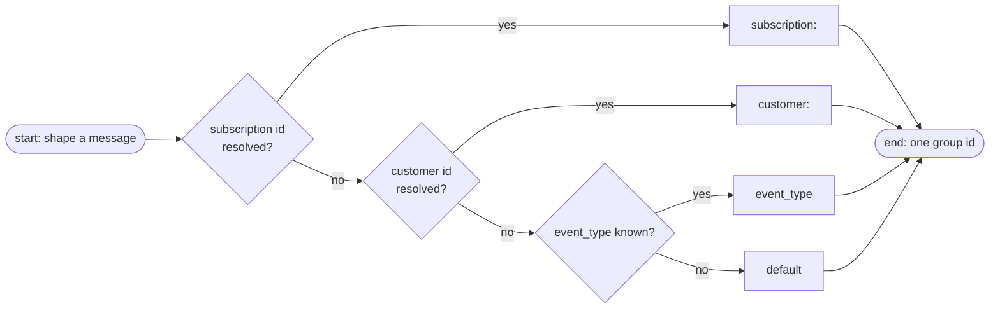

# Message Delivery

The SQS contract — the queue decision, the message shape, dedup/group semantics, the DLQ, and the worker cutover. Requirements live in [requirements.md](requirements.md); the wire contract in [http.md](http.md). The user-facing version is [docs/concepts/delivery.md](../docs/concepts/delivery.md).

## Broker survey

SQS is the call, and the neighbors were measured before it was made:

| Option | Verdict |
|--------|---------|
| **SQS FIFO** | chosen — one consumer; ordering + dedup native; DLQ via redrive |
| SQS Standard | viable fallback — the worker's idempotency layer would carry it, at the cost of delivery order |
| SNS | rejected — a fanout of one is a fanout of one |
| EventBridge | rejected — no rules needed, and it adds a hop per event |
| RabbitMQ (Amazon MQ) | rejected — the entire connection lifecycle is a cost the rebuild deletes |
| Kafka / MSK | rejected — overkill for webhook fan-in to one consumer |

The table, recorded so the trade is visible: SQS removes cluster operation **and** halves the service's own complexity — no connection manager, no reconnect jitter, no publisher confirms. A `SendMessage` 200 is the guarantee that the message sits on multi-AZ hardware.

## FIFO, not Standard

The one open transport decision, recorded because it was close:

| Aspect | Standard | FIFO (`payment_events.fifo`) |
|--------|----------|------------------------------|
| Ordering | none | strict per `MessageGroupId` |
| Dedup | none | `MessageDeduplicationId` within a 5-minute window |
| DLQ | redrive → standard DLQ | redrive → FIFO DLQ (must be FIFO) |
| Throughput | unlimited in practice | 300 msg/s (3,000/s high-throughput mode) |

Why FIFO: **the worker is out of scope and unchanged.** RabbitMQ delivers in birth order today; Standard would silently drop that guarantee beneath a consumer the rebuild cannot simultaneously rewrite. FIFO preserves delivery order, and its dedup window absorbs Paddle's immediate retries — making the worker's idempotency layer the second line of defense rather than the only one. Volume is payment lifecycle events (two digits per minute at most), so the throughput ceilings are irrelevant, and cost per message is within rounding of Standard.

## Queues and wiring

| Resource | Name | Owner |
|----------|------|-------|
| Main queue | `payment_events.fifo` | Terraform (pending provisioning) |
| Dead-letter queue | `payment_events_dlq.fifo` | Terraform |
| Redrive policy · visibility · retention | `maxReceiveCount = 5` · 300 s · 14 days | Terraform |

The service knows exactly one queue parameter: `QUEUE_URL`, mandatory, boot-validated. Queue creation, redrive, and alarms live in IaC — never runtime state. Local runs point `QUEUE_URL` at the ElasticMQ emulator; there is no topology code on the app side to dry-run.

## Message shape

| SQS field | Value |
|-----------|-------|
| Body | the received JSON bytes **verbatim** — never altered by the metadata parse |
| `MessageDeduplicationId` | the parsed `event_id` — guaranteed present by the envelope check; the sha256-of-body fallback cannot occur under the gate |
| `MessageGroupId` | the group-key ladder below |
| `source` | `paddle` — constant |
| `event_type` | the body's event_type; `unknown` when a foreign shape defeats the parse |
| `event_id` | the body's event_id — the envelope check guarantees it |
| `occurred_at` | the raw RFC3339 string verbatim — the worker's cross-entity ordering key |
| `subscription_id` · `transaction_id` · `customer_id` | the explicit field, or `data.id` when it carries the `sub_`/`txn_`/`ctm_` prefix |
| `user_id` | `data.custom_data.user_id` |

One flat rule for the attribute set: extract when the id resolves, omit when blank — no empty string ever reaches SQS. There is no per-type relevance matrix: event-type-specific interpretation stays the worker's (FR-7), and the body passthrough stays byte-for-byte. The metadata parse touches the payload for attribute extraction only; envelope gate and shaping share one parse (`internal/events`), so they can never disagree about an id.

### Group-key ladder

1. **Subscription id** → `subscription:<id>` — payment lifecycle events for one subscription never reorder. `data.subscription_id`, or `data.id` when `sub_`-prefixed (Paddle Billing embeds subscription-id events as the object's own `id`).
2. **Customer id** → `customer:<id>` — events that carry a customer without a subscription. `data.customer_id`, or `data.id` when `ctm_`-prefixed.
3. **`event_type`** — per-type ordering when neither id resolves; same-kind events still never interleave.
4. **`default`** — reachable only if a foreign shape defeats the parse entirely; the envelope gate makes rung 3 resolve for every accepted body, so rung 4 stays as defense.

Two consequences worth naming:

- **Ordering costs serialization within a group** — rung 1 is narrow (one subscription) enough that throughput stays multi-stream across groups; only same-subscription events serialize, which is correctness for lifecycle transitions.
- **Dedup erodes past 5 minutes** — Paddle retries spread over days are deduped only in-window; the worker's idempotency layer remains the backstop.

### The creation burst spans groups, deliberately

One checkout-created subscription emits a dozen-plus webhooks across entity types sharing no single field — `subscription_id` is absent from the non-subscription events, `customer_id` from `report.*` — so no group id spans the burst, and one is not attempted. Three things follow, all of them the worker's to solve with inputs this service already ships:

- **Sequencing correctness lives in the worker.** Enqueue order is Paddle's delivery order, never causal order. The worker rebuilds per-entity state by comparing `occurred_at` (with `event_id` as the deterministic tiebreak) instead of trusting arrival position — shipped as attributes precisely so the worker needs nothing beyond the body.
- **An entity can migrate groups mid-lifetime.** `transaction.created` rides `customer:<id>` before Paddle links the subscription; later `transaction.updated` carries `subscription_id` and rides `subscription:<id>`. FIFO cannot order across groups — covered by the same `occurred_at` rule.
- **Per-action atomicity is a worker aggregation pattern.** A settle window keyed on the entity graph is the honest shape; the gateway sees one body at a time. Customer-primary grouping (widening the ladder until the burst serializes) stays available at the cost of hot head-of-line blocking — choose it only if a consumer demands per-burst coherence.

## What dies with RabbitMQ

| RabbitMQ construct | Replacement |
|--------------------|-------------|
| `payment_events` quorum queue (main store) | SQS multi-AZ durability behind `SendMessage`'s 200 |
| `payment_events_retry` (TTL 5 s) | redrive policy — the retry moves to an attempt budget (`maxReceiveCount`), not a TTL to wait |
| `payment_events_dlq` (keep forever) | FIFO DLQ, 14-day retention, depth + age alarms (below) |
| Publisher confirms (5 s wait) | the synchronous `SendMessage` 200 |
| Connection manager, reconnects, channel lifecycle | no connection at all — SDK calls are stateless |
| `rabbitmq_connection_status` gauge driving readiness | boot-validated static readiness ([http.md](http.md)) |

### The DLQ story is bounded now, deliberately

| Aspect | RabbitMQ (old) | SQS (new) |
|--------|----------------|-----------|
| Retention | indefinite — until manually cleared | **14 days**, then lost (SQS's own ceiling) |
| Urgency | depth alone — messages hold forever | depth **and age**: CloudWatch alarms (IaC) page while dead events are still actionable |
| Replay | console/CLI requeue | console/CLI move-back; an S3 archive is the future lever if 14 days ever judges short |

## Worker knock-on (out of scope, contracted here)

- The consumer swaps `amqplib` for the SQS SDK against `payment_events.fifo` — long polling, batch size from worker config, record handlers unchanged
- Ordering input is equivalent or better: per-subscription serialization (ladder rung 1) replaces single-queue FIFO; at-least-once stays at-least-once with in-window dedup on top
- Visibility timeout (300 s) must exceed the worker's slowest handler — if any handler ever grows past it, the timeout moves in IaC, not in this service
- The `workers` alert policy's `rabbitmq_connection_status` condition retires at cutover

### Cancellation contract (period-end)

Client-triggered cancellation enters only through Paddle: the (deferred) `apps/web` route calls Paddle's cancel API with `effective_from: "next_billing_period"`, and the gateway queues the lifecycle events Paddle emits. The worker's state machine rides exactly these:

| Paddle event | Signal | Worker effect |
|--------------|--------|---------------|
| `subscription.updated`, `scheduled_change.action = "cancel"` | `effective_from` names the next billing period | **provisional** cancel — entitlements keep serving until that date |
| `subscription.canceled` (Paddle's single-`l` spelling) | the change took effect at the billing date | **permanent** cancel |
| scheduled change cleared, or `subscription.resumed` | the user changed their mind mid-period | downgrade the provisional state — the cancel never happened |

Period-end is the only flavor supported, which makes the provisional/permanent window weeks-wide — the downgrade path is a first-class case the worker owns, not a corner.

## Cutover order (the no-loss invariant, pending)

The consumer must exist before the producer's first publish, and RabbitMQ must drain before decommissioning:

1. Terraform provisions the FIFO queue + DLQ + redrive + alarms
2. `worker-payments` deploys the SQS consumer and begins polling (it idles on an empty queue)
3. This service publishes to SQS; RabbitMQ publication retires
4. Paddle's dashboard destination flips to `/api/v1/webhook/paddle`
5. The RabbitMQ queue drains; the broker, Amazon MQ, and the exporter scrape retire

The first event touches SQS only after step 2 — no gap where events would be accepted and lost.
