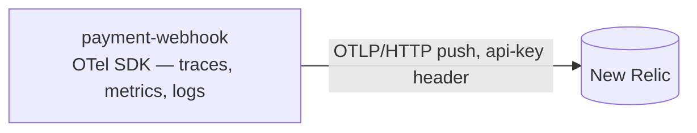

# Observability

What the payment-webhook service monitors and exports. Requirements live in [requirements.md](requirements.md) (NFR-5); the wire contract is [http.md](http.md). The user-facing version is [docs/concepts/observability.md](../docs/concepts/observability.md).

## Pipeline



One pipeline, three signals, zero hops: the SDK exports traces, metrics, and logs directly to New Relic's native OTLP endpoint (`otlp.nr-data.net`; EU accounts: `otlp.eu01.nr-data.net`), authenticated with the **ingest license key** in the `api-key` header — never a user API key, and the region prefix must match the account. HTTP/protobuf with gzip. This is document-parser's exception path for the same reason: a Lambda runtime cannot reach the compose stack's `otel-collector`. The collector keeps serving the compose-stack services and stays out of scope here.

## The gate (NFR-5)

With `OTEL_EXPORTER_OTLP_ENDPOINT` unset nothing is emitted: the boot builds the null observability and installs no SDK providers at all — dev is a silent no-op. With the endpoint set, the boot demands `NEW_RELIC_LICENSE_KEY` at the credential floor (16 chars), fail-closed on the same path as `PADDLE_WEBHOOK_SECRET`. Dev may also point the endpoint at any OTLP/HTTP receiver (a local collector on 4318) — the same code path, no special-casing anywhere.

## Metric inventory

Eight instruments, all landed. Six names were preserved from the pre-rebuild gateway so the NRQL surface stays greppable across the migration; the two envelope instruments join the gate that produces them ([http.md](http.md)'s 422 row).

| Instrument | Type | Attributes |
|------------|------|------------|
| `payment_webhooks_received_total` | Counter | `event_type` |
| `payment_events_published_total` | Counter | `event_type`, `status` |
| `payment_webhook_signatures_invalid_total` | Counter | — |
| `payment_webhooks_unknown_event_type_total` | Counter | — |
| `payment_webhook_body_errors_total` | Counter | `reason` (`unreadable`, `too_large`) |
| `payment_webhook_envelope_rejections_total` | Counter | `reason` (the missing field(s)) |
| `payment_webhook_envelope_advisories_total` | Counter | `reason` (`notification_id`, `addressable_id`) |
| `payment_events_enqueue_duration_seconds` | Histogram | `status` |

`status` on both the publish counter and the duration histogram partitions `success` | `error` | `timeout` — the deadline is the timeout verdict alone, so sums never double count.

### Dropped, with reasons

| Instrument | Why dropped |
|------------|-------------|
| `http_requests_total`, `http_request_errors_total`, `http_request_duration_seconds` | request/error-rate and latency signals come from OTel **spans** (otelgin), queried via `http.status_code`/`http.route` — the pattern document-parser established |
| `rabbitmq_*` (three) | the broker is gone; the connection lifecycle is no longer a quantity to monitor |
| `payment_signature_validation_duration_seconds` | constant-time HMAC over ≤ 256 KiB is µs-scale; no decision rides the number |
| `gateway_build_info` | version identity lives in the `service.version` resource attribute |
| Go runner / process collectors | push plumbing on Lambda — the platform's own signals cover it |

Naming-stability contract: surviving names are identical, attribute keys identical. Any change ships with a dashboard/alert migration in the same PR.

## What each verdict records

Every recording site on the ingress, and the instrument each call touches:

| Verdict | Call | Instruments |
|---|---|---|
| body unreadable / beyond the bound (400/413) | `record_body_error(reason)` | `payment_webhook_body_errors_total` |
| invalid signature (401) | `record_invalid_signature()` | `payment_webhook_signatures_invalid_total` |
| envelope fields incomplete (422) | `record_envelope_rejection(reason)` | `payment_webhook_envelope_rejections_total` |
| advisory-only oddity on a queued body (200) | `record_envelope_advisory(reason)` | `payment_webhook_envelope_advisories_total` |
| accepted body | `record_received(event_type)` (+ unknown) | `payment_webhooks_received_total` (+ `…_unknown_event_type_total`) |
| enqueue succeeded (200) | `record_publish(event_type, "success", d)` | `payment_events_published_total` + duration |
| enqueue fault/throttle (503) | `record_publish(event_type, "error", d)` | `payment_events_published_total` + duration |
| deadline exceeded (503) | `record_publish(event_type, "timeout", d)` | `payment_events_published_total` + duration |

The spans layer brackets every handler (otelgin) and carries `event_type`/`event_id` on the application span — the basis of the route/error/latency panels and per-event tracing.

## Config

```ini
OTEL_EXPORTER_OTLP_ENDPOINT=        # unset → nothing is emitted; https://otlp.eu01.nr-data.net for prod
NEW_RELIC_LICENSE_KEY=              # ingest license key — the secrets blob, not SSM
OTEL_SERVICE_NAME=payment-webhook   # resource identity (SSM-seedable)
OTEL_SERVICE_VERSION=               # optional; "dev" when unset (SSM-seedable)
OTEL_TRACE_SAMPLE_RATIO=1.0         # 0 < ratio ≤ 1, fails the boot on violation
```

- Fail-closed: a set endpoint without a license key fails the boot; an unset endpoint is a legitimate disabled boot in every plane.
- Resource identity: `service.name = payment-webhook`, `service.version`, and the `ENV_TYPE` flick supplying `deployment.environment` (`dev`/`prod`; `loadtest` on rigs) — direct push means the app owns the label the collector used to upsert.
- The SSM allowlist carries the `OTEL_*` keys; `NEW_RELIC_LICENSE_KEY` rides the secrets blob.

## Export shape

- **Interval**: 15 s metric cadence — the old scrape period, carried into the push reader; traces and logs ride the SDK's batch processors.
- **Temporality**: delta — the New Relic best fit for pushed data.
- **Sampling**: `ParentBased(TraceIdRatioBased(ratio))`, default 100%.
- **Resource**: `service.name` · `service.version` · `deployment.environment`.
- **Drain**: `Shutdown` flushes traces → metrics → logs, each within a 5 s cap, once at process stop.

Push is fire-and-forget from the request path: an OTLP export failure is logged by the SDK to its internal stderr logger and costs a batch, never a verdict.

## Queue-side signals (out of the app's view)

DLQ depth, oldest-message age, and retention are queue-level quantities on resources Terraform owns; they surface as CloudWatch alarms from the queue provisioning ([messaging.md](messaging.md)), not as app-instrumented counters. Publishing observability stops where the enqueue SDK call ends.

## Current assets (landed)

- **`dashboards/payment-webhook`** (prod + dev twins) — panels on the new `http.route` values, the metric inventory, and the error log stream; the container and RabbitMQ panels of the old board retired with their subjects.
- **`alerts/payment-webhook.tf`** — the 5xx span condition re-pointed at `service.name = 'payment-webhook'`, and the publish-failure condition on `payment_events_published_total` with `status IN ('error', 'timeout')` (the outage/throttle signal the old RabbitMQ log-condition carried).
- **Overview board + shared policy** — the services list and the `payment_webhook` policy area re-named; board-count assertions hold at 13.
- **Pending**: a condition on `payment_webhook_signatures_invalid_total` (tamper/replay signal), and the queue alarms with the queue provisioning.
