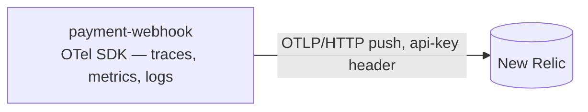

# Observability

What the payment-webhook service monitors and exports. Requirements live in [requirements.md](requirements.md) (NFR-5); the wire contract is [http.md](http.md); the queue contract in [messaging.md](messaging.md).

## Pipeline



One pipeline, three signals, zero hops: the SDK exports traces, metrics, and logs directly to New Relic's native OTLP endpoint (`otlp.nr-data.net`; EU accounts: `otlp.eu01.nr-data.net`), authenticated with the **ingest license key** in the `api-key` header — never a user API key, and the region prefix must match the account. HTTP/protobuf with gzip. This is the document-parser exception path, and the reason is the same: a Lambda runtime in the deployed target cannot reach the in-stack `otel-collector` the compose stack uses; it pushes straight to EU instead. The collector keeps serving the compose-stack services and stays out of scope here.

## The gate (NFR-5)

With `OTEL_EXPORTER_OTLP_ENDPOINT` unset nothing is emitted: the boot builds the null observability and installs no SDK providers at all — dev is a silent no-op. With the endpoint set but `NEW_RELIC_LICENSE_KEY` missing, the boot fails closed on the same path as `PADDLE_WEBHOOK_SECRET`. Dev may also point the endpoint at any OTLP/HTTP receiver (a local collector on 4318, for instance) — the same code path, no special-casing anywhere.

## Metric inventory

Eight instruments; six names preserved from the pre-refactor gateway keep the NRQL surface greppable across the migration. The two envelope instruments join with the gate that produces them ([http.md](http.md)'s 422 row); they are specified here and land with this service's observability build.

| Instrument | Type | Attributes | Consumed by |
|------------|------|------------|-------------|
| `payment_webhooks_received_total` | Counter | `event_type` | dashboards |
| `payment_events_published_total` | Counter | `event_type`, `status` | dashboards + alert |
| `payment_webhook_signatures_invalid_total` | Counter | — | dashboards + alert |
| `payment_webhooks_unknown_event_type_total` | Counter | — | dashboards |
| `payment_webhook_body_errors_total` | Counter | `reason` | dashboards |
| `payment_webhook_envelope_rejections_total` | Counter | `reason` — the missing field(s) | dashboards + alert |
| `payment_webhook_envelope_advisories_total` | Counter | `reason` — `notification_id`, `addressable_id` | dashboards |
| `payment_events_enqueue_duration_seconds` | Histogram | `status` | dashboards |

`status` on both the publish counter and the duration histogram partitions `success` | `error` | `timeout` — a share migration from RabbitMQ's `success`/`error` pair re-accounts the deadline-exceeded case on the same dimension, so boards aggregate unchanged.

### Dropped, with reasons

| Instrument | Why dropped |
|------------|-------------|
| `http_requests_total`, `http_request_errors_total`, `http_request_duration_seconds` | request/error-rate and latency signals come from OTel **spans** (otelgin), which the existing alerts already query via `http.status_code`/`http.route` — the same pattern document-parser dropped its HTTP instruments for |
| `rabbitmq_connection_status`, `rabbitmq_publish_duration_seconds`, `rabbitmq_reconnections_total` | the broker is gone; the connection lifecycle is no longer a quantity to monitor |
| `payment_signature_validation_duration_seconds` | constant-time HMAC over ≤ 1 MiB is µs-scale and deterministic; no decision rides the number |
| `gateway_build_info` | version identity moves to the `service.version` resource attribute |
| Go runner / process collectors | push plumbing on Lambda — the runtime platform's own signals cover it |

Naming-stability contract: surviving names are identical, attribute keys identical. Any change ships with a dashboard/alert migration in the same PR.

## What each verdict records

Every recording site on the ingress, and what each call touches:

| Route site | Verdict | Call | Instruments touched |
|---|---|---|---|
| body unreadable / beyond the bound | 400 / 413 | `record_body_error(reason)` (`unreadable`, `too_large`) | `payment_webhook_body_errors_total` |
| invalid Paddle signature | 401 | `record_invalid_signature()` | `payment_webhook_signatures_invalid_total` |
| envelope fields incomplete | 422 | `record_envelope_rejection(reason)` | `payment_webhook_envelope_rejections_total` |
| advisory-only oddity on a queued body | 200 | `record_envelope_advisory(reason)` | `payment_webhook_envelope_advisories_total` |
| recognized event received | accepted | `record_webhook_received(event_type)` | `payment_webhooks_received_total` |
| unrecognized `event_type` | accepted | received + unknown counters | `payment_webhooks_received_total`, `payment_webhooks_unknown_event_type_total` |
| enqueue succeeded | 200 | `record_publish(event_type, "success", d)` | `payment_events_published_total`, `payment_events_enqueue_duration_seconds` |
| enqueue error / throttle / deadline | 503 + `Retry-After` | `record_publish(event_type, "error", d)`; deadline site adds `"timeout"` | `payment_events_published_total`, `payment_events_enqueue_duration_seconds` |

The counters partition outcomes; dashboards sum paths without double counting. The span layer brackets every handler (otelgin export) and carries `event_type`/`event_id` span attributes on the application span — the basis of the route/error/latency panels, same shape as the existing board.

## Config

```ini
OTEL_EXPORTER_OTLP_ENDPOINT=        # unset → nothing is emitted (NFR-5); https://otlp.eu01.nr-data.net for prod
NEW_RELIC_LICENSE_KEY=              # ingest license key — the secrets blob, not SSM
OTEL_SERVICE_NAME=payment-webhook   # resource identity (SSM-seedable)
OTEL_SERVICE_VERSION=               # optional; "dev" when unset (SSM-seedable)
OTEL_TRACE_SAMPLE_RATIO=1.0         # 0 < ratio ≤ 1
```

- Fail-closed: an endpoint without a license key fails the boot on the same path as `PADDLE_WEBHOOK_SECRET`'s minimum length; an unset endpoint is a legitimate disabled boot in every plane.
- A set endpoint demands the key in every plane — the local collector on 4318 included; a throwaway value is legitimate there, and the destination knob stays `OTEL_EXPORTER_OTLP_ENDPOINT` alone (no enable/disable switch).
- Resource identity: `service.name = payment-webhook`, `service.version`, and the `ENV_TYPE` flick supplying `deployment.environment` (`dev`/`prod`; `loadtest` on rigs) — direct push means the app owns the label the collector used to upsert.
- The SSM allowlist (seed tooling) carries the `OTEL_*` keys; `NEW_RELIC_LICENSE_KEY` joins the secrets blob.

## Export shape

- **Interval**: 15 s — the old scrape cadence.
- **Temporality**: delta — the New Relic OTLP best fit for pushed data.
- **Sampling**: `ParentBased(TraceIdRatioBased(ratio))`, default 100%.
- **Resource**: `service.name`, `service.version`, `deployment.environment`.
- **Lambda lifecycle**: metric batches flush at invocation end alongside the trace, with the periodic reader capped to the budget — the same flush/hibernation discipline document-parser established on this runtime; the exact wiring is the `references/` observability LLD.

Push is fire-and-forget from the request path: an OTLP export failure is logged by the SDK to its internal stderr logger and costs a batch, never a 5xx.

## Queue-side signals (out of the app's view)

The service does **not** see queue-side truth it does not touch: DLQ depth, queue age, message retention counts are queue-level quantities on resources Terraform owns — they surface as CloudWatch alarms from the queue provisioning ([messaging.md](messaging.md)), not as app-instrumented counters. Publishing observability stops where the enqueue SDK call ends.

## Observability migration (knock-on, same contract)

The existing assets move with the rebuild; nothing is silently half-migrated:

| Asset | Action |
|-------|--------|
| `dashboards/payment-gateway` (prod + dev twins) | rebuilt as `payment-webhook` — spans panels re-point at `service.name = 'payment-webhook'` and the new `http.route` values; container panels (`container.cpu.*`) retire with Lambda; the RabbitMQ panels retire with the broker |
| `tests/dashboards.tftest.hcl` | board-count assertion stays 13 (swap); twin-parity lists updated for the new board name |
| `alerts/shared.tf` | `payment_gateway` policy area stays; condition queries re-point |
| `alerts/gateway.tf` — 5xx span condition | query updates to `service.name = 'payment-webhook'` — no semantic change |
| `alerts/gateway.tf` — rabbitmq log-condition | dies; replaced by a condition on `payment_events_published_total` with `status = 'error'` (outage/throttle signal, the old condition's intent) |
| recommended additions | conditions on `payment_webhook_signatures_invalid_total` above baseline rates — tamper/replay and brute-force signals the old policy never carried; thresholds set when wiring lands |
| `alerts/workers.tf` — `rabbitmq_connection_status` | retires with the broker at the worker cutover (not this service's PR) |
| overview board | `payment-gateway` entries in the services list re-name |
