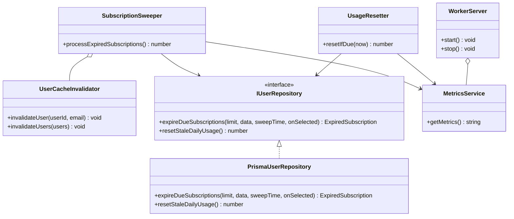
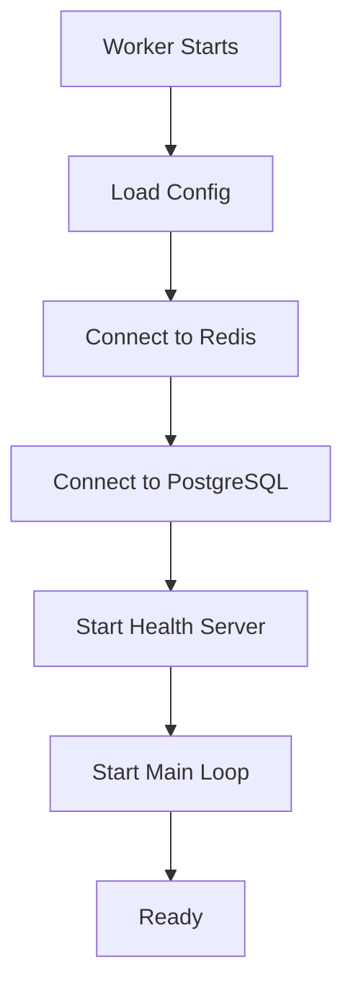
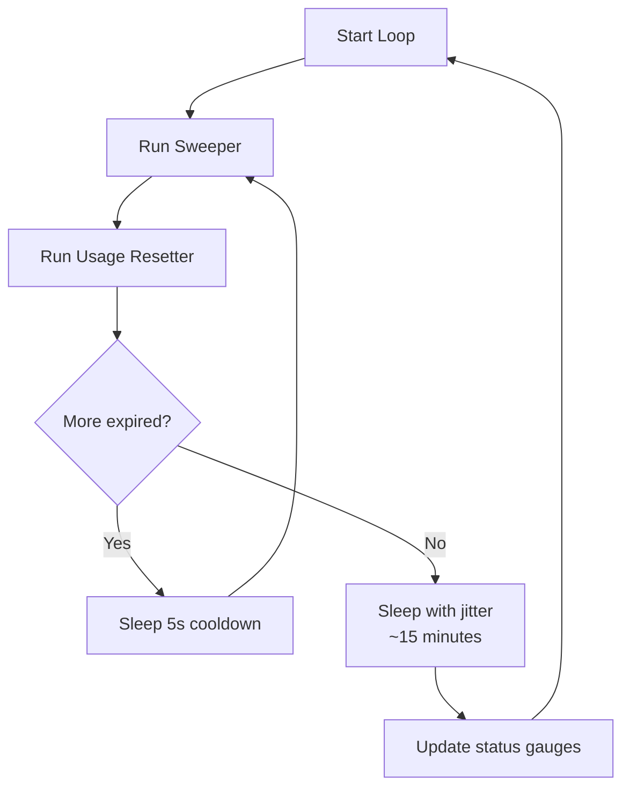
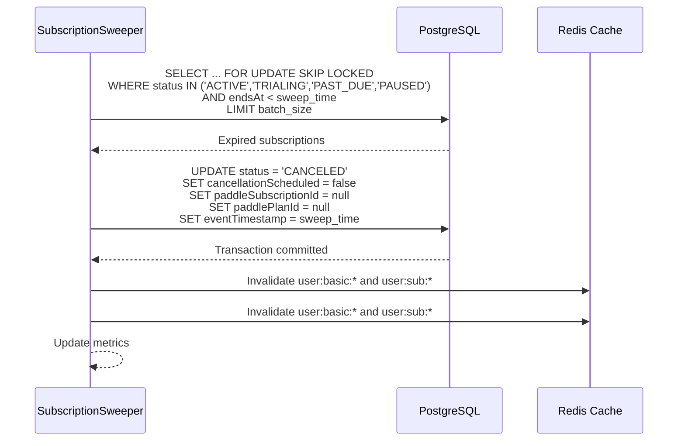
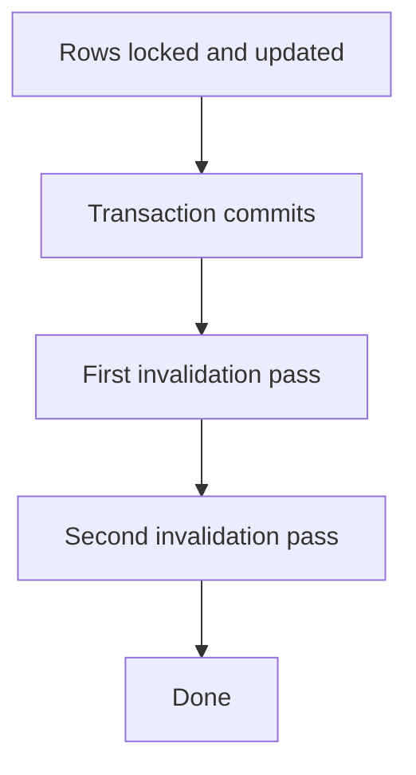
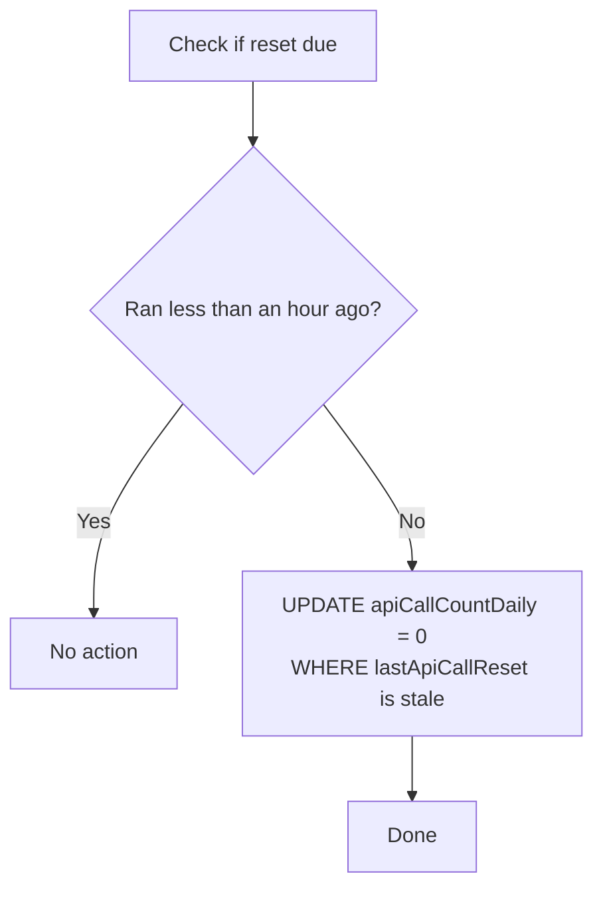
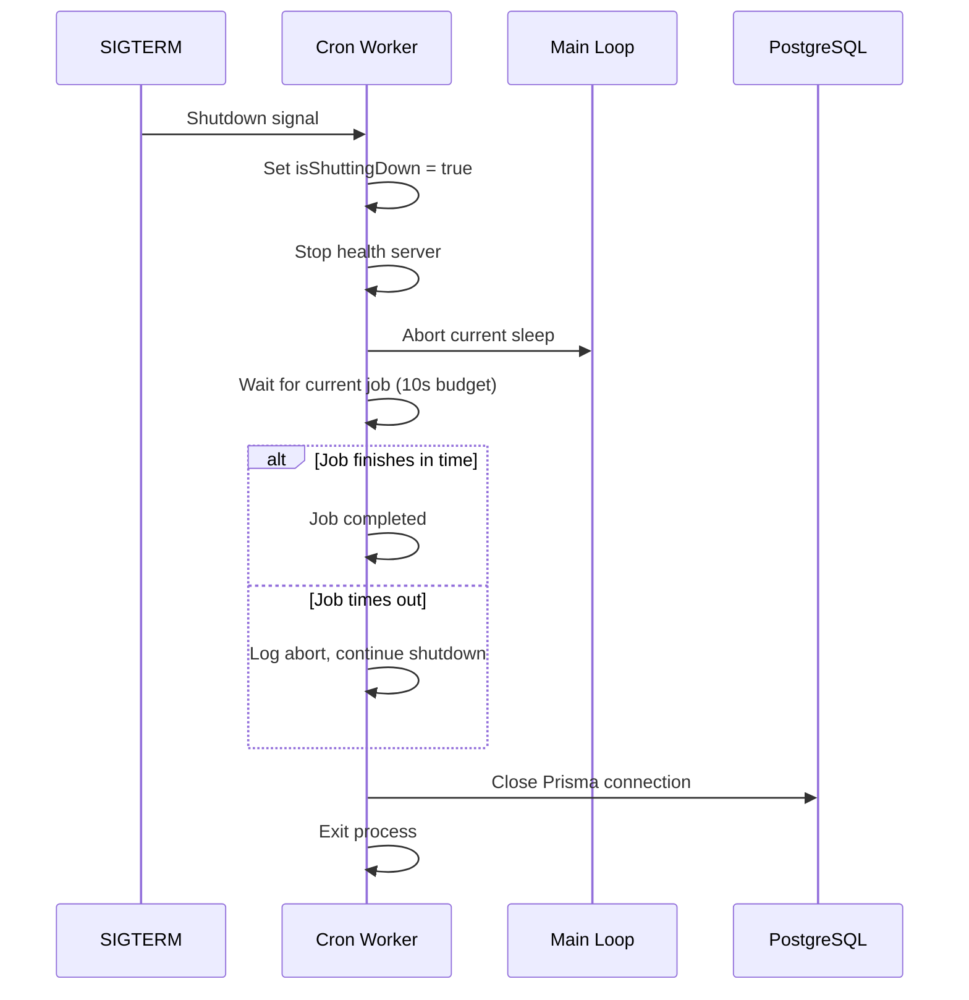
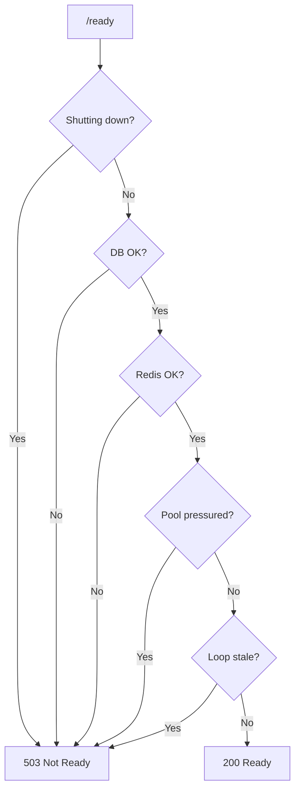

# Cron Worker

This document explains how the Cron worker performs background maintenance tasks in detail.

## What is the Cron Worker?

The Cron worker runs two periodic jobs:
1. **Subscription Sweeper** — Expires subscriptions that have passed their `endsAt` date
2. **Usage Resetter** — Clears the daily API call counters of rows whose UTC day has rolled over

## Why Have a Separate Cron Worker?

- **No queue dependency** — Runs on a timer, doesn't need RabbitMQ
- **Batch processing** — Handles thousands of expired subscriptions efficiently
- **Graceful shutdown** — Drains in-progress work before exiting
- **Self-healing** — Catches per-iteration errors and continues

## How It Works

The Cron worker has no message queue. It runs two services on a timer, and both reach the database through the same `IUserRepository` interface the Payments worker uses.

### Class Structure

**One thing to notice:** `PrismaUserRepository` takes an optional transition validator, and the Cron worker does not pass one. The Payments worker passes the payments state machine in, so webhooks are checked against it. The Cron worker never takes the webhook path at all — it sweeps through `expireDueSubscriptions` — so there is nothing to validate.

### Startup Sequence

**Key behaviors:**
1. Dependencies probed with up to 5 attempts, 2 seconds between attempts, 3-second timeout per probe
2. The health server starts **after** the probes finish, so there is a window at boot where the port is not yet listening
3. The main loop starts even if the dependencies are not ready — the loop catches errors and keeps going
4. Graceful shutdown on SIGINT/SIGTERM/SIGQUIT

### Main Loop

The Cron worker runs a continuous loop with intelligent sleeping:

| Phase | Sleep Duration | When |
|-------|---------------|------|
| Batch cooldown | 5 seconds | After processing a non-empty batch (no jitter) |
| Idle sleep | 900 seconds ± 10% (13.5 to 16.5 minutes) | When no expired subscriptions found |
| Error cooldown | 60 seconds | After a critical error in the loop (no jitter) |

Only the idle sleep is jittered. The jitter exists to stop every Cron instance in the fleet from waking up at the same instant and hitting the database together.

### Subscription Sweeper

The sweeper finds and expires subscriptions that have passed their `endsAt` date:

**Key behaviors:**
1. `FOR UPDATE SKIP LOCKED` — Prevents contention with other instances
2. **Only non-terminal statuses are swept** — `ACTIVE`, `TRIALING`, `PAST_DUE` and `PAUSED`. A subscription that is already `CANCELED` is skipped, as is one with a `NULL` status or a `NULL` `endsAt`.
3. **The whole sweep is one transaction** — the `SELECT` and the `UPDATE` share the same clock (`sweepTime`), so a row selected for expiry is the row that gets expired
4. **A selected row can still lose the race.** The `UPDATE` only touches rows whose stored `eventTimestamp` is older than the sweep clock, so a webhook that landed in between wins. Such a row is *not* updated and is not reported as swept — it is counted as `worker_cron_sweep_skipped_total` and as `worker_cron_stale_events_filtered_total{reason="phantom_select"}`.
5. **Expiry bypasses the payments state machine** — the sweeper uses a raw `UPDATE`, not the webhook path, so no transition is checked. (A webhook *can* make the same change: `PAUSED -> CANCELED` is a valid transition.)
6. Paddle identifiers cleared — Subscription is fully canceled
7. `cancellationScheduled` set to false — Moot after `endsAt` passes

#### Batch Processing

| Parameter | Default | Description |
|-----------|---------|-------------|
| `CRON_BATCH_SIZE` | 100 | Max subscriptions per batch |
| Batch cooldown | 5000ms | Sleep between non-empty batches |
| Idle sleep | ~900000ms (15 min) | Sleep between empty sweeps |

**Why batch?**
- Thousands of subscriptions may expire at once (e.g., billing cycle end)
- Processing all at once would overwhelm the database
- Batches allow interleaving with other database operations
- Metrics track batch efficiency

#### Cache Invalidation

The sweeper invalidates user caches twice, and **both passes run after the database transaction commits**:

**Why twice?**
- The first pass fires the moment the rows are updated, so a stale entry is unlikely to survive
- The second pass runs again once the repository returns, catching anything that was repopulated in between
- Redis deletes are cheap and idempotent, so a redundant pass costs little
- ~100ms replica lag remains possible (acceptable)

### Usage Resetter

The resetter is a safety net that clears the daily usage counters of rows whose UTC day has rolled over:

**It is an hourly job, not a midnight job.** The resetter has no clock of its own — it runs at most once an hour, anchored to when the process started, and the `UPDATE` decides which rows still need resetting. A row whose `lastApiCallReset` marker is `NULL`, or falls on an earlier UTC day than today, gets its daily counter cleared. A row already reset today is left alone.

That means the reset lands within an hour of the day rolling over, not exactly at midnight. It also means the job is safe to run more often than a day — the database predicate does the real work.

**Why a safety net?**
- Primary reset happens in the web app (sync)
- Cron reset catches cases where the web app didn't run
- Ensures daily counters reset even during maintenance windows

**Two guards stop it resetting twice:**

| Guard | Where | What it does |
|-------|-------|--------------|
| In-process | `UsageResetter` | Remembers when it last ran and skips any call within the next hour |
| In the database | The `UPDATE` statement | Only touches rows whose `lastApiCallReset` is `NULL` or falls on an earlier UTC day than today |

The database guard is the one that actually matters. It keeps the reset safe even if a second Cron instance is running, or if the process restarts halfway through.

**A failed reset is retried on the next loop iteration.** The in-process guard is cleared when the reset fails, so the next iteration tries again immediately rather than waiting an hour. A database that stays down therefore produces a `worker_job_errors_total{job_type="usage_reset", error_type="db_error"}` on **every** iteration.

**A failed reset does not show up in the loop metrics.** The reset runs inside the sweeper's `try` block and its error is swallowed there, so `worker_cron_loop_iterations_total{result="error"}` stays at zero and `/ready` stays green even when the reset has been failing for hours. Watch `worker_job_errors_total{job_type="usage_reset"}` instead.

## Graceful Shutdown

The Cron worker handles shutdown carefully to avoid data loss:

**Shutdown budget:** 10 seconds, shared between the two waits below. It does not cover the whole shutdown — closing the database and quitting Redis happen after it.

| Shutdown Step | Timeout | Action on Timeout |
|---------------|---------|-------------------|
| Abort current sleep | Immediate | Sleep interrupted via AbortSignal, counted as `worker_cron_shutdown_aborts_total{reason="sleep_aborted"}` |
| Wait for current job | 10s budget, shared with the loop wait | Log a warning, count `worker_cron_shutdown_aborts_total{reason="job_grace_timeout"}`, continue |
| Wait for the main loop | 10s budget, shared with the job wait | Log a warning, count `worker_cron_shutdown_aborts_total{reason="loop_grace_timeout"}`, continue |
| Close Prisma | None | Awaited without a timeout — it is a graceful close, not a forced one |
| Quit Redis | 3 seconds | The quit is abandoned and the process exits |
| Exit | Immediate | `process.exit(0)` |

The two waits share one budget, so a job that uses all 10 seconds leaves the loop wait with no time at all.

### Shutdown Metrics

| Metric | What It Tells You |
|--------|-------------------|
| `worker_cron_shutdown_aborts_total{reason="sleep_aborted"}` | Sleep was interrupted during shutdown |
| `worker_cron_shutdown_aborts_total{reason="job_grace_timeout"}` | Job didn't finish in time |
| `worker_cron_shutdown_aborts_total{reason="loop_grace_timeout"}` | Loop didn't finish in time |

## Health Checks

The Cron worker has two health endpoints:

### Liveness (`/health`)

Returns healthy unless:
- Worker is shutting down
- Loop hasn't started after 60 seconds

### Readiness (`/ready`)

Returns healthy only when:
- PostgreSQL is reachable
- Redis is reachable
- Connection pool is not pressured
- Last sweep was within 2x the check interval

## Configuration

| Variable | Default | Description |
|----------|---------|-------------|
| `CRON_CHECK_INTERVAL_MS` | 900000 (15 min) | How often to check for expired subscriptions (minimum 5000) |
| `CRON_BATCH_SIZE` | 100 | Max subscriptions per sweep batch (1-1000) |
| `REDIS_URL` | (required) | Redis for cache invalidation |
| `PORT` | 7777 | Health server port. Docker Compose sets 7002. |

See [Configuration](../getting-started/configuration.md) for the full list of shared settings.

## Metrics

| Metric | What It Tells You |
|--------|-------------------|
| `worker_cron_loop_iterations_total` | Loop iterations by result (success, empty, error) |
| `worker_cron_sweep_batch_size` | Batch sizes per sweep, under `stage="selected"` (rows locked) and `stage="updated"` (rows changed) |
| `worker_cron_expiry_lag_seconds` | Max lag between sweep time and the oldest expired `endsAt` that was swept. Reset to 0 whenever a sweep finds nothing. |
| `worker_cron_expired_backlog` | Expired subscriptions still pending — an exact count, not an estimate |
| `worker_cron_subscription_status` | Subscription status distribution. Only refreshed on sweeps that found nothing, and computed **after** the sweep. |
| `worker_cron_stale_events_filtered_total` | Rows selected for expiry but skipped, under `reason="phantom_select"` |
| `worker_cron_sweep_skipped_total` | Rows selected for expiry but not updated, because a fresher webhook or a concurrent change won the race. **Not** a lock-contention counter. |
| `worker_cron_cache_invalidate_duration_seconds` | Cache invalidation duration |
| `worker_cron_cache_invalidate_retries_total` | Cache invalidation retries |
| `worker_cron_db_transaction_duration_seconds` | Sweep transaction duration by result (committed/rolled back) |
| `worker_cron_jitter_seconds` | Sleep duration with jitter. Only the idle sleep is observed — the 5-second and 60-second sleeps are not. |
| `worker_cron_config` | Config values for drift detection, under `param="check_interval_ms"` and `param="batch_size"` |

**`worker_cron_db_lock_skipped_total` has been removed.** It measured how full the batch was rather than lock contention, and inflated by `limit - selected` on every sweep. `worker_cron_sweep_skipped_total` replaces it, and `worker_cron_expired_backlog` is now the count to watch for contention.

**The `job_type` labels are not what you would guess.** The sweeper reports `worker_jobs_processed_total{job_type="user_downgrade"}` and counts **rows**, while the resetter reports `worker_jobs_processed_total{job_type="usage_reset"}` and counts **runs**. The same counter therefore mixes two different units. The duration histogram uses `job_type="sweep_expired"` and `job_type="usage_reset"` instead, and a sweep failure is reported as `worker_job_errors_total{job_type="cron_loop", error_type="critical"}` rather than under the sweep's own job type.

## Troubleshooting

**Sweeper not processing?**
- Check PostgreSQL connectivity
- Verify `worker_cron_loop_iterations_total` is incrementing
- Look at worker logs for critical errors

**High expiry lag?**
- Check `worker_cron_expiry_lag_seconds` metric
- Increase `CRON_BATCH_SIZE` to process more per iteration
- Check database performance

**Many subscriptions in backlog?**
- Check `worker_cron_expired_backlog` metric — it is an exact count of the expired subscriptions still pending
- May need to increase batch size or run more frequently
- If the backlog is not falling, another instance may be holding the rows: compare `worker_cron_sweep_batch_size{stage="selected"}` with the batch size

**Shutdown aborts?**
- Check `worker_cron_shutdown_aborts_total` metric
- Jobs may be taking too long — check DB performance
- Consider increasing shutdown grace period if needed

## Next Steps

- [Message Flows](../concepts/message-flows.md) - Cron flow overview
- [Architecture](../concepts/architecture.md) - System design
- [Health](../operations/health.md) - Monitoring the worker
