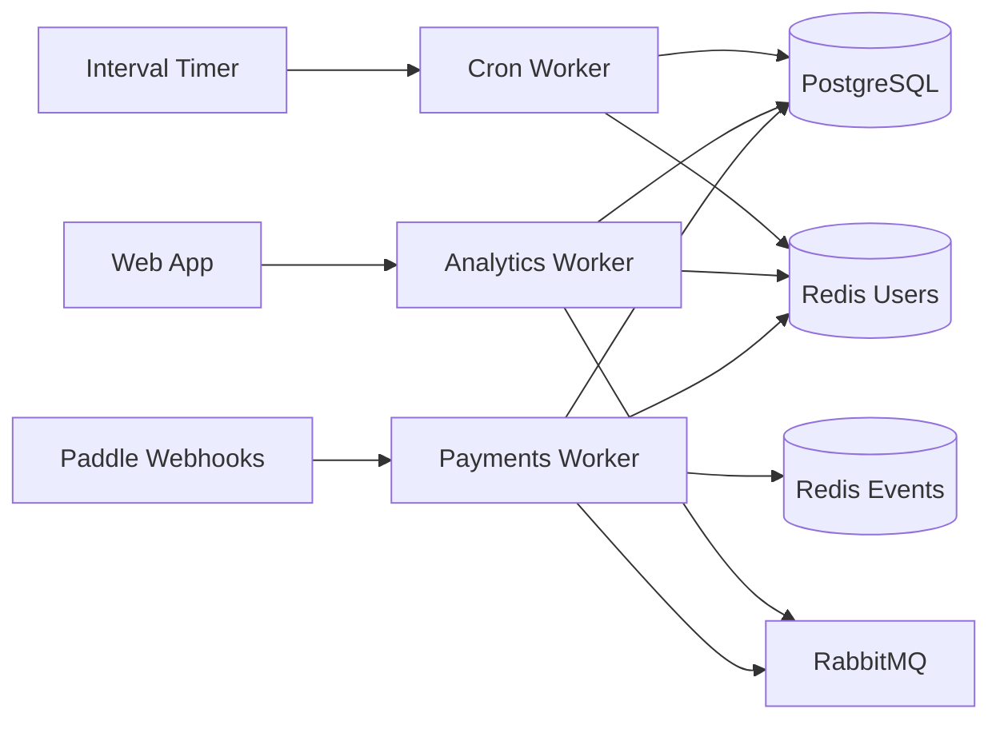
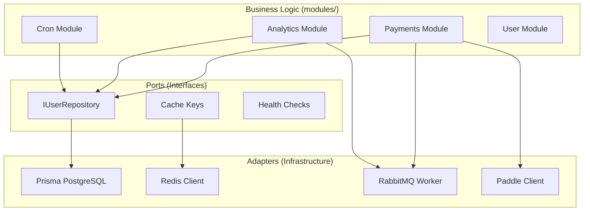
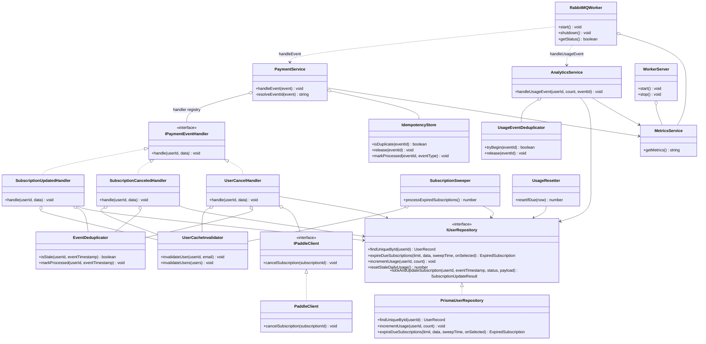
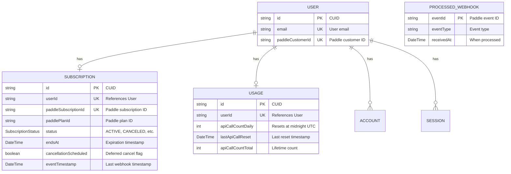
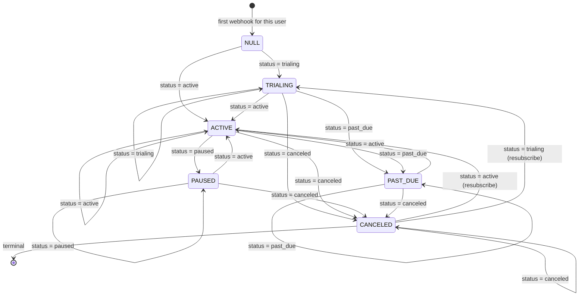
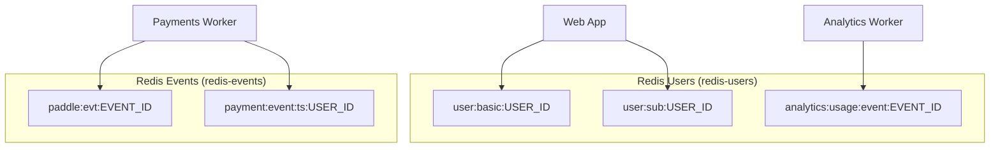
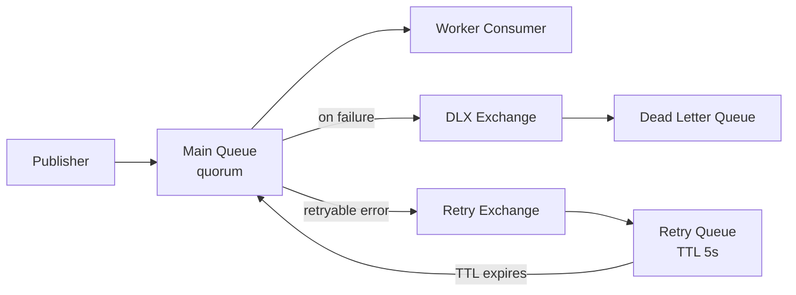
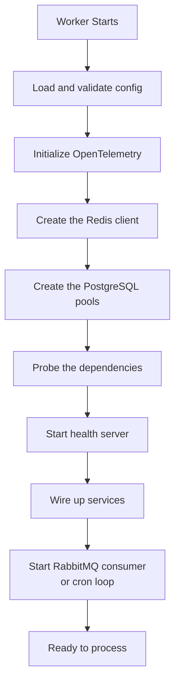

# Architecture

This document explains how the Workers service is structured and why it's designed this way.

## Overview

The Workers service is a TypeScript/Bun application that handles background processing for the DetectAI platform. It runs as **three independent worker processes**, each handling a specific domain:



**Why three separate workers?**
- Each worker has different dependencies (cron doesn't need RabbitMQ)
- Each can be scaled independently
- Failures in one don't affect the others
- Each runs in its own isolated Docker Compose stack

## How the Code is Organized

The service uses **clean architecture** (also called "ports and adapters"). This means:

- **Business logic** is in the center (the "hexagon")
- **External systems** (databases, caches, APIs) connect through "ports"
- Each external system has an "adapter" that connects it to the business logic



**Why this pattern?**
- Easy to test (can swap real databases with fakes)
- Easy to change external systems (swap PostgreSQL for another DB)
- Business logic stays clean and focused

### Key Classes

The graph above shows the *layers*. This diagram shows the actual classes and the interfaces they implement. Read it from the middle outwards: the services in the middle depend on interfaces, and the concrete adapters at the edges satisfy them.



**How to read it:**

| Relationship | Mermaid symbol | Meaning in this codebase |
|--------------|----------------|-------------------------|
| Implements | `<\|..` (dashed line, hollow triangle) | A concrete class provides the behaviour an interface promises. `PrismaUserRepository` is the only `IUserRepository` in the codebase. |
| Holds | `o--` (line with an open diamond) | One class keeps a reference to another for the whole of its life. `PaymentService` always owns its `IdempotencyStore`. |
| Depends on | `-->` (solid line, arrowhead) | One class calls another through an interface it was given. Swapping the implementation changes nothing for the caller. |
| Calls | `..>` (dotted line, arrowhead) | A loose dependency, usually a callback. `RabbitMQWorker` calls `PaymentService.handleEvent` through a function, not a class reference. |

**The two rules that keep this tidy:**
1. Services depend on **interfaces** (`IUserRepository`, `IPaymentEventHandler`, `IPaddleClient`), never on concrete adapters. That is what lets the tests swap in fakes.
2. The concrete adapters are wired in **one place** — `src/cmd/<worker>/index.ts`. Every worker builds its own object graph there, so you can read a single file to see the whole wiring.

## Project Structure

```
workers/
├── src/
│   ├── cmd/                          # Entry points (one per worker)
│   │   ├── payments/                 # Payments worker
│   │   │   ├── index.ts              # Bootstrap, handler registry, main loop
│   │   │   └── config.ts             # Paddle + events-redis config
│   │   ├── analytics/                # Analytics worker
│   │   │   ├── index.ts              # Bootstrap, event schema, main loop
│   │   │   └── config.ts             # Analytics config
│   │   └── cron/                     # Cron worker
│   │       ├── index.ts              # Bootstrap, timer loop, shutdown
│   │       └── config.ts             # Cron config
│   ├── modules/                      # Business logic
│   │   ├── payments/
│   │   │   ├── domain/               # State machine, error types, event types
│   │   │   ├── application/
│   │   │   │   ├── services/         # PaymentService (event dispatcher)
│   │   │   │   └── handlers/         # SubscriptionUpdated, Canceled, UserCancel
│   │   │   └── infrastructure/       # PaddleClient (external API)
│   │   ├── analytics/
│   │   │   ├── domain/               # Error types
│   │   │   ├── application/services/ # AnalyticsService
│   │   │   └── infrastructure/       # UsageEventDeduplicator
│   │   ├── cron/
│   │   │   ├── domain/               # Error types
│   │   │   └── application/services/ # SubscriptionSweeper, UsageResetter
│   │   └── user/
│   │       ├── domain/               # IUserRepository interface, types
│   │       └── infrastructure/       # PrismaUserRepository (persistence)
│   ├── shared/                       # Shared infrastructure
│   │   ├── cache/                    # Redis client, keys, invalidation, dedup
│   │   ├── config/                   # Zod schemas, AWS loader, provider
│   │   ├── database/                 # Prisma clients (primary + replica)
│   │   ├── errors/                   # MissingFieldError, isRetryableError
│   │   ├── health/                   # Health checks
│   │   ├── http/                     # WorkerServer (Bun HTTP)
│   │   ├── logging/                  # PII-redacting structured logger
│   │   ├── messaging/                # RabbitMQWorker, topology
│   │   ├── monitoring/               # prom-client metrics
│   │   ├── retry/                    # Exponential backoff, jitter
│   │   ├── tracing/                  # OpenTelemetry
│   │   └── utils/                    # withTimeout, abortableSleep
│   └── tests/                        # Unit, integration, HA and load tests
├── prisma/
│   ├── schema.prisma                 # Database models
│   └── migrations/                   # Schema migrations
├── infra/                            # Docker Compose per worker
│   ├── compose.payments.yml
│   ├── compose.analytics.yml
│   ├── compose.cron.yml
│   └── compose.migrate.yml
├── Dockerfile
├── Makefile
└── package.json
```

**A note on `shared/`:** you will also see `shared/bootstrap/`, `shared/infrastructure/`, `shared/observability/` and `shared/persistence/`. Three of them are one-line re-exports kept for backwards compatibility (for example `shared/persistence/RedisClient.ts` is just `export * from "../cache/RedisClient"`). `shared/bootstrap/` is the exception — it holds an older, unused copy of the pool-pressure helpers, and nothing imports it either. The live code lives in the folders listed above.

## Data Model

The Workers service uses PostgreSQL with the following models:



### Key Models

#### `User`
Stores user accounts. The Workers service reads user data for cache invalidation and subscription lookups.

#### `Subscription`
Tracks subscription lifecycle. This is the primary model modified by the Payments and Cron workers.

| Field | Description |
|-------|-------------|
| `status` | Current subscription state (`ACTIVE`, `CANCELED`, `PAST_DUE`, `PAUSED`, `TRIALING`) |
| `endsAt` | When the subscription expires (swept by Cron worker) |
| `cancellationScheduled` | Whether a cancellation is deferred to period end |
| `eventTimestamp` | Last Paddle event timestamp (stale-event detection) |

**Indexes:** `(status, endsAt)` for sweep queries, `(eventTimestamp)` for stale event filtering.

#### `Usage`
Daily and total API call counters. The Analytics worker atomically increments these.

| Field | Description |
|-------|-------------|
| `apiCallCountDaily` | Current day's API calls (resets at midnight UTC) |
| `apiCallCountTotal` | Lifetime API call count |

#### `ProcessedWebhook`
Permanent ledger of processed Paddle event IDs. There is no TTL on it — rows stay until something deletes them, and `receivedAt` is indexed so you can find and replay old events by hand. The Redis fast path in front of it expires after 7 days, so the ledger is the longer-lived of the two.

### Subscription Status State Machine

The Payments worker enforces valid status transitions:



**How to read the labels:** every edge is labelled with the `status` value that has to arrive in the Paddle payload for that change to be allowed. The worker reads `data.status`, upper-cases it, and checks it against the current status. Anything not listed here is rejected.

**Two things worth knowing about the end of the diagram:**

1. **`CANCELED` is the terminal state.** It is the only status the Cron sweeper leaves alone, and it is where a subscription ends up when a customer cancels or lets it expire. The `[*]` connector marks that end.
2. **`CANCELED` is not a one-way door.** A customer who resubscribes produces a new event with `status = active` or `status = trialing`, which moves the subscription straight out of `CANCELED`. The two arrows leaving `CANCELED` cover that case.

**The Cron sweeper bypasses this machine on purpose.** When a subscription passes its `endsAt` date, the sweeper writes `CANCELED` directly instead of asking the state machine for permission. It uses a different code path — a raw `UPDATE` in `expireDueSubscriptions`, not the webhook path — so no transition is checked at all. (A webhook *can* make the same change: `PAUSED -> CANCELED` is a valid transition. The sweeper just does not go through it.)

Invalid transitions throw `InvalidTransitionError` and send the event to the DLQ.

## Cache Architecture

The service uses two Redis instances with different purposes:



| Key Pattern | Purpose | TTL |
|-------------|---------|-----|
| `user:basic:USER_ID` | User profile cache | 1 hour |
| `user:basic:email:HASH` | User lookup by email | 1 hour |
| `user:sub:USER_ID` | Subscription status cache | 10 minutes |
| `analytics:usage:event:EVENT_ID` | Usage event dedup | 7 days |
| `paddle:evt:EVENT_ID` | Paddle event dedup | 7 days |
| `payment:event:ts:USER_ID` | Newest processed event time, per user | 30 days |

**A note on the two Paddle keys.** They are keyed differently on purpose. `paddle:evt:EVENT_ID` answers *"have I seen this exact event before?"*, so it is keyed by the event id. `payment:event:ts:USER_ID` answers *"is this event older than the last one I processed for this user?"*, so it is keyed by the user id and stores a timestamp rather than a marker. `HASH` is the first 16 characters of the SHA-256 of the lower-cased email.

## Message Queue Architecture

The Payments and Analytics workers consume from RabbitMQ quorum queues with built-in retry and dead-lettering:



| Component | Purpose |
|-----------|---------|
| Main Queue | Quorum queue, durable, holds pending messages |
| DLX Exchange | Direct exchange for dead-lettered messages |
| Dead Letter Queue | Stores messages that exceeded retry limit |
| Retry Exchange | Routes retryable messages to retry queue |
| Retry Queue | TTL-based delay (5s), messages re-enter main queue after TTL |

**Retry behavior:**
- Max 5 retries per message
- 5-second delay between retries (TTL on retry queue)
- Non-retryable errors (`UserNotFoundError`, `MissingFieldError`, `InvalidTransitionError`, `SyntaxError`) go directly to DLQ
- DB unavailable = infra-requeue (nack with requeue, no retry burn, no DLQ, 5-second delay first)

## How a Worker Starts

Each worker follows the same startup pattern:



**Key startup behaviors:**
1. Config is validated with Zod — invalid config exits immediately
2. The dependency probe *is* the first connection attempt. There is no separate connect step.
3. Dependencies are probed before the health server starts:
   - **Payments** and **Cron** — up to 5 attempts, 2 seconds between attempts, 3-second timeout per probe
   - **Analytics** — a single probe, no retry loop
4. If the probes fail, the worker starts **anyway** in degraded mode. It never exits just because a datastore is slow to come up.
5. The health server starts right after the probes, so `/health` and `/ready` answer as soon as the process is up
6. `/ready` reports the real dependency state, so a degraded worker is live but not ready for traffic
7. Graceful shutdown on SIGINT/SIGTERM/SIGQUIT with a 10-second drain budget

## Why This Design?

| Benefit | Explanation |
|---------|-------------|
| **Isolation** | Each worker runs independently, failures don't cascade |
| **Scalability** | Scale payments independently from analytics |
| **Testability** | Can test business logic without real databases |
| **Flexibility** | Swap external systems without changing business logic |
| **Reliability** | Quorum queues, idempotency, infra-requeue for resilience |
| **Observability** | Structured logs, OpenTelemetry traces, Prometheus metrics |

## Next Steps

- [Message Flows](message-flows.md) - See how events are processed
- [Configuration](../getting-started/configuration.md) - Learn about settings
- [Payments Worker](../components/payments-worker.md) - Payment processing details
