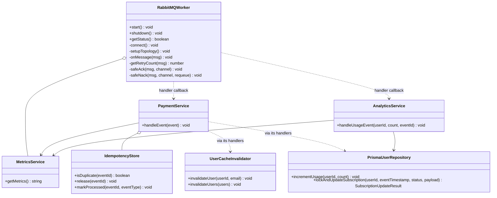
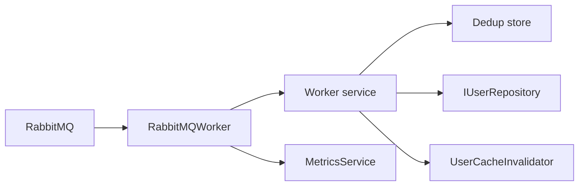
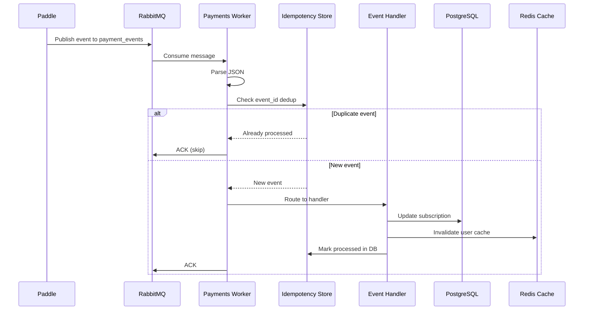
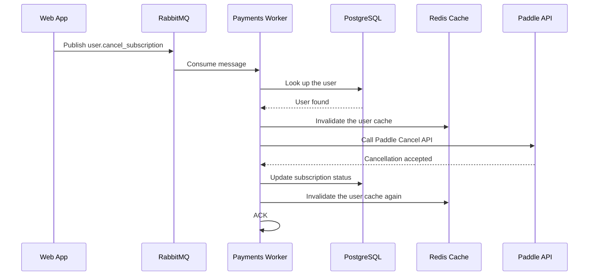
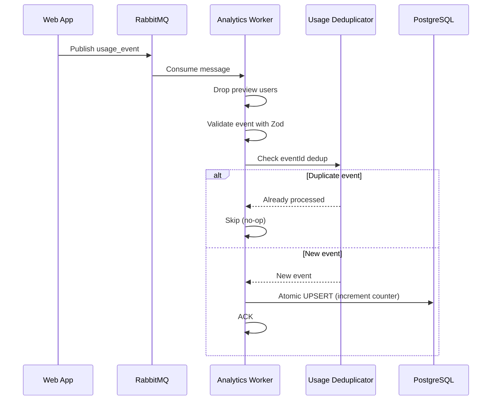
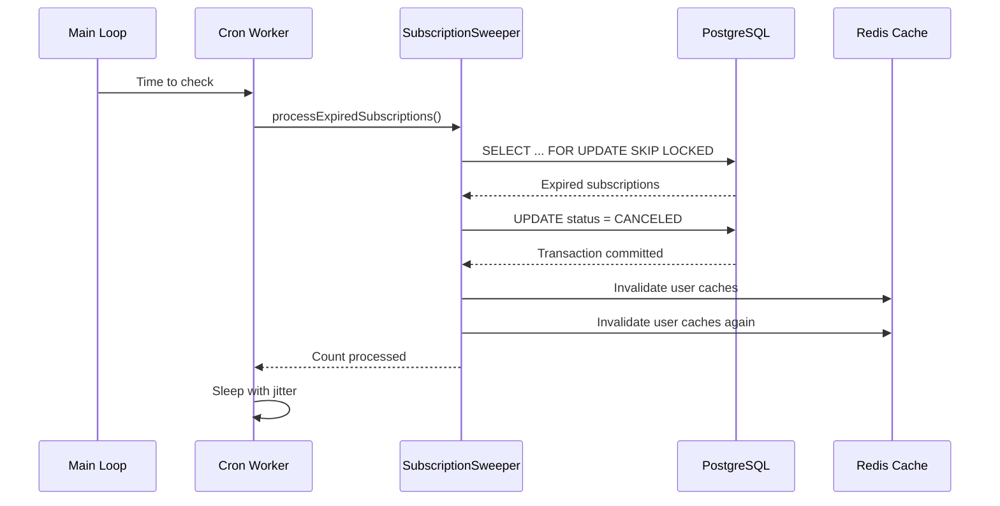
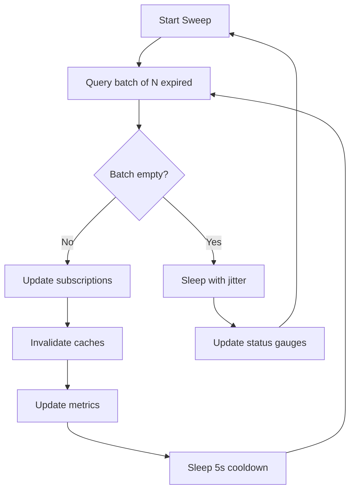
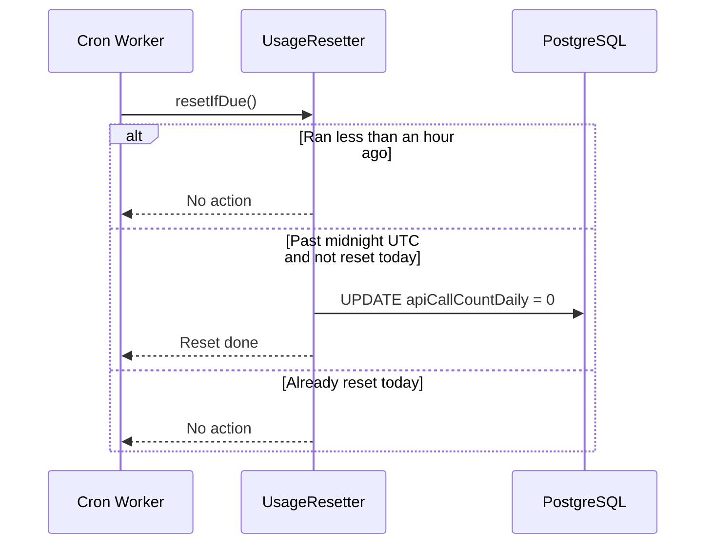

# Message Flows

This document explains how events are processed by each worker. We'll look at each main flow and see what happens step by step.

## The Classes Behind These Flows

Every message flow in this document travels through the same shared machinery first. `RabbitMQWorker` owns the connection and the queue, and calls into a worker-specific service through a plain function callback. The service then does the business work and reaches the database through a repository.

**The path a message takes:**

1. `RabbitMQWorker` receives the message, parses it and opens a tracing span
2. It calls the worker-specific service through the callback it was given at construction
3. The service checks idempotency, calls the repository, and invalidates caches
4. On success `RabbitMQWorker` acknowledges the message; on failure it retries, requeues or dead-letters it

## Payment Webhook Flow

When Paddle sends a webhook, the Payments worker processes it through a series of steps:

### Step by Step

1. **Paddle sends webhook** — Subscription created, updated, activated, or canceled
2. **RabbitMQ queues message** — Quorum queue ensures durability
3. **Worker consumes message** — JSON parsed, job type resolved
4. **Idempotency check** — `paddle:evt:EVENT_ID` in Redis (7d) + `ProcessedWebhook` in the database
5. **Event routing** — Handler selected based on `event_type`
6. **State machine validation** — Status transition checked (e.g., ACTIVE -> CANCELED is valid)
7. **Database update** — Subscription status, endsAt, paddle identifiers updated
8. **Cache invalidation** — Three keys deleted: `user:basic:USER_ID`, `user:basic:email:HASH` and `user:sub:USER_ID`
9. **Idempotency persistence** — Event ID written to the `ProcessedWebhook` table
10. **Message acknowledged** — Removed from queue

### Error Paths

| Error Type | What Happens |
|------------|--------------|
| **Duplicate event** | Silently skipped (idempotent) |
| **Invalid transition** | Sent to DLQ (non-retryable) |
| **Missing userId** | Sent to DLQ (non-retryable) |
| **User not found** | Sent to DLQ (webhook before user row exists) |
| **Malformed JSON** | Sent to DLQ (non-retryable) |
| **DB unavailable** | Infra-requeue (nack with requeue, no retry burn) |
| **Transient DB error** | Retry via delayed exchange (5s, up to 5 retries) |
| **Exhausted retries** | Sent to Dead Letter Queue |

### User Cancel Flow

When a user requests cancellation, the flow is slightly different:

**What happens:**
1. Web app publishes a `user.cancel_subscription` event
2. Worker looks the user up **first**. If the row does not exist, the event is dead-lettered and Paddle is never called — so the two sides cannot diverge.
3. Worker invalidates the user cache, then calls the Paddle API to cancel the subscription
4. On success, updates the database with the new status and invalidates the cache again
5. This two-step process ensures the Paddle-side cancellation happens before the local state change

**The cancel is scheduled, not immediate.** The API call sends `effective_from: next_billing_period`, so Paddle cancels the subscription at the end of the current billing period. The local `Subscription.status` is set to `CANCELED` straight away, so the two sides disagree until the period ends. See [Payments Worker](../components/payments-worker.md#calling-the-paddle-api).

## Analytics Usage Flow

When the web app tracks API usage, the Analytics worker processes the event:

### Step by Step

1. **Web app tracks usage** — API call happens, `usage_event` published
2. **RabbitMQ queues message** — Quorum queue ensures durability
3. **Worker consumes message** — JSON parsed
4. **Preview events filtered** — `userId` starting with `preview-` is dropped. This happens *before* validation, so preview traffic never has to satisfy the schema.
5. **Event validated** — Checked against the Zod schema (`eventId`, `userId`, `count` are required)
6. **Deduplication check** — `analytics:usage:event:EVENT_ID` in Redis (7d TTL, SET NX)
7. **Atomic increment** — `Usage.apiCallCountDaily` and `apiCallCountTotal` incremented atomically
8. **Message acknowledged**

### Key Design Decisions

| Decision | Why |
|----------|-----|
| **No cache invalidation** | Usage counters are excluded from cached user blobs |
| **Redis SET NX dedup** | Atomic, fast, fails open on Redis error |
| **Atomic UPSERT** | Prevents race conditions from concurrent increments |
| **Fail-open dedup** | If Redis is down, process anyway (better to over-count than lose data) |

## Cron Sweep Flow

The Cron worker runs a loop to clean up expired subscriptions:

### Step by Step

1. **Timer fires** — After a configurable interval (default 15 minutes, plus or minus 10% jitter). There is no separate timer: the loop sleeps at the bottom of each iteration and starts again when the sleep ends.
2. **Query expired subscriptions** — `endsAt < sweepTime`, where the status is one of `ACTIVE`, `TRIALING`, `PAST_DUE` or `PAUSED`. `CANCELED` is skipped, because it is already terminal.
3. **Lock rows** — `FOR UPDATE SKIP LOCKED` prevents contention with other instances
4. **Update subscriptions** — Set `status = CANCELED`, clear the Paddle identifiers, clear `cancellationScheduled`, and stamp `eventTimestamp` with the sweep time. A row whose `eventTimestamp` is newer than the sweep clock is skipped — a webhook won the race.
5. **Invalidate caches** — Delete `user:basic:*` and `user:sub:*` keys (two passes, both after the database commit)
6. **Update metrics** — Expiry lag, backlog, sweep batch size
7. **Sleep with jitter** — Randomized interval prevents a thundering herd

### Batch Processing

The sweeper processes subscriptions in batches:

| Parameter | Default | Description |
|-----------|---------|-------------|
| `CRON_BATCH_SIZE` | 100 | Max subscriptions per batch |
| `CRON_CHECK_INTERVAL_MS` | 900000 (15 min) | Sleep between empty sweeps, plus or minus 10% jitter |
| Batch cooldown | 5000 (5s) | Sleep between non-empty batches (no jitter) |

### Usage Reset Flow

The Cron worker also resets daily usage counters at midnight UTC:

There are two guards against resetting twice:

1. **In-process** — the resetter remembers when it last ran and skips any call within the next hour
2. **In the database** — the `UPDATE` only touches rows whose `lastApiCallReset` is either `NULL` or falls on an earlier UTC day than today

The database guard is the one that matters. It makes the reset safe even if a second Cron instance is running, or if the process restarts.

## Summary

| Flow | Trigger | Speed | Reliability |
|------|---------|-------|-------------|
| Payment webhook | Paddle event | Fast (async) | Quorum queue + idempotency |
| User cancel | Web app request | Medium (API call) | Two-step (Paddle + DB) |
| Analytics usage | Web app tracking | Fast (async) | Redis dedup + atomic UPSERT |
| Cron sweep | End of the previous sweep | Slow (batch) | FOR UPDATE SKIP LOCKED |
| Usage reset | End of the previous loop iteration | Fast | At most hourly, guarded by the UTC day marker |

## Next Steps

- [Payments Worker](../components/payments-worker.md) - Payment processing details
- [Analytics Worker](../components/analytics-worker.md) - Usage tracking details
- [Cron Worker](../components/cron-worker.md) - Background job details
