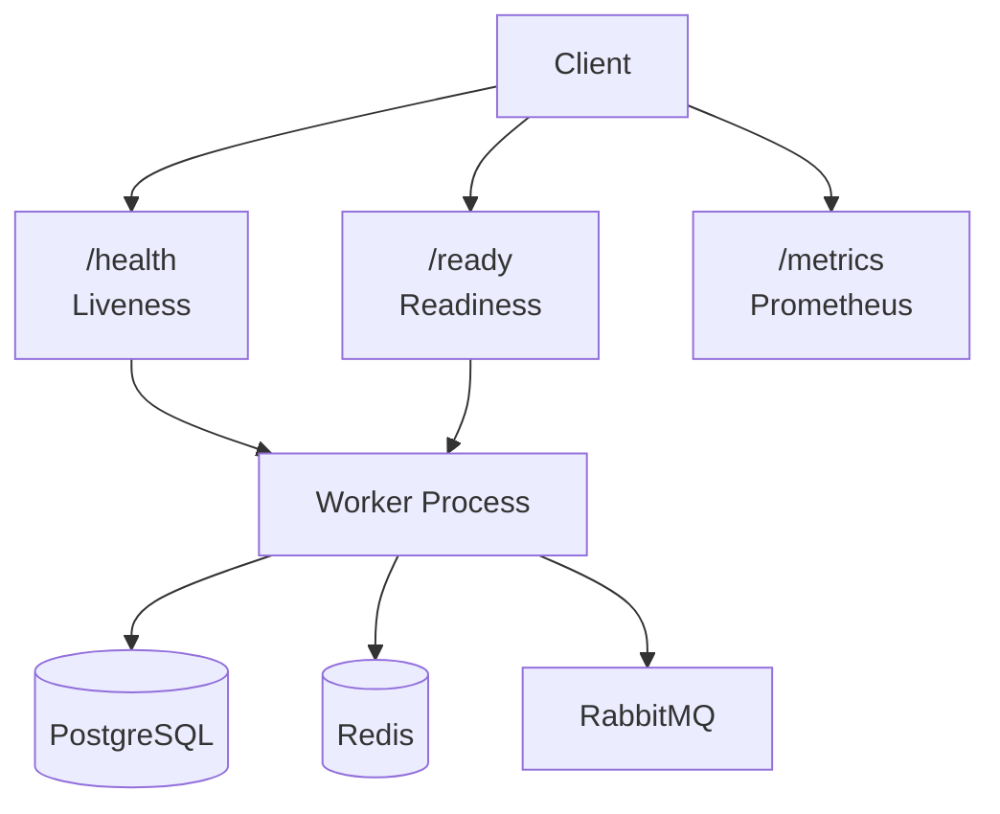
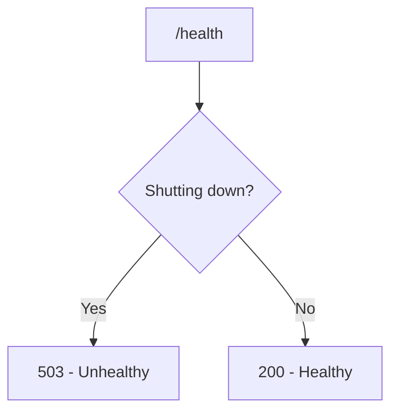
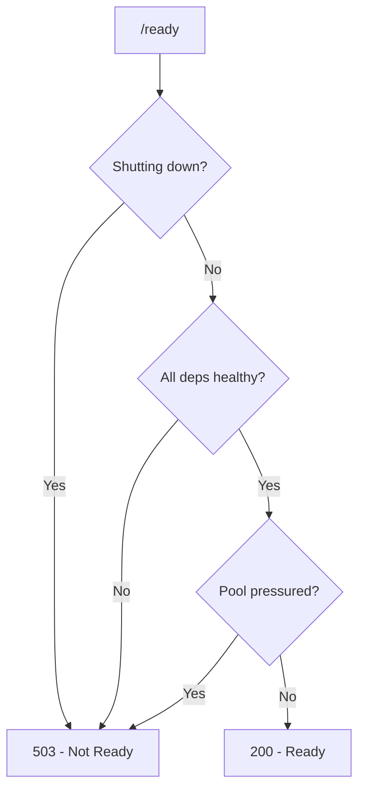

# Health Checks

This document explains how the Workers service monitors its own health and how you can check if it's working properly.

## Why Health Checks Matter

Health checks help you know:
- Is the worker running?
- Can it connect to its dependencies?
- Is it ready to handle messages?

This is important for:
- **Monitoring** — Know when something goes wrong
- **Load balancing** — Route traffic only to healthy instances
- **Kubernetes** — Liveness and readiness probes
- **Debugging** — Quickly identify what's broken

## How Health Checks Work

Each worker runs a Bun HTTP server with three endpoints:



### Liveness (`/health`)

The liveness endpoint answers: **"Is the worker process alive?"**



| Worker | Additional Liveness Checks |
|--------|---------------------------|
| Payments | None (process alive = healthy) |
| Analytics | None (process alive = healthy) |
| Cron | Loop started within 60s of boot |

**When to use:** Kubernetes `livenessProbe`. If this fails, restart the pod.

### Readiness (`/ready`)

The readiness endpoint answers: **"Can the worker handle messages right now?"**



Each worker checks its specific dependencies:

| Worker | Checks |
|--------|--------|
| Payments | DB + Redis + Events Redis + RabbitMQ + Pool pressure |
| Analytics | DB + Redis + RabbitMQ + Pool pressure |
| Cron | DB + Redis + Pool pressure + Loop staleness |

**When to use:** Kubernetes `readinessProbe`. If this fails, stop sending traffic.

### Metrics (`/metrics`)

Prometheus metrics endpoint. See [Observability](observability.md) for details.

## Health Endpoints by Worker

| Worker | Port | Liveness | Readiness |
|--------|------|----------|-----------|
| Payments | 7003 | `/health` | `/ready` |
| Analytics | 7001 | `/health` | `/ready` |
| Cron | 7002 | `/health` | `/ready` |

All workers also expose `/metrics` on the same port.

## Response Format

Every JSON response has the same shape: `status`, `timestamp` and `checks`. The `checks` object tells you **which** dependency is unhappy — without it you would only know that something is wrong, not what.

Two exceptions, both plain text rather than JSON: an unknown path returns `404 Not Found`, and a failure inside the metrics handler returns `500 Internal Server Error`.

The `status` value depends on which endpoint you called:

| Endpoint | Healthy | Not healthy | HTTP status |
|----------|---------|-------------|-------------|
| `/health` | `"ok"` | `"error"` | 200 / 503 |
| `/ready` | `"ready"` | `"not_ready"` | 200 / 503 |

### Healthy Response

`/health` always includes a `checks` object. Which fields it holds depends on the worker:

```json
{
  "status": "ok",
  "timestamp": "2024-09-10T12:00:00.000Z",
  "checks": {
    "isShuttingDown": false,
    "loopStarted": true
  }
}
```

The Payments and Analytics workers report only `isShuttingDown`, because their liveness check has nothing else to say.

### Ready Response (with checks)

This is the Payments worker. The `checks` object lists every dependency it depends on:

```json
{
  "status": "ready",
  "timestamp": "2024-09-10T12:00:00.000Z",
  "checks": {
    "db": true,
    "redis": true,
    "eventRedis": true,
    "rabbitmq": true,
    "poolWaiting": 0,
    "poolPressured": false,
    "isShuttingDown": false
  }
}
```

### Unhealthy Response

The same shape, with the failing dependency set to `false`:

```json
{
  "status": "not_ready",
  "timestamp": "2024-09-10T12:00:00.000Z",
  "checks": {
    "db": false,
    "redis": true,
    "rabbitmq": false,
    "poolWaiting": 5,
    "poolPressured": true,
    "isShuttingDown": false
  }
}
```

On `/health` the same failure is reported with `"status": "error"`.

### Checks by Worker

| Worker | `/health` checks | `/ready` checks |
|--------|------------------|-----------------|
| Payments | `isShuttingDown` | `db`, `redis`, `eventRedis`, `rabbitmq`, `poolWaiting`, `poolPressured`, `isShuttingDown` |
| Analytics | `isShuttingDown` | `db`, `redis`, `dedupRedis`, `rabbitmq`, `poolWaiting`, `poolPressured`, `isShuttingDown` |
| Cron | `isShuttingDown`, `loopStarted` (plus `bootAgeMs` and `reason` when the loop has not started) | `db`, `redis`, `poolWaiting`, `poolPressured`, `lastSuccessAgeMs`, `thresholdMs`, `loopStale`, `isShuttingDown` |

A few of these need explaining:

| Field | Meaning |
|-------|---------|
| `poolWaiting` | How many queries are queued waiting for a database connection |
| `poolPressured` | True when more than 5 queries are waiting at once. Only the **primary** pool is measured — a saturated replica never shows up here. |
| `dedupRedis` | The Analytics dedup Redis. It reports the same value as `redis`, because both point at the same instance. |
| `loopStale` | Cron only. True when the last completed loop iteration is older than twice the check interval. |
| `thresholdMs` | Cron only. The staleness limit in milliseconds — twice `CRON_CHECK_INTERVAL_MS`, so 30 minutes by default. |

**The Redis check wants a real `PONG`.** A reply of anything else — `-LOADING`, `-BUSY` — is reported as unhealthy, even when the connection is up.

### Timeout Response

A readiness check that takes longer than 3 seconds is cut short:

```json
{
  "status": "not_ready",
  "timestamp": "2024-09-10T12:00:00.000Z",
  "checks": {
    "timeout": true
  }
}
```

The liveness endpoint has the same 3-second limit, but returns a plain `false` instead of an object, so its timeout response has no `checks` field at all.

**The 3-second budget is shorter than the database check's own timeout.** The database probe allows 10 seconds and the Redis probe 3 seconds, but the endpoint wraps both in a 3-second limit. A database that accepts the connection and then answers slowly therefore produces `{"checks":{"timeout":true}}` — **not** `{"db":false}`. The per-dependency breakdown is lost exactly when it would be most useful.

### Exception Response

If the check itself throws, the error is reported in place of the dependency breakdown:

```json
{
  "status": "error",
  "timestamp": "2024-09-10T12:00:00.000Z",
  "checks": {
    "error": "Error: something went wrong"
  }
}
```

## Health Check Commands

```bash
# Check if Payments worker is healthy
curl http://localhost:7003/health

# Check if Payments worker is ready
curl http://localhost:7003/ready

# Check if Analytics worker is ready
curl http://localhost:7001/ready

# Check if Cron worker is healthy
curl http://localhost:7002/health

# View Prometheus metrics
curl http://localhost:7003/metrics
```

## Docker Health Checks

Each worker includes a Docker health check in its compose file:

```yaml
healthcheck:
  test: ["CMD", "bun", "-e", "const r = await fetch('http://localhost:7003/ready'); if (!r.ok) process.exit(1);"]
  interval: 30s
  timeout: 5s
  retries: 3
  start_period: 20s
```

**What this means:**
- Check every 30 seconds
- Timeout after 5 seconds
- Fail after 3 consecutive failures
- Wait 20 seconds before first check (startup time)

The endpoint each worker checks is different:

| Worker | Endpoint checked | Why |
|--------|------------------|-----|
| Payments | `/ready` | All of its dependencies have to be up before it can consume |
| Analytics | `/ready` | All of its dependencies have to be up before it can consume |
| Cron | `/health` | It only needs the process to be alive. The sweep recovers on its own if the database is briefly unavailable. |

## Port Layout

| Service | Host Port | Container Port | Purpose |
|---------|-----------|----------------|---------|
| worker-payments | 7003 | 7003 | Health + Metrics |
| worker-analytics | 7001 | 7001 | Health + Metrics |
| worker-cron | 7002 | 7002 | Health + Metrics |
| postgres-users | 5432 | 5432 | PostgreSQL |
| redis-users | 6379 | 6379 | Redis (users) |
| redis-events | 6382 | 6379 | Redis (events, payments only) |
| rabbitmq | 5672 | 5672 | RabbitMQ |
| rabbitmq | 15672 | 15672 | RabbitMQ Management UI |

**Override host ports** when running stacks side by side:

```bash
WORKER_PAYMENTS_PORT=7103 POSTGRES_PORT=5434 REDIS_PORT=6399 make worker-up WORKER=payments
```

## Monitoring Health

### What to Monitor

| Metric | Warning | Critical |
|--------|---------|----------|
| Worker up | Down > 1 min | Down > 2 min |
| DB connection | Slow > 1s | Failed |
| Redis connection | Slow > 1s | Failed |
| RabbitMQ connection | Disconnected > 30s | Disconnected > 2 min |
| Pool pressure | Waiting > 5 | Waiting > 20 |
| Cron loop stale | No sweep > 2x interval | No sweep > 4x interval |

### Health Check Commands

```bash
# Quick health check for all workers
for port in 7001 7002 7003; do
  echo "Port $port: $(curl -s -o /dev/null -w '%{http_code}' http://localhost:$port/health)"
done

# Check Docker container health
docker ps --format "table {{.Names}}\t{{.Status}}"

# Check specific worker readiness
curl -s http://localhost:7003/ready | jq .checks
```

## Troubleshooting

**Worker reports NOT_READY?**
- Check which dependency failed in the `checks` object
- Verify PostgreSQL is running: `docker ps | grep postgres`
- Verify Redis is running: `docker ps | grep redis`
- Verify RabbitMQ is running (payments/analytics): `docker ps | grep rabbitmq`

**The response says `timeout` instead of naming a dependency?**
- The check took longer than 3 seconds. Look at database latency first.
- A slow database is the usual cause — the database probe allows 10 seconds on its own, but the endpoint only waits 3.

**Health check timeout?**
- Check database performance
- Verify no network issues between containers
- Look at worker logs for slow queries

**Docker health check failing?**
- Check container logs: `make worker-logs WORKER=payments`
- Verify health check command works manually
- Ensure ports are correctly mapped

**Cron worker reports loop not started?**
- Check if the loop crashed on startup
- Verify PostgreSQL and Redis connectivity
- Look at logs for bootstrap errors

## Related Documentation

- [Configuration](../getting-started/configuration.md) - Health check settings
- [Observability](observability.md) - Metrics and alerts
- [Architecture](../concepts/architecture.md) - How components connect
