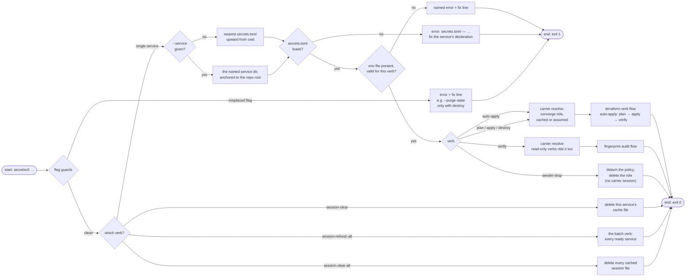
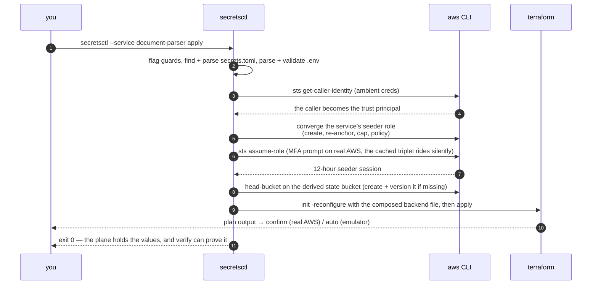

# Architecture

This document explains how one `secretsctl` invocation becomes a governed AWS change. Read the [quick start](../getting-started/quickstart.md) first if you have never run the tool.

## What this engine is

A service-agnostic CLI that drives any service's AWS secrets plane: validate its `.env`, terraform-plan/apply/destroy its stack, verify the live plane against the values, and tear it all down. One shared terraform root serves every service; the two files per service — the declared `secrets.toml` and the values `infra/.env` ([Declaration](declaration.md), [Values](values.md)) — are the only thing a service contributes.

Both out-of-stack prerequisites are created on demand and converged every run: the state bucket (terraform's ledger) and the seeder carrier role every verb rides ([Carrier](carrier.md)). There is no bootstrap command to run first — there is nothing to bootstrap to.

## The module map

```
tools/secretsctl/
├── app/
│   ├── main.py          verb dispatch: flag guards, service resolution, per-verb wiring
│   ├── declaration/     secrets.toml: schema rules, loader, service discovery
│   ├── values/          .env parser, per-verb validation, plane + window resolution
│   ├── carrier/         identity plumbing, trust + policy docs, seeder role, cached sessions
│   ├── stack/           terraform inputs (TF_VARs, backend), state bucket lifecycle, verb flows
│   ├── verify/          live-plane collection, fingerprints, drift findings
│   ├── shell.py         aws / terraform runners: plane-aware argv, env overlays
│   └── __main__.py      python -m app
├── terraform/           the one shared stack (module secrets-plane + per-plane provider block)
├── tests/               unit (default) + integration (live Floci)
└── mk/                  make fragments: install, lint, test tiers
```

Shape in toml, values in the `.env`, secrets in gitignored files, engine in one package: `main.py` is the composition root *by being the caller* — every verb's mechanics live in its own subpackage and nothing is wired anywhere else.

## How one invocation flows



Three details the flow hides:

- **Verb families.** Two verbs never touch a service at all (`session-clear-all`, `session-refresh-all` — they walk all services), one verb needs only the declaration (`session-clear` deletes its service's cache file without touching any values), and the rest are single-service verbs.
- **Validation depth varies by verb.** Terraform-writing verbs run the [full value ladder](values.md); verify and `seeder-drop` run only the region check, because they must be able to comment on a plane even when a value is misedited.
- **Dry runs are stakeouts, not executions.** `--dry-run` resolves no carrier session, prompts for nothing, runs no terraform. What it prints is verb-shaped: the full banner plus backend overrides and exact commands on the terraform verbs, the three read-only aws commands on `verify`, the would-refresh list on the batch verb.

## What a verb run looks like end to end



## Credentials: three sources, clear precedence

| Source | Used when | Where it travels |
|--------|-----------|------------------|
| Carrier triplet (assumed seeder session) | every plane-writing verb on both planes | env overlay on the subprocess; env creds outrank profiles, `AWS_PROFILE` is stripped |
| Ambient credentials (env/profile/SSO) | identity resolution, role convergence, `seeder-drop`, and the real-AWS assume itself | the untouched process environment |
| Emulator fakes (`test`/`test`) | session-less emulator calls (trust resolution, `seeder-drop`) | env overlay on the subprocess |

Nothing is ever written to your `~/.aws` credentials; the cache is the session file in the tool tree only.

## The engine's output contract

Every failure is shaped before it is printed — a `error:` line with a `fix:` line, both human sentences:

```text
error: could not assume arn:aws:iam::123456789012:role/detectai-document-parser-seeder
fix:   check the MFA code and that the seeder role trusts your caller (...details...)
```

| Marker | Means |
|--------|-------|
| `error:` + `fix:` | the run stops; you are told exactly what to type next |
| `note:` | reality logged without opinion (ignored legacy keys, healed buckets, assumed-role substitutions) |
| `warning:` | the run continues but you probably want to look (dev-on-realAWS, window 0) |
| `ok:` / `fail:` | verify's verdict lines |
| `running:` / `created:` / `removed:` | the subprocess narration: each line names exactly what was run, made, or taken away |

Secret values never print — keys appear as `KEY *** (22 chars, hidden)` and comparisons as **lengths and fingerprints** (first 12 hex of a SHA-256). Exit codes are contract too: `0` success, `1` any typed failure, `130` Ctrl+C (prints *interrupted: rerun the same verb when ready; terraform writes are atomic per run*), and EOF at any prompt reads as *cancelled* with exit 1.

## Next Steps

- **[Declaration](declaration.md)** and **[Values](values.md)** — the two inputs every verb above reads
- **[Carrier](carrier.md)** — the resolve step in full: trust ladder, MFA, caching
- **[The terraform lifecycle](../guides/terraform-lifecycle.md)** — the verb flows themselves
